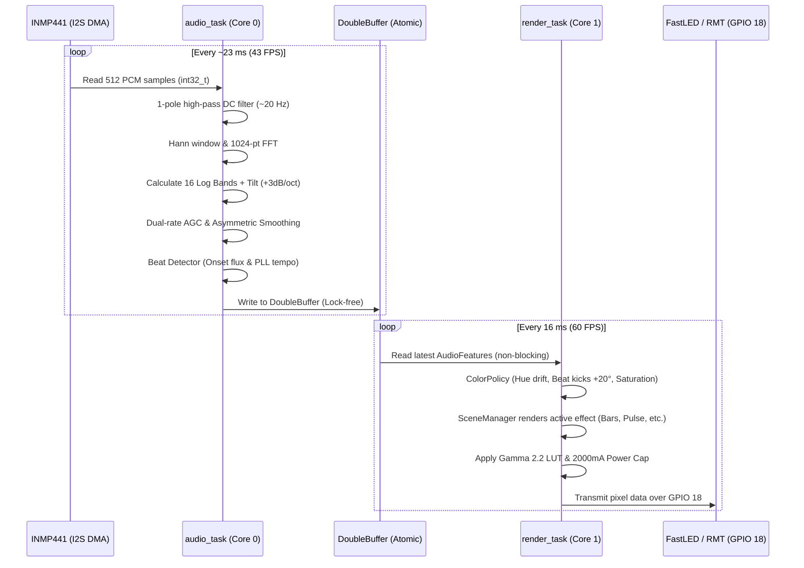

# ESP32 and Android: complete synchronization context and source snapshot

**Current project delivery: SmartRoom Controller — Version 6 (V6).** ESP32 source version: `1.1.4-music`. See `VERSION.md`, `START_HERE_ESP32.md` and the sequential delivery rule in `AGENTS.md`.

**V6 music integration addendum:** The canonical `SmartRoomController_Complete_Source/SmartRoomController` now uses the supplied 16-band DSP and lighting engine. Calibration persistence, automatic/manual noise-floor behavior, quiet policies, configurable telemetry smoothing and sound transition events are retained. FFT work runs outside the application mutex; transients are consumed once by rendering. GPIOs and sample/pixel counts are unchanged. See `RELEASE_V6_1_1_4_MUSIC.md` and `BUILD_VERIFICATION.md` in that folder for exact behavior and evidence. Only the existing five effects are exposed through the unchanged API/panel. The secondary public mirror remains `1.1.3-controls` and is not the V6 upload source.

No firmware was uploaded or Android code changed/installed. Android remains `0.3.0` / versionCode `5`; last recorded physical board firmware remains `1.1.2-http`, without a fresh device query. The OTA monotonic NVS counter was not queried or changed. Embedded documents/source below remain the earlier snapshot; current working source and this addendum supersede their implementation/version statements. No live performance or physical-peripheral acceptance is implied by host tests or compilation.

**V6 final verification:** Compile/link passed with program 1,402,903/1,966,080 bytes and global RAM 67,036/327,680 bytes (before runtime allocations). Final source/header and entry-point snapshots match. Production C++ regressions, eight Python helper tests and new DSP/renderer tests pass. Public source: `artifacts/SmartRoomController_V6_1.1.4-music_Source.zip`, with SHA-256 sidecar and per-file manifest; private identities and generated binaries are excluded. See canonical `BUILD_VERIFICATION.md` for evidence and limits.

**Historical V5 organization:** Six obsolete ESP32 copies remain under `archive/obsolete-esp32-V5/`, with their original hierarchy and SHA-256 manifest. See `PROJECT_STRUCTURE.md`. Historical source snapshots and previous archives are retained.

Recorded: 21 October 2026, Asia/Calcutta. Workspace: `D:\PC DEFAULT\Room automation`.

This is the shared handoff for ESP32 and app development. It records decisions, actual source contracts, observed device results, outstanding acceptance work, and the public ESP32 code itself. It is a snapshot, not a claim that every peripheral has been tested. Private device credentials are deliberately excluded; their existing matching files remain necessary to build and connect to this particular controller.

## Contents and precedence

1. Authoritative locations and release status
2. Confirmed requirements and hardware allocation
3. Runtime architecture and configuration
4. Exact direct-device API and asynchronous results
5. Android integration and connection procedure
6. Security, persistence, maintenance and OTA
7. Build, verification evidence and troubleshooting history
8. Detailed remaining work and synchronization rules
9. Embedded reference documents, Android integration source and complete public ESP32 source

**Precedence:** explicit later user decisions take precedence over earlier proposals. Current executable source establishes current implementation behavior; requirements establish intended behavior. A mismatch is outstanding work, not permission to silently discard a requirement. The synthesis in sections 1–8 resolves known historical contradictions. Embedded documents retain their original wording for traceability; old claims that the application is only a diagnostic sketch, controls are unapproved, real drivers are absent, or direct Android integration is wholly missing are superseded. Actual hardware behavior still needs physical acceptance.

## 1. Authoritative locations and release status

| Item | Authoritative location / status |
| --- | --- |
| Main project directory | `D:\PC DEFAULT\Room automation` |
| Active ESP32 upload source | `SmartRoomController_Complete_Source\SmartRoomController` |
| Arduino entry point | `SmartRoomController_Complete_Source\SmartRoomController\SmartRoomController.ino` |
| Public firmware maintenance mirror | `esp32-firmware\arduino\SmartRoomController` |
| Current source version | `1.1.4-music`, from active `Config.h`; earlier embedded source remains historical |
| Last observed physical board version | `1.1.2-http`; do not assume the latest source is installed |
| Current Android source | Root `android\`, native Kotlin/Compose; `MainActivity` launches `RoomApp` / `RoomModel` |
| Android source version | `android/app/build.gradle.kts`: versionName `0.3.0`, versionCode `5`, minSdk 26, target/compile SDK 35, Java 17 |
| Earlier APK record | `docs/FINAL_APK.md` describes a verified `0.2.2` artifact; it does not establish that current `0.3.0` source is in that APK |
| React root | Component/UI reference, built by Vite; not the native app and not embedded firmware |
| Python backend | Legacy/alternative companion-server protocol; unnecessary for the direct-device control path |
| Public firmware archives | Root `SmartRoomController_Complete_Source.zip` and `SmartRoomController_Arduino.zip` |
| Other extracted copies | Root `SmartRoomController_Arduino`, nested `app/`, handover exports and old firmware copies are historical unless explicitly reconciled |

Open the active `.ino` **with every companion file in its folder**. The small entry point calls `roomSetup()` and `roomLoop()`; functionality is in the `.cpp`/headers, not a giant standalone sketch. The private identity in the active folder and the mirror's private identity are distinct. Never overwrite one with the other. Preserve the board's own `DeviceSecrets.h`, matching `.device-private/`, data backup and partition layout.

### Observed state versus readiness

- Home Wi-Fi, persistent storage, valid configuration, secrets namespace, HTTPS routes and Spotify worker have all been observed ready on the physical controller.
- Last observed LAN address was `192.168.1.102`; earlier it was `.105`. These are DHCP observations, not a fixed app constant.
- Spotify metadata was read from a real Premium account/device: track, artist, Web Player (Chrome), playback state and volume. This proves the read path at that time, not all control operations.
- `time_valid:true` was observed after saving `pool.ntp.org`; the previous `time.google.com` setting did not synchronize this ESP32 during the observed attempt. The general cause was not established.
- All four physical driver flags remained **false**: OLED, microphone, IR and LED. Their saved hardware enable flags also remained false. No output can be inferred from saved lighting values.
- Appliances, commands, presets and rules remained empty. Automation was disabled/disarmed. Hardware models, electrical parameters and physical outputs are unverified.
- Latest `1.1.3-controls` compiles; its pause/resume behavior is **not yet verified on the board**. No universal “100% complete/error-free” claim is supported.

## 2. Confirmed requirements and hardware allocation

### Project behavior

- Classic ESP32 DevKit V1 / ESP-WROOM-32 family. The upload log identified an original ESP32-D0WD-V3. Flash capacity and exact development-board variant still require confirmation.
- Replace Gesto/original lighting control with addressable lights. Gesto, Magic Home and the old lighting remote are no longer required integrations.
- Approximately 15 m, **60 physical LEDs per metre, three LEDs per addressable pixel**. Therefore 20 pixels/m; exactly 15 m gives 900 physical LEDs and 300 addressable pixels. Approximate length does not establish the final installed pixel count.
- Android controls ESP32 locally over Wi-Fi. No remote VPN, cloud relay or public port forwarding. Spotify's internet access remains necessary independently of local room control.
- Initial provisioning uses the ESP32's unique protected temporary AP. Router loss enables protected recovery AP; supported panel, lighting, IR and eligible local rules continue without the router. Stop AP when home connectivity returns.
- Encoder navigates/adjusts, short press selects/confirms, long press returns/back/home. Four shortcut buttons: Lighting, Music/Spotify, Appliances/IR, Favourites. Both control and GPIO tables were explicitly approved as the software basis, subject to electrical verification.
- OLED menus include lighting, music/device selection, IR library/favourites, settings/confirmations and status. Configurable display timeout and bounded scrolling; current font does not provide full Unicode title rendering.
- Lighting: power, RGB colour, brightness, presets/favourites and solid/beat/bass/level/bands effects. Room microphone is the sound source; no direct audio input. Automatic/manual sensitivity, noise floor, smoothing, calibration and quiet dim/off/hold behavior. No added strobe or ambient-transition requirement.
- IR: named appliances and commands, learn/capture decoded information and raw timings, replay, favourites and separately learned safe repeat handling. Transmitted does not mean appliance-confirmed. No blind repeated toggles or replay on reconnect/reboot. Stateful, rolling-code and unusual protocols are conditional.
- Spotify Premium, multiple playback-device types, usually on home Wi-Fi, supported authorization accepted. Play/pause/next/previous, Spotify volume, device discovery/selection/transfer, metadata, playlists/recent on OLED, search in Android. Speaker IR volume is a separate control path.
- Persistent settings/library/rules; backup/restore; daily/selected-weekday schedules and sound/IR events, cooldowns and deliberate arming. Calendar/one-off recurrence was not finalized.
- Strong practical security: authentication, encryption, unique setup credentials, rate limits, secret minimization, signed/authenticated updates and deliberate recovery. Secure boot/flash encryption must be evaluated before irreversible provisioning.

### Approved GPIO and physical actions

| Function | GPIO | Notes |
| --- | --- | --- |
| OLED SDA / SCL | 21 / 22 | SSD1306 I²C driver family |
| LED data | 23 | Suitable external interface/buffer if required |
| IR TX / RX | 18 / 27 | TX uses a suitable transistor driver |
| INMP441 BCLK / WS / SD | 26 / 25 / 35 | GPIO35 input-only, no internal pull resistor |
| Encoder A / B / push | 32 / 33 / 4 | Debounced push; quadrature rotation |
| Button 1 / 2 / 3 / 4 | 13 / 14 / 16 / 17 | Momentary to GND; pull-ups/debounce; Lighting/Music/IR/Favourites |

Avoid flash GPIO6–11; account for original ESP32 strapping and module constraints. The approved map is not an electrically verified wiring diagram. The strip is not powered by the ESP32.

### Candidate components and information still needed from the user/hardware

OLED: 0.96-inch 128×64 blue SSD1306 four-pin I²C; verify actual controller, address and supply. Encoder: EC11 push type, actual detents/mounting unknown. Four normally-open momentary buttons, size/style unknown. Microphone: INMP441 I²S breakout, actual module and channel selection unknown; suitable 3.3 V operation must be checked. Receiver: Vishay TSOP38438 38 kHz candidate; emitter: TSAL6200 940 nm with suitable PN2222A/2N2222A driver, calculated resistor/current and verified part pinout.

Supporting candidates: 74AHCT125N data buffer, 330 Ω series data resistor, 1000 µF bulk capacitor with correct voltage rating, 100 nF microphone decoupling, suitable regulated logic converter (DDR-15G-5 was a conditional example), fuse/holder, rated distribution/terminals, wire/connectors and perfboard. Final strip model/protocol/voltage/RGB order/data speed/current, supply sizing, power injection, fusing, ground/interface design and enclosure dimensions/material remain unknown. These are candidate specifications, not an approved purchasing BOM.

## 3. Runtime architecture and configuration

| File / group | Responsibility |
| --- | --- |
| `.ino`, `Application.cpp` | Arduino lifecycle and one application instance |
| `RoomApp.h/.cpp` | Database, commands, persistence, state and main service loop |
| `Hardware.cpp` | Pixel rendering/current estimate, I²S/FFT, calibration, IR learning/RMT and rules |
| `Panel.cpp`, `hardware_profile.hpp` | OLED, encoder/buttons, approved map and actions |
| `Network.cpp`, `WifiRetry.h` | STA/setup/recovery AP, retries, authenticated HTTPS and update transport |
| `Spotify.cpp`, `SpotifyData.*`, `HttpBodyReader.h` | Worker queue, token refresh, Spotify HTTP, bounded parsing/projections/browser cache |
| `ClockConfig.*` | Owned persistent TZ/NTP buffers and safe reconfiguration |
| `DatabaseValidation.*`, `RequestValidation.*`, `BoundedJsonAllocator.h` | Schema/reference/range checks and bounded request memory |
| `Diagnostics.cpp`, `RuntimePolicies.h`, `JobData.h` | Integrity diagnostics and bounded asynchronous operation records |
| `OtaHealth.cpp` | Staging journal, boot health, acceptance/rollback policy |
| `PulseEncoding.h` | RMT pulse splitting |
| `room_core.*`, `connectivity.*`, `state_store.*` | Included portable policy/prototype helpers; main deployed coordinator is RoomApp |
| `tools/` | Build, client, identity, PKCE, backup, security check, tests, soak, roots refresh and packaging helpers |

`Config.h` defaults: 300 pixels, 512 audio samples at 16 kHz, 30 ms debounce, 800 ms long press, nominal 60 s display timeout, 15 s learning timeout/reconnect policy, 25 ms lighting frames. Limits: 128 commands, 128 appliances, 48 rules, 48 presets, 1024 timings/frame, 100,000 serialized database/request bytes. Limits do not guarantee enough heap for their simultaneous maxima.

### Schema 1 saved objects

`schema`, `lighting`, `microphone`, `hardware`, `settings`, `appliances`, `commands`, `presets`, `rules` form the persistent database. Live `runtime` and `spotify` are added to state, not credentials. Use complete objects for lighting/microphone/settings/hardware replacement; these are not arbitrary field patches. Read current values, change intended fields, submit the complete object. There is no optimistic concurrency/version-conflict API; coordinate app/panel edits and re-read after writes.

```json
{"lighting":{"power":false,"color":"#FFFFFF","brightness":20,"effect":"solid","speed":50,"intensity":60},"microphone":{"automatic":true,"sensitivity":50,"noise_floor":0.01,"smoothing":0.7,"quiet_behavior":"dim","quiet_seconds":10},"hardware":{"oled":false,"microphone":false,"ir":false,"led":false,"oled_address":60,"microphone_right":false,"led_protocol":"unconfigured","rgb_order":"unconfigured","data_khz":0,"carrier_khz":0,"carrier_verified":false,"max_milliamps":0,"pixel_max_milliamps":0},"settings":{"timezone":"","ntp_server":"","volume_target":"spotify","volume_up_ir":"","volume_down_ir":"","display_timeout_seconds":60,"resume_automation":false,"automation_enabled":false}}
```

This is a defaults fragment, not a complete restore database. Last observed saved lighting brightness was **26**, not default 20. Latest live time configuration was **`IST-5:30` / `pool.ntp.org`**. These are this user's saved choices, not universal hardcoded defaults.

- Colour is `#RRGGBB`; brightness/speed/intensity integers 0–100. Effects: `solid`, `beat`, `bass`, `level`, `bands`.
- Microphone automatic boolean, sensitivity integer 1–100, noise_floor 0–1, smoothing 0–0.99, quiet_seconds integer 1–300, quiet_behavior `dim`/`off`/`hold`. App displays floor/smoothing as percentages and must convert both ways.
- LED enabled profile supports `WS2811`/`WS2812B`, `RGB`/`GRB`/`BRG`, 800 kHz or WS2811 400 kHz. Software budget 1–65000 mA and per-pixel full-white estimate 1–500 mA must be verified inputs. This is an estimate, not measured protection. Other strips need code changes; do not guess family from density.
- OLED enabled address decimal 60 or 61 (`0x3C`/`0x3D`). IR enabled carrier verified boolean true and 20–60 kHz; receiver cannot measure carrier. Hardware change persists and requires reboot for driver initialization. `hardware.*` enable flags differ from `runtime.drivers.*` readiness.
- Settings use one global **POSIX TZ**, max 80 characters, and NTP server max 120. Display timeout 0–3600 seconds. `volume_target` is `spotify` or `speaker_ir`; configure IR IDs before speaker mode. `settings` cannot directly change automation_enabled: use `automation`.
- IDs 1–64 and names 1–80 characters, unique within each collection. `put` creates IDs if omitted. Appliance references and IR rule command references must resolve; delete rejects dangling references. Presets contain complete `lighting` objects. Inspect embedded validator for exact fields actually enforced; do not invent strict validation for optional presentation metadata.
- IR commands contain appliance_id, toggle boolean, carrier_khz 20–60, raw and repeat_raw arrays. Main raw has at least two entries; max 1024; each duration 40–65000 µs; each frame total ≤2,000,000 µs. Repeat gap 1000–400000 µs when present. Emitting repeats additionally requires repeat_safe true, toggle false, learned gap and matching recent completed initial transmission within 400 ms. Legacy missing-gap records may load but cannot repeat until relearned.
- Rules have enabled, trigger, cooldown_seconds 1–86400 and action. Triggers: schedule/sound_started/sound_stopped/ir_received. Actions: lighting (complete lighting), ir (command_id), calibrate. Schedule HH:mm and weekdays Monday=0 through Sunday=6; daily selects all seven. No catch-up IR; first valid minute establishes baseline, backward clocks/missed windows do not replay. Attempt markers persist before scheduled IR.
- Startup armed state requires both resume_automation and automation_enabled; explicit automation enable arms. Export/restore disarms. Saved enabled rules alone do not prove the global runtime is armed.

## 4. Exact direct-device API and asynchronous results

HTTPS port **443**, same device identity on setup and home addresses. `Authorization: Bearer <device-owner-token>` required. Pin the **exact leaf certificate SHA-256** and validate certificate dates. Never implement trust-all TLS or follow redirects with credentials. No companion login is used for direct device commands.

| Method / path | Meaning |
| --- | --- |
| GET `/v1/state` | Saved database plus live runtime/Spotify |
| GET `/v1/backup` | Export without credentials; automation resumption disabled |
| GET `/v1/jobs` | Retained bounded jobs and boot ID |
| POST `/v1/command` | One JSON object using commands below |
| POST `/v1/ota` | Authenticated signed application binary, separate maintenance procedure |

USB is 115200 baud, Newline, one full JSON object per line; the same operations except physical-only owner recovery are available through HTTPS. Do not paste Serial Monitor timestamps, a whole state reply, or extra closing brackets as a command.

| op | Fields / effects |
| --- | --- |
| state / backup / jobs | Read current state/export/ledger |
| job | Positive unsigned `id`; response includes current boot_id and job |
| lighting / microphone | `value`: corresponding complete object |
| settings | `value`: complete object; `confirm:true` required when turning off previously enabled resume_automation |
| hardware | `confirm:true`, complete `value`; initialize after reboot |
| put | `collection`: appliances/commands/presets/rules; object `value`; optional `id` for replacement; returns id. Disabling existing enabled rule needs confirm |
| delete | collection, id, `confirm:true`; reference validation applies |
| learn | appliance_id, name, optional saved command `id`; `repeat:true` requires existing command |
| cancel_learning | Stop capture |
| transmit | command `id`, optional repeat boolean; returns queued job |
| calibrate | Five-second quiet calibration; microphone must be ready; tracked running job |
| automation | `enabled`; disabling requires confirm true |
| wifi | ssid, password; persists and requests connection; SSID 1–32 bytes, pass empty or 8–63 characters |
| spotify_credentials | client_id length 10–100, refresh_token length 20–2048; never returned by state/backup |
| spotify | action, optional argument string/value integer; mappings below |
| restore | `confirm:true`, complete backup `value`; preserves current electrical hardware profile, disarms rules |
| format_storage | `confirm:true`; allowed only if filesystem mount failed. Destructive recovery, not routine setup/upgrade |
| rotate_owner_token | `confirm:true`, randomly generated URL-safe token length 43–86; invalidates previous owner token |
| reset_owner_token | `confirm:true`, **physical USB only**; restores unique originally compiled token |

Normal replies include `ok:true` or `ok:false,error`. Command execution errors use HTTP 400; oversized body 413; unauthorized 401; temporary lockout 429; busy resources 503; response allocation errors 500. See embedded Network.cpp for route-specific behavior. Requests: 100,000 serialized bytes, 48 KiB parsed allocation, nesting 12, no trailing data. Responses are allocation-checked; Android's bounded response reader is 150,000 bytes. An app budget is not a promise that every possible firmware response fits; test maximum accepted library/browser combinations.

### Jobs: acceptance is not completion

```json
{"op":"spotify","action":"pause"}
```

```json
{"ok":true,"status":"queued","job_id":1,"boot_id":4182006640}
```

Follow with `{"op":"job","id":1}` or GET `/v1/jobs`. Status is queued/running/succeeded/failed; inspect detail and current boot_id. Sixteen records per boot; active records are not evicted. Old terminal records expire. Do not mix IDs between boots, treat missing records/reboot/lost acknowledgements as unknown outcomes, and do not automatically resend disruptive actions. There is no generic duplicate-request idempotency key contract here.

IR success means waveform transmitted, not appliance state. Spotify success means API accepted the operation, not confirmed audible output. Background metadata may clear global spotify.error; **terminal job detail is the action's result**. Calibration succeeds only after floor persistence; failure restores prior floor. A queued command can expire before running: Spotify queue age limit is eight seconds, queue capacity six.

### Spotify action mapping

| action | argument / value | ESP32 upstream behavior |
| --- | --- | --- |
| refresh | none | GET current player |
| play / pause | none | PUT active player's play/pause |
| next / previous | none | POST active player's next/previous |
| volume | value 0–100 | PUT active playback volume |
| devices | none | GET device list |
| transfer | argument device ID | PUT device_ids, play=false |
| playlists | value offset 0–1000 | GET saved playlists, page size 20 |
| recent | argument prior before cursor or empty | GET recent, page size 20 |
| search | argument query ≤199 chars, value offset 0–1000 | GET tracks and playlists, 10 of each |
| play_uri | argument Spotify URI | Playlist/album uses context_uri; other URI uses uris |

Play/pause/next/previous/volume act on Spotify's active player; selecting a row must transfer to the intended device first. Device IDs are not GPIO/IR appliance IDs. Current search is **tracks and playlists**, not all Spotify media categories. Broader interpretation of “full music search” needs a documented decision and code/UI expansion.

Browse cache shape: resource, offset, has_next, next_argument, items[]. Each item has name, id (device ID or playable URI), kind (`transfer`/`play_uri`); device rows additionally expose is_active/is_restricted/supports_volume/volume_percent. Preserve recent cursor and search query when requesting next page. New cache commits only after complete validated parse; a failed browse keeps previous cache.

Runtime metadata: spotify track/artist/device/playing/volume_percent/device_id/is_restricted/supports_volume/authorized/error/browse. `authorized:true` only means stored refresh credentials exist. Worker readiness, valid home connection, synchronized clock, internet, token scopes/account eligibility and playback-device availability all matter. Handle 401/403/404/429 distinctly; obey Retry-After and never blindly retry controls.

## 5. Android integration and exact phone connection

### Current implementation, not the old companion-server assumption

Root `android/` already includes DeviceTransport, DeviceJobs, RoomModel direct mapping, DeviceScreens, SpotifyPkce and SpotifyConnectActivity. It is not accurate to say direct integration is entirely absent. MainActivity currently uses RoomApp/RoomModel. WledModel/WledProtocol/WledBrowser and associated files also exist as a **separate WLED path**; WLED JSON/WebSocket APIs are not this firmware's `/v1` API and cannot be substituted without an explicit architecture change.

The current personal app embeds an existing controller identity in `android/app/src/main/assets/room-device.config`. **That asset, APK and source exports containing it are sensitive**; the raw asset is excluded from this document. Current RoomModel reads that configured identity, retains only matching stored pairing, and exposes “Connect my ESP32”. Older pairing-import instructions describe an earlier UI. Do not regenerate firmware identity to match a new app; configure app for the already flashed device. Keystore storage protects saved pairing locally, but embedding credentials in an APK is not hardware-backed protection of the distributed APK and needs review for a general/public release.

### Connection sequence

1. For the existing already-provisioned ESP32, put the phone on the same home Wi-Fi. Open the matching personal app, choose Connect my ESP32, use `https://` plus actual current ESP32 LAN IP, and reconnect on home Wi-Fi. Last observed example: `https://192.168.1.102`.
2. For first setup or recovery, open phone Wi-Fi settings, join the unique ESP32 setup SSID with its matching private password, and remain connected despite the no-internet warning.
3. Select setup connection using the pairing setup IP (observed `192.168.4.1`). DeviceTransport verifies the exact cert pin/date before authenticated requests and routes through a Wi-Fi Network explicitly.
4. In app settings send home **2.4 GHz** SSID/password with op wifi. Credentials go to ESP32, not a companion PC. A successful save does not prove the station connected.
5. AP closes when the controller joins home Wi-Fi. Move phone to home Wi-Fi. Read actual address from router/device diagnostics/display if available and update app's HTTPS origin. Firmware does **not** advertise mDNS; a `.local` hostname in the identity is not proof discovery works. Do not add automatic discovery claims.
6. Confirm authenticated GET /v1/state, storage/configuration ready, valid version, driver capabilities and non-stale state. Save the verified endpoint for later; DHCP address change requires reconnection. AP client isolation or home guest-network isolation can block access.
7. Configure approved timezone/NTP, then authorize Spotify using the phone browser. Developer callback is exactly `in.roomcontroller.app://spotify/callback`. Desktop helper instead uses `http://127.0.0.1:8765/callback`; register the appropriate URI for the chosen flow. Never mix the two.
8. Test one control, follow its job to terminal outcome, refresh status, and check actual playback/output. Phone pairing, APK installation/version and end-to-end control are not proven by firmware compile success.

### App adapter contract and known limits

- `/state` UI request maps to GET /v1/state and deviceUiState adds connected/system/telemetry/capabilities. Runtime driver readiness determines reported capabilities. Failed polls produce stale display, not disconnected hardware-state guesses.
- Lighting action maps to op lighting with complete value. Microphone percentages divide by 100; smoothing capped .99; bass_gain/mid_gain/treble_gain are removed because **these per-band gains are not supported by this firmware contract**. The app must not imply those sliders affect ESP32 output.
- IR action maps to op transmit/id. Collection POST/PUT/DELETE maps to put/delete, collection/id/value/confirm. App removes per-rule timezone because firmware has one global POSIX TZ. Companion IANA/timezone/schedule semantics must not be applied to direct firmware.
- Direct settings/provisioning/learning/automation/Spotify use /v1/command. Unsupported companion routes deliberately fail instead of silently calling a different server.
- Spotify uses tracked job polling: initially 250 ms, then 500 ms, bounded 48 polls and outer 25-second wait; verifies boot/id; state refresh failure does not rewrite a confirmed terminal result. State background interval is 1.5 seconds when eligible, rather than legacy four seconds.
- Direct generic IR currently displays queued/unconfirmed notice rather than using the complete Spotify-style job watcher. Calibration also has a running job, which should be consistently surfaced. This is remaining UI integration work, not a missing firmware ledger.
- Direct backup/update screens inherited from companion backend are not exposed; use firmware helpers. Backend Ed25519 update manifests, owner login sessions, /actions, /device/jobs and idempotency rules **are not** the device RSA OTA/Bearer `/v1` protocol.
- Transport uses pinned TLS, no redirects, 7-second connect and 12-second read timeout, 150 KB bounded JSON response, explicit Wi-Fi network. App has INTERNET/ACCESS_NETWORK_STATE/ACCESS_WIFI_STATE permissions; Wi-Fi selection uses system settings. NSD/WLED support elsewhere does not prove SmartRoom discovery.
- Preview/demo never means real hardware. Current source contains some garbled UI text encodings; preserve this as a cleanup item, not a firmware data-integrity conclusion.

## 6. Security, persistence, maintenance and OTA

- `tools/prepare_device.py` is **once per new identity**, refuses to overwrite DeviceSecrets.h. Existing controller already has identity: do not run it as an upgrade step. No shared token/AP password exists.
- Excluded private material: actual DeviceSecrets.h; .device-private contents, pairing.json, private signing/TLS keys; app room-device.config and Wi-Fi/Spotify tokens. Safe DeviceSecrets.example.h is embedded. Keep signed recovery builds and matching private files separately secured.
- Failed authentication: five failures cause 30-second lockout. Owner rotation persists a new token; helper handles pending/lost acknowledgement. Physical-only reset restores original compiled unique token; not factory password bypass.
- USB is trusted physical administration, not authenticated remote API. Never bridge it to an untrusted network.
- LittleFS mounts without automatic format. Validated `/room.json` / `/room.old` fallback; writes stage `/room.new`, rotate previous snapshot and commit. Invalid existing database is preserved and configuration_ready false prevents unsafe persistence. Format only for explicitly confirmed failed mount, never generic troubleshooting.
- NVS `room-secrets` holds Wi-Fi/Spotify configuration, owner override and OTA state separately. State/backup omit credentials. Restore validates complete database, preserves current electrical profile and disables automation resumption/arming. Client encrypted backup uses helper/passphrase; retain passphrase privately.
- `storage_ready` is mount success, `configuration_ready` is valid loaded/new data, `secrets_ready` is NVS readiness. They have separate meanings.
- Current development build reported secure_boot/flash_encryption/nvs_encryption false. policy_satisfied true with protection_required false **does not mean physically protected secrets**. Protected deployment uses ROOM_REQUIRE_PROTECTED_FLASH and SDK checks; stock dev profile does not satisfy that target. Do not burn eFuses or enable protection without a recoverable reviewed plan.
- OTA: authenticated POST /v1/ota, physical OLED “Allow signed OTA 60s”, inactive dual-OTA application partition, application binary only. RSA-3072 PKCS#1 v1.5 SHA-256 signature over UTF-8 `version + "\n" + lowercase_sha256`. Headers X-Version (increasing uint32), X-SHA256, X-Signature (base64 384-byte signature). Semantic source version and monotonic OTA number are distinct.
- Busy IR/learning/calibration blocks update. During writes/staged/pending verification controls, autosave, automation and output changes pause; readable diagnostics remain available where network runs. Journal target/version before boot selection; startup defers default Arduino early acceptance. Ten continuous healthy seconds within thirty seconds required; version floor committed before marking valid. Internet/Spotify service availability is not a boot health prerequisite. Health includes config/FS/secrets/heap, enabled drivers/live audio, workers/local network/HTTPS. Full power-cut/rollback acceptance needs a staging board and compatible bootloader/core config.
- Certificate expiry/CA root rotation, owner rotation, private backup recovery and rollback are maintenance responsibilities. Do not publish the personal APK/source archive containing credentials as a public build.

## 7. Build, evidence and troubleshooting history

### Reproducible build

Board target original ESP32, ESP32 Dev Module, Espressif **3.3.1**. Pinned libraries: ArduinoJson **7.4.3**, Adafruit NeoPixel **1.15.5**, SSD1306 **2.5.17**, GFX **1.12.6**, BusIO **1.17.4**, arduinoFFT **2.0.4**, Arduino-IRremote **4.7.1**. IRremoteESP8266 is not a replacement library. The previous missing ArduinoJson.h was a library installation problem.

Verified FQBN `esp32:esp32:esp32:PartitionScheme=min_spiffs`: 1,966,080-byte OTA app slot. Keep existing compatible partition settings on an already configured board. For confirmed 4 MB boards this is the IDE “Minimal SPIFFS (1.9MB APP with OTA)” layout; LittleFS uses its filesystem slot despite the label. Confirm actual flash capacity before choosing a new layout. Old 1,310,720-byte default app slots are nearly full/inadequate for growth.

```powershell
Set-Location -LiteralPath 'D:\PC DEFAULT\Room automation\SmartRoomController_Complete_Source\SmartRoomController'
python -m pip install -r tools/requirements.txt
# Existing identity is already present: do not rerun prepare_device.py.
powershell -ExecutionPolicy Bypass -File tools/build.ps1
```

The requirements.txt and prepare_device.py live under the **sketch's tools/**, not `app/tools/`. Build helper checks core version, installs pinned libs into isolated dependencies and compiles without flashing. CLI on this machine: `%LOCALAPPDATA%\Programs\Arduino IDE\resources\app\lib\backend\resources\arduino-cli.exe`. Existing readable dependencies are `.arduino-deps/libraries`; old OneDrive sketchbook placeholders caused problems. IDE sketchbook can point to `.arduino-deps` if needed.

Latest recorded compile: exit 0, program **1,398,547 bytes (71%)**, globals **68,464 bytes (20%)**, nominal remaining **259,216 bytes before runtime allocations**. All 34 root compiler inputs matched the frozen/build snapshots. This does not mean 259 KB remains during Wi-Fi/TLS/audio operation. Latest observed earlier runtime minimum heap was 44,912 bytes; test under real load.

Evidence: `artifacts/esp32-1.1.3-controls-verification.json`, `...-frozen.json`, `...-build.log`, `...-build.exit`. Firmware binary SHA-256: `25f1ed883f60f15bbfc27cf395bb2281b233d61d0070f0f48a2bbb941199d649`. Verification explicitly says uploaded_by_this_task false and new_binary_playback_verified false. Earlier host suites covered database/request validation, job policies, response parsing, clock configuration ownership and maintenance tools; compilation/unit tests are not physical hardware tests. Detailed original test records are embedded below.

### Observed failures and changes, in order

| Release / observation | Finding / correction / boundary |
| --- | --- |
| Early upload | At 921600 baud upload stopped responding; later log reached 100% with hash verified. Upload success alone says nothing about runtime features |
| Early LittleFS errors | Corrupted dir pair/mount failed; explicit recovery eventually produced storage_ready true. Do not repeat formatting now |
| Historical watchdog | task_wdt_reset task not found during earlier storage activity; historical logs are not current acceptance evidence |
| Malformed nested state / garbled serial prefixes | Guards and checked whole-frame USB output were added; root cause of earlier corruption was not conclusively established. Complete valid HTTPS replies were separately observed |
| Wi-Fi connecting/config spam | Retry ownership policy avoids reconfiguring an active attempt. Home connection subsequently observed |
| 1.1.1 / responsive | Clock configuration owns TZ/NTP buffers and reconfigures on connection; worker responsiveness, bounded handshakes/queue age and app job tracking added |
| 1.1.1 pause | Queued acknowledgement was not pause success; retained job reported HTTP 411 |
| 1.1.2-http | Explicit Content-Length: 0 added for empty PUT/POST; later job failed clock prerequisite while station was connected |
| Live time setting | Reapplying time.google.com did not sync during test; pool.ntp.org produced time_valid true. PC NTP probes do not prove ESP reachability; Google failure root cause unknown |
| Live 1.1.2 pause | Job failed “Spotify trailing JSON data”; actual playback remained on. Fresh-connection test did not establish reuse as sole cause |
| 1.1.3-controls source | Isolates control connections, keeps metadata GET reuse, parses JSON only for successful GET resources, accepts successful control HTTP status and discards optional body on close. Retains explicit zero-body framing. Compiles; latest physical playback acceptance pending |

`runtime.time_valid` checks a plausible epoch (>1700000000); it is not cryptographically authenticated NTP. Keep TLS certificate checks, do not disable them to bypass clock problems. RSSI around -72 to -88 dBm was observed in historical tests; improve reception for reliability, but do not assert it caused every failure.

## 8. Detailed remaining work and synchronization rules

### Priority A: establish the real installed pair

- [ ] Preserve matching existing private identity, backup and partition configuration. Identify actual board flash size; do not format/repartition casually.
- [ ] Upload active `1.1.3-controls` using existing compatible IDE settings. GET state must show that version, storage/configuration/secrets ready, HTTPS/worker ready, integrity_failures zero.
- [ ] Confirm pool.ntp.org/TZ saved across reboot, home station true and time_valid true before Spotify. Observe long enough for reconnect/time failure conditions, not just one good poll.
- [ ] Start a real Spotify player, submit exactly one pause, follow job through terminal state and verify music stops. Repeat deliberate play/next/previous/volume/device transfer tests, no automatic retries. Capture redacted state/jobs and actual result.
- [ ] Identify installed Android APK version; reconcile current `0.3.0` working source against `0.2.2` artifact records before calling any APK current. Rebuild/test/lint after app edits and install intentionally.
- [ ] Validate phone-to-current-board pinned HTTPS, built-in identity matching, endpoint persistence and same-home-LAN control without companion PC. Confirm wrong pin/token fails, redirects refused, recovery AP routing works despite no internet.

### Priority B: finish direct-app contract coverage

- [ ] Reconcile “full music search” versus actual tracks/playlists subset; decide explicitly whether album/artist/other categories are required, then update firmware/UI/tests together.
- [ ] Show IR and calibration job terminal results as consistently as Spotify, including reboot/missing ID/timeout/unknown result. Never label queued work completed.
- [ ] Hide/label unsupported per-band gain controls for direct firmware; current adapter removes them. Do not silently imply they work.
- [ ] Confirm complete-object edits preserve fields and concurrent app/panel changes are handled; no current revision/ETag conflict API exists.
- [ ] Test maximum state/browser/library payload against both firmware heap and app 150 KB bound. Define explicit user-facing capacity errors.
- [ ] Keep direct backup/OTA intentionally in helpers or implement secure app workflows with the **device** contract; do not reuse backend manifest/session semantics.
- [ ] Review personal embedded credentials before any public distribution, replace stale pairing-import help and garbled UI strings, and distinguish SmartRoom and WLED paths clearly.
- [ ] Verify OAuth Android redirect/scopes/expiry/state/refresh/account restrictions, browser return, no accidental secret logging, device selection and pagination on the actual account.

### Priority C: qualify and enable physical components

- [ ] Obtain exact strip model, voltage/protocol/data rate/order, installed pixel count and measured/rated per-pixel draw; review budget/supply/injection/fuses/wiring/interface and change Config.h pixels only if required.
- [ ] Confirm OLED model/address/supply and encoder/buttons, microphone breakout/channel/supply, IR receiver/emitter/driver and actual appliance carriers/protocols.
- [ ] Save a confirmed complete hardware profile, reboot and verify each enabled runtime driver individually. Keep unverified modules disabled. Hardware/driver false is not solved by declaring all software configured.
- [ ] Exercise OLED menu/scroll/timeout, quadrature direction/debounce, short/long actions, four shortcuts, confirmations and usability while network/Spotify is slow/offline.
- [ ] Verify low-brightness solid RGB/order, limits and all effects using safe initial load. Verify mic live RMS/bands/freshness, quiet-room calibration, automatic/manual sensitivity/noise/smoothing and quiet policies against real sound.
- [ ] Learn/save/reboot/replay each intended appliance command; verify carrier, raw overflow/timeouts, safe separately learned repeat gap and blocked unsafe toggle repeats. Check last_transmitted_id and actual appliance response.
- [ ] Populate required appliances/commands/presets/rules and speaker-volume IR IDs. Exact appliance models and user routine/favourite selections are still needed.
- [ ] Test schedules/events/cooldowns/explicit arming, global timezone/weekdays, clock corrections/DST where applicable, offline execution, no startup/reconnect catch-up IR and backup restore disarming.

### Priority D: reliability and deployment acceptance

- [ ] Soak current release with Wi-Fi/TLS/music/audio/LED/panel/IR and realistic database together. Record minimum heap, stack high water, integrity_failures, latency and failures; old release soak does not certify this release.
- [ ] Test router loss/recovery AP/home return, changed DHCP, failed DNS/NTP, Spotify 401/403/404/429, full queue/expired job, dropped acknowledgements, reboot and stale UI without duplicate disruptive controls.
- [ ] Reproduce/diagnose serial garbling if it recurs, using full raw capture and simultaneous valid HTTPS state before claiming memory corruption or a solved cause.
- [ ] Test storage-full/interrupted write/fallback/invalid preserved config, encrypted backup restoration and owner-token rotation/lost-ack/physical recovery on recoverable hardware.
- [ ] Test signed OTA authentication/signature/hash/version rejection, physical approval expiry, busy blocking, interrupted upload, pending-image health and power-cut rollback on staging hardware.
- [ ] Evaluate protected SDK/secure boot/flash/NVS encryption and private-key recovery before irreversible provisioning. Development policy satisfaction is not final deployment protection.
- [ ] Keep actual hardware, user choices and account constraints pending until evidence exists. No automatic purchases, rewiring, flashing, erasure or eFuse operations are implied by this document.

### How both developers keep this file current

For each contract change update firmware parser/validator, app mapper/UI, job/error semantics, examples and acceptance tests in the same change. Record source version, compiled binary/source digest, installed board version, Android source/APK version and **which actual test passed** separately. Never infer installation from a successful build or claim physical output from an API acknowledgement. Preserve explicit unresolved requirements, rollback/recovery instructions and credential exclusions. Regenerate the source appendix/hashes after source changes; edit canonical files, not the embedded snapshot. The appendix is not a second development tree.

## 9. Embedded documents and final source snapshot

The following appendices retain complete public first-party ESP32 release files, including runtime source, helper tools, tests and release/acceptance documents. Private identity files and generated dependencies/binaries are excluded. A manifest and SHA-256 for each original file identify the captured bytes. Code fences preserve text; line endings may display normalized. Reference documents and relevant Android adapter files are included separately so another developer can work from this one handoff without assuming the old backend API is the firmware API.

Original embedded document statements remain historical when contradicted by the synthesis above, especially the old README/API Android-integration paragraphs and older implementation matrices. The original requirements contain replaced lighting assumptions; confirmed updates and explicit approved mappings supersede them. No attached/reference text independently authorizes device actions.

### Snapshot inventory

Original-file hashes are SHA-256 over file bytes, including original line endings.

| Group | File relative to project root | Bytes | SHA-256 |
| --- | --- | ---: | --- |
| Public ESP32 release | `SmartRoomController_Complete_Source/SmartRoomController/.gitignore` | 53 | `4c080081e3af00ccb4cda8bd56eac25825b6bdd2c88fd6c3581ee89ccf5d2899` |
| Public ESP32 release | `SmartRoomController_Complete_Source/SmartRoomController/API.md` | 14320 | `c70b47dd18214151f7f5713e33f5ee262d21664e8f3fbe8b423171506f295c51` |
| Public ESP32 release | `SmartRoomController_Complete_Source/SmartRoomController/Application.cpp` | 131 | `1c73cd5c10f2f95aa7a95746a8a9e0ec59207327164337cdbaca753dc36c907f` |
| Public ESP32 release | `SmartRoomController_Complete_Source/SmartRoomController/BoundedJsonAllocator.h` | 1168 | `3d759bb7cb02dfa103f9eb12df8d95050e5c386102f091b1e7f7b012a471c80d` |
| Public ESP32 release | `SmartRoomController_Complete_Source/SmartRoomController/BUILD_VERIFICATION.md` | 7002 | `3b37208c18f618566c3786b34f906e7796d51ec3e69d9e02d13e029f35b0c1a7` |
| Public ESP32 release | `SmartRoomController_Complete_Source/SmartRoomController/ClockConfig.cpp` | 385 | `e5de665623bc31109ad7512f3ae365cec37633a38eab7d80f9c7723e0bcfeea5` |
| Public ESP32 release | `SmartRoomController_Complete_Source/SmartRoomController/ClockConfig.h` | 833 | `4a471788abb5e8f2f09e82e7ffa0deeb224aeb9fe35db07197f0edc07851a6bb` |
| Public ESP32 release | `SmartRoomController_Complete_Source/SmartRoomController/COMPLETION_TODO.md` | 21295 | `878cbda94214b118622e918f5b166f41bdc7e41b57d5420983516b52306ab2ed` |
| Public ESP32 release | `SmartRoomController_Complete_Source/SmartRoomController/Config.h` | 638 | `2b6aefb5f7bb26582a95935d76cfa811bf2f258cbfda49e5599e1189d1d80867` |
| Public ESP32 release | `SmartRoomController_Complete_Source/SmartRoomController/connectivity.cpp` | 2196 | `cb7afeca488f872b2cb1fdd482e4846f048f5291a351d5ec3800895201f7d110` |
| Public ESP32 release | `SmartRoomController_Complete_Source/SmartRoomController/connectivity.hpp` | 1258 | `41c8da7e88c968f01e0c3a5d7391d8cbe15271e455c265e9a5211c70ca021270` |
| Public ESP32 release | `SmartRoomController_Complete_Source/SmartRoomController/DatabaseValidation.cpp` | 7699 | `438da49fa5759c7115c2f1eec9ea02abbc14d6eb80238b714ea9f2910ccf2eb7` |
| Public ESP32 release | `SmartRoomController_Complete_Source/SmartRoomController/DatabaseValidation.h` | 152 | `1c959e2046cdb2ce31494b4c6232ac9ede5edab573cbb5755c830e7f88b4c5fa` |
| Public ESP32 release | `SmartRoomController_Complete_Source/SmartRoomController/DEVICE_ACCEPTANCE.md` | 10241 | `c114a637d197e734405677eb711b0d806780ca1c702961d881d7296125c951d6` |
| Public ESP32 release | `SmartRoomController_Complete_Source/SmartRoomController/DEVICE_LOG_FOLLOWUP.md` | 2170 | `bf2ecb8c0cc61df0d30924c6685bde259f3809aff935e54d520e98ec199e9d21` |
| Public ESP32 release | `SmartRoomController_Complete_Source/SmartRoomController/DeviceSecrets.example.h` | 301 | `83eaa52999fe0d1874aff306fef9fc6355fa5ff99509d1ef68bf4da7aa15a5e3` |
| Public ESP32 release | `SmartRoomController_Complete_Source/SmartRoomController/Diagnostics.cpp` | 1906 | `dfc370a08dda26035f56e9160c82d21c27405affd32110799a58c38567bb577b` |
| Public ESP32 release | `SmartRoomController_Complete_Source/SmartRoomController/examples/appliance.json` | 75 | `99cfd81fd3b00f503ebebccca83bed5ad1c5aae5a380ba1bf9307e20eadf550a` |
| Public ESP32 release | `SmartRoomController_Complete_Source/SmartRoomController/examples/hardware.json` | 294 | `ff1c8721e6dcf7c98a21802fa9d0f55c19e894e39fb4d741827da9fec74a2980` |
| Public ESP32 release | `SmartRoomController_Complete_Source/SmartRoomController/examples/learn.json` | 79 | `10860df4ce236fa30b36a2cce454e224f7a6bef1fd806ba0976b248161793890` |
| Public ESP32 release | `SmartRoomController_Complete_Source/SmartRoomController/examples/lighting.json` | 119 | `cac12e318976c73a25370dfb298c5e5c26832ab45c6b1780b32be68a958b66b9` |
| Public ESP32 release | `SmartRoomController_Complete_Source/SmartRoomController/examples/microphone.json` | 141 | `058edc3a1477eee1742f29f1d16a937e267c2ba0726199836ca529c944981bdb` |
| Public ESP32 release | `SmartRoomController_Complete_Source/SmartRoomController/examples/README.md` | 954 | `299d791cd1693af5649be0839e7e017c628687fb8ee99d1d981f8e69513f3a0f` |
| Public ESP32 release | `SmartRoomController_Complete_Source/SmartRoomController/Hardware.cpp` | 17689 | `6570bb98c763ca7e7b0c02235c77ba627d41111f4beb30093e43fb94dd6416c7` |
| Public ESP32 release | `SmartRoomController_Complete_Source/SmartRoomController/hardware_profile.hpp` | 1233 | `3a9cc3590acf14fa77aa9e0a603a2de337ac4a9f06461a51fdb6adbab4044a09` |
| Public ESP32 release | `SmartRoomController_Complete_Source/SmartRoomController/HttpBodyReader.h` | 2576 | `e6ab078de3493056441befef313cc8260b89be06a83f4de4b6f6a4c004fd193a` |
| Public ESP32 release | `SmartRoomController_Complete_Source/SmartRoomController/JobData.h` | 547 | `fd2aa2f4dbd9d3229fcc14f8ab4ceba67232b8fc15099c45f2593c9233f92b1b` |
| Public ESP32 release | `SmartRoomController_Complete_Source/SmartRoomController/Network.cpp` | 12112 | `80d54ce6cb5b72321bb1054fb0a3b4743a2171592f775ded43aa734d334cf830` |
| Public ESP32 release | `SmartRoomController_Complete_Source/SmartRoomController/OtaHealth.cpp` | 4101 | `1ec3520d53a74a7c2368ac7c249441671b2141a29a25234c1873d2b022f2ad75` |
| Public ESP32 release | `SmartRoomController_Complete_Source/SmartRoomController/Panel.cpp` | 13342 | `f44d439944b4ba8eccef92a220805698c15ddfebd7271849365ba96919fad846` |
| Public ESP32 release | `SmartRoomController_Complete_Source/SmartRoomController/PulseEncoding.h` | 598 | `bfb54cd3c107303a3b2a05ce8ab58bf9e8963e5fedea7ed96e5af3f73491b1e7` |
| Public ESP32 release | `SmartRoomController_Complete_Source/SmartRoomController/README.md` | 8527 | `708d4d563ca76ff5cf3342b44eb6c5f24d33d9e7f5490d042367aa9e0a86ace0` |
| Public ESP32 release | `SmartRoomController_Complete_Source/SmartRoomController/RELEASE_1_1_0.md` | 6797 | `77c2f65233a02413a3fd50f5b0116c4c0b9f44d80150722d5b1b3d8a505a9450` |
| Public ESP32 release | `SmartRoomController_Complete_Source/SmartRoomController/RELEASE_1_1_1.md` | 3452 | `1dfbc3305dc718872688ce0b9c934a9281b2b465c75342ee1ee08002522c5bdc` |
| Public ESP32 release | `SmartRoomController_Complete_Source/SmartRoomController/RELEASE_1_1_2_HTTP.md` | 3047 | `fe98d25f6aecfaedeef201cc42fe3b08beae0a78ff913991ac50c2c6b9cd9130` |
| Public ESP32 release | `SmartRoomController_Complete_Source/SmartRoomController/RELEASE_1_1_3_CONTROLS.md` | 3328 | `1aa5df07c39de3b3ee1daf86b5ed8a7ba3446cc8c6e88281d9af74c10c1ad401` |
| Public ESP32 release | `SmartRoomController_Complete_Source/SmartRoomController/RequestValidation.cpp` | 950 | `764b4e3bffa94d647cb84874c1c74570edb2217a6f0af129de0955ac43f370cb` |
| Public ESP32 release | `SmartRoomController_Complete_Source/SmartRoomController/RequestValidation.h` | 150 | `824e04fd37704c1618f5a1553cd78c5fc7d755db18ab4395b0ab048207315366` |
| Public ESP32 release | `SmartRoomController_Complete_Source/SmartRoomController/REQUIREMENTS_COVERAGE.md` | 5582 | `9a58ed3dfa91c703a082dfeed66cde4813b26b4842ba33281e88000ba7396b81` |
| Public ESP32 release | `SmartRoomController_Complete_Source/SmartRoomController/room_core.cpp` | 7741 | `c432ead3e21d577c8a169a4996a0687f5b08f94300dd4dc9b1c6919b20bc1a42` |
| Public ESP32 release | `SmartRoomController_Complete_Source/SmartRoomController/room_core.hpp` | 3458 | `0ba8f0b514d8bc0792b27c9e2f3a387a5c8158313f7a994bb78bb7f6d1dec62f` |
| Public ESP32 release | `SmartRoomController_Complete_Source/SmartRoomController/RoomApp.cpp` | 13769 | `6a7ef94a9d14d53d59916c4d5e08a58d5709604bc7b0b013a4d7125152a926e1` |
| Public ESP32 release | `SmartRoomController_Complete_Source/SmartRoomController/RoomApp.h` | 3703 | `d2c91391a828d79f536332c498799cfdf9193979ecf96bc3c062dc31e96cfd2d` |
| Public ESP32 release | `SmartRoomController_Complete_Source/SmartRoomController/RuntimePolicies.h` | 3744 | `b0d79a61d01484b7cdf5e7df58eca7f08c4cb4cfde2801d909a68c111a919b17` |
| Public ESP32 release | `SmartRoomController_Complete_Source/SmartRoomController/SECURITY_PROFILE.md` | 5101 | `6fe83c6bc6a69f8702df7030f1b78ffd121d68340f7aef40cb37de1d46c6541a` |
| Public ESP32 release | `SmartRoomController_Complete_Source/SmartRoomController/SmartRoomController.ino` | 175 | `c1f8bd0811b384bfd9e46a24c5fc4574d227f8c5fdf09f10fab0bc92d159ab94` |
| Public ESP32 release | `SmartRoomController_Complete_Source/SmartRoomController/Spotify.cpp` | 14551 | `2e1683260280b7c68d43e929a7c95b8126c8d77fcde7cb335fb53b61bfb7ebdd` |
| Public ESP32 release | `SmartRoomController_Complete_Source/SmartRoomController/SpotifyData.cpp` | 3285 | `373b49d3ed922ce354bb021832921ea95cdd65e603abe318498b2f65ee0d0ac0` |
| Public ESP32 release | `SmartRoomController_Complete_Source/SmartRoomController/SpotifyData.h` | 463 | `eacd773ee217c319de020e0dc5517cc991dff124b80fd46901669ad51340537b` |
| Public ESP32 release | `SmartRoomController_Complete_Source/SmartRoomController/state_store.cpp` | 1505 | `77808397f2810a1539bf054017c0638e71de450aaf79a1278f0c8c40dbd80119` |
| Public ESP32 release | `SmartRoomController_Complete_Source/SmartRoomController/state_store.hpp` | 214 | `8c1f31e185bb12e3659a6668685dc41e96eef37736833b27365f79a38a3060f0` |
| Public ESP32 release | `SmartRoomController_Complete_Source/SmartRoomController/tools/backup_crypto.py` | 1273 | `bdbb6ca0b8f7299eb944597e217c273a600eca2e5edd53d51af9ef269f16d1e1` |
| Public ESP32 release | `SmartRoomController_Complete_Source/SmartRoomController/tools/build.ps1` | 1728 | `e3e558075b06cbe891bbcc632ac81d1fa3f67e1144e7857563a5139d98e5ed74` |
| Public ESP32 release | `SmartRoomController_Complete_Source/SmartRoomController/tools/check_security_profile.py` | 1409 | `0dccafc2937b8a1298a9d447aa66b5257820159aecbbb1d0753ed5eee1fd24f0` |
| Public ESP32 release | `SmartRoomController_Complete_Source/SmartRoomController/tools/database_tests.cpp` | 4330 | `9607d4f0da84755dd7cdfc221888397a172665af18212233d2de567ad8e36c0d` |
| Public ESP32 release | `SmartRoomController_Complete_Source/SmartRoomController/tools/device_client.py` | 4201 | `47b950875c5cda977480f7d15c87956695d440d08e2f319286036c71438de219` |
| Public ESP32 release | `SmartRoomController_Complete_Source/SmartRoomController/tools/device_soak.py` | 3093 | `f98ba9cdd4263217d66c8f3acb338c4cf3efcc6c71fd73eb1e939b957259ac7c` |
| Public ESP32 release | `SmartRoomController_Complete_Source/SmartRoomController/tools/functional_tests.cpp` | 8887 | `bd03bfca9e359d0629b29602e0cc0073a314c69d9bff57c0be2fc10181b0facd` |
| Public ESP32 release | `SmartRoomController_Complete_Source/SmartRoomController/tools/package_release.py` | 1577 | `14be294fcc471c140075793ba7d1cb3873ec1e7525964d2857196e33839c2038` |
| Public ESP32 release | `SmartRoomController_Complete_Source/SmartRoomController/tools/prepare_device.py` | 3504 | `fd6458f13a7431307e61375327d259d44d9ce91cfc0da80a38e06359db276f7d` |
| Public ESP32 release | `SmartRoomController_Complete_Source/SmartRoomController/tools/refresh_spotify_roots.py` | 2530 | `a132eee3b00ead764676122476944d570ea627504fef3849fd6ea83ce150829c` |
| Public ESP32 release | `SmartRoomController_Complete_Source/SmartRoomController/tools/requirements.txt` | 54 | `92f2c516448583ac051759b0a4a236d6d3fcd4d1723a32b89f8a79e1b89f1aba` |
| Public ESP32 release | `SmartRoomController_Complete_Source/SmartRoomController/tools/rotate_device_token.py` | 2274 | `8a9701b8737e10ace066184fcd0c3e343040d6b824729e4a7a613e044f6b82a0` |
| Public ESP32 release | `SmartRoomController_Complete_Source/SmartRoomController/tools/run_cpp_tests.py` | 1679 | `135c89c364de4d0f3a18d4c88de511a25d82d2a59205a4d57839abfd51a9e6bd` |
| Public ESP32 release | `SmartRoomController_Complete_Source/SmartRoomController/tools/spotify_authorize.py` | 2876 | `206a373f7bb2000d6c380921bef08b8ed29e8647827e5adc55451cac1a1a7843` |
| Public ESP32 release | `SmartRoomController_Complete_Source/SmartRoomController/tools/test_hardening.py` | 3395 | `b402193517bfadc6ca09d4d3dc8a8ba5e651f1bf180717a18ca0d9d7c05eb367` |
| Public ESP32 release | `SmartRoomController_Complete_Source/SmartRoomController/tools/test_tools.py` | 6276 | `a6a8d2dfb792c21f614582dfeca2dec89ae0d4da567b8b9dbf7a318c2a6f43e5` |
| Public ESP32 release | `SmartRoomController_Complete_Source/SmartRoomController/WifiRetry.h` | 520 | `c4fd7928e63fcb973f953f6d7be5f2f6419bffdabbb9be492a88753693e6678e` |
| Public ESP32 release manifest | `SmartRoomController_Complete_Source/SmartRoomController/SOURCE_SHA256.json` | 6262 | `66c489c919e0bda211f9a599e3449237d0ba4c30cdf027057b28f3ca51fdb40c` |
| Reference / historical record | `ESP32_Smart_Room_Controller_Requirements.md` | 40559 | `7a02690d4f12fee77725e33d636302b2cebdfc3294b162cd53877d2cb284b099` |
| Reference / historical record | `MUSIC_REACTIVE_SYSTEM_COMPLETE_GUIDE.md` | 18356 | `ca56ab6a7eba917c39a2aacbd2385cd28cad30acf06840818249fbd921790e98` |
| Reference / historical record | `esp32-firmware/docs/CONFIRMED_UPDATES.md` | 6892 | `36755573b0df41a59e4943b249a114c3c788d2139d14e88121ecf77da5c769c6` |
| Reference / historical record | `esp32-firmware/docs/REQUIREMENTS_FROM_YOU.md` | 7772 | `097ad848d86dcfde838a8257dc8500a8aec0ca6376bc4780fc2125bc8f6820ab` |
| Reference / historical record | `esp32-firmware/docs/REFERENCE_CHECKLIST.md` | 34269 | `6df2764553206ccd7cc1c81eddf4db5688285811203bc4c964678570197f350f` |
| Reference / historical record | `docs/APPROVED_PROFILE.md` | 1982 | `0be30acee0e7918ab96caa0a708abab1ddf58aeeee93f886625196405fe89e7c` |
| Reference / historical record | `docs/DIRECT_ANDROID_SETUP.md` | 3354 | `109762dd347c025094c6401afca90ccf54a1fa768c0800897f615ebd27e5fbdf` |
| Reference / historical record | `docs/FINAL_APK.md` | 4408 | `473a4db4d17b938ca9cd41420045531abf78fe18b103e1221861705400ad9e79` |
| Reference / historical record | `docs/SPOTIFY_RESPONSIVENESS.md` | 3628 | `4c2015b8f7efc62972b5327724400c0ec9ea53c51d1877b851bcde0cd9e653f3` |
| Reference / historical record | `docs/PROTOCOL.md` | 3065 | `d359ef7d1248544f62299a254ad47fd0477cdede4751a4106559d092defdebe0` |
| Reference / historical record | `docs/IMPLEMENTATION_STATUS.md` | 6543 | `fb9e727d89218e12a9463d331760b0239e09941e6ee43901bc29e2c7f96d915e` |
| Reference / historical record | `START_HERE_ESP32.md` | 2430 | `837a5e8f20f17cd415cfa6619ed8c50741e4005dd6dea5ad1ecbeb58c8fa9e20` |
| Reference / historical record | `artifacts/esp32-1.1.3-controls-verification.json` | 744 | `c050f5a45e86ef15dfc7bcddc88c8bc59b5e1764f3830e50497c990bcbfae1d2` |
| Current Android integration source | `android/app/src/main/java/in/roomcontroller/app/RoomModel.kt` | 19563 | `dc40bebca85be793306365d5765128faf479dab153d11636be9ea11b96f826ac` |
| Current Android integration source | `android/app/src/main/java/in/roomcontroller/app/DeviceTransport.kt` | 6930 | `f7f79e4df297b071cb394f02118267431bd037ec2f20f1bebcc930d802a5a772` |
| Current Android integration source | `android/app/src/main/java/in/roomcontroller/app/DeviceJobs.kt` | 2059 | `799f9e5f65230bb6d4d423173202ede5401496bcc96a71facc3f6a47d8c892a6` |
| Current Android integration source | `android/app/src/main/java/in/roomcontroller/app/DeviceScreens.kt` | 11499 | `3facf96fab5d73df7394d850dc9c325706002467ca6ec4a3e688366736c36cd1` |
| Current Android integration source | `android/app/src/main/java/in/roomcontroller/app/SpotifyPkce.kt` | 2696 | `519cf7ebf7315a9cb84175aedd47e0befff34b701fb0be8d25494ce17647b821` |
| Current Android integration source | `android/app/src/main/java/in/roomcontroller/app/SpotifyConnectActivity.kt` | 6367 | `e47a80e329f955855cf358748e97a4c843d026f0aedf3de597710eb4effbefe2` |
| Current Android integration source | `android/app/src/main/java/in/roomcontroller/app/SoundTuning.kt` | 9787 | `0cd75978a9eeb4b7dca03ba5b465208314cb61ab9dce3985c31cc2818794dfbc` |
| Current Android integration source | `android/app/src/main/java/in/roomcontroller/app/MainActivity.kt` | 12564 | `9fc92f9fd05449ed75cebd04e6400f2e3cd33b913ae73233bcbb96a8b7775044` |
| Current Android integration source | `android/app/src/main/java/in/roomcontroller/app/BoundedInput.kt` | 545 | `e0bec152cf8309c33c0331cb08c11fd5b89851f802f8c8d2c9d34f9d05e68067` |
| Current Android build / contract tests | `android/app/build.gradle.kts` | 1627 | `95e3ed09dec4ec03ec019928742d9f29566357dc04823bcd4e27a31bce0ad11c` |
| Current Android build / contract tests | `android/app/src/main/AndroidManifest.xml` | 2190 | `90a7b864a12a9f1c211f7aa46077ff4bc2b4d140c5b4dad255492957941f626e` |
| Current Android build / contract tests | `android/app/src/test/java/in/roomcontroller/app/DeviceJobsTest.kt` | 3129 | `0a7c4fc46a09d7f5e45c8551ab1d10606fa43003a7a25c1a9f5b13587483fa5d` |
| Current Android build / contract tests | `android/app/src/test/java/in/roomcontroller/app/DeviceIntegrationTest.kt` | 2354 | `842f191498e295c9da52b121122b413dc934755b4b48472f0f4bcb2daee7fe59` |
| Current Android build / contract tests | `android/app/src/test/java/in/roomcontroller/app/SpotifyPkceTest.kt` | 1884 | `14064a37fb937e68b3ebb35c13f3ff24e5884d735922e6ccf99514e6b28816fa` |

### Embedded file 1: SmartRoomController_Complete_Source/SmartRoomController/.gitignore

Group: Public ESP32 release. Original bytes: 53. SHA-256: `4c080081e3af00ccb4cda8bd56eac25825b6bdd2c88fd6c3581ee89ccf5d2899`.

```text
DeviceSecrets.h
.device-private/
__pycache__/
build/
```

### Embedded file 2: SmartRoomController_Complete_Source/SmartRoomController/API.md

Group: Public ESP32 release. Original bytes: 14320. SHA-256: `c70b47dd18214151f7f5713e33f5ee262d21664e8f3fbe8b423171506f295c51`.

````markdown
> Release 1.1.0 adds tracked operations, expanded status, bounded streaming and explicit recovery. The device protocol is distinct from the existing Android/backend protocol; Android integration remains a separate task.

# SmartRoom device API

Local HTTPS only, port 443. Pin the exact device certificate generated by
`tools/prepare_device.py`; send `Authorization: Bearer <unique-device-token>`.
There is no default token, no public HTTP endpoint and no remote-control relay.
Five failed authentications temporarily lock authentication for 30 seconds.
The USB serial interface is a trusted physical maintenance interface, 115200 baud,
one JSON request per line. Never connect it to an untrusted serial/network bridge.

## Transport

| Endpoint | Meaning |
| --- | --- |
| GET `/v1/state` | Configuration, library, rules and live capability/status data; no Wi-Fi/Spotify secrets |
| POST `/v1/command` | JSON command from the table below |
| GET `/v1/backup` | Settings, IR, presets and rules; no credentials; resumption disarmed in export |
| POST `/v1/ota` | Signed binary upload, documented below |

Commands generally return `{"ok":true}` or `{"ok":false,"error":"..."}`.
IR requests return queue acceptance; inspect `runtime.ir_busy` and
`runtime.last_transmitted_id` for completed hardware transmission. Completed
transmission still does not prove that the appliance accepted the command.
Spotify commands return queue acceptance; inspect `spotify.error` and refreshed
metadata for execution results. No disruptive operation is automatically retried.

## Commands

| `op` | Other fields / effect |
| --- | --- |
| `state`, `backup` | Same as corresponding GET |
| `format_storage` | `confirm:true`, allowed only if mount failed; initializes the data filesystem |
| `hardware` | `confirm:true`, `value`: complete hardware profile; saves, reboot to initialize drivers |
| `lighting` | `value`: complete lighting object |
| `microphone` | `value`: complete audio settings |
| `settings` | `value`: complete general settings; disabling auto-resume requires `confirm:true`; use automation operation to arm/disarm |
| `put` | `collection`: appliances/commands/presets/rules; `value`: object; optional `id` to replace; returns generated ID |
| `delete` | `collection`, `id`, `confirm:true`; rejected if removal leaves dangling rule/appliance references |
| `learn` | `appliance_id`, `name`, optional command `id` to replace; `repeat:true` requires saved command ID |
| `cancel_learning` | Cancels current capture |
| `transmit` | `id`; optional `repeat:true` sends one separately learned repeat frame; toggle/unsafe repeats rejected; commands require `repeat_safe:true` and `toggle:false` before repeat transmission |
| `calibrate` | Five-second quiet-room noise calibration |
| `automation` | `enabled`; disabling requires `confirm:true` |
| `wifi` | `ssid`, `password`; stores locally and attempts station connection |
| `spotify_credentials` | `client_id`, `refresh_token`; use PKCE helper; values never returned by state/backup |
| `spotify` | `action`: play/pause/next/previous/volume/devices/transfer/playlists/recent/search/play_uri/refresh; optional `argument`, `value` |
| `restore` | `value`: backup object, `confirm:true`; validated, electrical profile preserved, automation disarmed |

The implementation has bounded collections and request size, and reports storage
failure. It does not promise unlimited IR storage. Adjust `Config.h` only after
checking heap and flash behavior on the actual ESP32.

## Data objects

Lighting:

```json
{"power":true,"color":"#FF8040","brightness":25,"effect":"solid","speed":50,"intensity":60}
```

Effects are `solid`, `beat`, `bass`, `level`, `bands`. Room-microphone input alone
drives sound effects. `speed` changes pulse decay; `intensity` changes response.
No strobe or ambient-transition effect is added.

Microphone settings:

```json
{"automatic":true,"sensitivity":50,"noise_floor":0.01,"smoothing":0.7,"quiet_behavior":"dim","quiet_seconds":10}
```

Hardware profile: these are named driver families implemented by the code. They
must match the actual modules. The `0` current values deliberately fail validation
if LED output is enabled; replace them with verified values, not guessed values.

```json
{"oled":false,"oled_address":60,"microphone":false,"microphone_right":false,"ir":false,"carrier_khz":0,"carrier_verified":false,"led":false,"led_protocol":"unconfigured","rgb_order":"unconfigured","data_khz":0,"max_milliamps":0,"pixel_max_milliamps":0}
```

The OLED driver is SSD1306 I²C (address 60 or 61 decimal), microphone driver INMP441
I²S, LED drivers WS2811/WS2812B with RGB/GRB/BRG order. For IR learning, a demodulated
receiver cannot determine carrier frequency: provide and verify the carrier
instead of silently assuming 38 kHz. The TSOP38438 candidate only receives its
supported band. Other protocols/modules require corresponding driver changes.

`max_milliamps` is a software brightness budget and `pixel_max_milliamps` is the
verified full-white draw per addressable pixel. The estimate is not a measured
current limit and does not replace a correctly sized supply, injection or fuses.

General settings:

```json
{"timezone":"","ntp_server":"","volume_target":"spotify","volume_up_ir":"","volume_down_ir":"","display_timeout_seconds":60,"resume_automation":false,"automation_enabled":false}
```

Set an approved **POSIX TZ string** and NTP server before schedules/Spotify TLS.
Timezone is global to the controller, not silently set to India. For daily rules,
select all weekdays; for weekly rules, select desired days (Monday=0 ... Sunday=6).
Spotify volume and speaker IR volume are separate; supply the IR command IDs
before selecting `speaker_ir`.

Rule example (attach an approved timezone separately; disabled until chosen):

```json
{"op":"put","collection":"rules","value":{"name":"Evening light","enabled":false,"trigger":"schedule","time":"19:00","weekdays":[0,1,2,3,4,5,6],"cooldown_seconds":60,"action":{"type":"lighting","lighting":{"power":true,"color":"#FF8040","brightness":25,"effect":"solid","speed":50,"intensity":60}}}}
```

Other triggers: `sound_started`, `sound_stopped`, `ir_received`. Actions:
`lighting`, `ir` with `command_id`, `calibrate`. Capture events can trigger rules
but do not prove an appliance's state. Cooldown limits feedback loops. Scheduled
IR attempts are persisted before sending; first valid minute only establishes a
baseline, missed windows are skipped, and a repeated local-time occurrence is not
replayed across DST rollback. Recurring rules use the configured timezone.

## OTA

Open System / Audio > Allow signed OTA 60s on the OLED panel. Upload the **application
binary**, not bootloader/merged image, with the client helper. The manifest signs
UTF-8 `version + "\n" + lowercase_sha256` using RSA-3072 PKCS#1 v1.5 SHA-256.
`X-Signature` carries the 384-byte signature encoded as Base64; `X-Version`
and `X-SHA256` carry the signed version and digest.
The binary's digest and the SDK's OTA validation must succeed before boot selection.
The version must increase. Filesystem, credentials and inactive images are not
erased automatically. Interrupted writes leave the currently selected app intact.

Automatic rollback depends on the compiled ESP32 core/bootloader configuration;
this project does not silently enable eFuses, secure boot or flash encryption.
Keep a known-good USB recovery build and the matching pairing/signing files.

## Android integration

These are real device endpoints. The separate Android/backend files in the parent
workspace use their own server protocol and are **not automatically compatible**
with this direct-device API. The Android transport must pin this device certificate,
send its unique token, and map its controls to the commands above. No Android
integration or real phone/device connectivity has been claimed as tested.

## Release 1.1.0 execution/status contract

POST /v1/command with Spotify or transmit returns {"ok":true,"status":"queued","job_id":NUMBER,"boot_id":NUMBER}. Calibration returns status=running. These acknowledgements do not establish execution success. Read GET /v1/jobs or POST {"op":"job","id":NUMBER} to inspect the operation. POST {"op":"jobs"} lists retained records. Status is queued, running, succeeded or failed; detail explains the result. IR succeeded always means transmitted, not appliance-confirmed; Spotify succeeded means the API accepted the operation, not that a speaker's physical output was verified.

Sixteen records are retained per boot. Active records are never evicted to admit another operation. Old terminal records expire; an unavailable ID returns a clear error. Pair the ID with boot_id because IDs reset on reboot. Record targets are command IDs/operation names, not credential material. Commands are not automatically retried. A client that loses a disruptive command's acknowledgement must inspect operations/actual device state rather than blindly submit it again; this API does not promise transport-level idempotency for arbitrary duplicate requests.

Spotify state now includes volume_percent, device_id, is_restricted, supports_volume and authorized. A true authorized flag means refresh credentials are present, not that the account/API/device has just been verified. Device capability booleans reflect what the API advertises; missing support is not proof of every possible operation's behavior. Metadata refresh remains asynchronous.

Runtime adds boot_id, configuration_ready, secrets_ready, https_ready, spotify_worker_ready, calibrating, calibration_error, audio_age_ms, integrity_failures, integrity_phase, ota_writing, ota_pending_verification and security fields. storage_ready means the filesystem mounted; configuration_ready means its existing snapshot loaded or it is a valid new configuration. An unreadable stored configuration is preserved and blocks persistence/OTA acceptance until an explicit valid restore succeeds. Do not format as a generic error-recovery action.

The security object reports flash_encryption, secure_boot, nvs_encryption, protection_required and policy_satisfied. A development build can have protection_required=false and policy_satisfied=true while all physical protections are false. This is deliberately not a claim of protected stored secrets. Read SECURITY_PROFILE.md for the protected deployment gate and SDK requirements.

New maintenance commands:

| op | Fields | Contract |
| --- | --- | --- |
| job | id: positive unsigned operation ID | One retained result plus current boot ID |
| jobs | None | Bounded retained operation records |
| rotate_owner_token | token: randomly generated 43..86 URL-safe characters; confirm:true | Persist new owner authorization; old owner token ceases to authorize requests |
| reset_owner_token | confirm:true; physical USB only | Remove owner-token override, restore original unique compiled token; rejected over HTTPS |

Calibration rejects an unavailable microphone or an active calibration; a stalled acquisition becomes failed. It reports succeeded only after saving the new floor and restores the previous floor on persistence failure. Settings-only lighting/microphone operations store configuration; inspect ready driver flags before interpreting them as physical output changes.

Requests have a 100,000-byte serialized cap and a 48 KiB parsed-allocation budget; resource limits can reject a smaller request that expands into too many JSON slots. Full request bodies are not duplicated into another HTTP String. Serial requests require one complete JSON object per line, without trailing data; failed allocation/oversize input is discarded until newline. Response allocation is checked. USB replies are serialized into a complete checked frame and sent in one application UART write after releasing the application lock. This reduces interleaving and audio starvation without proving the cause of the historical display problem. Capacity is bounded by the real device's heap and flash, not only collection-count maxima.

Spotify bodies are streamed with a 128 KiB decoded cap, bounded wire/chunk headers/trailers, an eight-second reader deadline plus SDK transport timeout limits, and filtered retained JSON budgets (24 KiB API results; 8 KiB token results). HTTP identity and chunked bodies are supported. Unrequested compressed transfer formats are rejected. Invalid/truncated/over-budget responses leave the previous browser cache intact. Query pagination retains offsets and recent cursors; search checks both tracks and playlists for a next page.

Captured IR repeat_raw now has repeat_gap_us (1,000..400,000 us). Legacy records without this field still load, but repeat emission is rejected until a fresh repeat capture learns timing. Repeat learning requires a matching initial press and then either a matching decoded repeat identity or a matching full-frame repeat. Raw timings outside 40..65,000 us are rejected instead of clipped. Replaying repeats also requires repeat_safe=true, toggle=false, a matching recently completed initial transmission and the learned minimum inter-frame gap. The recent-initial window is 400 ms. The controller never automatically emits an indefinite repeat sequence.

During OTA flash writes and pending-image verification, state/jobs remain readable where the transport is available, while configuration/control commands, IR actions, rules, lighting changes and autosave are paused. Busy IR/learning/calibration blocks starting an update. A failed update releases maintenance; a staged image stays paused until its automatic or documented manual restart. The pending target/version journal is persisted before boot selection. The ota_writing field denotes this maintenance pause, including pending-image verification. A new image defers Arduino's default early acceptance and requires ten continuous healthy seconds within thirty seconds, including configuration/heap/filesystem, enabled drivers, workers and HTTPS routes. External Spotify availability or internet service is not an OTA health prerequisite. Full power-cut/rollback acceptance still requires a recoverable staging device.
````

### Embedded file 3: SmartRoomController_Complete_Source/SmartRoomController/Application.cpp

Group: Public ESP32 release. Original bytes: 131. SHA-256: `1c73cd5c10f2f95aa7a95746a8a9e0ec59207327164337cdbaca753dc36c907f`.

```cpp
#include "RoomApp.h"
static RoomApp app;
void roomSetup(){Serial.begin(115200);app.begin();}
void roomLoop(){app.tick();delay(1);}
```

### Embedded file 4: SmartRoomController_Complete_Source/SmartRoomController/BoundedJsonAllocator.h

Group: Public ESP32 release. Original bytes: 1168. SHA-256: `3d759bb7cb02dfa103f9eb12df8d95050e5c386102f091b1e7f7b012a471c80d`.

```cpp
#pragma once
#include <ArduinoJson.h>
#include <cstdlib>
#include <cstddef>
#include <cstdint>
class BoundedJsonAllocator : public ArduinoJson::Allocator {
  struct alignas(std::max_align_t) Header {size_t size;};
  size_t limit_,used_=0;
public:
  explicit BoundedJsonAllocator(size_t limit):limit_(limit){}
  size_t used()const{return used_;}
  void* allocate(size_t size)override{
    if(size>limit_-used_||size>SIZE_MAX-sizeof(Header))return nullptr;
    auto h=static_cast<Header*>(std::malloc(sizeof(Header)+size));if(!h)return nullptr;
    h->size=size;used_+=size;return h+1;
  }
  void deallocate(void* pointer)override{if(!pointer)return;auto h=static_cast<Header*>(pointer)-1;used_-=h->size;std::free(h);}
  void* reallocate(void* pointer,size_t size)override{
    if(!pointer)return allocate(size);
    if(!size){deallocate(pointer);return nullptr;}
    auto old=static_cast<Header*>(pointer)-1;size_t oldSize=old->size;
    if(size>limit_-(used_-oldSize)||size>SIZE_MAX-sizeof(Header))return nullptr;
    auto h=static_cast<Header*>(std::realloc(old,sizeof(Header)+size));if(!h)return nullptr;
    h->size=size;used_=used_-oldSize+size;return h+1;
  }
};
```

### Embedded file 5: SmartRoomController_Complete_Source/SmartRoomController/BUILD_VERIFICATION.md

Group: Public ESP32 release. Original bytes: 7002. SHA-256: `3b37208c18f618566c3786b34f906e7796d51ec3e69d9e02d13e029f35b0c1a7`.

```markdown
# Current release: 1.1.3-controls — 21 October 2026

Compile/link: passed, exit code 0. Original ESP32, Arduino core 3.3.1, esp32:esp32:esp32:PartitionScheme=min_spiffs. Program 1,398,547 bytes (71% of 1,966,080); global RAM 68,464 bytes (20%); compiler-reported remaining RAM 259,216 bytes before runtime allocations. All 34 frozen inputs match the build snapshots. Public ZIP manifests and private-identity exclusion checks pass.

[RELEASE_1_1_3_CONTROLS.md](RELEASE_1_1_3_CONTROLS.md) distinguishes observed live tests from post-upload acceptance. The live 1.1.2-http board synchronized after its NTP server was changed to pool.ntp.org. Its pause still hit a response parser error, including a fresh-connection test. The new binary corrects control response handling but has not been uploaded automatically; actual pause/resume remains unverified until tested on the device.

## Historical verification records

# Current release: 1.1.2-http — verified 21 October 2026

Compilation/link passed, exit code 0, original ESP32 / core 3.3.1 / esp32:esp32:esp32:PartitionScheme=min_spiffs. Program: 1,398,443 of 1,966,080 bytes (71%); global RAM: 68,464 bytes (20%); compiler-reported remaining RAM: 259,216 bytes before runtime allocations. All 34 compiler inputs match the frozen source and build snapshots.

[RELEASE_1_1_2_HTTP.md](RELEASE_1_1_2_HTTP.md) records the actual HTTP 411 failure and empty-request framing correction. Existing responsive-worker and NTP fixes are retained. Both source archives and their SHA-256 manifests are verified, and private identities are unchanged. This release has not been uploaded automatically. Playback acceptance and the separate serial-prefix investigation remain pending.

## Historical validation records

# Release 1.1.1 verification — 21 October 2026

Final compile/link: **passed, exit code 0**. Original ESP32, Arduino core 3.3.1, esp32:esp32:esp32:PartitionScheme=min_spiffs.

- Program: **1,396,795 / 1,966,080 bytes**.
- Global RAM: **68,128 / 327,680 bytes**; compiler-reported remaining RAM **259,552 bytes** before runtime allocations.
- All **34 frozen compiler inputs** match the build snapshots; generated Arduino line directives/prototypes/wrapper whitespace are the only normalized material.
- The strong verifyRollbackLater OTA hook remains linked.
- Production C++ regressions pass under both slot-ID sizes, including the new NTP hostname lifetime, configuration bounds and stop-before-update tests.
- The eight Python helper cases passed in the preceding 1.1.0 verification; those helpers are unchanged in this patch.
- Both public source copies and source ZIP manifests were verified; private identities and credentials remain excluded from ZIPs.

See [RELEASE_1_1_1.md](RELEASE_1_1_1.md) for the time-sync defect and [DEVICE_ACCEPTANCE.md](DEVICE_ACCEPTANCE.md) for post-upload checks. The connected board is still on 1.1.0 until the user uploads this patch; a successful compile is not on-device clock or Spotify acceptance.

---

## Historical 1.1.0 verification

# Release 1.1.0 verification — 21 October 2026

The final Arduino CLI compilation and link passed with exit code 0. This record applies to the actual multi-file application in this folder, including the final OTA maintenance, Spotify feedback and loaded-snapshot ownership changes.

| Check | Observed result |
| --- | --- |
| Target | Original ESP32 / ESP32 Dev Module |
| Core | Espressif Arduino 3.3.1 |
| FQBN | esp32:esp32:esp32:PartitionScheme=min_spiffs |
| Application slot | 1,966,080 bytes, dual-slot OTA layout |
| Program | 1,396,599 bytes (71%) |
| Global RAM | 67,928 bytes (20%) |
| Compiler-reported remaining RAM | 259,752 bytes before runtime allocations |
| Frozen source/build snapshot comparison | All 32 compiler inputs matched |
| OTA early-acceptance override | ELF symbol has strong T binding for verifyRollbackLater |
| Production C++ host regressions | Passed with both 4-byte and 2-byte ArduinoJson slot IDs |
| Python helper tests | Eight passed with warnings treated as errors, with a narrowly scoped CA-bundle parser deprecation exception |
| Python/PowerShell syntax and document checks | Passed |
| Public source release integrity | Unique ZIP entries, SHA-256 manifest and private-material exclusion verified |

## What the tests establish

The host C++ suite compiles production database validation, request parsing, Spotify response projection/cache handling and the portable runtime policies, with -Wall -Wextra -Werror. It covers IR timing/repeat gates, pulse encoding, quiet-lighting/calibration policies, OTA decisions/journal matching, operation retention/string ownership, strict requests, chunked/truncated/oversized HTTP bodies, filtered Spotify pagination and allocation failures, and repeated constrained-memory snapshots. Two-byte slot IDs exercise ESP32-sized identifiers; this is not complete ESP32 ABI emulation.

Python tests cover unique identities and signed manifests, exact certificate pinning and pin rejection, authenticated backup/tamper rejection, protected-profile checks, owner-token rotation with lost-ack recovery, soak validation, and identity-preserving Spotify CA refresh. Historical zero serial numbers in trusted CA bundles receive a narrowly scoped parser-warning exception; ESP32 TLS verification remains enabled.

The build uses the exact dependencies listed in README.md. The build helper now checks core 3.3.1 and pins direct and supporting libraries. All companion application sources compiled and linked. Generated private identities were retained locally and excluded from public ZIPs. The separate maintained identity was preserved rather than replaced by the active device identity.

## Boundaries and pending acceptance

The new source was not uploaded during this task. The observed 120-request pinned-HTTPS baseline belongs to the existing 1.0.1-diagnostics device, not this release. The historical nested-JSON root cause remains unconfirmed; containment and regression coverage do not prove that cause.

Real 1.1.0 peripheral operation, Spotify account/device behavior, Android transport integration, long-duration combined workloads, storage power-cut recovery and signed OTA/rollback still require DEVICE_ACCEPTANCE.md. Unknown modules remain disabled pending their actual electrical/profile verification. A compiled current-limiting estimate is not electrical power-system verification.

The installed SDK lacks secure boot, flash encryption and encrypted NVS. The static protected-profile checker correctly rejects it. SECURITY_PROFILE.md records the explicit protected deployment gate; no eFuses or irreversible security settings were changed. The verified partition target does not authorize repartitioning an existing configured board.

Read RELEASE_1_1_0.md for the change mapping and COMPLETION_TODO.md for every remaining acceptance task. A clean compile is not a guarantee of zero possible defects.
```

### Embedded file 6: SmartRoomController_Complete_Source/SmartRoomController/ClockConfig.cpp

Group: Public ESP32 release. Original bytes: 385. SHA-256: `e5de665623bc31109ad7512f3ae365cec37633a38eab7d80f9c7723e0bcfeea5`.

```cpp
#include "ClockConfig.h"
#include <Arduino.h>
#include <esp_sntp.h>
#include <esp_netif.h>

bool configureRoomClock(const char* timezone,const char* server){
  if(esp_netif_init()!=ESP_OK)return false;
  static ClockConfiguration configuration;
  return configuration.apply(timezone,server,
    []{esp_sntp_stop();},
    [](const char* tz,const char* host){configTzTime(tz,host);});
}
```

### Embedded file 7: SmartRoomController_Complete_Source/SmartRoomController/ClockConfig.h

Group: Public ESP32 release. Original bytes: 833. SHA-256: `4a471788abb5e8f2f09e82e7ffa0deeb224aeb9fe35db07197f0edc07851a6bb`.

```cpp
#pragma once
#include <cstring>

// lwIP borrows the server-name pointer. The owner must outlive the SNTP client.
class ClockConfiguration {
  char timezone_[81]{};
  char server_[121]{};
public:
  template<class Stop,class Start>
  bool apply(const char* timezone,const char* server,Stop stop,Start start){
    if(!timezone||!server)return false;
    const size_t tzLength=std::strlen(timezone),serverLength=std::strlen(server);
    if(tzLength>=sizeof(timezone_)||serverLength>=sizeof(server_))return false;
    stop(); // Stop the previous client before changing its borrowed storage.
    std::memmove(timezone_,timezone,tzLength+1);
    std::memmove(server_,server,serverLength+1);
    if(tzLength&&serverLength)start(timezone_,server_);
    return true;
  }
};

bool configureRoomClock(const char* timezone,const char* server);
```

### Embedded file 8: SmartRoomController_Complete_Source/SmartRoomController/COMPLETION_TODO.md

Group: Public ESP32 release. Original bytes: 21295. SHA-256: `878cbda94214b118622e918f5b166f41bdc7e41b57d5420983516b52306ab2ed`.

```markdown
# ESP32 completion checklist — 21 October 2026

Scope: the actual Arduino application in this folder. Preserve both device identities, approved pins, stored data and driver enable flags. Do not flash, erase, provision eFuses, or change Android during this work. A checked code item means implemented and tested to its stated boundary, not a physical-device acceptance result.

## 1. IR learning and replay
- [x] Enable the IRremote 16-bit timing buffer so the library does not silently clip long marks.
- [x] Reject timings outside the supported range, reporting the failure without replacing saved commands.
- [x] Require a matching initial press before accepting repeat frames; support decoded repeat flags and matching full-frame repeats.
- [x] Preserve repeat gap timing; validate it and respect it when transmitting another repeat.
- [x] Preserve toggle/repeat-safety restrictions and do not automatically retry transmissions.
- [x] Test initial-only capture, unrelated signals, repeated full frames, explicit repeat frames, timeout, timing bounds and wraparound.

## 2. Spotify browsing and memory
- [x] Verify playlist response shape with fixtures. Correct the audit record if its claimed root-level bug is not present.
- [x] Consider both track and playlist pagination for search; handle absent/null/empty next links.
- [x] Preserve recent-item cursor pagination, resource, offset and search text.
- [x] Stream and filter responses; bound retained JSON allocation, response bytes and read duration; handle unsupported transfer encodings explicitly.
- [x] Keep the previous browser cache on parse, allocation or HTTP failure.
- [x] Validate operation arguments and avoid replaying disruptive commands after errors.
- [x] Add filtered fixtures and malformed, oversized and allocation-failure tests.

## 3. API execution feedback
- [x] Add bounded per-boot operation IDs and queue/running/succeeded/failed states.
- [x] Expose individual and recent operation results; retain IR appliance-state uncertainty.
- [x] Include Spotify volume, device ID, device restrictions and volume support in state.
- [x] Separate queue acceptance from execution; report missing driver, queue and worker startup failures.
- [x] Test queue saturation, record retention, active-record protection and ID wraparound.

## 4. Panel, lighting and calibration
- [x] Show track, artist, play/pause state and output device in separate OLED fields with scrolling for long values.
- [x] Keep the existing destructive confirmations and approved gestures.
- [x] Produce a nonzero quiet dim frame in band mode; preserve off and hold behavior.
- [x] Reject calibration without a ready microphone, reject concurrent calibration and fail stalled acquisition explicitly.
- [x] Mark calibration saved only after persistence succeeds; retain the prior calibration on failure.
- [x] Test quiet policies, display scrolling and unavailable/busy calibration states.

## 5. OTA lifecycle
- [x] Override Arduino's early image acceptance and defer rollback cancellation to application health checks.
- [x] Verify heap, database, filesystem, required drivers, worker startup and local HTTPS health over a bounded observation period.
- [x] Bind the pending update record to the target image/partition and write it before selecting the next boot partition.
- [x] Recover from interruption before/after boot selection and version-floor persistence; verify persistence writes.
- [x] Keep signed-manifest/digest checks, physical maintenance approval and monotonic version rejection.
- [x] Test the portable decision policy; document power-cut and real rollback acceptance tests separately.

## 6. Credential protection and recovery
- [x] Report secure-boot/flash-encryption state truthfully without revealing keys.
- [x] Provide an explicit build-time policy for deployments that require protected flash, failing closed when protection is absent.
- [x] Document encrypted NVS/flash, signed boot, key custody, USB recovery and credential rotation requirements against the installed SDK.
- [x] Do not claim at-rest protection merely because TLS or application-layer encoding is present.
- [x] Do not automatically burn eFuses or enable irreversible hardware security.

## 7. Earlier JSON corruption and reliability
- [x] Preserve heap/database/copy integrity guards and record their failure phase/counter.
- [x] Test repeated snapshots with runtime metadata, browser cache, swaps, persistence-like roundtrips and constrained allocation.
- [x] Add source-level regressions for the fixed behaviors and test both normal and ESP32-sized slot IDs.
- [x] Activate validated loaded snapshots by ownership swap, avoiding a second allocation/copy that could fail after validation.
- [x] Clearly retain root cause as unconfirmed unless a reproducer establishes it.
- [x] Document a long-duration device capture and combined peripheral/network acceptance procedure.

## 8. Release validation
- [x] Run production C++ host tests and Python helper tests.
- [x] Pin all direct/transitive build libraries and reject unsupported installed core versions in the build helper.
- [x] Compile/link the final source against the installed ESP32 core and record size/target.
- [x] Confirm compiler snapshots match the final source.
- [x] Synchronize maintained source copies without copying DeviceSecrets.h or .device-private.
- [x] Package source without generated credentials and verify unique entries and SHA-256 manifest.
- [x] Update API, build record, security and device acceptance instructions.

## Explicit device/account acceptance gates
- [ ] Configure approved timezone/NTP and confirm synchronized time.
- [ ] Verify actual module/strip profile and enable drivers deliberately.
- [ ] Verify Spotify authorization and actual supported playback devices.
- [ ] Exercise phone authentication, local HTTPS, Wi-Fi outage/recovery and app protocol integration.
- [ ] Exercise simultaneous audio/LED/IR/panel operation and persistence across power loss.
- [ ] Exercise signed OTA success, bad signature, corrupt/truncated image, failed application health and interrupted power on a recoverable device.
- [ ] Evaluate and provision physical flash/boot protection only through an explicitly approved device lifecycle.

These gates cannot be checked by a host compiler or by a clean startup JSON alone.

## Evidence and unresolved investigation
- Host C++ policy/JSON/HTTP/Spotify tests pass under both 4-byte and 2-byte slot IDs; Python has eight passing cases. Final-source test reruns and ESP32 compile are recorded in RELEASE_1_1_0.md.
- Audit correction: the original playlist root-level next lookup was already correct. Fixtures preserve it; combined search pagination was the actual defect.
- The prior nested JSON cause is still unconfirmed. Containment, stricter framing, constrained-memory regression coverage and a reproducible soak capture are implemented; they are not a discovered historical root cause.
- The board was subsequently uploaded to 1.1.0 by the user; its state shows mounted storage, ready HTTPS and zero integrity failures, but no synchronized time. Release 1.1.1 fixes the identified NTP hostname lifetime defect and needs a fresh upload/clock check. Earlier 1.0.1 baseline evidence remains historical.
- Stored-data recovery and OTA health were hardened further: unreadable stored configuration is preserved, configuration_ready must be true for OTA acceptance, and write and pending-image maintenance pause controls/autosave.
- Owner-token rotation/recovery and the protected profile checker are implemented. Actual flash/boot/NVS security provisioning stays in the explicit device lifecycle gate.

- [x] Serialize complete USB replies before one UART write outside the application lock; reject partial/allocation-failed replies.
- [x] Verify operation-result string ownership and true lengths after ledger mutation.

## Detailed remaining acceptance tasks and pass criteria

These are verification tasks for the ESP32 implementation. They are deliberately unchecked until the exact release is installed and tested. A device/account/configuration prerequisite is identified explicitly; it is not a claim that the associated function is absent from the source. DEVICE_ACCEPTANCE.md gives the sequence and recovery conditions. Keep private captures outside the public release.

### R01 — Install the verified release without changing identity
- [ ] Record board model, flash capacity, existing partition setting, core and library versions before upload.
- [ ] Make a private backup of room data and the matching pairing/signing archive; confirm the backup can be authenticated/decrypted.
- [ ] Open the canonical SmartRoomController.ino with every companion source file present.
- [ ] Use the existing compatible partition setting; do not erase or format as a routine upgrade step.
- [ ] Verify the uploaded runtime reports exactly 1.1.1, rather than relying on the filename or IDE success message.
- [ ] Require storage_ready, configuration_ready and secrets_ready; investigate each false flag separately.
- [ ] Confirm the owner token and pinned certificate still authenticate after upload and a power cycle.
- [ ] Confirm no unrequested LED/IR output or automation starts during first boot.

### R02 — Reproduce and isolate the earlier malformed JSON
- [ ] Capture at least 3,600 read-only pinned-HTTPS snapshots from 1.1.1 with the supplied soak tool.
- [ ] Require boolean lighting.power, correct schema/version, zero integrity failures and no unexplained uptime regression.
- [ ] Repeat while reading serial at 115200/Newline; preserve complete raw lines privately when a failure occurs.
- [ ] Compare serial and HTTPS from the same operating period; distinguish terminal rendering/interleaving from malformed live state.
- [ ] Record boot ID, operation sequence, allocation failures, heap and stack low-water data when corruption occurs.
- [ ] Repeat with audio, lighting, IR and Spotify enabled after their profiles have been verified.
- [ ] Inspect warmed-up heap across equal workloads; do not diagnose a leak from minimum_free_heap alone.
- [ ] Close the historical-root-cause investigation only with a reproducible failure and evidence that a specific correction removes it.

### R03 — Local networking, authentication and recovery
- [ ] Verify temporary setup AP credentials are unique and that configuration/control still require owner authentication.
- [ ] Provision the actual home network and verify the station address through state.
- [ ] Confirm the setup AP stops after home connectivity succeeds.
- [ ] Test router loss: protected recovery AP appears, physical controls/local rules continue, and Spotify reports unavailable service.
- [ ] Test recovery: home station reconnects without overlapping Wi-Fi configuration attempts and the unnecessary AP stops.
- [ ] Reject missing/wrong owner tokens and verify throttling/temporary lockout without exposing credentials in logs.
- [ ] Reject a mismatched certificate pin; never substitute an insecure TLS bypass for pairing.
- [ ] Verify the Android transport sends the documented device API and owner token with the correct certificate pin. This is an integration acceptance check, not a completed Android change.

### R04 — Approved panel and OLED
- [ ] Confirm encoder A/B/push and all four buttons match the approved GPIO table on the actual board.
- [ ] Check rotation direction, detents, debounce and rapid input with no accidental double actions.
- [ ] Check short press Select/Confirm, long press Back/Home and Lighting/Music/IR/Favourites shortcuts.
- [ ] Verify destructive dialogs default to Cancel and cancellation leaves data unchanged.
- [ ] Verify long track, artist and device strings scroll independently without hiding the selection rows.
- [ ] Verify Spotify queue/argument/worker failures are visible and do not claim playback success.
- [ ] Check display timeout, wake-up and navigation during network loss.

### R05 — Microphone and addressable lighting
- [ ] Obtain the actual strip protocol, RGB order, signal rate, installed pixel count and current profile before enabling the LED driver.
- [ ] Obtain the actual OLED address and microphone channel/breakout profile before enabling them; candidate parts are not verified modules.
- [ ] Verify each enabled driver's ready flag after restart and deliberate configuration.
- [ ] Verify power, colour, brightness, presets, speed and intensity at safe loads.
- [ ] Verify solid, beat, bass, level and bands using controlled audible inputs from more than one source.
- [ ] Verify manual sensitivity, automatic gain, smoothing and noise floor against actual room noise.
- [ ] Verify quiet dim has a visible nonzero base frame, off is dark, and hold retains the last output.
- [ ] Verify disabled-microphone calibration fails immediately with an explicit reason.
- [ ] Verify an active calibration rejects a second start, finishes only after persisted measurements, and exposes its operation result.
- [ ] On staging hardware, interrupt acquisition or persistence and verify failed calibration retains the previous floor.
- [ ] Run simultaneous audio/LED/panel/IR/network activity and record latency, stack headroom and false-trigger behavior.

### R06 — IR library, repeat safety and execution results
- [ ] Verify actual carrier/protocol compatibility and mark the carrier verified only after measurement/specification confirmation.
- [ ] Create named appliances/commands; learn a harmless initial press, inspect raw/decoded capture and replay once.
- [ ] Verify overflow, unsupported duration and capture timeout errors preserve existing saved commands.
- [ ] Verify repeat learning rejects an initial-only press and unrelated frames.
- [ ] Verify press-and-hold learns either a valid decoded repeat or matching full-frame repeat and its gap.
- [ ] Verify repeat transmission rejects missing timing, unsafe/toggle commands, unmatched initial commands and too-short gaps.
- [ ] Verify legacy records without repeat_gap_us remain loadable and request re-learning before repeat emission.
- [ ] Follow job_id plus boot_id through queued/running/terminal states; require failures to remain inspectable.
- [ ] Verify a completed transmit is described as transmitted, with appliance state still unconfirmed.
- [ ] Verify no automatic disruptive retry or automatic IR replay after reboot.
- [ ] Verify appliance names, commands, favourites and repeat metadata survive a power cycle.

### R07 — Spotify account and device acceptance
- [ ] Configure approved timezone/NTP values and require time_valid before testing Spotify TLS.
- [ ] Authorize the real Premium account using the supported authorization flow; keep client/token material private.
- [ ] Verify API eligibility, granted permissions and discovery of the actual playback devices.
- [ ] Verify play/pause/next/previous against actual playback and refreshed metadata.
- [ ] Verify Spotify volume separately from mapped speaker IR volume; check device restrictions and volume support.
- [ ] Verify device transfer on each intended device type and inspect selected device ID/name afterward.
- [ ] Browse multiple playlist/recent pages and confirm cursor/offset continuity and selectable item identity.
- [ ] Search where playlist pagination continues after track results finish; verify continuation is retained.
- [ ] On a staging harness, test malformed/truncated/chunked/oversized responses; require bounded memory and preserved prior browser cache.
- [ ] Test offline, rejected authorization, expired credentials, HTTP 401/429 and queue saturation; require explicit terminal failures without disruptive automatic retries.

### R08 — Rules, persistence and backup
- [ ] Verify weekday/time rules with a valid clock, cooldowns, and no stale boot-time replay.
- [ ] Verify sound start/stop and IR events trigger only the intended enabled rules.
- [ ] Verify clock corrections, router loss and internet loss do not silently enable/disarm unrelated functions.
- [ ] Verify explicit automation enable/disable and the selected resume policy across reboot.
- [ ] Verify invalid references/types/ranges and malformed/trailing request data leave the database unchanged.
- [ ] Verify backup/restore roundtrip and wrong-password/tampered-backup rejection using the supplied tooling.
- [ ] Verify restore disarms automation and preserves the active electrical profile and credentials.
- [ ] On staging hardware, fill storage and interrupt snapshot write/rename; require explicit failure or a valid recoverable snapshot.
- [ ] Verify an unreadable existing room file is preserved and blocks persistence until a deliberate valid restore.

### R09 — Signed update and recovery
- [ ] Verify the compiled rollback-defer override is linked and the board's bootloader supports rollback.
- [ ] Reject unauthorized/expired maintenance approval, wrong signature/digest, truncated/oversized image and non-increasing version.
- [ ] Reject an update while IR/learning/calibration is busy; verify failed writes resume control safely.
- [ ] Keep controls, actions and autosave paused during write, staging and pending-image verification; keep diagnostics available.
- [ ] Verify acceptance only after ten continuous healthy seconds and rollback at the thirty-second failure deadline.
- [ ] Exercise unavailable requested drivers, invalid configuration and failed HTTPS/worker startup as health failures on staging hardware.
- [ ] Interrupt power before/after journal persistence, boot selection, health observation and version-floor commit; record the selected image and accepted floor.
- [ ] Verify an orphan/inactive-slot journal cannot advance the accepted floor or accept an unrelated image.
- [ ] Verify USB recovery with the matching private identity remains possible under the chosen deployment policy.

### R10 — Protected deployment, credentials and closure
- [ ] Run the static security checker against the chosen SDK and partition table; retain its explicit rejection reasons if protection is absent.
- [ ] Build and verify the protected SDK/profile on separately approved recoverable hardware before irreversible security provisioning.
- [ ] Verify actual secure boot, flash encryption and encrypted NVS diagnostics; TLS alone is not at-rest protection.
- [ ] Test owner-token rotation, lost acknowledgement/recovery, old-token rejection and physical-USB-only reset.
- [ ] Apply OS access controls to private keys/pairing/pending-token files and document their recovery custody.
- [ ] Record the exact source manifest, binary hash, installed runtime version and all acceptance results.
- [ ] Leave any failed or unexecuted acceptance task open with its actual cause; do not mark it complete from a successful compile alone.

## 1.1.1 time-synchronization follow-up
- [x] Replace temporary hostname pointers with permanent bounded clock-configuration storage.
- [x] Stop SNTP before replacing borrowed names; support clearing settings without leaving the old client running.
- [x] Restart synchronization on home-Wi-Fi connection/reconnection and reconfigure after settings/restore.
- [x] Add regressions for borrowed-pointer lifetime, configuration bounds, stop-before-change and disable/re-enable.
- [ ] Upload 1.1.1 and verify time_valid becomes true on the actual device, then inspect Spotify separately.

- [x] Compile/link 1.1.1, match all 34 frozen inputs to compiler snapshots, and verify release manifests while retaining private identities.

## 1.1.2-http playback-control follow-up
- [x] Read the retained pause result through authenticated HTTPS and establish HTTP 411 as the control failure.
- [x] Add explicit zero Content-Length for empty Spotify PUT/POST requests while preserving other request paths.
- [x] Upload 1.1.2-http and verify the HTTP 411 framing failure is no longer the reported failure.
- [ ] Verify actual pause/resume with 1.1.3-controls and inspect terminal results plus refreshed playback state.
- [ ] Diagnose the damaged serial prefix independently using a raw capture and the valid HTTPS state/result path.

- [x] Compile/link 1.1.2-http; verify all frozen compiler snapshots, preserve responsive-worker/NTP fixes, synchronize public source and validate credential-free release manifests.

## 1.1.3-controls follow-up
- [x] Verify on-device synchronization using pool.ntp.org and preserve the selected timezone.
- [x] Retain the old failed action records and distinguish a general metadata error from a terminal operation result.
- [x] Exercise close-on-error with a rejected read-only cursor and repeat one deliberate pause on a fresh connection; record that reuse alone did not explain the parser failure.
- [x] Separate GET response parsing from status-based control acceptance; close control connections while retaining GET reuse.
- [ ] Verify fresh-boot NTP synchronization and actual playback changes after uploading 1.1.3-controls.

- [x] Compile/link 1.1.3-controls; match all 34 frozen inputs and verify public source/archives while preserving both private identities.
```

### Embedded file 9: SmartRoomController_Complete_Source/SmartRoomController/Config.h

Group: Public ESP32 release. Original bytes: 638. SHA-256: `2b6aefb5f7bb26582a95935d76cfa811bf2f258cbfda49e5599e1189d1d80867`.

```cpp
#pragma once
#include "hardware_profile.hpp"
namespace config {
// Implementation defaults; editable and not claimed as user-confirmed specs.
constexpr unsigned pixels=300, audioSamples=512, sampleRate=16000;
constexpr unsigned debounceMs=30, longPressMs=800, displayTimeoutMs=60000;
constexpr unsigned learningTimeoutMs=15000, reconnectMs=15000, frameMs=25;
constexpr unsigned maxCommands=128, maxRules=48, maxPresets=48, maxRaw=1024;
constexpr unsigned maxDatabaseBytes=100000, maxRequestBytes=100000;
constexpr unsigned maxSpotifyResponseBytes=131072,maxSpotifyJsonBytes=24576;
constexpr char version[]="1.1.3-controls";
}
```

### Embedded file 10: SmartRoomController_Complete_Source/SmartRoomController/connectivity.cpp

Group: Public ESP32 release. Original bytes: 2196. SHA-256: `cb7afeca488f872b2cb1fdd482e4846f048f5291a351d5ec3800895201f7d110`.

```cpp
#include "connectivity.hpp"
namespace room {
Result Connectivity::ensure_ap(NetworkState state) {
    if (!status_.ap_active) {
        auto result = driver_.start_protected_ap();
        if (result != Result::ok) return result;
        status_.ap_active = true;
    }
    status_.state = state;
    return Result::ok;
}
Result Connectivity::start(bool saved_credentials) {
    if (running_) return Result::invalid;
    running_ = true;
    provisioned_ = saved_credentials;
    if (!saved_credentials) return ensure_ap(NetworkState::setup_ap);
    status_.state = NetworkState::connecting;
    auto result = driver_.connect_saved_home();
    if (result != Result::ok) {
        auto fallback = ensure_ap(NetworkState::recovery_ap);
        return fallback == Result::ok ? result : fallback;
    }
    return Result::ok;
}
Result Connectivity::credentials_saved() {
    if (!running_) return Result::invalid;
    provisioned_ = true;
    auto result = driver_.connect_saved_home();
    // Keep setup AP reachable until home connection is actually established.
    if (!status_.ap_active) status_.state = NetworkState::connecting;
    return result;
}
Result Connectivity::home_connected() {
    if (!running_ || !provisioned_) return Result::invalid;
    status_.home_connected = true;
    status_.internet_available = false; // Wi-Fi association is not an internet test.
    status_.state = NetworkState::home;
    if (status_.ap_active) {
        auto result = driver_.stop_ap();
        if (result != Result::ok) return result; // Report AP still active accurately.
        status_.ap_active = false;
    }
    return Result::ok;
}
Result Connectivity::home_lost() {
    if (!running_ || !provisioned_) return Result::invalid;
    status_.home_connected = false;
    status_.internet_available = false;
    status_.state = NetworkState::connecting;
    return ensure_ap(NetworkState::recovery_ap);
}
Result Connectivity::retry_home() {
    if (!running_ || !provisioned_ || status_.home_connected) return Result::invalid;
    return driver_.connect_saved_home();
}
void Connectivity::internet_checked(bool reachable) {
    status_.internet_available = status_.home_connected && reachable;
}
}
```

### Embedded file 11: SmartRoomController_Complete_Source/SmartRoomController/connectivity.hpp

Group: Public ESP32 release. Original bytes: 1258. SHA-256: `41c8da7e88c968f01e0c3a5d7391d8cbe15271e455c265e9a5211c70ca021270`.

```cpp
#pragma once
#include "room_core.hpp"

namespace room {
enum class NetworkState { stopped, setup_ap, connecting, home, recovery_ap };
struct NetworkStatus {
    NetworkState state = NetworkState::stopped;
    bool home_connected = false;
    bool ap_active = false;
    bool internet_available = false;
};
// Adapter must implement WPA-protected AP and authenticated/encrypted app access.
// The policy deliberately exposes no cloud relay or remote-access operations.
class NetworkDriver {
public:
    virtual ~NetworkDriver() = default;
    virtual Result start_protected_ap() = 0;
    virtual Result stop_ap() = 0;
    virtual Result connect_saved_home() = 0;
};
class Connectivity {
    NetworkDriver& driver_;
    NetworkStatus status_{};
    bool running_ = false;
    bool provisioned_ = false;
    Result ensure_ap(NetworkState);
public:
    explicit Connectivity(NetworkDriver& driver) : driver_(driver) {}
    Result start(bool saved_credentials);
    // Caller saves credentials through the future protected provisioning service.
    Result credentials_saved();
    Result home_connected();
    Result home_lost();
    Result retry_home();
    void internet_checked(bool reachable);
    const NetworkStatus& status() const { return status_; }
};
}
```

### Embedded file 12: SmartRoomController_Complete_Source/SmartRoomController/DatabaseValidation.cpp

Group: Public ESP32 release. Original bytes: 7699. SHA-256: `438da49fa5759c7115c2f1eec9ea02abbc14d6eb80238b714ea9f2910ccf2eb7`.

```cpp
#include "DatabaseValidation.h"
#include "Config.h"
#include <cmath>
#include <cctype>
#include <cstdlib>
void defaultDatabase(JsonDocument& out){
  out.clear();out["schema"]=1;
  auto l=out["lighting"].to<JsonObject>();l["power"]=false;l["color"]="#FFFFFF";l["brightness"]=20;l["effect"]="solid";l["speed"]=50;l["intensity"]=60;
  auto m=out["microphone"].to<JsonObject>();m["automatic"]=true;m["sensitivity"]=50;m["noise_floor"]=.01;m["smoothing"]=.7;m["quiet_behavior"]="dim";m["quiet_seconds"]=10;
  auto h=out["hardware"].to<JsonObject>();h["oled"]=false;h["microphone"]=false;h["ir"]=false;h["led"]=false;
  h["oled_address"]=60;h["microphone_right"]=false;h["led_protocol"]="unconfigured";h["rgb_order"]="unconfigured";h["data_khz"]=0;h["carrier_khz"]=0;h["carrier_verified"]=false;h["max_milliamps"]=0;h["pixel_max_milliamps"]=0;
  auto s=out["settings"].to<JsonObject>();s["timezone"]="";s["ntp_server"]="";s["volume_target"]="spotify";s["volume_up_ir"]="";s["volume_down_ir"]="";s["display_timeout_seconds"]=60;s["resume_automation"]=false;s["automation_enabled"]=false;
  for(auto name:{"appliances","commands","presets","rules"})out[name].to<JsonArray>();
}
static bool validLight(JsonVariantConst l){
  if(!l.is<JsonObjectConst>())return false;std::string c=l["color"]|"",e=l["effect"]|"";
  if(c.length()!=7||c[0]!='#')return false;for(int i=1;i<7;++i)if(!isxdigit(c[i]))return false;
  if(!l["power"].is<bool>()||(e!="solid"&&e!="beat"&&e!="bass"&&e!="level"&&e!="bands"))return false;
  for(auto f:{"brightness","speed","intensity"})if(!l[f].is<int>()||l[f].as<int>()<0||l[f].as<int>()>100)return false;
  return true;
}
bool validateDatabase(JsonVariantConst v,std::string& why){
  auto bad=[&](const char* w){why=w;return false;};
  if(!v["schema"].is<int>()||v["schema"].as<int>()!=1||!validLight(v["lighting"]))return bad("Invalid schema/lighting");
  for(auto n:{"appliances","commands","presets","rules"})if(!v[n].is<JsonArrayConst>())return bad("Missing collection");
  if(v["commands"].size()>config::maxCommands||v["appliances"].size()>128||v["rules"].size()>config::maxRules||v["presets"].size()>config::maxPresets)return bad("Capacity exceeded");
  for(auto collection:{"appliances","commands","presets","rules"}){
    auto a=v[collection].as<JsonArrayConst>();
    for(unsigned i=0;i<a.size();++i){std::string id=a[i]["id"]|"",name=a[i]["name"]|"";
      if(!a[i]["id"].is<std::string>()||!a[i]["name"].is<std::string>()||id.length()<1||id.length()>64||name.length()<1||name.length()>80)return bad("Invalid ID/name");
      for(unsigned j=0;j<i;++j)if(id==a[j]["id"].as<std::string>())return bad("Duplicate ID");
    }
  }
  for(auto c:v["commands"].as<JsonArrayConst>()){
    bool found=false;for(auto a:v["appliances"].as<JsonArrayConst>())if(a["id"].as<std::string>()==c["appliance_id"].as<std::string>())found=true;
    if(!found||!c["toggle"].is<bool>()||c["carrier_khz"].as<int>()<20||c["carrier_khz"].as<int>()>60)return bad("IR appliance/toggle/carrier invalid");
    if(c["repeat_gap_us"].isNull()==false&&(!c["repeat_gap_us"].is<uint32_t>()||c["repeat_gap_us"].as<uint32_t>()<1000||c["repeat_gap_us"].as<uint32_t>()>400000))return bad("Invalid repeat gap");
    for(auto field:{"raw","repeat_raw"}){
      if(!c[field].is<JsonArrayConst>())return bad("Missing IR timings");auto a=c[field].as<JsonArrayConst>();
      if(a.size()>config::maxRaw||(std::string(field)=="raw"&&a.size()<2))return bad("IR timing count invalid");
      uint64_t sum=0;for(auto p:a){if(!p.is<unsigned>()||p.as<unsigned>()<40||p.as<unsigned>()>65000)return bad("IR timing invalid");sum+=p.as<unsigned>();}if(sum>2000000)return bad("IR frame too long");
    }
  }
  for(auto p:v["presets"].as<JsonArrayConst>())if(!validLight(p["lighting"]))return bad("Preset invalid");
  auto m=v["microphone"];double floor=m["noise_floor"].as<double>(),smooth=m["smoothing"].as<double>();std::string quiet=m["quiet_behavior"]|"";
  if(!m["automatic"].is<bool>()||!m["sensitivity"].is<int>()||!m["noise_floor"].is<double>()||!m["smoothing"].is<double>()||!m["quiet_seconds"].is<int>()||m["sensitivity"].as<int>()<1||m["sensitivity"].as<int>()>100||!std::isfinite(floor)||floor<0||floor>1||!std::isfinite(smooth)||smooth<0||smooth>.99||m["quiet_seconds"].as<int>()<1||m["quiet_seconds"].as<int>()>300||(quiet!="off"&&quiet!="dim"&&quiet!="hold"))return bad("Microphone invalid");
  for(auto rule:v["rules"].as<JsonArrayConst>()){
    std::string t=rule["trigger"]|"",type=rule["action"]["type"]|"";
    if(!rule["enabled"].is<bool>()||!rule["cooldown_seconds"].is<int>()||(t!="schedule"&&t!="sound_started"&&t!="sound_stopped"&&t!="ir_received"))return bad("Invalid trigger/enable/cooldown");
    if(type!="lighting"&&type!="ir"&&type!="calibrate")return bad("Invalid action");
    if(type=="lighting"&&!validLight(rule["action"]["lighting"]))return bad("Invalid lighting action");
    if(type=="ir"){bool found=false;for(auto c:v["commands"].as<JsonArrayConst>())if(c["id"].as<std::string>()==rule["action"]["command_id"].as<std::string>())found=true;if(!found)return bad("Rule command missing");}
    if(rule["cooldown_seconds"].as<int>()<1||rule["cooldown_seconds"].as<int>()>86400)return bad("Cooldown invalid");
    if(t=="schedule"){
      std::string tm=rule["time"]|"";
      if(tm.length()!=5||tm[2]!=':'||!isdigit(tm[0])||!isdigit(tm[1])||!isdigit(tm[3])||!isdigit(tm[4])||std::atoi(tm.substr(0,2).c_str())>23||std::atoi(tm.substr(3).c_str())>59)return bad("Time invalid");
      if(!rule["weekdays"].is<JsonArrayConst>()||rule["weekdays"].size()<1||rule["weekdays"].size()>7)return bad("Weekdays invalid");
      for(auto d:rule["weekdays"].as<JsonArrayConst>())if(!d.is<int>()||d.as<int>()<0||d.as<int>()>6)return bad("Weekday invalid");
    }
  }
  if(!v["hardware"].is<JsonObjectConst>()||!v["settings"].is<JsonObjectConst>())return bad("Config missing");
  auto settings=v["settings"];std::string volume=settings["volume_target"]|"";
  if(!settings["automation_enabled"].is<bool>()||!settings["resume_automation"].is<bool>()||!settings["timezone"].is<std::string>()||!settings["ntp_server"].is<std::string>()||(volume!="spotify"&&volume!="speaker_ir")||!settings["display_timeout_seconds"].is<int>()||settings["display_timeout_seconds"].as<int>()<0||settings["display_timeout_seconds"].as<int>()>3600)return bad("General settings invalid");
  auto h=v["hardware"];std::string protocol=h["led_protocol"]|"",order=h["rgb_order"]|"";
  for(auto flag:{"oled","microphone","ir","led","microphone_right","carrier_verified"})if(!h[flag].is<bool>())return bad("Hardware flags must be booleans");
  if(h["led"].as<bool>()&&((protocol!="WS2811"&&protocol!="WS2812B")||(order!="RGB"&&order!="GRB"&&order!="BRG")||h["max_milliamps"].as<int>()<1||h["max_milliamps"].as<int>()>65000||h["pixel_max_milliamps"].as<int>()<1||h["pixel_max_milliamps"].as<int>()>500))return bad("Confirm LED protocol/order/current budget and per-pixel draw");
  if(h["led"].as<bool>()&&(h["data_khz"].as<int>()!=800&&(protocol!="WS2811"||h["data_khz"].as<int>()!=400)))return bad("Verify LED data rate (400/800 kHz)");
  if(h["ir"].as<bool>()&&(!h["carrier_verified"].as<bool>()||h["carrier_khz"].as<int>()<20||h["carrier_khz"].as<int>()>60))return bad("Verify IR carrier");
  if(h["oled"].as<bool>()&&h["oled_address"].as<int>()!=60&&h["oled_address"].as<int>()!=61)return bad("OLED address invalid");
  if(v["settings"]["timezone"].as<std::string>().length()>80||v["settings"]["ntp_server"].as<std::string>().length()>120)return bad("Time config invalid");
  if(measureJson(v)>config::maxDatabaseBytes)return bad("Database too large");return true;
}
```

### Embedded file 13: SmartRoomController_Complete_Source/SmartRoomController/DatabaseValidation.h

Group: Public ESP32 release. Original bytes: 152. SHA-256: `1c959e2046cdb2ce31494b4c6232ac9ede5edab573cbb5755c830e7f88b4c5fa`.

```cpp
#pragma once
#include <ArduinoJson.h>
#include <string>
void defaultDatabase(JsonDocument&);
bool validateDatabase(JsonVariantConst,std::string&);
```

### Embedded file 14: SmartRoomController_Complete_Source/SmartRoomController/DEVICE_ACCEPTANCE.md

Group: Public ESP32 release. Original bytes: 10241. SHA-256: `c114a637d197e734405677eb711b0d806780ca1c702961d881d7296125c951d6`.

```markdown
# Device acceptance procedure — release 1.1.3-controls

This is a verification procedure, not a record of tests already performed. Keep COMPLETION_TODO.md checked states tied to actual evidence. Run one phase at a time and record results. Do not enable unknown modules, change the partition layout, regenerate identity files, or erase storage as part of this upgrade.

## A. Upload and non-destructive startup
1. Retain the existing DeviceSecrets.h, .device-private directory and current room-data backup privately. Use the canonical sketch folder, all companion files and installed dependencies from README.md.
2. Upload using the current board/partition settings that match the existing filesystem. The verified build target uses Minimal SPIFFS with a 1,966,080-byte application slot; this is not authorization to change an existing partition layout.
3. Open Serial Monitor at 115200 with Newline and send {"op":"state"}. Require runtime.version=1.1.3-controls, storage_ready=true, configuration_ready=true, secrets_ready=true, integrity_failures=0 and the expected home connection. Drivers may correctly remain false when disabled in the stored profile.
4. If configuration_ready is false, do not format: the new loader has preserved an unreadable/unsupported room file. Restore a known valid backup using the explicit restore workflow. State and diagnostics remain available.
5. Confirm recovery credentials and the device certificate still match the private pairing archive. Use the pinned client; do not disable certificate verification.

## B. Read-only stability and network recovery
1. Run python tools/device_soak.py --host DEVICE_IP --samples 3600 --interval 1 --expected-version 1.1.3-controls --output PRIVATE_NEW_LOG.jsonl. The output file must not already exist. This sends only GET /v1/state and records selected runtime diagnostics, body size and SHA-256, not credentials or full room data.
2. Require boolean lighting.power, expected schema, no rejected snapshots, no unexpected restart and zero integrity failures. Inspect warmed-up heap trend; a minimum-heap low-water value alone does not establish a leak.
3. Perform controlled router-loss/recovery testing separately. Confirm protected AP appears, local physical functions continue, app authentication remains required and AP stops after home connection returns. Do not interpret station=true as proof of internet reachability.
4. If JSON corruption returns, retain the raw capture privately, failure phase/counter, boot ID, exact operations, SDK/library versions and serial settings. Compare an independent pinned-HTTPS capture with serial output to distinguish transport/display artifacts from an invalid live database. Do not claim a historical root cause without a reproducer.

## C. Operation results and unavailable capabilities
1. With microphone disabled, send {"op":"calibrate"}. Require ok=false and an unavailable-driver reason; it must not claim calibration started or completed.
2. With IR disabled, transmit a saved ID only if a harmless test command exists; require an unavailable-driver failure and no emission.
3. After a valid queued command, retain job_id and boot_id. Send {"op":"job","id":NUMBER} or GET /v1/jobs. Observe queued/running and a terminal result. A reboot changes boot_id; expired IDs are not reusable operation proof.
4. For IR, succeeded means a frame was transmitted. Verify appliance response separately. For Spotify, succeeded means API acceptance; verify playback state/device metadata separately. Failed disruptive operations must not automatically replay.

## D. Verified panel and microphone/lighting profile
1. Supply the verified hardware profile through the existing confirmed hardware command, then reset to initialize drivers. Confirm each enabled driver becomes ready. Do not substitute candidate module specifications for actual models.
2. Check each approved GPIO/control function, encoder direction/detents, debounce, short/long behavior and four shortcuts. Confirm important deletes and automation disabling default to Cancel.
3. On Music, test long track/artist/device values and separate Playing/Paused, track, artist and Out lines. Rotate through all menu entries despite fewer visible rows.
4. With a verified microphone, test calibration success, concurrent-calibration rejection, read interruption and a deliberately unavailable-storage failure on staging hardware. Only a persisted calibration may be reported as saved; failure must retain the previous floor.
5. Test solid, beat, bass, level and bands. During silence check dim produces the configured standby base frame, off is dark and hold retains the last physical frame. Test brightness/power transitions and the configured current estimate at safe loads.
6. Exercise simultaneous audio, LED rendering, IR and panel input. Record sample stability, frame timing, stack high-water values, heap, false triggers and driver failures under the actual installation.

## E. IR capture, repeat and persistence
1. Use a harmless command and known appliance/carrier. Learn an initial press, inspect raw/decoded metadata, save and transmit once. Confirm clear overflow, unsupported-timing and timeout errors.
2. Start repeat learning for that same saved command. A single initial press must not finish repeat learning. Press then hold the same button: require a matching initial press followed by a verified decoded repeat or matching full-frame repeat. Unrelated signals and a new isolated press must not be silently saved as a repeat.
3. Inspect repeat_gap_us. Repeat emission requires repeat_safe=true, toggle=false, learned timing and a matching recently transmitted initial frame. Test the min-gap guard and the 400 ms recent-initial window. Legacy records without gaps remain stored but cannot emit repeats until re-learned.
4. Test saved commands, names, appliance references and favourites after reboot. A boot alone must not transmit old IR commands. Stateful/rolling protocols need appliance-specific verification and may remain unsupported.

## F. Spotify and time
1. Configure an approved POSIX timezone and NTP server using the complete settings object; confirm time_valid=true before Spotify TLS or schedules. Do not infer a timezone from the PC's location.
2. Authorize the actual Premium account using the supported helper. Keep token data private. Verify permission/API eligibility and actual playback devices.
3. Exercise play, pause, next, previous, Spotify volume, device transfer and play_uri. Verify reported device_id, device name, volume, restrictions and volume support. Speaker IR volume remains a separate mapping.
4. Browse >20 playlists and recent items, verify cursors, and test search where tracks have no next page but playlists do. Confirm null/deleted items do not become invalid selectable entries.
5. Interrupt internet access, reject token refresh, simulate 401/429, malformed/truncated/chunked/oversized responses and queue saturation on a test endpoint/staging harness. Confirm bounded memory, clear terminal job failure, unchanged prior browser cache and no automatic disruptive retry.

## G. Persistence, schedules and backup
1. Create named commands, presets and weekday rules; back up using pinned HTTPS and optional authenticated client encryption. Test wrong password and tamper rejection.
2. Confirm rules stay disarmed on restore and electrical configuration/credentials are not replaced by imported room data. Invalid references and malformed requests must leave the active database unchanged.
3. Test matching weekday/time, sound start/stop and IR event triggers, cooldowns, invalid clock, forward/backward correction and deliberate automation resumption. No stale schedule should blindly replay IR after boot.
4. On staging hardware, interrupt snapshot writes/renames and fill the data filesystem. Confirm fallback snapshot/recovery feedback and that a failed write is not reported committed.

## H. Signed update, rollback and protected deployment
1. Keep a recoverable USB/staging device and private signing archive. First install 1.1.0 using the normal USB workflow. Confirm the linked image uses the application rollback-defer override.
2. Test no approval, expired approval, wrong owner, malformed manifest, bad signature, wrong digest, truncated body, oversized image and non-increasing version. All must reject without selecting an unverified image.
3. Test busy IR/learning/calibration. During an accepted flash write, controls/output changes and autosave are paused. Failed writes release maintenance; a staged image remains paused until restart. A failed restart-task allocation must instruct manual reset.
4. Interrupt power before journal persistence, after journal persistence, after boot selection, during health observation and after version-floor commit. Inactive/orphan journals must not advance the floor. A conservative higher floor after rollback is acceptable; admitting an older signed version is not.
5. A pending image must keep actuator/configuration changes paused and remain pending until ten continuous healthy seconds pass, with a thirty-second deadline. Test bad heap/schema/configuration, unavailable requested driver, failed HTTPS route setup and worker startup. Require rollback; do not treat filesystem mounting alone as complete health.
6. Execute SECURITY_PROFILE.md on separately approved staging hardware: rebuilt encryption-enabled SDK, reviewed encrypted NVS-key partition, signed boot, flash/NVS protection, key custody and the chosen recovery interface. Confirm actual runtime security fields; static profile checks alone do not provision a device.
7. Test owner-token rotation, lost acknowledgement/retry, rejection of the old token and physical-USB-only reset. HTTPS must reject reset_owner_token even for an authenticated owner. Protect the private pending-token file and pairing archive with operating-system access controls.

## Completion rule
Record compiler, host, on-device and account results separately. A source checklist, successful upload or valid state response does not establish every peripheral, service, recovery path or historical corruption cause. Keep incomplete device gates unchecked.
```

### Embedded file 15: SmartRoomController_Complete_Source/SmartRoomController/DEVICE_LOG_FOLLOWUP.md

Group: Public ESP32 release. Original bytes: 2170. SHA-256: `bf2ecb8c0cc61df0d30924c6685bde259f3809aff935e54d520e98ec199e9d21`.

```markdown
# Device log follow-up — 20 October 2026

Revision: `1.0.1-diagnostics`.

The former network loop called WiFi.begin every 15 seconds while association could still be running. It now tracks one attempt for up to 30 seconds, cancels it through esp_wifi_disconnect, and waits 15 seconds before another attempt. Saving new credentials schedules that same controlled cancellation. SDK automatic reconnect is disabled so it does not compete with this policy. Recovery AP behavior is retained.

The recursively nested lighting.power response is not reproduced on the host and its root cause remains unconfirmed. State responses now check heap integrity, validate the live database and copied response, and check response allocation failure. A failed check returns an error instead of reporting ok. These checks are diagnostic containment, not proof that a memory-corruption cause is fixed. Existing stored configuration is not silently erased or replaced.

Runtime fields now include storage_ready, ap_ip, wifi_status, wifi_connecting, minimum_free_heap, and task_stack_high_water (native FreeRTOS units). The existing ip field remains the station address; use ap_ip when connected through the recovery AP.

Validation: production host tests passed, including 10,000 JSON copy/swap/serialization cycles on each of normal and 16-bit slot-ID configurations; retry tests cover attempt timeout, backoff and clock rollover. Three Python helper tests passed. ESP32 compilation passed with Arduino core 3.3.1, target esp32:esp32:esp32:PartitionScheme=min_spiffs: 1,368,335 bytes of program storage (69% of 1,966,080), 62,936 bytes of global RAM (19%). Physical-board verification is pending. This compile target is a validation target; retain the board's current partition selection during diagnosis.

Next device check: upload this revision, open Serial Monitor at 115200 baud with Newline, and send {"op":"state"}. Confirm runtime.version is 1.0.1-diagnostics and provide the complete response plus any errors. Keep the current partition selection and do not format or erase storage during diagnosis. Never share passwords, DeviceSecrets.h, or .device-private files.
```

### Embedded file 16: SmartRoomController_Complete_Source/SmartRoomController/DeviceSecrets.example.h

Group: Public ESP32 release. Original bytes: 301. SHA-256: `83eaa52999fe0d1874aff306fef9fc6355fa5ff99509d1ef68bf4da7aa15a5e3`.

```cpp
#pragma once
// tools/prepare_device.py generates a unique DeviceSecrets.h. Never use shared defaults.
#define ROOM_SECRETS_READY 0
static const char DEVICE_TOKEN[]="", SETUP_SSID[]="", SETUP_PASSWORD[]="";
static const char SERVER_CERT[]="", SERVER_KEY[]="", OTA_PUBLIC_KEY[]="", SPOTIFY_ROOTS[]="";
```

### Embedded file 17: SmartRoomController_Complete_Source/SmartRoomController/Diagnostics.cpp

Group: Public ESP32 release. Original bytes: 1906. SHA-256: `dfc370a08dda26035f56e9160c82d21c27405affd32110799a58c38567bb577b`.

```cpp
#include "RoomApp.h"
#include <esp_heap_caps.h>
#include <esp_flash_encrypt.h>
#include <esp_secure_boot.h>
#include <LittleFS.h>
#include "JobData.h"

bool RoomApp::integrityCheck(String& why){
  const char* phase=nullptr;
  if(!heap_caps_check_integrity_all(false)){why="Heap integrity failed";phase="heap";}
  else if(db.overflowed()||!validate(db.as<JsonVariantConst>(),why))phase="database";
  if(!phase)return true;
  armed=false;++integrityFailures;integrityPhase=phase;return false;
}
void RoomApp::jobState(JsonDocument& out,uint32_t id){
  out["boot_id"]=bootId;
  if(id){auto job=jobs.find(id);if(!job){fail(out,"Operation not found or expired");return;}writeJobRecord(out["job"].to<JsonObject>(),*job);}
  else{auto rows=out["jobs"].to<JsonArray>();for(auto& job:jobs.records)if(job.id)writeJobRecord(rows.add<JsonObject>(),job);}
  out["ok"]=!out.overflowed();
}
bool RoomApp::startCalibration(){
  if(otaWriting||!calibrationAvailable(microphoneReady,calibrating)){
    calibrationError=microphoneReady?"Calibration already running":"Microphone driver unavailable";notify(calibrationError);return false;
  }
  calibrationJob=jobs.create("calibration","microphone",millis());
  if(!calibrationJob){calibrationError="Operation ledger busy";notify(calibrationError);return false;}
  lastQueuedJob=calibrationJob;calibrationError="";calibrating=true;
  calibrationEnd=millis()+5000;calibrationSum=0;calibrationCount=0;
  jobs.update(calibrationJob,"running","Keep the room quiet for five seconds",millis());notify("Keep room quiet 5s");return true;
}
void RoomApp::calibrationTick(){
  if(calibrating&&static_cast<int32_t>(millis()-calibrationEnd)>1500){
    calibrating=false;calibrationError="Microphone calibration stalled; no complete acquisition";
    jobs.update(calibrationJob,"failed",calibrationError.c_str(),millis());notify(calibrationError);
  }
}
```

### Embedded file 18: SmartRoomController_Complete_Source/SmartRoomController/examples/appliance.json

Group: Public ESP32 release. Original bytes: 75. SHA-256: `99cfd81fd3b00f503ebebccca83bed5ad1c5aae5a380ba1bf9307e20eadf550a`.

```json
{"op":"put","collection":"appliances","value":{"name":"Fan","kind":"fan"}}
```

### Embedded file 19: SmartRoomController_Complete_Source/SmartRoomController/examples/hardware.json

Group: Public ESP32 release. Original bytes: 294. SHA-256: `ff1c8721e6dcf7c98a21802fa9d0f55c19e894e39fb4d741827da9fec74a2980`.

```json
{"op":"hardware","confirm":true,"value":{"oled":false,"oled_address":60,"microphone":false,"microphone_right":false,"ir":false,"carrier_khz":0,"carrier_verified":false,"led":false,"led_protocol":"unconfigured","rgb_order":"unconfigured","data_khz":0,"max_milliamps":0,"pixel_max_milliamps":0}}
```

### Embedded file 20: SmartRoomController_Complete_Source/SmartRoomController/examples/learn.json

Group: Public ESP32 release. Original bytes: 79. SHA-256: `10860df4ce236fa30b36a2cce454e224f7a6bef1fd806ba0976b248161793890`.

```json
{"op":"learn","appliance_id":"REPLACE_WITH_SAVED_APPLIANCE_ID","name":"Power"}
```

### Embedded file 21: SmartRoomController_Complete_Source/SmartRoomController/examples/lighting.json

Group: Public ESP32 release. Original bytes: 119. SHA-256: `cac12e318976c73a25370dfb298c5e5c26832ab45c6b1780b32be68a958b66b9`.

```json
{"op":"lighting","value":{"power":false,"color":"#FF8040","brightness":25,"effect":"solid","speed":50,"intensity":60}}
```

### Embedded file 22: SmartRoomController_Complete_Source/SmartRoomController/examples/microphone.json

Group: Public ESP32 release. Original bytes: 141. SHA-256: `058edc3a1477eee1742f29f1d16a937e267c2ba0726199836ca529c944981bdb`.

```json
{"op":"microphone","value":{"automatic":true,"sensitivity":50,"noise_floor":0.01,"smoothing":0.7,"quiet_behavior":"dim","quiet_seconds":10}}
```

### Embedded file 23: SmartRoomController_Complete_Source/SmartRoomController/examples/README.md

Group: Public ESP32 release. Original bytes: 954. SHA-256: `299d791cd1693af5649be0839e7e017c628687fb8ee99d1d981f8e69513f3a0f`.

````markdown
# Example commands

These are complete command objects accepted by the USB/HTTPS API. They do not
choose or verify your hardware. `hardware.json` has outputs disabled and unknown
electrical values set to zero; edit only after confirming actual module details.
LED validation rejects enabling output with unknown protocol, colour order, data
rate or current values. `lighting.json` starts with power off.

`appliance.json` returns the created ID. Put that ID into `learn.json` before
learning. You can create these items and start learning from the physical panel
as well, once the OLED and IR profiles have been configured.

```powershell
python tools/device_client.py --port COM5 --json examples/hardware.json
python tools/device_client.py --host 192.168.4.1 --json examples/lighting.json
```

The sample microphone thresholds and UI timing values are editable implementation
defaults, not confirmed acoustic measurements of your room. Use calibration.
````

### Embedded file 24: SmartRoomController_Complete_Source/SmartRoomController/Hardware.cpp

Group: Public ESP32 release. Original bytes: 17689. SHA-256: `6570bb98c763ca7e7b0c02235c77ba627d41111f4beb30093e43fb94dd6416c7`.

```cpp
#define RAW_BUFFER_LENGTH 1024
#define USE_16_BIT_TIMING_BUFFER
#define RECORD_GAP_MICROS 20000
#define NO_LED_FEEDBACK_CODE
#include <IRremote.hpp>
#include <Adafruit_NeoPixel.h>
#include "RoomApp.h"
#include <driver/i2s_std.h>
#include <driver/rmt_tx.h>
#include <driver/rmt_encoder.h>
#include "PulseEncoding.h"
#include <arduinoFFT.h>
#include <time.h>
#include <new>

static i2s_chan_handle_t audioChannel=nullptr;
static Adafruit_NeoPixel* strip=nullptr;
static rmt_channel_handle_t irTxChannel=nullptr;
static rmt_encoder_handle_t irEncoder=nullptr;
void RoomApp::setupHardware(){
  using namespace room::hardware;
  for(auto pin:button_pins)pinMode(pin,INPUT_PULLUP);
  for(auto pin:{encoder_a,encoder_b,encoder_push})pinMode(pin,INPUT_PULLUP);
  auto hw=db["hardware"];
  if(hw["oled"].as<bool>()){
    Wire.begin(oled_sda,oled_scl);Wire.setTimeOut(25);
    Wire.beginTransmission(hw["oled_address"].as<int>());
    if(Wire.endTransmission()==0)oledReady=display.begin(SSD1306_SWITCHCAPVCC,hw["oled_address"].as<int>(),false,false);
    if(oledReady){display.clearDisplay();display.setTextColor(SSD1306_WHITE);display.setTextSize(1);display.display();}
  }
  if(hw["led"].as<bool>()){
    String protocol=hw["led_protocol"]|"",order=hw["rgb_order"]|"";
    if(protocol=="WS2811"||protocol=="WS2812B"){
      neoPixelType type=(order=="RGB"?NEO_RGB:order=="GRB"?NEO_GRB:NEO_BRG)|(hw["data_khz"].as<int>()==400?NEO_KHZ400:NEO_KHZ800);
      strip=new(std::nothrow) Adafruit_NeoPixel(config::pixels,led_data,type);
      if(strip&&strip->getPixels()){strip->begin();strip->clear();strip->show();ledsReady=true;}
    }
  }
  if(hw["ir"].as<bool>()){
    rmt_tx_channel_config_t tx{};tx.clk_src=RMT_CLK_SRC_DEFAULT;tx.gpio_num=static_cast<gpio_num_t>(ir_tx);tx.resolution_hz=1000000;tx.mem_block_symbols=64;tx.trans_queue_depth=1;
    rmt_copy_encoder_config_t encoder{};
    esp_err_t result=rmt_new_tx_channel(&tx,&irTxChannel);
    if(result==ESP_OK)result=rmt_new_copy_encoder(&encoder,&irEncoder);
    if(result==ESP_OK)result=rmt_enable(irTxChannel);
    if(result==ESP_OK){IrReceiver.begin(ir_rx,DISABLE_LED_FEEDBACK);irQueue=xQueueCreate(1,sizeof(IrJob));if(irQueue&&xTaskCreatePinnedToCore([](void* p){static_cast<RoomApp*>(p)->irSendTask();},"room-ir-tx",6144,this,1,nullptr,1)==pdPASS)irReady=true;}
  }
  if(hw["microphone"].as<bool>()){
    i2s_chan_config_t chan=I2S_CHANNEL_DEFAULT_CONFIG(I2S_NUM_0,I2S_ROLE_MASTER);chan.dma_desc_num=8;chan.dma_frame_num=256;
    auto error=i2s_new_channel(&chan,nullptr,&audioChannel);
    i2s_std_config_t cfg{};cfg.clk_cfg=I2S_STD_CLK_DEFAULT_CONFIG(config::sampleRate);
    cfg.slot_cfg=I2S_STD_PHILIPS_SLOT_DEFAULT_CONFIG(I2S_DATA_BIT_WIDTH_32BIT,I2S_SLOT_MODE_MONO);
    cfg.slot_cfg.slot_mask=hw["microphone_right"].as<bool>()?I2S_STD_SLOT_RIGHT:I2S_STD_SLOT_LEFT;
    cfg.gpio_cfg.mclk=I2S_GPIO_UNUSED;cfg.gpio_cfg.bclk=static_cast<gpio_num_t>(microphone_bclk);
    cfg.gpio_cfg.ws=static_cast<gpio_num_t>(microphone_ws);cfg.gpio_cfg.dout=I2S_GPIO_UNUSED;cfg.gpio_cfg.din=static_cast<gpio_num_t>(microphone_data);
    if(error==ESP_OK)error=i2s_channel_init_std_mode(audioChannel,&cfg);
    if(error==ESP_OK)error=i2s_channel_enable(audioChannel);
    if(error==ESP_OK){microphoneReady=xTaskCreatePinnedToCore([](void* p){static_cast<RoomApp*>(p)->audioTask();},"room-audio",6144,this,2,nullptr,0)==pdPASS;}
    else if(audioChannel){i2s_del_channel(audioChannel);audioChannel=nullptr;}
  }
}

void RoomApp::lightingTick(){
  if(otaWriting||!ledsReady||millis()-lastFrame<config::frameMs)return;lastFrame=millis();auto l=db["lighting"];
  if(!l["power"].as<bool>()){strip->clear();strip->show();return;}
  uint32_t value=strtoul(String(l["color"]|"#FFFFFF").c_str()+1,nullptr,16);Pixel color{uint8_t(value>>16),uint8_t(value>>8),uint8_t(value)};
  float brightness=l["brightness"].as<float>()/100.0f;String effect=l["effect"]|"solid";
  float intensity=l["intensity"].as<float>()/100.0f;
  for(auto& p:pixels)p=color;
  if(effect!="solid"){
    bool quiet=!soundActive;String policy=db["microphone"]["quiet_behavior"]|"dim";
    if(quiet&&policy=="hold")return;
    float response=0;
    if(effect=="level")response=rms;
    else if(effect=="bass")response=bands[0];
    else if(effect=="beat"){
      static float pulse=0;float decay=.75f+.23f*(1-l["speed"].as<float>()/100.f);
      pulse=beat?1:pulse*decay;response=pulse;
    }else if(effect=="bands"){
      for(unsigned i=0;i<config::pixels;++i){float band=bands[std::min(2u,i*3/config::pixels)];pixels[i]=color;pixels[i].scale(constrain(band*intensity,0.f,1.f));}
      if(quiet)for(auto& p:pixels)p=color;
      response=1;
    }
    response=quietDimScale(!quiet,policy=="off",response);
    brightness*=constrain(response*(effect=="bands"?1:1+intensity*3),0.f,1.f);
  }
  float estimated=0;for(auto p:pixels)estimated+=(p.r+p.g+p.b)/765.f;
  estimated*=db["hardware"]["pixel_max_milliamps"].as<float>();
  if(estimated*brightness>db["hardware"]["max_milliamps"].as<float>())brightness=db["hardware"]["max_milliamps"].as<float>()/estimated;
  // This is a configured estimate, not current sensing or a substitute for fusing.
  brightness=constrain(brightness,0.f,1.f);for(unsigned i=0;i<config::pixels;++i){auto p=pixels[i];strip->setPixelColor(i,uint8_t(p.r*brightness),uint8_t(p.g*brightness),uint8_t(p.b*brightness));}strip->show();beat=false;
}

void RoomApp::audioTask(){
  static int32_t input[config::audioSamples];static float real[config::audioSamples],imag[config::audioSamples];
  ArduinoFFT<float> fft(real,imag,config::audioSamples,config::sampleRate);
  float averageBass=.01f;
  for(;;){
    size_t bytes=0;auto error=i2s_channel_read(audioChannel,input,sizeof(input),&bytes,200);
    if(error!=ESP_OK||bytes!=sizeof(input)){vTaskDelay(pdMS_TO_TICKS(5));continue;}
    float mean=0,sum=0;for(unsigned i=0;i<config::audioSamples;++i){real[i]=static_cast<float>(input[i])/2147483648.f;mean+=real[i];imag[i]=0;}mean/=config::audioSamples;
    for(unsigned i=0;i<config::audioSamples;++i){real[i]-=mean;sum+=real[i]*real[i];}
    float level=sqrtf(sum/config::audioSamples);
    fft.windowing(FFTWindow::Hamming,FFTDirection::Forward);fft.compute(FFTDirection::Forward);fft.complexToMagnitude();
    float energy[3]={};unsigned count[3]={};
    for(unsigned k=1;k<config::audioSamples/2;++k){float hz=k*float(config::sampleRate)/config::audioSamples;if(hz<40||hz>7500)continue;int b=hz<250?0:hz<2000?1:2;energy[b]+=real[k]*real[k];++count[b];}
    xSemaphoreTakeRecursive(mutex,portMAX_DELAY);
    lastAudioMs=millis();auto m=db["microphone"];float sensitivity=m["sensitivity"].as<float>();float gain=.5f+sensitivity*1.5f;
    if(calibrating){
      calibrationSum+=level;++calibrationCount;
      if(static_cast<int32_t>(millis()-calibrationEnd)>=0){
        float previous=db["microphone"]["noise_floor"]|.01f;
        float measured=constrain(calibrationSum/std::max(1u,calibrationCount)*1.5f,0.f,1.f);
        db["microphone"]["noise_floor"]=measured;calibrating=false;
        if(save()){noise=measured;calibrationError="";jobs.update(calibrationJob,"succeeded","Calibration persisted",millis());notify("Calibration saved");}
        else{db["microphone"]["noise_floor"]=previous;noise=previous;calibrationError="Calibration persistence failed";jobs.update(calibrationJob,"failed",calibrationError.c_str(),millis());notify(calibrationError);}
      }
    }
    if(m["automatic"].as<bool>()&&!soundActive&&!calibrating)noise=.998f*noise+.002f*level;
    if(!m["automatic"].as<bool>())noise=m["noise_floor"]|.01f;
    float smooth=m["smoothing"]|.7f;
    rms=smooth*rms+(1-smooth)*constrain((level-noise)*gain,0.f,1.f);
    for(int b=0;b<3;++b){float normalized=sqrtf(energy[b]/std::max(1u,count[b]))/config::audioSamples*gain*3;bands[b]=smooth*bands[b]+(1-smooth)*constrain(normalized,0.f,1.f);}
    static uint32_t lastBeat=0;bool detected=bands[0]>averageBass*1.5f&&rms>.03f&&millis()-lastBeat>180;
    averageBass=.97f*averageBass+.03f*bands[0];if(detected){beat=true;lastBeat=millis();}
    if(rms>.03f)lastSound=millis();bool active=millis()-lastSound<m["quiet_seconds"].as<unsigned>()*1000u&&lastSound!=0;
    if(active!=soundActive){soundActive=active;event(active?"sound_started":"sound_stopped");}
    xSemaphoreGiveRecursive(mutex);vTaskDelay(1);
  }
}

bool RoomApp::startLearning(const String& appliance,const String& name,const String& target,bool repeat){
  if(otaWriting||!irReady||!fsReady||irBusy){notify("IR/storage unavailable or busy");return false;}bool found=false;
  for(auto a:db["appliances"].as<JsonArray>())if(a["id"].as<String>()==appliance)found=true;
  if(!found||name.length()<1||name.length()>64){notify("Choose appliance/name");return false;}
  if(repeat){bool exists=false;for(auto c:db["commands"].as<JsonArray>())if(c["id"].as<String>()==target&&c["appliance_id"].as<String>()==appliance)exists=true;if(!exists){notify("Choose saved command for appliance");return false;}}
  repeatGate.reset();
  learnAppliance=appliance;learnName=name;learnTarget=target;learnRepeat=repeat;learning=true;learnStart=millis();IrReceiver.resume();notify(repeat?"Press then hold same button":"Press remote once");return true;
}

void RoomApp::irTick(){
  if(!irReady||irBusy)return;if(otaWriting){IrReceiver.resume();return;}if(learning&&millis()-learnStart>config::learningTimeoutMs){learning=false;notify("IR timeout; retry");}
  if(!IrReceiver.decode())return;
  if(IrReceiver.decodedIRData.flags&IRDATA_FLAGS_WAS_OVERFLOW){notify("IR capture overflow");IrReceiver.resume();return;}
  if(millis()-lastIrTx<300){IrReceiver.resume();return;}
  if(learning){
    unsigned length=IrReceiver.irparams.rawlen-1;
    if(length>=2&&length<=config::maxRaw){
      JsonObject saved;
      if(learnTarget.length())for(auto item:db["commands"].as<JsonArray>())if(item["id"].as<String>()==learnTarget)saved=item.as<JsonObject>();
      uint32_t gap=uint32_t(IrReceiver.decodedIRData.initialGapTicks)*MICROS_PER_TICK;
      bool matches=!saved.isNull()&&saved["raw"].size()==length;
      for(unsigned i=1;i<IrReceiver.irparams.rawlen;++i){
        int64_t duration=int64_t(IrReceiver.irparams.rawbuf[i])*MICROS_PER_TICK+(i%2?-MARK_EXCESS_MICROS:MARK_EXCESS_MICROS);
        if(!validIrDuration(duration)){notify("IR timing unsupported; not saved");learning=false;IrReceiver.resume();return;}
        if(matches&&!similarIrDuration(saved["raw"][i-1].as<uint32_t>(),uint32_t(duration)))matches=false;
      }
      auto decoded=IrReceiver.decodedIRData;
      bool sameIdentity=!saved.isNull()&&decoded.protocol!=UNKNOWN&&saved["protocol_id"].as<int>()==int(decoded.protocol)&&saved["address"].as<uint32_t>()==decoded.address&&saved["command"].as<uint32_t>()==decoded.command;
      bool flaggedRepeat=sameIdentity&&(decoded.flags&(IRDATA_FLAGS_IS_REPEAT|IRDATA_FLAGS_IS_AUTO_REPEAT));
      if(learnRepeat&&!repeatGate.observe(matches,flaggedRepeat,gap,millis())){
        notify(repeatGate.initialSeen?"Keep holding same button":"Press then hold saved button");IrReceiver.resume();return;
      }
      JsonDocument candidate;candidate.set(db);auto cmds=candidate["commands"].as<JsonArray>();JsonObject c;
      if(learnTarget.length())for(auto item:cmds)if(item["id"].as<String>()==learnTarget)c=item.as<JsonObject>();
      if(c.isNull()){if(cmds.size()>=config::maxCommands){learning=false;notify("IR library full");IrReceiver.resume();return;}c=cmds.add<JsonObject>();c["id"]=String(esp_random(),HEX);c["appliance_id"]=learnAppliance;c["name"]=learnName;c["favorite"]=false;c["toggle"]=true;c["repeat_safe"]=false;c["carrier_khz"]=db["hardware"]["carrier_khz"];c["repeat_raw"].to<JsonArray>();}
      JsonArray raw=c[learnRepeat?"repeat_raw":"raw"].to<JsonArray>();
      for(unsigned i=1;i<IrReceiver.irparams.rawlen;++i){int duration=IrReceiver.irparams.rawbuf[i]*MICROS_PER_TICK+(i%2?-MARK_EXCESS_MICROS:MARK_EXCESS_MICROS);raw.add(duration);}
      if(learnRepeat)c["repeat_gap_us"]=gap;
      if(!learnRepeat){auto d=IrReceiver.decodedIRData;c["protocol"]=getProtocolString(d.protocol);c["protocol_id"]=static_cast<int>(d.protocol);c["address"]=d.address;c["command"]=d.command;c["bits"]=d.numberOfBits;c["extra"]=d.extra;c["decoded"]=String(static_cast<uint64_t>(d.decodedRawData),HEX);}
      String why;if(!candidate.overflowed()&&validate(candidate.as<JsonVariantConst>(),why)){swap(db,candidate);if(save())notify(learnRepeat?"Repeat saved":"IR command saved");else{swap(db,candidate);notify("Capture save failed");}}else notify(candidate.overflowed()?"IR storage heap limit":why);
      learning=false;
    }
  }else event("ir_received");
  IrReceiver.resume();
}

bool RoomApp::transmit(const String& id,bool repeat){
  if(otaWriting||!irReady||irBusy||learning){notify("IR driver disabled, busy or learning");return false;}if(millis()-lastIrTx<120&&!repeat){notify("Wait before next IR");return false;}
  for(auto c:db["commands"].as<JsonArray>())if(c["id"].as<String>()==id){
    if(repeat&&(!c["repeat_safe"].as<bool>()||c["toggle"].as<bool>()||c["repeat_raw"].size()==0)){notify("Repeat unsafe/unlearned");return false;}
    if(repeat&&!repeatReplayAllowed(c["repeat_gap_us"].is<uint32_t>(),lastTransmittedId==id,millis()-lastIrTx,c["repeat_gap_us"].as<uint32_t>())){
      notify("Repeat needs initial frame, learned gap and recent transmission");return false;
    }
    IrJob job{};auto raw=c[repeat?"repeat_raw":"raw"].as<JsonArray>();if(raw.size()<2||raw.size()>config::maxRaw)return false;
    for(unsigned i=0;i<raw.size();++i)job.raw[i]=raw[i].as<uint16_t>();job.count=raw.size();job.carrier=c["carrier_khz"].as<uint8_t>();strlcpy(job.id,id.c_str(),sizeof(job.id));
    job.jobId=jobs.create("ir",id.c_str(),millis());if(!job.jobId){notify("Operation ledger busy");return false;}
    irBusy=true;IrReceiver.stop();
    if(xQueueSend(irQueue,&job,0)!=pdTRUE){jobs.update(job.jobId,"failed","IR queue unavailable",millis());irBusy=false;IrReceiver.start();notify("IR queue unavailable");return false;}
    lastQueuedJob=job.jobId;lastIrTx=millis();notify("IR queued; no retry");return true;
  }
  notify("IR command not found");return false;
}
void RoomApp::irSendTask(){
  static rmt_symbol_word_t symbols[config::maxRaw];
  IrJob job{};for(;;)if(xQueueReceive(irQueue,&job,portMAX_DELAY)==pdTRUE){
    xSemaphoreTakeRecursive(mutex,portMAX_DELAY);jobs.update(job.jobId,"running","",millis());xSemaphoreGiveRecursive(mutex);
    size_t halves=0;
    bool encoded=encodeIrPulses(job.raw,job.count,[&](uint16_t duration,bool level){
      if(halves/2>=config::maxRaw)return false;auto& s=symbols[halves/2];
      if(halves%2){s.duration1=duration;s.level1=level;}else{s.val=0;s.duration0=duration;s.level0=level;}++halves;return true;
    });
    if(halves%2){symbols[halves/2].duration1=1;symbols[halves/2].level1=0;}
    rmt_carrier_config_t carrier{};carrier.frequency_hz=job.carrier*1000u;carrier.duty_cycle=.333333f;
    rmt_transmit_config_t tx{};tx.loop_count=0;
    esp_err_t result=encoded?rmt_apply_carrier(irTxChannel,&carrier):ESP_ERR_INVALID_ARG;
    if(result==ESP_OK)result=rmt_transmit(irTxChannel,irEncoder,symbols,((halves+1)/2)*sizeof(rmt_symbol_word_t),&tx);
    if(result==ESP_OK)result=rmt_tx_wait_all_done(irTxChannel,3000);
    if(result!=ESP_OK)rmt_disable(irTxChannel);
    xSemaphoreTakeRecursive(mutex,portMAX_DELAY);lastIrTx=millis();jobs.update(job.jobId,result==ESP_OK?"succeeded":"failed",result==ESP_OK?"IR transmitted; appliance state unconfirmed":"IR transmission failed; no retry",millis());if(result==ESP_OK)lastTransmittedId=job.id;else irReady=false;IrReceiver.start();irBusy=false;notify(result==ESP_OK?"IR sent (unconfirmed)":"IR TX failed; reboot driver");xSemaphoreGiveRecursive(mutex);
  }
}

bool RoomApp::action(JsonVariantConst a){String type=a["type"]|"";if(type=="ir")return transmit(a["command_id"]|"");if(type=="lighting"){db["lighting"].set(a["lighting"]);changed();return true;}if(type=="calibrate")return startCalibration();return false;}
void RoomApp::event(const String& name){
  if(otaWriting||!armed)return;for(auto r:db["rules"].as<JsonArray>())if(r["enabled"].as<bool>()&&r["trigger"].as<String>()==name){
    uint32_t last=r["_last_ms"]|0;if(last&&millis()-last<r["cooldown_seconds"].as<unsigned>()*1000u)continue;r["_last_ms"]=millis();action(r["action"]);
  }
}
void RoomApp::automationTick(){
  static int64_t previous=-1;static bool wasArmed=false;time_t now=time(nullptr);
  if(otaWriting||!armed||now<1700000000||!String(db["settings"]["timezone"]|"").length()){previous=-1;wasArmed=false;return;}
  int64_t minute=now/60;if(!wasArmed||previous<0){previous=minute;wasArmed=true;return;}if(minute<=previous)return;
  bool consecutive=minute==previous+1;previous=minute;if(!consecutive)return;
  tm local{};localtime_r(&now,&local);int weekday=(local.tm_wday+6)%7;
  char hm[6];snprintf(hm,sizeof(hm),"%02d:%02d",local.tm_hour,local.tm_min);
  for(auto r:db["rules"].as<JsonArray>())if(r["enabled"].as<bool>()&&r["trigger"].as<String>()=="schedule"&&r["time"].as<String>()==hm){
    bool day=false;for(auto d:r["weekdays"].as<JsonArray>())if(d.as<int>()==weekday)day=true;
    String occurrence=String(local.tm_year)+"-"+String(local.tm_yday)+"-"+hm;
    if(!day||r["_last_occurrence"].as<String>()==occurrence)continue;
    r["_last_occurrence"]=occurrence;
    // Commit attempt before any IR emission; reboot cannot replay this occurrence.
    if(save())action(r["action"]);else notify("Schedule skipped: storage");
  }
}
```

### Embedded file 25: SmartRoomController_Complete_Source/SmartRoomController/hardware_profile.hpp

Group: Public ESP32 release. Original bytes: 1233. SHA-256: `3a9cc3590acf14fa77aa9e0a603a2de337ac4a9f06461a51fdb6adbab4044a09`.

```cpp
#pragma once
#include <cstdint>

namespace room::hardware {
// User-approved software allocation. Electrical/module verification remains pending.
// Constants alone do not initialize or drive any pin.
constexpr uint8_t oled_sda = 21;
constexpr uint8_t oled_scl = 22;
constexpr uint8_t led_data = 23;
constexpr uint8_t ir_tx = 18;
constexpr uint8_t ir_rx = 27;
constexpr uint8_t microphone_bclk = 26;
constexpr uint8_t microphone_ws = 25;
constexpr uint8_t microphone_data = 35;
constexpr uint8_t encoder_a = 32;
constexpr uint8_t encoder_b = 33;
constexpr uint8_t encoder_push = 4;
constexpr uint8_t button_pins[] = {13, 14, 16, 17};
enum class ControlAction { navigate_adjust, select_confirm, back_home, lighting, music, appliances_ir, favourites };
constexpr ControlAction encoder_rotate = ControlAction::navigate_adjust;
constexpr ControlAction encoder_short_press = ControlAction::select_confirm;
constexpr ControlAction encoder_long_press = ControlAction::back_home;
constexpr ControlAction button_actions[] = {
    ControlAction::lighting, ControlAction::music, ControlAction::appliances_ir, ControlAction::favourites
};
constexpr unsigned planned_pixels_per_metre = 20;
constexpr unsigned planned_pixels_at_15_metres = 300;
}
```

### Embedded file 26: SmartRoomController_Complete_Source/SmartRoomController/HttpBodyReader.h

Group: Public ESP32 release. Original bytes: 2576. SHA-256: `e6ab078de3493056441befef313cc8260b89be06a83f4de4b6f6a4c004fd193a`.

```cpp
#pragma once
#include <stddef.h>
#include <stdint.h>
// A bounded pull reader for ArduinoJson. Source supplies read() with its own
// transport deadline. Supports HTTP identity and chunked bodies without buffering.
template<class Source> class HttpBodyReader {
  Source& source_;bool chunked_,done_=false,needCrLf_=false;
  size_t limit_,count_=0,wire_=0,remaining_=0;
  int wire(){
    if(wire_++>=limit_*2+8192){error="HTTP wire byte limit";return -1;}
    int c=source_.read();if(c<0)error="Truncated HTTP body";return c;
  }
  bool crlf(){int a=wire(),b=wire();if(a!='\r'||b!='\n'){error="Invalid chunk delimiter";return false;}return true;}
  bool chunk(){
    if(needCrLf_&&!crlf())return false;
    size_t size=0;bool digit=false,extension=false;
    for(unsigned n=0;n<128;++n){
      int c=wire();if(c<0)return false;
      if(c=='\r'){
        if(wire()!='\n'||!digit){error="Invalid chunk header";return false;}
        if(size>limit_-count_){error="HTTP body byte limit";return false;}
        remaining_=size;needCrLf_=true;
        if(!size){
          // Bounded trailer section ending with an empty CRLF line.
          for(unsigned line=0;line<32;++line){
            unsigned width=0;int t;
            while((t=wire())!='\r'){if(t<0||++width>128){error="Invalid chunk trailer";return false;}}
            if(wire()!='\n'){error="Invalid chunk trailer";return false;}
            if(!width){done_=true;return false;}
          }
          error="Chunk trailers exceed limit";return false;
        }
        return true;
      }
      if(c==';'){extension=true;continue;}
      if(extension)continue;
      int hex=c>='0'&&c<='9'?c-'0':c>='a'&&c<='f'?c-'a'+10:c>='A'&&c<='F'?c-'A'+10:-1;
      if(hex<0||size>(limit_>>4)){error="Invalid chunk size";return false;}
      digit=true;size=size*16+hex;
    }
    error="Chunk header exceeds limit";return false;
  }
public:
  const char* error=nullptr;
  HttpBodyReader(Source& source,bool chunked,size_t limit):source_(source),chunked_(chunked),limit_(limit){}
  int read(){
    if(error||done_)return -1;
    if(chunked_&&!remaining_&&!chunk())return -1;
    if(count_>=limit_){
      if(!chunked_&&source_.read()<0){done_=true;return -1;}
      error="HTTP body byte limit";return -1;
    }
    int c;
    if(chunked_){c=wire();if(c>=0)--remaining_;}
    else{c=source_.read();if(c<0){done_=true;return -1;}}
    if(c>=0)++count_;return c;
  }
  size_t readBytes(char* to,size_t length){size_t n=0;for(;n<length;++n){int c=read();if(c<0)break;to[n]=char(c);}return n;}
  size_t bytes()const{return count_;}
};
```

### Embedded file 27: SmartRoomController_Complete_Source/SmartRoomController/JobData.h

Group: Public ESP32 release. Original bytes: 547. SHA-256: `fd2aa2f4dbd9d3229fcc14f8ab4ceba67232b8fc15099c45f2593c9233f92b1b`.

```cpp
#pragma once
#include <ArduinoJson.h>
#include <string>
#include "RuntimePolicies.h"
inline void writeJobRecord(JsonObject row,const JobRecord& job){
  row["id"]=job.id;
  // Const fixed-size record buffers are not string literals. Explicit owned
  // strings avoid literal-length padding and references to mutable ledger data.
  row["kind"]=std::string(job.kind);row["target"]=std::string(job.target);
  row["status"]=std::string(job.status);row["detail"]=std::string(job.detail);
  row["created_ms"]=job.created;row["updated_ms"]=job.updated;
}
```

### Embedded file 28: SmartRoomController_Complete_Source/SmartRoomController/Network.cpp

Group: Public ESP32 release. Original bytes: 12112. SHA-256: `80d54ce6cb5b72321bb1054fb0a3b4743a2171592f775ded43aa734d334cf830`.

```cpp
#include "RoomApp.h"
#include "ClockConfig.h"
#include <esp_https_server.h>
#include <esp_ota_ops.h>
#include <mbedtls/pk.h>
#include <mbedtls/sha256.h>
#include <mbedtls/base64.h>
#include <esp_timer.h>
#include <esp_wifi.h>
#include <time.h>
#include "BoundedJsonAllocator.h"
static RoomApp* appInstance=nullptr;
static httpd_handle_t httpsServer=nullptr;
static unsigned failedAuth=0;static int64_t lockedUntil=0;
static bool connectHome(RoomApp& app){
  JsonDocument credentials;if(deserializeJson(credentials,app.secrets.getString("wifi-config","{}")))return false;
  String ssid=credentials["ssid"]|"",password=credentials["password"]|"";
  if(!ssid.length())return false;
  app.wifiRetry.started(millis());
  WiFi.begin(ssid.c_str(),password.c_str());return true;
}
static bool authorized(httpd_req_t* req){
  if(esp_timer_get_time()<lockedUntil){httpd_resp_set_status(req,"429 Too Many Requests");httpd_resp_sendstr(req,"Authentication temporarily locked");return false;}
  char provided[128]={};size_t n=httpd_req_get_hdr_value_len(req,"Authorization");
  if(n>=sizeof(provided)||httpd_req_get_hdr_value_str(req,"Authorization",provided,sizeof(provided))!=ESP_OK)provided[0]=0;
  String expected="Bearer "+appInstance->secrets.getString("owner-token",DEVICE_TOKEN);unsigned mismatch=strlen(provided)^expected.length();
  for(unsigned i=0;i<expected.length();++i)mismatch|=static_cast<unsigned char>(provided[i])^static_cast<unsigned char>(expected[i]);
  if(mismatch){if(++failedAuth>=5){lockedUntil=esp_timer_get_time()+30000000;failedAuth=0;}httpd_resp_set_status(req,"401 Unauthorized");httpd_resp_sendstr(req,"Authentication required");return false;}
  failedAuth=0;return true;
}
struct RequestReader {
  httpd_req_t* request;int remaining;char buffer[512];size_t at=0,size=0;bool failed=false;uint32_t started=millis();
  int read(){
    if(at==size){
      if(!remaining)return -1;
      if(millis()-started>8000){failed=true;return -1;}
      int n=httpd_req_recv(request,buffer,std::min(remaining,int(sizeof(buffer))));
      if(n<=0){failed=true;return -1;}remaining-=n;size=n;at=0;
    }
    return static_cast<unsigned char>(buffer[at++]);
  }
  size_t readBytes(char* to,size_t count){size_t n=0;for(;n<count;++n){int c=read();if(c<0)break;to[n]=char(c);}return n;}
};
static esp_err_t api(httpd_req_t* req){
  if(!authorized(req))return ESP_OK;
  if(req->content_len<0||req->content_len>config::maxRequestBytes){httpd_resp_set_status(req,"413 Payload Too Large");return httpd_resp_sendstr(req,"Request too large");}
  BoundedJsonAllocator allocator(49152);JsonDocument request(&allocator),response;
  if(req->method==HTTP_GET){String uri=String(req->uri);uri=uri.substring(0,uri.indexOf('?')<0?uri.length():uri.indexOf('?'));request["op"]=uri=="/v1/backup"?"backup":uri=="/v1/jobs"?"jobs":"state";}
  else{
    RequestReader reader{req,int(req->content_len)};
    auto error=deserializeJson(request,reader,DeserializationOption::NestingLimit(12));
    bool trailing=false;int c;while(!error&&(c=reader.read())>=0)if(c!=' '&&c!='\t'&&c!='\r'&&c!='\n'){trailing=true;break;}
    if(error||reader.failed||trailing){httpd_resp_set_hdr(req,"Connection","close");httpd_resp_set_status(req,"400 Bad Request");return httpd_resp_sendstr(req,"Invalid, oversized, or incomplete JSON");}

  }
  if(xSemaphoreTakeRecursive(appInstance->mutex,pdMS_TO_TICKS(2000))!=pdTRUE){httpd_resp_set_status(req,"503 Service Unavailable");return httpd_resp_sendstr(req,"Busy");}
  bool ok=appInstance->command(request.as<JsonVariantConst>(),response);xSemaphoreGiveRecursive(appInstance->mutex);
  if(!ok)httpd_resp_set_status(req,"400 Bad Request");
  httpd_resp_set_type(req,"application/json");httpd_resp_set_hdr(req,"Cache-Control","no-store");
  String body;size_t size=measureJson(response);if(response.overflowed()||!body.reserve(size+1)||serializeJson(response,body)!=size)return httpd_resp_send_err(req,HTTPD_500_INTERNAL_SERVER_ERROR,"Response allocation failed");return httpd_resp_send(req,body.c_str(),body.length());
}
static String header(httpd_req_t* req,const char* name){char buf[1024]={};if(httpd_req_get_hdr_value_str(req,name,buf,sizeof(buf))!=ESP_OK)return "";return String(buf);}
static esp_err_t ota(httpd_req_t* req){
  if(!authorized(req))return ESP_OK;
  xSemaphoreTakeRecursive(appInstance->mutex,portMAX_DELAY);bool allowed=!appInstance->otaPendingVerify&&appInstance->otaAllowedUntil&&static_cast<int32_t>(appInstance->otaAllowedUntil-millis())>0;appInstance->otaAllowedUntil=0;xSemaphoreGiveRecursive(appInstance->mutex);
  if(!allowed){httpd_resp_set_status(req,"403 Forbidden");return httpd_resp_sendstr(req,"Approve signed update on panel first");}
  String digest=header(req,"X-SHA256"),signature=header(req,"X-Signature"),versionString=header(req,"X-Version");
  if(versionString.length()<1||versionString.length()>10)return httpd_resp_send_err(req,HTTPD_400_BAD_REQUEST,"Invalid version");
  for(unsigned i=0;i<versionString.length();++i)if(!isdigit(versionString[i]))return httpd_resp_send_err(req,HTTPD_400_BAD_REQUEST,"Invalid version");
  if(strtoull(versionString.c_str(),nullptr,10)>0xFFFFFFFFULL)return httpd_resp_send_err(req,HTTPD_400_BAD_REQUEST,"Version exceeds counter range");
  auto target=esp_ota_get_next_update_partition(nullptr);unsigned version=strtoul(versionString.c_str(),nullptr,10);
  if(!target||req->content_len<1||req->content_len>target->size||digest.length()!=64||signature.length()!=512||versionString.length()<1||version<=appInstance->secrets.getUInt("ota-version",0)){httpd_resp_set_status(req,"400 Bad Request");return httpd_resp_sendstr(req,"Invalid image manifest, capacity or version");}
  uint8_t sig[384];size_t decoded=0;
  if(mbedtls_base64_decode(sig,sizeof(sig),&decoded,reinterpret_cast<const unsigned char*>(signature.c_str()),signature.length())||decoded!=sizeof(sig))return httpd_resp_send_err(req,HTTPD_400_BAD_REQUEST,"Invalid signature");
  for(unsigned i=0;i<digest.length();++i)if(!isxdigit(digest[i]))return httpd_resp_send_err(req,HTTPD_400_BAD_REQUEST,"Invalid digest");
  digest.toLowerCase();String manifest=versionString+"\n"+digest;uint8_t manifestHash[32];mbedtls_sha256(reinterpret_cast<const unsigned char*>(manifest.c_str()),manifest.length(),manifestHash,0);
  mbedtls_pk_context key;mbedtls_pk_init(&key);int valid=mbedtls_pk_parse_public_key(&key,reinterpret_cast<const unsigned char*>(OTA_PUBLIC_KEY),strlen(OTA_PUBLIC_KEY)+1);
  if(!valid)valid=mbedtls_pk_verify(&key,MBEDTLS_MD_SHA256,manifestHash,32,sig,sizeof(sig));mbedtls_pk_free(&key);
  if(valid)return httpd_resp_send_err(req,HTTPD_403_FORBIDDEN,"Signature rejected");
  xSemaphoreTakeRecursive(appInstance->mutex,portMAX_DELAY);
  bool busy=appInstance->irBusy||appInstance->learning||appInstance->calibrating||appInstance->otaWriting;
  if(!busy)appInstance->otaWriting=true;
  xSemaphoreGiveRecursive(appInstance->mutex);
  if(busy){httpd_resp_set_status(req,"503 Service Unavailable");return httpd_resp_sendstr(req,"IR, calibration, learning or update is busy");}
  struct Maintenance {
    RoomApp* app;bool staged=false;
    ~Maintenance(){if(!staged){xSemaphoreTakeRecursive(app->mutex,portMAX_DELAY);app->otaWriting=false;xSemaphoreGiveRecursive(app->mutex);}}
  } maintenance{appInstance};
  esp_ota_handle_t handle;if(esp_ota_begin(target,req->content_len,&handle)!=ESP_OK)return httpd_resp_send_err(req,HTTPD_500_INTERNAL_SERVER_ERROR,"OTA begin failed");
  mbedtls_sha256_context sha;mbedtls_sha256_init(&sha);mbedtls_sha256_starts(&sha,0);char buffer[2048];int remaining=req->content_len;bool ok=true;
  while(remaining){int n=httpd_req_recv(req,buffer,std::min(remaining,int(sizeof(buffer))));if(n<=0){ok=false;break;}if(esp_ota_write(handle,buffer,n)!=ESP_OK){ok=false;break;}mbedtls_sha256_update(&sha,reinterpret_cast<unsigned char*>(buffer),n);remaining-=n;}
  uint8_t hash[32];mbedtls_sha256_finish(&sha,hash);mbedtls_sha256_free(&sha);char hex[65];for(int i=0;i<32;++i)snprintf(hex+i*2,3,"%02x",hash[i]);
  if(!ok||digest!=hex){esp_ota_abort(handle);return httpd_resp_send_err(req,HTTPD_400_BAD_REQUEST,"Image incomplete or digest mismatch");}
  if(esp_ota_end(handle)!=ESP_OK)return httpd_resp_send_err(req,HTTPD_500_INTERNAL_SERVER_ERROR,"Image validation failed");
  // Journal the target and version before changing boot selection. An orphan
  // journal for the inactive partition never advances the accepted version.
  xSemaphoreTakeRecursive(appInstance->mutex,portMAX_DELAY);
  bool journal=appInstance->secrets.putString("ota-label",target->label)==strlen(target->label)&&appInstance->secrets.putUInt("ota-pending",version)==sizeof(uint32_t);
  xSemaphoreGiveRecursive(appInstance->mutex);
  if(!journal)return httpd_resp_send_err(req,HTTPD_500_INTERNAL_SERVER_ERROR,"Update journal persistence failed");
  if(esp_ota_set_boot_partition(target)!=ESP_OK)return httpd_resp_send_err(req,HTTPD_500_INTERNAL_SERVER_ERROR,"Boot selection failed");
  maintenance.staged=true;
  bool restart=xTaskCreate([](void*){vTaskDelay(pdMS_TO_TICKS(1500));ESP.restart();},"ota-restart",2048,nullptr,1,nullptr)==pdPASS;
  return httpd_resp_sendstr(req,restart?"Verified update staged; restarting for health check":"Verified update staged; restart manually for health check");
}
void RoomApp::networkBegin(){
  appInstance=this;
  if(!ROOM_SECRETS_READY){notify("Run prepare_device.py");return;}
  if(!securityReady){notify("Protected flash policy unmet; network disabled");return;}
  WiFi.persistent(false);WiFi.mode(WIFI_AP_STA);WiFi.setSleep(false);WiFi.setAutoReconnect(false);
  if(!connectHome(*this))apActive=WiFi.softAP(SETUP_SSID,SETUP_PASSWORD,1,false,2);
  configureRoomClock(db["settings"]["timezone"]|"",db["settings"]["ntp_server"]|"");
  httpd_ssl_config_t cfg=HTTPD_SSL_CONFIG_DEFAULT();cfg.httpd.max_open_sockets=2;cfg.httpd.lru_purge_enable=true;cfg.httpd.stack_size=10240;cfg.httpd.recv_wait_timeout=4;cfg.httpd.send_wait_timeout=4;
  cfg.servercert=reinterpret_cast<const uint8_t*>(SERVER_CERT);cfg.servercert_len=strlen(SERVER_CERT)+1;cfg.prvtkey_pem=reinterpret_cast<const uint8_t*>(SERVER_KEY);cfg.prvtkey_len=strlen(SERVER_KEY)+1;
  if(httpd_ssl_start(&httpsServer,&cfg)==ESP_OK){
    httpd_uri_t state{};state.uri="/v1/state";state.method=HTTP_GET;state.handler=api;httpsReady=httpd_register_uri_handler(httpsServer,&state)==ESP_OK;
    state.uri="/v1/backup";httpsReady&=httpd_register_uri_handler(httpsServer,&state)==ESP_OK;
    state.uri="/v1/jobs";httpsReady&=httpd_register_uri_handler(httpsServer,&state)==ESP_OK;
    state.uri="/v1/command";state.method=HTTP_POST;httpsReady&=httpd_register_uri_handler(httpsServer,&state)==ESP_OK;
    state.uri="/v1/ota";state.handler=ota;httpsReady&=httpd_register_uri_handler(httpsServer,&state)==ESP_OK;
    if(!httpsReady){httpd_ssl_stop(httpsServer);httpsServer=nullptr;notify("HTTPS route registration failed");}
  }else notify("HTTPS startup failed");
}
void RoomApp::networkTick(){
  if(!ROOM_SECRETS_READY||!securityReady)return;
  if(wifiRestartRequested){
    // Stop even an unfinished association before replacing its configuration.
    esp_wifi_disconnect();wifiRetry.stopped(millis());wifiRestartRequested=false;
  }
  bool connected=WiFi.status()==WL_CONNECTED;
  if(connected)wifiRetry.connected();
  if(connected&&!stationOnline){stationOnline=true;if(apActive){WiFi.softAPdisconnect(true);apActive=false;}configureRoomClock(db["settings"]["timezone"]|"",db["settings"]["ntp_server"]|"");notify("Home Wi-Fi connected");}
  if(!connected){
    if(stationOnline){stationOnline=false;wifiRetry.stopped(millis());notify("Wi-Fi recovery AP");}
    if(!apActive&&(millis()>10000||!secrets.isKey("wifi-config")))apActive=WiFi.softAP(SETUP_SSID,SETUP_PASSWORD,1,false,2);
    if(wifiRetry.expired(millis())){
      esp_wifi_disconnect();wifiRetry.stopped(millis());notify("Wi-Fi attempt timed out; retry pending");
    }else if(wifiRetry.ready(millis())){
      if(!connectHome(*this))wifiRetry.stopped(millis());
    }
  }
}
```

### Embedded file 29: SmartRoomController_Complete_Source/SmartRoomController/OtaHealth.cpp

Group: Public ESP32 release. Original bytes: 4101. SHA-256: `1ec3520d53a74a7c2368ac7c249441671b2141a29a25234c1873d2b022f2ad75`.

```cpp
#include "RoomApp.h"
#include <esp_ota_ops.h>
#include <esp_partition.h>
#include <esp_flash_encrypt.h>
#include <esp_secure_boot.h>
#include <esp_heap_caps.h>
#include <nvs_flash.h>

// Arduino otherwise accepts a pending image before setup() or application checks.
extern "C" bool verifyRollbackLater(){return true;}

// A protected deployment can require both protections at build time. The default
// remains compatible with the existing development board and never programs eFuses.
#ifndef ROOM_REQUIRE_PROTECTED_FLASH
#define ROOM_REQUIRE_PROTECTED_FLASH 0
#endif

bool RoomApp::protectedStorageReady(){
#if defined(CONFIG_NVS_ENCRYPTION) && CONFIG_NVS_ENCRYPTION
  auto keys=esp_partition_find_first(ESP_PARTITION_TYPE_DATA,ESP_PARTITION_SUBTYPE_DATA_NVS_KEYS,nullptr);
  nvs_sec_cfg_t config{};bool ok=keys&&keys->encrypted&&nvs_flash_read_security_cfg(keys,&config)==ESP_OK;
  volatile uint8_t* bytes=reinterpret_cast<volatile uint8_t*>(&config);for(size_t i=0;i<sizeof(config);++i)bytes[i]=0;
  return ok;
#else
  return false;
#endif
}
bool RoomApp::applicationHealthy(){
  if(!securityReady||!fsReady||!configurationReady||!secretsReady||(!stationOnline&&!apActive)||!httpsReady||!musicReady||!heap_caps_check_integrity_all(false))return false;
  String why;if(!validate(db.as<JsonVariantConst>(),why))return false;
  auto h=db["hardware"];
  return (!h["oled"].as<bool>()||oledReady)&&(!h["led"].as<bool>()||ledsReady)&&
    (!h["ir"].as<bool>()||irReady)&&(!h["microphone"].as<bool>()||(microphoneReady&&millis()-lastAudioMs<2000));
}
void RoomApp::otaBegin(){
  protectedPolicyRequired=ROOM_REQUIRE_PROTECTED_FLASH;
  securityReady=protectedPolicySatisfied(protectedPolicyRequired,esp_secure_boot_enabled(),esp_flash_encryption_enabled(),protectedStorageReady());
  auto running=esp_ota_get_running_partition();esp_ota_img_states_t state;
  otaPendingVerify=running&&esp_ota_get_state_partition(running,&state)==ESP_OK&&state==ESP_OTA_IMG_PENDING_VERIFY;
  // Keep actuators and configuration writes paused until this image is accepted.
  otaWriting=otaPendingVerify;
  // One-time compatibility with the previous signed updater's version-only journal.
  if(otaPendingVerify&&secrets.getUInt("ota-pending",0)&&!secrets.getString("ota-label","").length())secrets.putString("ota-label",running->label);
  otaHealthSince=millis();
  if(!securityReady)notify("Protected flash policy unmet; network control disabled");
}
void RoomApp::otaTick(){
  auto running=esp_ota_get_running_partition();if(!running)return;
  const String label=secrets.getString("ota-label","");uint32_t version=secrets.getUInt("ota-pending",0);
  bool ours=otaJournalMatches(version,running->label,label.c_str());
  if(!otaPendingVerify){
    // An update interrupted before boot selection belongs to the other slot.
    // Leave it inert; it cannot advance the accepted version floor.
    if(ours&&secrets.getUInt("ota-version",0)>=version){secrets.remove("ota-pending");secrets.remove("ota-label");}
    return;
  }
  bool healthy=applicationHealthy();if(!healthy)otaHealthySince=0;else if(!otaHealthySince)otaHealthySince=millis();
  auto decision=otaDecision(healthy,millis()-otaHealthSince,otaHealthySince?millis()-otaHealthySince:0);
  if(decision==OtaDecision::observe)return;
  if(decision==OtaDecision::rollback){
    notify("OTA health failed; rolling back");esp_ota_mark_app_invalid_rollback_and_reboot();return;
  }
  // Commit the anti-downgrade floor first. A cut here may conservatively keep a
  // higher floor on the old image, but cannot admit an older signed update.
  if(!ours||secrets.putUInt("ota-version",std::max(version,secrets.getUInt("ota-version",0)))!=sizeof(uint32_t)){
    notify("OTA version persistence failed; rolling back");esp_ota_mark_app_invalid_rollback_and_reboot();return;
  }
  if(esp_ota_mark_app_valid_cancel_rollback()!=ESP_OK){notify("OTA acceptance failed");return;}
  otaPendingVerify=false;otaWriting=false;secrets.remove("ota-pending");secrets.remove("ota-label");notify("OTA health verified");
}
```

### Embedded file 30: SmartRoomController_Complete_Source/SmartRoomController/Panel.cpp

Group: Public ESP32 release. Original bytes: 13342. SHA-256: `f44d439944b4ba8eccef92a220805698c15ddfebd7271849365ba96919fad846`.

```cpp
#include "RoomApp.h"
#include <vector>
static volatile int32_t encoderEdges=0;
static volatile uint8_t encoderPrevious=0;
static portMUX_TYPE encoderMux=portMUX_INITIALIZER_UNLOCKED;
static void ARDUINO_ISR_ATTR encoderInterrupt(){
  uint8_t now=(digitalRead(room::hardware::encoder_a)<<1)|digitalRead(room::hardware::encoder_b);
  static const int8_t table[]={0,-1,1,0,1,0,0,-1,-1,0,0,1,0,1,-1,0};
  portENTER_CRITICAL_ISR(&encoderMux);encoderEdges+=table[(encoderPrevious<<2)|now];encoderPrevious=now;portEXIT_CRITICAL_ISR(&encoderMux);
}
struct MenuEntry{String label,key,id;};
static std::vector<MenuEntry> entries(RoomApp& a){
  std::vector<MenuEntry> list;auto add=[&](const String& label,const String& key,const String& id=""){list.push_back({label,key,id});};
  String page=a.currentPage;
  if(page=="home"){add("Lighting","page","lighting");add("Music / Spotify","page","music");add("Appliances / IR","page","ir");add("Favourites","page","favourites");add("Schedules / Rules","page","rules");add("System / Audio","page","settings");}
  else if(page=="lighting"){
    add(a.db["lighting"]["power"].as<bool>()?"Power: On":"Power: Off","power");add("Brightness "+String(a.db["lighting"]["brightness"].as<int>())+"%","brightness");
    add("Effect: "+String(a.db["lighting"]["effect"]|""),"effect");add("Red channel","red");add("Green channel","green");add("Blue channel","blue");add("Effect speed","speed");add("Effect intensity","intensity");
    add("Save as favourite","save_preset");for(auto p:a.db["presets"].as<JsonArray>())add(p["name"]|"Preset","preset",p["id"]|"");
  }else if(page=="music"){
    add(a.spotifyPlaying?"Pause":"Play","music","toggle");add("Next","music","next");add("Previous","music","previous");
    add("Volume "+String(a.spotifyVolume)+"%","volume");add("Output devices","browse","devices");add("Saved playlists","browse","playlists");add("Recent tracks","browse","recent");
    add("Volume: "+String(a.db["settings"]["volume_target"]|"spotify"),"volume_target");
  }else if(page=="browse"){
    for(auto item:a.musicCache["items"].as<JsonArray>())add(item["name"]|"Item",item["kind"]|"play_uri",item["id"]|"");
    add("Refresh","browse",a.musicCache["resource"]|"devices");if(a.musicCache["has_next"].as<bool>())add("Next page","browse_next",a.musicCache["resource"]|"playlists");
  }else if(page=="ir"){
    add("Learn new command","page","learn");add("Add appliance","add_appliance");
    for(auto c:a.db["commands"].as<JsonArray>())add(c["name"]|"Command","command_menu",c["id"]|"");
  }else if(page=="learn"){
    add("Choose target below","none");for(auto p:a.db["appliances"].as<JsonArray>())add(p["name"]|"Appliance","learn",p["id"]|"");
    if(a.learning)add("Cancel learning","cancel_learn");
  }else if(page=="command"){
    add("Transmit once","send",a.learnTarget);add("Favourite toggle","favorite",a.learnTarget);add("Relearn single press","relearn",a.learnTarget);add("Capture held/repeat","repeat_learn",a.learnTarget);add("Send verified repeat","send_repeat",a.learnTarget);add("Delete command","delete_command",a.learnTarget);
  }else if(page=="favourites"){
    for(auto p:a.db["presets"].as<JsonArray>())add(p["name"]|"Preset","preset",p["id"]|"");
    for(auto c:a.db["commands"].as<JsonArray>())if(c["favorite"].as<bool>())add(c["name"]|"IR","send",c["id"]|"");
  }else if(page=="rules"){
    add(a.armed?"Disable automation":"Enable automation","automation");
    for(auto r:a.db["rules"].as<JsonArray>())add(String(r["enabled"].as<bool>()?"On ":"Off ")+String(r["name"]|"Rule"),"rule_menu",r["id"]|"");
  }else if(page=="rule"){
    add("Enable / disable rule","toggle_rule",a.confirmId);add("Delete rule","delete_rule",a.confirmId);
  }else if(page=="settings"){
    add("Calibrate microphone","calibrate");add("Sensitivity","sensitivity");add("Auto gain toggle","auto_gain");add("Quiet behavior","quiet");add("Display timeout","timeout");add("Allow signed OTA 60s","allow_ota");if(!a.fsReady)add("Initialize filesystem","format_storage");
  }else if(page=="confirm"){add("Cancel","cancel");add("Confirm "+a.confirmAction,"confirm");}
  if(list.empty())add("No entries yet","none");return list;
}
void RoomApp::rotate(int direction){
  if(otaWriting){notify("Update pending; restart");return;}
  lastUi=millis();auto list=entries(*this);if(!editValue){cursor=constrain(cursor+direction,0,static_cast<int>(list.size())-1);return;}
  String key=list[constrain(cursor,0,static_cast<int>(list.size())-1)].key;
  if(key=="brightness"||key=="speed"||key=="intensity")db["lighting"][key]=constrain(db["lighting"][key].as<int>()+direction*2,0,100);
  else if(key=="sensitivity")db["microphone"]["sensitivity"]=constrain(db["microphone"]["sensitivity"].as<int>()+direction,1,100);
  else if(key=="volume"){
    if(db["settings"]["volume_target"].as<String>()=="speaker_ir")transmit(db["settings"][direction>0?"volume_up_ir":"volume_down_ir"]|"");
    else{spotifyVolume=constrain(spotifyVolume+direction*2,0,100);music("volume","",spotifyVolume);}
  }else if(key=="red"||key=="green"||key=="blue"){
    String color=db["lighting"]["color"]|"#FFFFFF";uint32_t rgb=strtoul(color.c_str()+1,nullptr,16);unsigned shift=key=="red"?16:key=="green"?8:0;
    int channel=constrain(int((rgb>>shift)&255)+direction*5,0,255);rgb=(rgb&~(255u<<shift))|(channel<<shift);char hex[8];snprintf(hex,sizeof(hex),"#%06lX",static_cast<unsigned long>(rgb));db["lighting"]["color"]=hex;
  }changed();
}
void RoomApp::back(){editValue=false;cursor=0;scroll=0;currentPage=currentPage=="home"?"home":(currentPage=="command"?"ir":currentPage=="rule"?"rules":"home");lastUi=millis();}
void RoomApp::select(){
  if(otaWriting){notify("Update pending; restart");return;}
  lastUi=millis();auto list=entries(*this);if(cursor>=int(list.size()))cursor=0;auto item=list[cursor];String k=item.key;
  auto dialog=[&](const String& action,const String& id=""){confirmAction=action;confirmId=id;currentPage="confirm";cursor=0;};
  if(k=="page"){currentPage=item.id;cursor=0;scroll=0;editValue=false;}
  else if(k=="brightness"||k=="red"||k=="green"||k=="blue"||k=="speed"||k=="intensity"||k=="volume"||k=="sensitivity")editValue=!editValue;
  else if(k=="power"){db["lighting"]["power"]=!db["lighting"]["power"].as<bool>();changed();}
  else if(k=="effect"){const char* effects[]={"solid","beat","bass","level","bands"};for(int i=0;i<5;++i)if(db["lighting"]["effect"].as<String>()==effects[i]){db["lighting"]["effect"]=effects[(i+1)%5];break;}changed();}
  else if(k=="music")music(item.id=="toggle"?(spotifyPlaying?"pause":"play"):item.id);
  else if(k=="volume_target"){db["settings"]["volume_target"]=db["settings"]["volume_target"].as<String>()=="spotify"?"speaker_ir":"spotify";changed();}
  else if(k=="browse"||k=="browse_next"){
    unsigned offset=k=="browse_next"?(musicCache["offset"]|0)+(item.id=="search"?10:20):0;
    String argument=k=="browse_next"?String(musicCache["next_argument"]|""):"";
    music(item.id,argument,offset);currentPage="browse";cursor=0;
  }
  else if(k=="transfer")music("transfer",item.id);
  else if(k=="play_uri")music("play_uri",item.id);
  else if(k=="command_menu"){learnTarget=item.id;currentPage="command";cursor=0;}
  else if(k=="rule_menu"){confirmId=item.id;currentPage="rule";cursor=0;}
  else if(k=="send"||k=="send_repeat")transmit(item.id,k=="send_repeat");
  else if(k=="learn")startLearning(item.id,"Command "+String(db["commands"].size()+1),"",false);
  else if(k=="cancel_learn")learning=false;
  else if(k=="relearn"||k=="repeat_learn"){for(auto c:db["commands"].as<JsonArray>())if(c["id"].as<String>()==item.id)startLearning(c["appliance_id"]|"",c["name"]|"",item.id,k=="repeat_learn");}
  else if(k=="preset"){for(auto p:db["presets"].as<JsonArray>())if(p["id"].as<String>()==item.id){db["lighting"].set(p["lighting"]);changed();}}
  else if(k=="favorite"){for(auto c:db["commands"].as<JsonArray>())if(c["id"].as<String>()==item.id){c["favorite"]=!c["favorite"].as<bool>();changed();}}
  else if(k=="save_preset"||k=="add_appliance"){
    JsonDocument request,response;request["op"]="put";request["collection"]=k=="save_preset"?"presets":"appliances";
    request["value"]["name"]=(k=="save_preset"?"Favourite ":"Appliance ")+String(k=="save_preset"?db["presets"].size()+1:db["appliances"].size()+1);
    if(k=="save_preset")request["value"]["lighting"].set(db["lighting"]);command(request.as<JsonVariantConst>(),response);notify(response["ok"].as<bool>()?"Saved; rename in app":response["error"]|"Save failed");
  }else if(k=="automation"){if(armed)dialog("disable_automation");else{armed=true;db["settings"]["automation_enabled"]=true;changed();}}
  else if(k=="toggle_rule"){for(auto r:db["rules"].as<JsonArray>())if(r["id"].as<String>()==item.id){if(r["enabled"].as<bool>())dialog("disable_rule",item.id);else{r["enabled"]=true;changed();}}}
  else if(k=="delete_command"||k=="delete_rule"||k=="format_storage")dialog(k,item.id);
  else if(k=="calibrate")startCalibration();
  else if(k=="auto_gain"){db["microphone"]["automatic"]=!db["microphone"]["automatic"].as<bool>();changed();}
  else if(k=="quiet"){String q=db["microphone"]["quiet_behavior"]|"dim";db["microphone"]["quiet_behavior"]=q=="dim"?"off":q=="off"?"hold":"dim";changed();}
  else if(k=="timeout"){unsigned seconds=db["settings"]["display_timeout_seconds"]|60;db["settings"]["display_timeout_seconds"]=seconds>=120?0:seconds+30;changed();}
  else if(k=="allow_ota"){otaAllowedUntil=millis()+60000;notify("Signed OTA allowed 60s");}
  else if(k=="cancel")back();
  else if(k=="confirm"){
    JsonDocument request,response;
    if(confirmAction=="disable_rule"){for(auto r:db["rules"].as<JsonArray>())if(r["id"].as<String>()==confirmId){r["enabled"]=false;changed();}}
    else{
      request["confirm"]=true;request["id"]=confirmId;
      if(confirmAction=="disable_automation"){request["op"]="automation";request["enabled"]=false;}
      else if(confirmAction=="format_storage")request["op"]="format_storage";
      else{request["op"]="delete";request["collection"]=confirmAction=="delete_command"?"commands":"rules";}
      command(request.as<JsonVariantConst>(),response);notify(response["ok"].as<bool>()?"Confirmed":response["error"]|"Operation failed");
    }back();
  }
}
void RoomApp::panelTick(){
  using namespace room::hardware;
  static bool initialized=false;static int accumulator=0;
  if(!initialized){encoderPrevious=(digitalRead(encoder_a)<<1)|digitalRead(encoder_b);attachInterrupt(encoder_a,encoderInterrupt,CHANGE);attachInterrupt(encoder_b,encoderInterrupt,CHANGE);initialized=true;}
  portENTER_CRITICAL(&encoderMux);int32_t edges=encoderEdges;encoderEdges=0;portEXIT_CRITICAL(&encoderMux);accumulator+=edges;
  while(accumulator>=4){rotate(1);accumulator-=4;}while(accumulator<=-4){rotate(-1);accumulator+=4;}
  struct Switch{bool raw=true,stable=true,longSent=false;uint32_t changed=0,pressed=0;};static Switch switches[5];
  uint8_t pins[]={encoder_push,button_pins[0],button_pins[1],button_pins[2],button_pins[3]};
  for(unsigned i=0;i<5;++i){auto& s=switches[i];bool level=digitalRead(pins[i]);if(level!=s.raw){s.raw=level;s.changed=millis();}
    if(level!=s.stable&&millis()-s.changed>=config::debounceMs){s.stable=level;if(!level){s.pressed=millis();s.longSent=false;lastUi=millis();}else if(!s.longSent){if(i==0)select();else{const char* pages[]={"lighting","music","ir","favourites"};currentPage=pages[i-1];cursor=0;scroll=0;editValue=false;}}}
    if(i==0&&!s.stable&&!s.longSent&&millis()-s.pressed>=config::longPressMs){s.longSent=true;back();}
  }
}
void RoomApp::draw(){
  lastDraw=millis();unsigned timeout=db["settings"]["display_timeout_seconds"]|60;
  if(timeout&&millis()-lastUi>timeout*1000u){display.ssd1306_command(SSD1306_DISPLAYOFF);return;}
  display.ssd1306_command(SSD1306_DISPLAYON);display.clearDisplay();display.setCursor(0,0);
  display.print(stationOnline?"WiFi ":apActive?"AP ":"OFF ");display.print(armed?"AUTO ":"MAN ");display.print(currentPage.substring(0,11));
  if(currentPage=="music"){
    auto text=[&](const String& value,int y){size_t offset=scrollOffset(value.length(),21,millis()-lastUi);display.setCursor(0,y);display.print(value.substring(offset,offset+21));};
    text(musicError.length()?musicError:spotifyPlaying?"Playing":"Paused",9);text(spotifyTrack.length()?spotifyTrack:"No track",18);
    text(spotifyArtist.length()?spotifyArtist:"No artist",27);text("Out: "+spotifyDevice,36);
  }else if(currentPage=="browse"){
    display.setCursor(0,9);display.print(String(musicCache["resource"]|"Browse").substring(0,21));
    display.setCursor(0,17);display.print(message.substring(0,21));
  }
  else{display.setCursor(0,9);display.print(learning?"Point remote & press":message.substring(0,21));}
  auto list=entries(*this);cursor=constrain(cursor,0,int(list.size())-1);if(cursor<scroll)scroll=cursor;if(cursor>=scroll+4)scroll=cursor-3;
  int y=currentPage=="music"?46:currentPage=="browse"?29:22;int visible=(64-y)/9;
  if(cursor>=scroll+visible)scroll=cursor-visible+1;
  for(int i=scroll;i<int(list.size())&&i<scroll+visible;++i){display.setCursor(0,y+(i-scroll)*9);display.print(i==cursor?(editValue?"*":">"):" ");display.print(list[i].label.substring(0,20));}display.display();
}
```

### Embedded file 31: SmartRoomController_Complete_Source/SmartRoomController/PulseEncoding.h

Group: Public ESP32 release. Original bytes: 598. SHA-256: `bfb54cd3c107303a3b2a05ce8ab58bf9e8963e5fedea7ed96e5af3f73491b1e7`.

```cpp
#pragma once
#include <cstddef>
#include <cstdint>
// Split durations to the ESP32 RMT's 15-bit limit without changing pulse levels.
// Both production output and host tests use this implementation.
template<class Emit>
bool encodeIrPulses(const uint16_t* durations,size_t count,Emit emit){
  if(!durations||count<2)return false;
  for(size_t i=0;i<count;++i){
    if(durations[i]<40||durations[i]>65000)return false;
    unsigned remaining=durations[i];
    while(remaining){uint16_t part=remaining>32767?32767:remaining;if(!emit(part,(i%2)==0))return false;remaining-=part;}
  }
  return true;
}
```

### Embedded file 32: SmartRoomController_Complete_Source/SmartRoomController/README.md

Group: Public ESP32 release. Original bytes: 8527. SHA-256: `708d4d563ca76ff5cf3342b44eb6c5f24d33d9e7f5490d042367aa9e0a86ace0`.

````markdown
> **Current source: 1.1.3-controls.** See [RELEASE_1_1_3_CONTROLS.md](RELEASE_1_1_3_CONTROLS.md) for control-response handling, live NTP findings and post-upload playback checks.

> **Earlier request-framing patch: 1.1.2-http.** See [RELEASE_1_1_2_HTTP.md](RELEASE_1_1_2_HTTP.md) for the observed Spotify HTTP 411 failure and request-framing fix. Existing responsive-worker and NTP fixes are retained.

> **Earlier clock-patch record: 1.1.1.** See [RELEASE_1_1_1.md](RELEASE_1_1_1.md) for the NTP lifetime/reconnection fix. See [RELEASE_1_1_0.md](RELEASE_1_1_0.md), [COMPLETION_TODO.md](COMPLETION_TODO.md), [REQUIREMENTS_COVERAGE.md](REQUIREMENTS_COVERAGE.md), [DEVICE_ACCEPTANCE.md](DEVICE_ACCEPTANCE.md) and [SECURITY_PROFILE.md](SECURITY_PROFILE.md). Keep the existing per-device identity and partition layout when upgrading.

# SmartRoomController — Arduino application

This is the application source, replacing the earlier diagnostic sketch. `setup()`
starts `RoomApp`; `loop()` services panel input, IR, rules, lighting and network
recovery. Hardware, panel, security and Spotify code live in companion `.cpp` files.
Open `SmartRoomController.ino` with the entire folder intact.

## Implemented code paths

- Approved GPIO/control mappings; EC11 quadrature interrupts and debounced buttons.
- SSD1306 menus, value editing, shortcuts, library/favourites, learning flow,
  confirmations, track/artist/device display and configurable display timeout.
- WS2811/WS2812B output for 300 pixels; colour/brightness/presets; beat, bass, level
  and three-band effects with configured current-budget estimation.
- INMP441 I²S acquisition, FFT, noise-floor calibration, automatic/manual gain,
  filtering, beat detection and dim/off/hold quiet behavior.
- IR decoded metadata plus raw capture/replay, named appliances/commands,
  separately learned repeat frames, favourites, overflow/timeout diagnostics,
  and asynchronous RMT transmission with a verified carrier input.
- Transactional JSON snapshots with a previous copy, persistent IR/presets/rules,
  validated restore and optional encrypted client backups.
- Daily/selected-weekday rules and sound/IR events; deliberate arming and no catch-up IR.
- Local TLS API, unique token/AP credential, failure lockout, setup and recovery AP.
- Signed OTA application upload, digest verification and increasing versions.
- Spotify PKCE helper, token refresh, playback, volume, devices, playlist/recent
  browsing, search, playback transfer and rate-limit feedback.

**Implemented code is not proof of hardware compatibility or perfect behavior.**
No real strip, microphone, OLED, remote, Spotify account or Android device has
been exercised here. Check BUILD_VERIFICATION.md for exactly what compiled/tested.

## Hardware configuration

The GPIOs and control actions in `hardware_profile.hpp` are approved. Candidate
module identities and electrical parameters were not all confirmed. Consequently,
physical drivers are initially disabled in persisted configuration; they are fully
implemented and enabled by the confirmed `hardware` command, rather than by
editing dummy placeholder functions. See API.md for fields and supported families.

Lighting is confirmed as ~15 m, 60 LEDs/m and three LEDs/pixel: 20 pixels/m, 300
pixels at exactly 15 m. Verify the installed length, voltage, protocol, RGB order,
driver interface, supply/injection plan and per-pixel draw before enabling output.
The controller does not power the strip. IR requires a suitable LED driver.

## Arduino build

Test target: original ESP32, **ESP32 Dev Module**, Espressif core **3.3.1**.
Library versions: ArduinoJson 7.4.3, Adafruit NeoPixel 1.15.5, Adafruit SSD1306 2.5.17,
Adafruit GFX 1.12.6, Adafruit BusIO 1.17.4, arduinoFFT 2.0.4, IRremote 4.7.1.
Install these through Library Manager. On this machine the old OneDrive
sketchbook contains unreadable library placeholders. Set File > Preferences >
Sketchbook location to a local folder before installing; the copies used for
verification are in `D:/PC DEFAULT/Room Automation/.arduino-deps/libraries`.
Selecting `D:/PC DEFAULT/Room Automation/.arduino-deps` as the sketchbook location
lets this installation use those readable copies. Alternatively, `tools/build.ps1`
uses isolated dependencies without changing your IDE settings.
Do not install IRremoteESP8266 in place of
IRremote; this code uses Arduino-IRremote's current API.

The complete application needs a larger app partition than the diagnostic sketch.
For a **verified 4 MB flash board**, select **Minimal SPIFFS (1.9MB APP with OTA)**.
LittleFS uses the filesystem partition despite its SPIFFS label. Do not use the
No OTA partition scheme if OTA is wanted. A different flash size needs a reviewed
partition table. No physical flash capacity has been assumed or verified here.

## First device setup

1. Install Python tool dependencies: `python -m pip install -r tools/requirements.txt`.
2. Run `python tools/prepare_device.py` once. It creates unique credentials,
   certificate/private identity and OTA signing keys. Keep `DeviceSecrets.h` and
   `.device-private/` private; the public ZIP deliberately excludes them.
3. Compile in Arduino IDE with all companion files. Upload only to the intended
   ESP32 after confirming board/flash settings. Uploading replaces its current app.
4. Open Serial Monitor at 115200 baud. If the data partition is new/unformatted,
   send `{"op":"format_storage","confirm":true}`. Existing data is never
   silently formatted on a mount error.
5. Use the `hardware` command in API.md to select the verified modules. Save and
   reset the controller to initialize those drivers. USB JSON works before Wi-Fi.
6. Join the unique setup SSID using the password in the private pairing file.
   Use the pinned HTTPS client to provision Wi-Fi (a JSON file keeps credentials
   out of process command lines). Recovery uses the same protected AP if the
   router fails. Once home connectivity returns, the AP stops.
7. Set an approved POSIX timezone and NTP server, then configure/arm rules.
8. Register a Spotify developer app/approved account and the exact loopback URI
   `http://127.0.0.1:8765/callback`. Run `tools/spotify_authorize.py --client-id ...
   --host <device-LAN-IP>`. Account/API/device restrictions remain external limits.

Client examples, from the sketch folder:

```powershell
python tools/device_client.py --port COM5 --json my-command.json
python tools/device_client.py --host 192.168.4.1 --json wifi-private.json
python tools/device_client.py --host DEVICE_LAN_IP --backup room-backup.json --encrypted
python tools/device_client.py --host DEVICE_LAN_IP --restore room-backup.json --encrypted --confirm
python tools/device_client.py --host DEVICE_LAN_IP --ota application.bin --version 2
```

For OTA, approve the short maintenance window on the panel first. Keep the signing
private key off the ESP32 and retain a USB recovery path. Secure boot, flash
encryption/eFuses and hardware-specific automatic rollback are not enabled here.
NVS credentials/compiled identity are not protected against physical flash extraction
without separately configured device encryption.

## Boundaries requiring real acceptance tests

IR carrier frequency is a verified input, not measured by a demodulated receiver.
Stateful/rolling and unusual protocols may not replay reliably. Raw hold learning
stores a repeat frame, not arbitrary indefinitely long button sequences. Disruptive
commands are never blindly retried. The selected font renders ASCII rather than
complete Unicode track titles. The hardware implementation uses a global POSIX
timezone and selected-weekday recurrence; calendar/one-off rule UX was not specified.

The separate existing Android/server folders are not altered or declared compatible
with this device protocol. Their Android transport still needs integration with
API.md. This codebase does not manufacture Spotify eligibility, electrical
verification or real-device test results.

Sources: [Arduino-IRremote](https://github.com/Arduino-IRremote/Arduino-IRremote),
[Espressif HTTPS server](https://docs.espressif.com/projects/esp-idf/en/v5.5/esp32/api-reference/protocols/esp_https_server.html),
[Spotify PKCE](https://developer.spotify.com/documentation/web-api/tutorials/code-pkce-flow),
[Spotify API restrictions](https://developer.spotify.com/documentation/web-api/references/changes/february-2026).
````

### Embedded file 33: SmartRoomController_Complete_Source/SmartRoomController/RELEASE_1_1_0.md

Group: Public ESP32 release. Original bytes: 6797. SHA-256: `77c2f65233a02413a3fd50f5b0116c4c0b9f44d80150722d5b1b3d8a505a9450`.

```markdown
> Historical 1.1.0 release record. Current patch details: [RELEASE_1_1_1.md](RELEASE_1_1_1.md).

# ESP32 release 1.1.0 — implementation and validation record

Validation updated: 21 October 2026. Canonical sketch: SmartRoomController_Complete_Source/SmartRoomController/SmartRoomController.ino. Keep the complete folder together in Arduino IDE. This release changes ESP32 software and its maintenance tools; it does not modify Android or flash the connected controller.

## Audit corrections
The previous audit's claim that playlist pagination used the wrong root level was incorrect: Spotify.cpp already read the top-level next link for playlist pages. The production policy now has fixtures proving that behavior. The confirmed pagination issue was search considering tracks alone while ignoring playlist-only next pages; both collections now determine continuation. Destructive panel confirmations were already implemented and are preserved. The OLED change concerns metadata visibility, not a missing confirmation flow.

## Changes mapped to the audit
1. IR: 16-bit receiver timing buffers; no silent timing clamp; initial-press matching before repeat capture; decoded identity checks; full-frame-repeat support; learned inter-frame gap; safe/toggle checks; matching recent transmission required for replay. Existing libraries without repeat gaps still load; repeating those legacy captures is blocked until timing is learned.
2. Spotify: filtered streaming JSON with a 24 KiB allocation budget, 128 KiB decoded body cap, transport/wire deadlines and bounded chunk decoding. Token responses have an 8 KiB budget. Malformed, truncated, over-budget or failed browse responses preserve the prior cache. Playlist, recent-cursor and combined search pagination have fixtures.
3. Execution reporting: 16-record bounded per-boot operation ledger, IDs, queued/running/succeeded/failed outcomes, per-operation details, GET /v1/jobs and command-based individual lookup. Spotify state includes playback volume, selected device ID, restricted status, volume support and credential presence. IR success explicitly means transmitted, not appliance-confirmed.
4. OLED: separate play/pause, track, artist and device lines with bounded horizontal scrolling; menu rows remain accessible. Original shortcuts and destructive confirmations remain.
5. Lighting: silent band mode resets its base frame before dim/off scaling, so dim no longer multiplies an already-black band frame. Hold retains the physical output.
6. Calibration: missing/busy microphone rejection, operation status, stalled-acquisition timeout, noise-floor bounds and persistence-before-success. A failed save restores the prior calibration.
7. OTA: override Arduino early acceptance, require ten continuous healthy seconds within a thirty-second window, require valid loaded configuration, heap, filesystem, enabled drivers, Spotify worker and HTTPS routes. Journal target/version before selecting boot partition; check writes; commit monotonic floor before rollback cancellation. Quiesce controls, IR/rules/lighting changes and autosave during flash write and pending-image verification; reject busy IR/learning/calibration; failed updates resume normal operation, staged updates remain quiesced until restart. First upload of this release should use the existing USB workflow; the legacy version-only signed-update journal has a compatibility path.
8. Security: explicit secure-boot/flash/NVS diagnostics, optional fail-closed ROOM_REQUIRE_PROTECTED_FLASH deployment gate, read-only static configuration checker, private owner-token rotation with lost-ack recovery, physical-USB-only owner reset and a documented protected deployment lifecycle. Ordinary development builds do not activate flash encryption or program eFuses.
9. JSON reliability: preserve heap/database/copy guards, activate validated loaded snapshots by ownership swap, expose guard phase/count and boot ID; bound request JSON allocation, reject trailing request data, detect serial allocation failure, release input storage before executing an owned parsed request, and send one complete checked UART reply outside the application lock. Ledger responses own their strings instead of borrowing mutable fixed-size record buffers. Add constrained-memory snapshot regressions and a read-only pinned-HTTPS soak tool. The original nested-JSON root cause remains unconfirmed; the new tests and a clean baseline do not establish that historical cause.
10. Acceptance: COMPLETION_TODO.md and DEVICE_ACCEPTANCE.md distinguish code checks, host tests, compile checks and device/account gates. No claim of universal IR compatibility or zero possible defects is made.

## Validation status
- Production C++ tests: passed with 4-byte and ESP32-sized 2-byte slot IDs. These are host tests, not ESP32 memory-layout emulation.
- Python helper tests: eight passed, including certificate pinning, signed manifests, authenticated backup roundtrip, static security profile rejection, lost-ack token rotation/recovery invalid soak-state detection, and identity-preserving Spotify CA refresh.
- ESP32 final compilation/link: passed, exit code 0. Original ESP32, core 3.3.1, esp32:esp32:esp32:PartitionScheme=min_spiffs; program 1,396,599 / 1,966,080 bytes (71%), global RAM 67,928 / 327,680 bytes (20%), compiler-reported remaining RAM 259,752 bytes before runtime allocations. All 32 frozen compiler inputs match the build snapshots. ELF symbols confirm a strong (T) verifyRollbackLater override.
- Physical 1.1.0 acceptance: pending upload and component/account tests. No board was flashed during this change.
- Read-only HTTPS baseline: the connected device at 192.168.1.105 was authenticated using its pinned certificate and returned version 1.0.1-diagnostics with home Wi-Fi and mounted storage. The baseline is not a test of 1.1.0.

## Limits and deployment conditions
The active board's hardware drivers remain disabled until the actual modules and electrical profile are verified. Timezone/NTP and Spotify authorization remain configuration/account gates. The current precompiled development SDK is not a protected production security profile. Read SECURITY_PROFILE.md before preparing a rebuilt SDK or any irreversible device-security provisioning. Full rollback and power-cut behavior must be exercised on recoverable hardware.

## Observed baseline evidence
The 120-request read-only pinned-HTTPS soak of the existing 1.0.1-diagnostics device completed with zero JSON parse/state-shape errors and observed free heap 122,068..122,228 bytes during HTTPS requests. It did not flash or change the board. This narrow baseline does not establish historical corruption root cause, long-duration leak freedom, peripheral behavior or 1.1.0 on-device acceptance.
```

### Embedded file 34: SmartRoomController_Complete_Source/SmartRoomController/RELEASE_1_1_1.md

Group: Public ESP32 release. Original bytes: 3452. SHA-256: `1dfbc3305dc718872688ce0b9c934a9281b2b465c75342ee1ee08002522c5bdc`.

```markdown
# ESP32 1.1.1 — NTP hostname ownership fix

The uploaded 1.1.0 device reported mounted storage, valid loaded configuration, ready HTTPS, station connectivity and zero integrity failures, but time_valid remained false for more than eight minutes. The configured server responded to a separate UDP NTP test from the PC; that does not by itself prove ESP32-to-server reachability.

Source inspection found a concrete lifetime defect: both boot and settings paths passed a local String's c_str() as the NTP hostname. Arduino forwards that pointer and lwIP retains it for later DNS/contact. The temporary is destroyed on return. This is a defect regardless of whether it is the sole cause of this device's failed synchronization.

## Change
- ClockConfiguration owns bounded permanent hostname/timezone buffers for the life of the application.
- Stop the previous SNTP client before changing its borrowed storage; initialize the network interface API before touching SNTP.
- Reuse the same clock setup on boot, settings, restore and each successful home-Wi-Fi connection/reconnection.
- Empty time settings stop the previous client; invalid lengths leave the previous configuration intact.
- Regression tests simulate a borrowing client, destroy/overwrite temporary input strings, and check retained names, update ordering, bounds and disabled/re-enabled configuration.
- Preserve actual timezone/NTP settings, hardware enable flags, both private identities and the partition layout. No device update or settings change is performed automatically.

## Validation
Production C++ regression tests passed with both 4-byte and 2-byte ArduinoJson slot IDs. ESP32 core 3.3.1 compilation/link passed with exit code 0 for esp32:esp32:esp32:PartitionScheme=min_spiffs. Program: 1,396,795 / 1,966,080 bytes; global RAM: 68,128 bytes; compiler-reported remaining RAM: 259,552 bytes before runtime allocations. All 34 frozen source inputs match their compiler snapshots. The strong OTA rollback-defer hook remains linked. Public source copies and ZIP manifests are verified with both private identities preserved. The connected device remains on 1.1.0 until the user uploads this patch. NTP success, Spotify authentication/API access and peripheral readiness remain separate checks.

## Source evidence
The installed Arduino 3.3.1 esp32-hal-time.c forwards server names. Espressif's [SNTP implementation](https://github.com/espressif/esp-lwip/blob/2.2.0-esp/src/apps/sntp/sntp.c#L852-L868) retains the server pointer rather than making a copy. The [ESP-IDF wrapper](https://github.com/espressif/esp-idf/blob/v5.5.1/components/lwip/apps/sntp/sntp.c) dispatches the SNTP APIs through the TCP/IP thread.

## User verification after upload
1. Open the existing canonical sketch folder and upload normally, retaining the current partition and identity files.
2. Wait 30 seconds after home Wi-Fi connects, then send {"op":"state"} at 115200/Newline.
3. Require runtime.version=1.1.1 and check time_valid=true. If false, retain the state and continue device-specific DNS/UDP diagnostics; this patch does not claim every network permits NTP.
4. Once synchronized, inspect the Spotify error and actual metadata independently. authorized=true only establishes stored refresh credentials, not successful authentication.
5. All hardware drivers are still disabled in the supplied device profile; enable them only with verified actual module parameters.
```

### Embedded file 35: SmartRoomController_Complete_Source/SmartRoomController/RELEASE_1_1_2_HTTP.md

Group: Public ESP32 release. Original bytes: 3047. SHA-256: `fe98d25f6aecfaedeef201cc42fe3b08beae0a78ff913991ac50c2c6b9cd9130`.

```markdown
# 1.1.2-http — Spotify empty-request framing

## Observed failure
The live 1.1.1-responsive controller accepted pause as operation 1, then recorded failed with detail Spotify returned HTTP 411. A separate authenticated, pinned-HTTPS GET /v1/jobs returned that intact record. Metadata GET requests continued succeeding, so a later state refresh showed an empty global Spotify error even though the pause operation had failed. The boot ID remained 1118834133; the board had not restarted.

## Fix
Arduino core 3.3.1 HTTPClient adds Content-Length automatically only when the payload has nonzero length. The firmware now explicitly adds Content-Length: 0 for empty PUT and POST requests. This covers pause/resume, next/previous and volume. Nonempty JSON bodies retain the library's normal content length; GET polling remains unchanged. The responsive worker, persistent Spotify API connection, NTP lifetime fix, authentication, TLS validation and no-automatic-disruptive-retry behavior are preserved.

See the [installed-core implementation](https://github.com/espressif/arduino-esp32/blob/3.3.1/libraries/HTTPClient/src/HTTPClient.cpp) and Spotify's [Pause Playback API](https://developer.spotify.com/documentation/web-api/reference/pause-a-users-playback).

## Validation
ESP32 compilation/link passed with exit code 0 using Arduino core 3.3.1 and esp32:esp32:esp32:PartitionScheme=min_spiffs. Program: 1,398,443 / 1,966,080 bytes (71%); global RAM: 68,464 / 327,680 bytes (20%); compiler-reported remaining RAM: 259,216 bytes before runtime allocations. All 34 frozen compiler inputs match the build snapshots. Private identities and public release manifests are verified. Actual playback control remains a post-upload acceptance check.

## Device acceptance
1. Reopen the canonical sketch and upload 1.1.2-http with the same board/partition settings and existing identity files.
2. Confirm the runtime version and synchronized time, then play music in the existing Spotify player.
3. Send {"op":"spotify","action":"pause"}; retain job_id and boot_id. Confirm the music actually pauses.
4. Send {"op":"jobs"} or {"op":"job","id":NUMBER} and inspect the terminal status. Queue acceptance is not playback success. The general spotify.error field may be cleared by a later successful metadata poll.
5. Verify play, next/previous and volume separately with deliberately requested actions. Do not blindly retry disruptive actions after an uncertain result.

## Serial-output issue
The user's serial capture still has a damaged prefix, while pinned HTTPS returns valid state/operation JSON and integrity_failures stays zero. This establishes an independent reliable capture path; it does not establish the root cause of the USB/UART/monitor corruption. This HTTP framing patch does not claim to fix that separate issue.

No board was flashed, reset or formatted automatically. Existing configuration and both private identities are retained. On-device playback acceptance requires the user upload and actual pause/resume test.
```

### Embedded file 36: SmartRoomController_Complete_Source/SmartRoomController/RELEASE_1_1_3_CONTROLS.md

Group: Public ESP32 release. Original bytes: 3328. SHA-256: `1aa5df07c39de3b3ee1daf86b5ed8a7ba3446cc8c6e88281d9af74c10c1ad401`.

```markdown
# 1.1.3-controls — control-response handling

## Live findings
The uploaded 1.1.2-http controller was on home Wi-Fi but had no synchronized time. Reapplying its existing time.google.com configuration did not synchronize it. Changing only ntp_server to pool.ntp.org produced time_valid=true on the actual ESP32; that server is now retained in its saved settings. PC reachability of Google did not establish ESP32 reachability.

With time valid, pause operation 3 reached the API but failed with Spotify trailing JSON data. An intentionally invalid read-only recent-history cursor produced HTTP 400 and closed the connection; a subsequent fresh-connection pause operation 9 still hit the same parser error. Therefore connection reuse alone is not an established root cause. The old firmware parses every non-204 successful response as JSON, including control responses that are not metadata resources. Refreshed state still reported playing=true; physical pause has not been confirmed.

## Changes
- Parse JSON only for GET resources that return metadata or browser data. A successful control response is evaluated by HTTP status rather than requiring a metadata JSON object.
- Use a fresh, non-reusable connection for each control request and close it afterward, preventing unused response data from leaking into a later poll. Metadata GET polling retains connection reuse.
- Retain explicit Content-Length: 0 for empty PUT/POST requests, the responsive worker/queue expiry behavior, NTP hostname ownership, TLS verification and operation-result reporting.
- HTTP 2xx means API acceptance, not confirmation of physical playback. Actual device state and the user's observation remain the acceptance criteria. No disruptive request is automatically retried.

## Build validation
ESP32 compilation/link passed, exit code 0: core 3.3.1, esp32:esp32:esp32:PartitionScheme=min_spiffs. Program: 1,398,547 / 1,966,080 bytes (71%); global RAM: 68,464 bytes (20%); compiler-reported remaining RAM: 259,216 bytes before runtime allocations. All 34 frozen compiler inputs match their build snapshots. Both public source copies and ZIP manifests are verified with private identities unchanged. Live control acceptance on this release still requires upload; the old-firmware test results above are not validation of the new binary.

## After upload
1. Reopen the canonical sketch and upload with the existing identity and compatible partition settings.
2. Require runtime.version=1.1.3-controls and time_valid=true. The saved server should be pool.ntp.org.
3. With music playing, send {"op":"spotify","action":"pause"}. Retain the new job_id and boot_id; old IDs belong to the preceding boot.
4. After five seconds, send {"op":"jobs"}; verify a terminal result and whether the music actually stops. Use state to check the refreshed spotify.playing value afterward.
5. Test resume only when deliberately requested. If the API accepts a command but playback does not change, retain both the job result and fresh playback metadata rather than treating the acknowledgement as proof.

No board was flashed automatically. Account credentials, timezone, driver flags and both source-folder identities are preserved. Hardware/phone integration and the historical serial-prefix investigation remain separate acceptance gates.
```

### Embedded file 37: SmartRoomController_Complete_Source/SmartRoomController/RequestValidation.cpp

Group: Public ESP32 release. Original bytes: 950. SHA-256: `764b4e3bffa94d647cb84874c1c74570edb2217a6f0af129de0955ac43f370cb`.

```cpp
#include "RequestValidation.h"
#include "Config.h"
bool parseRoomRequest(const char* data,size_t size,JsonDocument& request,std::string& error){
  request.clear();
  if(!data||size>config::maxRequestBytes){error="Request exceeds byte limit";return false;}
  struct Reader {
    const char* data;size_t size,at=0;
    int read(){return at<size?static_cast<unsigned char>(data[at++]):-1;}
    size_t readBytes(char* to,size_t length){size_t n=0;for(;n<length;++n){int c=read();if(c<0)break;to[n]=char(c);}return n;}
  } reader{data,size};
  auto result=deserializeJson(request,reader,DeserializationOption::NestingLimit(12));
  if(result||request.overflowed()){error=result.c_str();return false;}
  int c;while((c=reader.read())>=0)if(c!=' '&&c!='\r'&&c!='\n'&&c!='\t'){error="Trailing request data";return false;}
  if(!request.is<JsonObject>()||!request["op"].is<const char*>()){error="Object with string op required";return false;}
  return true;
}
```

### Embedded file 38: SmartRoomController_Complete_Source/SmartRoomController/RequestValidation.h

Group: Public ESP32 release. Original bytes: 150. SHA-256: `824e04fd37704c1618f5a1553cd78c5fc7d755db18ab4395b0ab048207315366`.

```cpp
#pragma once
#include <ArduinoJson.h>
#include <string>
bool parseRoomRequest(const char* data,size_t size,JsonDocument& request,std::string& error);
```

### Embedded file 39: SmartRoomController_Complete_Source/SmartRoomController/REQUIREMENTS_COVERAGE.md

Group: Public ESP32 release. Original bytes: 5582. SHA-256: `9a58ed3dfa91c703a082dfeed66cde4813b26b4842ba33281e88000ba7396b81`.

```markdown
# ESP32 requirements coverage — release 1.1.1

Read the historical requirements together with esp32-firmware/docs/CONFIRMED_UPDATES.md and the later approved GPIO/control mapping. The addressable replacement, local-only Wi-Fi and approved controls supersede the earlier Gesto/remote-access/unassigned-control statements. This table concerns ESP32 source; it is not a claim that the separate Android app already speaks this API.

| Requirement | Implementation | Verification boundary / remaining gate |
| --- | --- | --- |
| Original ESP32, approved GPIOs and controls | hardware_profile.hpp, Config.h, Panel.cpp | ESP32 build; actual board/wiring acceptance pending |
| Encoder navigation/edit/select/back and four shortcuts | Panel.cpp | Debounce/gesture implementation; physical encoder/button test pending |
| SSD1306 menus, favourites, learning and confirmations | Panel.cpp | Compiled; actual OLED/interface/address and visual acceptance pending |
| Track, artist, status and output device | Panel.cpp, Spotify.cpp | Separate scrolling fields; real metadata/OLED test pending |
| Addressable replacement, approximately 300 pixels at exactly 15 m | Config.h, Hardware.cpp, DatabaseValidation.cpp | Approved calculation; installed count, protocol, RGB order and current must be verified before enabling |
| Colour, brightness, presets and adjustable effects | Hardware.cpp, RoomApp.cpp | Validated settings and driver code; strip acceptance pending |
| Beat, bass, overall level and frequency bands | Hardware.cpp | I2S/FFT/render code; actual acoustic response pending |
| Room microphone, automatic/manual sensitivity and noise filtering | Hardware.cpp, Diagnostics.cpp | Disabled/busy/stalled calibration and persistence failure handled; actual module/acoustics pending |
| Quiet dim/off/hold | RuntimePolicies.h, Hardware.cpp | Portable policies tested; physical output acceptance pending |
| Named appliances, expandable command library and favourites | RoomApp.cpp, DatabaseValidation.cpp, Panel.cpp | Validation/persistence host tests; storage/heap limits are explicit |
| IR decoded metadata plus raw capture/transmit | Hardware.cpp, PulseEncoding.h | Timing/pulse tests and ESP32 build; appliance/carrier/driver acceptance pending |
| Press/hold repeats and disruptive-command safety | RuntimePolicies.h, Hardware.cpp | Initial-match/gap/timeout/safety regressions; real remote repeat acceptance pending |
| IR feedback without claiming appliance confirmation | JobData.h, Diagnostics.cpp, Hardware.cpp | Bounded result ledger tests; physical response still separate |
| Spotify playback, volume, device selection/transfer | Spotify.cpp | API client compiled; Premium/API permissions/device support pending |
| Saved playlists, recent items and search | SpotifyData.cpp, Spotify.cpp, Panel.cpp | Filtered fixtures, pagination and transactional cache tests; real API/account acceptance pending |
| Supported Spotify authorization and refresh | tools/spotify_authorize.py, Spotify.cpp | Helper/client implementation; real authorization and permission test pending |
| Spotify volume separate from IR speaker volume | Panel.cpp, settings volume_target and IR command mappings | Both command paths present; actual target mapping and device tests pending |
| Local Wi-Fi provisioning and protected router-loss AP | Network.cpp | Real Wi-Fi baseline exists only for 1.0.1; 1.1.0 recovery acceptance pending |
| Local authenticated/encrypted app API | Network.cpp, API.md | Pinned-client Python tests; Android transport integration acceptance pending |
| Unique setup/owner credentials and failed-login limiting | tools/prepare_device.py, Network.cpp | Identity/pin tests; real failed-login acceptance pending |
| Local operation without phone/internet | Hardware.cpp, Panel.cpp, Network.cpp | Source paths remain local; simultaneous outage/peripheral test pending; Spotify still needs internet |
| Local persistence and backup/restore | RoomApp.cpp, DatabaseValidation.cpp, tools/backup_crypto.py | Schema, roundtrip, wrong-password/tamper tests; power-cut/full-filesystem tests pending |
| Daily/weekday schedules and event rules | Hardware.cpp, DatabaseValidation.cpp | Validation and clock/cooldown/no-catch-up logic; on-device clock/event acceptance pending |
| Signed OTA, integrity checks, deliberate approval and recovery | Network.cpp, OtaHealth.cpp, RuntimePolicies.h | Signature/policy tests and ESP32 build; staging-device rollback/power-cut matrix pending |
| Stored-secret protection and deliberate recovery | SECURITY_PROFILE.md, OtaHealth.cpp, owner-token commands | Development SDK reports unprotected storage; protected SDK/device provisioning is an explicit open deployment gate |
| Clear diagnostics and bounded asynchronous work | Diagnostics.cpp, JobData.h, RequestValidation.cpp, tools/device_soak.py | Ledger, string ownership, request and constrained-memory regressions; 1.1.0 soak pending |

Non-selected strobe/ambient effects, remote cloud/VPN control and obsolete Gesto integration are not added. Calendar/one-off scheduling policy, arbitrary long/stateful/rolling IR compatibility and a complete Unicode OLED font are not silently promised. The requested broad IR and Spotify capabilities remain conditional on the actual appliance/API/device, as the requirements themselves state.

COMPLETION_TODO.md contains the detailed implementation checklist and individual acceptance tasks. DEVICE_ACCEPTANCE.md specifies their execution order. RELEASE_1_1_0.md records observed results separately from pending work.
```

### Embedded file 40: SmartRoomController_Complete_Source/SmartRoomController/room_core.cpp

Group: Public ESP32 release. Original bytes: 7741. SHA-256: `c432ead3e21d577c8a169a4996a0687f5b08f94300dd4dc9b1c6919b20bc1a42`.

```cpp
#include "room_core.hpp"
#include <algorithm>
#include <cmath>
#include <new>

namespace room {
const char* describe(Result r) {
    switch (r) {
    case Result::ok: return "ok";
    case Result::invalid: return "invalid request";
    case Result::unavailable: return "dependency not configured";
    case Result::not_found: return "not found";
    case Result::confirmation_required: return "confirmation required";
    case Result::io_error: return "storage or hardware failure";
    }
    return "unknown";
}
bool valid_lighting(const Lighting& l) { return static_cast<unsigned>(l.mode) <= static_cast<unsigned>(Mode::bands); }
Result Controller::boot() {
    Lighting saved;
    auto result = store_.load_lighting(saved);
    if (result != Result::ok) return result;
    if (!valid_lighting(saved)) return Result::invalid;
    result = lights_.apply(saved);
    if (result == Result::ok) lighting_ = saved;
    return result;
}
Result Controller::set_lighting(const Lighting& state) {
    if (!valid_lighting(state)) return Result::invalid;
    auto result = lights_.apply(state);
    if (result != Result::ok) return result;
    lighting_ = state; // Reflect hardware even when subsequent persistence fails.
    return store_.save_lighting(state);
}
Result validate_ir(const IrCommand& c) {
    if (c.id.empty() || c.appliance.empty() || c.name.empty() || c.raw_us.empty() ||
        c.raw_us.size() > 4096 || c.id.size() > 96 || c.appliance.size() > 96 || c.name.size() > 96 ||
        c.protocol.size() > 96 || c.carrier_hz == 0 || c.carrier_hz > 1000000) return Result::invalid;
    if (c.repeat_count && (!c.repeat_verified || !c.repeat_gap_us)) return Result::invalid;
    uint64_t total = 0;
    for (auto duration : c.raw_us) {
        if (duration == 0 || duration > 1000000) return Result::invalid;
        total += duration;
    }
    // Resource bounds are software limits, not claims of protocol coverage.
    if (total > 10000000 || c.repeat_count > 100 || c.repeat_gap_us > 1000000) return Result::invalid;
    return Result::ok;
}
Result Controller::put_ir(const IrCommand& command) {
    auto result = validate_ir(command);
    if (result != Result::ok) return result;
    auto it = std::find_if(commands_.begin(), commands_.end(), [&](const auto& c) { return c.id == command.id; });
    if (it != commands_.end()) *it = command;
    else commands_.push_back(command);
    return Result::ok;
}
Result Controller::delete_ir(const std::string& id, bool confirmed) {
    if (!confirmed) return Result::confirmation_required;
    auto it = std::find_if(commands_.begin(), commands_.end(), [&](const auto& c) { return c.id == id; });
    if (it == commands_.end()) return Result::not_found;
    commands_.erase(it);
    return Result::ok;
}
Result Controller::send_ir(const std::string& id) {
    auto it = std::find_if(commands_.begin(), commands_.end(), [&](const auto& c) { return c.id == id; });
    return it == commands_.end() ? Result::not_found : ir_.transmit(*it);
}
Result Automation::execute(const Action& a) {
    if (a.type == ActionType::light) return controller_.set_lighting(a.light);
    if (a.type == ActionType::ir) return controller_.send_ir(a.ir_id);
    return Result::invalid;
}
Result Automation::put(const Rule& rule) {
    if (rule.id.empty() || rule.id.size() > 96 || rule.event.size() > 96 ||
        (rule.event.empty() && rule.utc_minute < 0) ||
        (rule.action.type != ActionType::light && rule.action.type != ActionType::ir) ||
        (rule.action.type == ActionType::light && !valid_lighting(rule.action.light)) ||
        (rule.action.type == ActionType::ir && rule.action.ir_id.empty())) return Result::invalid;
    auto it = std::find_if(rules_.begin(), rules_.end(), [&](const auto& r) { return r.id == rule.id; });
    Rule clean = rule;
    clean.last_minute = it == rules_.end() ? -1 : it->last_minute;
    if (it == rules_.end()) rules_.push_back(clean); else *it = clean;
    return Result::ok;
}
Result Automation::remove(const std::string& id, bool confirmed) {
    if (!confirmed) return Result::confirmation_required;
    auto it = std::find_if(rules_.begin(), rules_.end(), [&](const auto& r) { return r.id == id; });
    if (it == rules_.end()) return Result::not_found;
    rules_.erase(it);
    return Result::ok;
}
Result Automation::set_armed(bool armed, bool confirmed) {
    if (!armed && !confirmed) return Result::confirmation_required;
    armed_ = armed;
    seen_time_ = false;
    return Result::ok;
}
std::vector<Result> Automation::tick(int64_t minute, bool valid) {
    std::vector<Result> results;
    if (!valid || minute < 0 || !armed_) { seen_time_ = false; return results; }
    if (!seen_time_) { previous_minute_ = minute; seen_time_ = true; return results; }
    if (minute <= previous_minute_) return results;
    // Deliberately skip windows missed during an outage or forward time jump.
    bool consecutive = minute == previous_minute_ + 1;
    previous_minute_ = minute;
    if (!consecutive) return results;
    for (auto& rule : rules_) {
        if (rule.enabled && rule.event.empty() && rule.utc_minute == minute && rule.last_minute != minute) {
            rule.last_minute = minute; // At most one attempt, even on transmission failure.
            results.push_back(execute(rule.action));
        }
    }
    return results;
}
std::vector<Result> Automation::event(const std::string& name) {
    std::vector<Result> results;
    if (!armed_ || name.empty()) return results;
    // Internal events only. Future transport must authenticate and suppress duplicates.
    for (const auto& rule : rules_) if (rule.enabled && rule.event == name) results.push_back(execute(rule.action));
    return results;
}
Result analyze_audio(const float* data, size_t n, const AudioConfig& c, AudioFeatures& out) {
    out = {};
    if (!data || n < 8 || n > 2048 || !std::isfinite(c.sample_rate) || !std::isfinite(c.bass_low) ||
        !std::isfinite(c.bass_high) || !std::isfinite(c.mid_high) || !std::isfinite(c.treble_high) ||
        !std::isfinite(c.noise_floor) || !std::isfinite(c.gain) || !std::isfinite(c.beat_ratio) ||
        !(c.sample_rate > 0 && c.bass_low > 0 && c.bass_high > c.bass_low &&
          c.mid_high > c.bass_high && c.treble_high > c.mid_high && c.treble_high <= c.sample_rate / 2 &&
          c.noise_floor >= 0 && c.gain > 0 && c.beat_ratio > 1)) return Result::invalid;
    double mean = 0, rms = 0;
    for (size_t i = 0; i < n; ++i) { if (!std::isfinite(data[i]) || std::abs(data[i]) > 1) return Result::invalid; mean += data[i]; }
    mean /= n;
    for (size_t i = 0; i < n; ++i) { double x = data[i] - mean; rms += x*x; }
    out.level = std::max(0.0f, static_cast<float>(std::sqrt(rms / n)) - c.noise_floor) * c.gain;
    constexpr double pi = 3.14159265358979323846;
    for (size_t k = 1; k <= n / 2; ++k) {
        double freq = k * c.sample_rate / n;
        if (freq < c.bass_low || freq > c.treble_high) continue;
        double re = 0, im = 0;
        for (size_t i = 0; i < n; ++i) {
            double x = (data[i] - mean) * (0.5 - 0.5 * std::cos(2*pi*i/(n-1)));
            double phase = 2*pi*k*i/n;
            re += x * std::cos(phase); im -= x * std::sin(phase);
        }
        float power = static_cast<float>((re*re+im*im)/(n*n));
        if (freq < c.bass_high) out.bass += power;
        else if (freq < c.mid_high) out.mid += power;
        else out.treble += power;
    }
    out.bass = std::sqrt(out.bass)*c.gain; out.mid = std::sqrt(out.mid)*c.gain; out.treble = std::sqrt(out.treble)*c.gain;
    // Spectral bass dominance only. Temporal beat tracking remains a separate feature.
    out.beat = out.level > 0 && out.bass > (out.mid + out.treble) * c.beat_ratio;
    return Result::ok;
}
}
```

### Embedded file 41: SmartRoomController_Complete_Source/SmartRoomController/room_core.hpp

Group: Public ESP32 release. Original bytes: 3458. SHA-256: `0ba8f0b514d8bc0792b27c9e2f3a387a5c8158313f7a994bb78bb7f6d1dec62f`.

```cpp
#pragma once
#include <cstdint>
#include <cstddef>
#include <string>
#include <vector>

namespace room {
enum class Result { ok, invalid, unavailable, not_found, confirmation_required, io_error };
const char* describe(Result result);
enum class Mode : uint8_t { solid, beat, bass, level, bands };
struct Lighting {
    bool on = false;
    uint8_t red = 0, green = 0, blue = 0, brightness = 0;
    Mode mode = Mode::solid;
};
// Unknown hardware has no pin values and cannot be initialized by this core.
class LightingOutput {
public:
    virtual ~LightingOutput() = default;
    virtual Result apply(const Lighting&) = 0;
};
struct IrCommand {
    std::string id, appliance, name, protocol;
    std::vector<uint32_t> raw_us;
    uint32_t carrier_hz = 0; // Required: a demodulated receiver cannot measure this.
    bool favourite = false;
    bool repeat_verified = false;
    uint16_t repeat_count = 0;
    uint32_t repeat_gap_us = 0;
};
class IrOutput {
public:
    virtual ~IrOutput() = default;
    // One explicit invocation only; no implicit retries or startup replays.
    virtual Result transmit(const IrCommand&) = 0;
};
class StateStore {
public:
    virtual ~StateStore() = default;
    virtual Result save_lighting(const Lighting&) = 0;
    virtual Result load_lighting(Lighting&) = 0;
};
class Controller {
    LightingOutput& lights_;
    IrOutput& ir_;
    StateStore& store_;
    Lighting lighting_{};
    std::vector<IrCommand> commands_;
public:
    Controller(LightingOutput& l, IrOutput& i, StateStore& s) : lights_(l), ir_(i), store_(s) {}
    Result boot();
    Result set_lighting(const Lighting& state);
    const Lighting& lighting() const { return lighting_; }
    Result put_ir(const IrCommand& command);
    Result delete_ir(const std::string& id, bool confirmed);
    Result send_ir(const std::string& id);
    const std::vector<IrCommand>& library() const { return commands_; }
};
enum class ActionType { light, ir };
struct Action { ActionType type = ActionType::light; Lighting light{}; std::string ir_id; };
struct Rule {
    std::string id;
    bool enabled = false;
    std::string event; // Nonempty for event rule; UTC minute is then ignored.
    int64_t utc_minute = -1; // One occurrence supplied by an eventual timezone policy adapter.
    Action action{};
    int64_t last_minute = -1;
};
class Automation {
    Controller& controller_;
    bool armed_ = false;
    bool seen_time_ = false;
    int64_t previous_minute_ = -1;
    std::vector<Rule> rules_;
    Result execute(const Action&);
public:
    explicit Automation(Controller& c) : controller_(c) {}
    Result put(const Rule& rule);
    Result remove(const std::string& id, bool confirmed);
    Result set_armed(bool armed, bool confirmed);
    // First valid tick establishes a baseline; never catch up missed commands.
    std::vector<Result> tick(int64_t utc_minute, bool time_valid);
    std::vector<Result> event(const std::string& name);
};
struct AudioConfig {
    float sample_rate = 0;
    float bass_low = 0, bass_high = 0, mid_high = 0, treble_high = 0;
    float noise_floor = 0, gain = 0, beat_ratio = 0;
};
struct AudioFeatures { float level = 0, bass = 0, mid = 0, treble = 0; bool beat = false; };
// Portable reference analysis, not an optimized real-time FFT driver.
Result analyze_audio(const float* samples, size_t count, const AudioConfig&, AudioFeatures&);
bool valid_lighting(const Lighting&);
Result validate_ir(const IrCommand&);
}
```

### Embedded file 42: SmartRoomController_Complete_Source/SmartRoomController/RoomApp.cpp

Group: Public ESP32 release. Original bytes: 13769. SHA-256: `6a7ef94a9d14d53d59916c4d5e08a58d5709604bc7b0b013a4d7125152a926e1`.

```cpp
#include "DatabaseValidation.h"
#include "RoomApp.h"
#include <LittleFS.h>
#include <time.h>
#include <esp_system.h>
#include <esp_heap_caps.h>
#include <esp_flash_encrypt.h>
#include <esp_secure_boot.h>
#include "BoundedJsonAllocator.h"
#include "RequestValidation.h"
#include "ClockConfig.h"
void RoomApp::notify(const String& text){message=text;lastUi=millis();}
void RoomApp::changed(){dirty=true;}
void RoomApp::fail(JsonDocument& out,const String& why){out["ok"]=false;out["error"]=why;}
void RoomApp::defaults(JsonDocument& out){defaultDatabase(out);}
bool RoomApp::validate(JsonVariantConst value,String& why){std::string detail;bool result=validateDatabase(value,detail);why=detail.c_str();return result;}
bool RoomApp::load(){
  for(auto path:{"/room.json","/room.old"}){File f=LittleFS.open(path,"r");if(!f||f.size()>config::maxDatabaseBytes)continue;JsonDocument c;auto error=deserializeJson(c,f);f.close();String why;if(!error&&validate(c.as<JsonVariantConst>(),why)){swap(db,c);return true;}}
  return false;
}
bool RoomApp::save(){
  String why;if(!fsReady||!configurationReady||db.overflowed()||!validate(db.as<JsonVariantConst>(),why)){notify("Save failed: "+why);return false;}
  File f=LittleFS.open("/room.new","w");if(!f)return false;size_t n=serializeJson(db,f);f.flush();f.close();if(n!=measureJson(db))return false;
  LittleFS.remove("/room.old");if(LittleFS.exists("/room.json")&&!LittleFS.rename("/room.json","/room.old"))return false;
  if(!LittleFS.rename("/room.new","/room.json")){LittleFS.rename("/room.old","/room.json");return false;}
  dirty=false;lastSave=millis();return true;
}
void RoomApp::begin(){
  mutex=xSemaphoreCreateRecursiveMutex();fsReady=LittleFS.begin(false);secretsReady=secrets.begin("room-secrets",false);defaults(db);if(fsReady){bool existing=LittleFS.exists("/room.json")||LittleFS.exists("/room.old");configurationReady=load()||!existing;if(!configurationReady)notify("Stored config invalid; restore backup");}
  noise=db["microphone"]["noise_floor"]|.01f;armed=db["settings"]["resume_automation"].as<bool>()&&db["settings"]["automation_enabled"].as<bool>();
  bootId=esp_random();otaBegin();setupHardware();networkBegin();musicBegin();if(!message.length())notify(fsReady?"Ready":"USB: format_storage");
  Serial.println("SmartRoom application ready. USB JSON commands; local authenticated HTTPS when device keys exist.");
}
void RoomApp::state(JsonDocument& out,bool backup){
  String why;
  if(!integrityCheck(why)){out.clear();fail(out,"State integrity check failed: "+why);out["phase"]=integrityPhase;out["integrity_failures"]=integrityFailures;return;}
  if(!out.set(db)||!validate(out.as<JsonVariantConst>(),why)){
    ++integrityFailures;integrityPhase="copy";out.clear();fail(out,"State copy integrity check failed: "+why);return;
  }
  if(backup){out["settings"]["resume_automation"]=false;out["settings"]["automation_enabled"]=false;return;}
  auto r=out["runtime"].to<JsonObject>();r["version"]=config::version;r["uptime_ms"]=millis();r["free_heap"]=ESP.getFreeHeap();r["station"]=stationOnline;r["recovery_ap"]=apActive;r["ip"]=WiFi.localIP().toString();r["rssi"]=stationOnline?WiFi.RSSI():0;r["time_valid"]=time(nullptr)>1700000000;r["armed"]=armed;r["learning"]=learning;r["sound_active"]=soundActive;r["rms"]=rms;r["message"]=message;
  for(auto b:bands)r["bands"].add(b);r["drivers"]["led"]=ledsReady;r["drivers"]["ir"]=irReady;r["drivers"]["oled"]=oledReady;r["drivers"]["microphone"]=microphoneReady;
  r["ir_busy"]=irBusy;r["last_transmitted_id"]=lastTransmittedId;r["boot_id"]=bootId;
  r["integrity_failures"]=integrityFailures;r["integrity_phase"]=integrityPhase;
  r["calibrating"]=calibrating;r["calibration_error"]=calibrationError;
  r["audio_age_ms"]=lastAudioMs?millis()-lastAudioMs:0;r["https_ready"]=httpsReady;r["spotify_worker_ready"]=musicReady;
  r["ota_pending_verification"]=otaPendingVerify;r["security"]["flash_encryption"]=esp_flash_encryption_enabled();
  r["security"]["secure_boot"]=esp_secure_boot_enabled();r["security"]["nvs_encryption"]=protectedStorageReady();r["security"]["policy_satisfied"]=securityReady;r["security"]["protection_required"]=protectedPolicyRequired;
  r["storage_ready"]=fsReady;r["configuration_ready"]=configurationReady;r["secrets_ready"]=secretsReady;r["ota_writing"]=otaWriting;r["ap_ip"]=apActive?WiFi.softAPIP().toString():String("0.0.0.0");
  r["wifi_status"]=int(WiFi.status());r["wifi_connecting"]=wifiRetry.active;
  r["minimum_free_heap"]=ESP.getMinFreeHeap();r["task_stack_high_water"]=uxTaskGetStackHighWaterMark(nullptr);
  auto s=out["spotify"].to<JsonObject>();s["track"]=spotifyTrack;s["artist"]=spotifyArtist;s["device"]=spotifyDevice;s["playing"]=spotifyPlaying;s["volume_percent"]=spotifyVolume;s["device_id"]=spotifyDeviceId;s["is_restricted"]=spotifyRestricted;s["supports_volume"]=spotifySupportsVolume;s["authorized"]=secrets.isKey("sp-config");s["error"]=musicError;s["browse"].set(musicCache);
  if(out.overflowed()||!validate(out.as<JsonVariantConst>(),why)){
    ++integrityFailures;integrityPhase="response";out.clear();fail(out,"State response allocation/integrity check failed: "+why);
  }
}
bool RoomApp::command(JsonVariantConst r,JsonDocument& out,bool physical){
  out.clear();String op=r["op"]|"";
  if(otaWriting&&op!="state"&&op!="jobs"&&op!="job"&&op!="backup"){fail(out,"Update maintenance active; controls paused");return false;}
  if(!securityReady&&(op=="wifi"||op=="spotify_credentials"||op=="rotate_owner_token")){fail(out,"Protected storage policy unmet; credentials not written");return false;}
  if(op=="state"){state(out);if(out["ok"].is<bool>()&&!out["ok"].as<bool>())return false;out["ok"]=true;return true;}
  if(op=="backup"){state(out,true);return !out["error"].is<const char*>();}
  if(op=="jobs"||op=="job"){if(op=="job"&&(!r["id"].is<uint32_t>()||!r["id"].as<uint32_t>())){fail(out,"Positive operation ID required");return false;}jobState(out,op=="job"?r["id"].as<uint32_t>():0);return out["ok"]|false;}
  if(op=="spotify"){bool ok=music(r["action"]|"",r["argument"]|"",r["value"]|0);if(!ok)fail(out,musicError);else{out["ok"]=true;out["status"]="queued";out["job_id"]=lastQueuedJob;out["boot_id"]=bootId;}return ok;}
  if(op=="transmit"){bool ok=transmit(r["id"]|"",r["repeat"]|false);if(!ok)fail(out,message);else{out["ok"]=true;out["status"]="queued";out["job_id"]=lastQueuedJob;out["boot_id"]=bootId;}return ok;}
  if(op=="learn"){bool ok=startLearning(r["appliance_id"]|"",r["name"]|"",r["id"]|"",r["repeat"]|false);if(!ok)fail(out,message);else out["ok"]=true;return ok;}
  if(op=="cancel_learning"){learning=false;out["ok"]=true;return true;}
  if(op=="calibrate"){if(!startCalibration()){fail(out,calibrationError);return false;}out["ok"]=true;out["status"]="running";out["job_id"]=lastQueuedJob;out["boot_id"]=bootId;return true;}
  if(op=="format_storage"){
    if(!r["confirm"].as<bool>()||fsReady){fail(out,"Confirm required; format only when mount failed");return false;}
    fsReady=LittleFS.format()&&LittleFS.begin(false);if(!fsReady){fail(out,"Format failed");return false;}configurationReady=true;bool saved=save();configurationReady=saved;out["ok"]=saved;return saved;
  }
  if(op=="wifi"){
    String ssid=r["ssid"]|"",pass=r["password"]|"";if(ssid.length()<1||ssid.length()>32||pass.length()>63||(pass.length()>0&&pass.length()<8)){fail(out,"Invalid Wi-Fi credentials");return false;}
    JsonDocument credentials;credentials["ssid"]=ssid;credentials["password"]=pass;String encoded;serializeJson(credentials,encoded);
    if(secrets.putString("wifi-config",encoded)!=encoded.length()){fail(out,"Wi-Fi credential persistence failed");return false;}
    wifiRestartRequested=true;out["ok"]=true;return true;
  }
  if(op=="rotate_owner_token"){
    String token=r["token"]|"";if(!r["confirm"].as<bool>()||!validOwnerToken(token.c_str(),token.length())){fail(out,"Confirm a 43..86 character URL-safe owner token");return false;}
    if(secrets.putString("owner-token",token)!=token.length()){fail(out,"Owner token persistence failed");return false;}out["ok"]=true;return true;
  }
  if(op=="reset_owner_token"){
    if(!physical||!r["confirm"].as<bool>()){fail(out,"Owner recovery requires physical USB and confirmation");return false;}
    if(secrets.isKey("owner-token")&&!secrets.remove("owner-token")){fail(out,"Owner recovery persistence failed");return false;}out["ok"]=true;return true;
  }
  if(op=="spotify_credentials"){
    String id=r["client_id"]|"",refresh=r["refresh_token"]|"";if(id.length()<10||id.length()>100||refresh.length()<20||refresh.length()>2048){fail(out,"Invalid Spotify credentials");return false;}
    JsonDocument credentials;credentials["client_id"]=id;credentials["refresh_token"]=refresh;String encoded;serializeJson(credentials,encoded);
    if(secrets.putString("sp-config",encoded)!=encoded.length()){fail(out,"Spotify credential persistence failed");return false;}
    tokenExpiry=0;out["ok"]=true;return true;
  }
  JsonDocument candidate;candidate.set(db);String id=r["id"]|"";
  if(op=="lighting"||op=="microphone"||op=="settings"){
    candidate[op].set(r["value"]);
    if(op=="settings"){
      candidate["settings"]["automation_enabled"].set(db["settings"]["automation_enabled"]);
      if(db["settings"]["resume_automation"].as<bool>()&&!candidate["settings"]["resume_automation"].as<bool>()&&!r["confirm"].as<bool>()){fail(out,"Confirm disabling automation resumption");return false;}
    }
  }
  else if(op=="hardware"){if(!r["confirm"].as<bool>()){fail(out,"Hardware confirmation required");return false;}candidate["hardware"].set(r["value"]);}
  else if(op=="automation"){bool enabled=r["enabled"]|false;if(!enabled&&!r["confirm"].as<bool>()){fail(out,"Confirmation required");return false;}candidate["settings"]["automation_enabled"]=enabled;}
  else if(op=="restore"){
    if(!r["confirm"].as<bool>()){fail(out,"Restore confirmation required");return false;}candidate.set(r["value"]);candidate["hardware"].set(db["hardware"]);candidate["settings"]["automation_enabled"]=false;candidate["settings"]["resume_automation"]=false;
  }else if(op=="put"||op=="delete"){
    String coll=r["collection"]|"";if(coll!="commands"&&coll!="appliances"&&coll!="presets"&&coll!="rules"){fail(out,"Invalid collection");return false;}
    JsonArray a=candidate[coll].as<JsonArray>();int index=-1;for(unsigned i=0;i<a.size();++i)if(a[i]["id"].as<String>()==id)index=i;
    if(op=="delete"){if(!r["confirm"].as<bool>()){fail(out,"Delete confirmation required");return false;}if(index<0){fail(out,"Not found");return false;}a.remove(index);}
    else{
      if(!r["value"].is<JsonObjectConst>()){fail(out,"Object required");return false;}
      if(coll=="rules"&&index>=0&&a[index]["enabled"].as<bool>()&&!r["value"]["enabled"].as<bool>()&&!r["confirm"].as<bool>()){fail(out,"Confirm disabling rule");return false;}
      if(id.length()==0)id=String(esp_random(),HEX)+String(esp_random(),HEX);if(index>=0)a[index].set(r["value"]);else a.add(r["value"]);a[index>=0?index:a.size()-1]["id"]=id;
    }
  }else{fail(out,"Unknown operation");return false;}
  String why;if(candidate.overflowed()||!validate(candidate.as<JsonVariantConst>(),why)){fail(out,candidate.overflowed()?"Insufficient heap for this database":why);return false;}
  bool previousReady=configurationReady;if(op=="restore")configurationReady=true;
  swap(db,candidate);if(!save()){swap(db,candidate);configurationReady=previousReady;fail(out,"Persistent write failed; not committed");return false;}
  if(op=="automation"||op=="restore")armed=db["settings"]["automation_enabled"]|false;
  if(op=="hardware")notify("Hardware saved; reboot");
  if(op=="settings"||op=="restore")configureRoomClock(db["settings"]["timezone"]|"",db["settings"]["ntp_server"]|"");
  out["ok"]=true;if(id.length())out["id"]=id;return true;
}
void RoomApp::tick(){
  String reply;bool haveReply=false,replyValid=false;
  xSemaphoreTakeRecursive(mutex,portMAX_DELAY);panelTick();irTick();calibrationTick();automationTick();lightingTick();networkTick();otaTick();
  if(!otaWriting&&dirty&&millis()-lastSave>2000){if(!save()){lastSave=millis();notify("Storage write failed");}}
  if(oledReady&&millis()-lastDraw>150)draw();
  static String line;static bool overflow=false;
  for(unsigned i=0;i<128&&Serial.available();++i){
    char c=Serial.read();
    if(c=='\n'){
      BoundedJsonAllocator allocator(49152);JsonDocument request(&allocator),response;std::string parseError;
      bool parsed=!overflow&&parseRoomRequest(line.c_str(),line.length(),request,parseError);
      bool wasOverflow=overflow;line=String();overflow=false; // Stream parsing owns its strings.
      if(parsed)command(request.as<JsonVariantConst>(),response,true);
      else fail(response,wasOverflow?"Input allocation/byte limit exceeded":parseError.c_str());
      haveReply=true;
      if(!response.overflowed()){
        size_t size=measureJson(response);
        replyValid=reply.reserve(size+2)&&serializeJson(response,reply)==size&&reply.concat('\n');
      }
      break; // Service at most one complete request before releasing the lock.
    }
    if(c!='\r'){
      if(line.length()<config::maxRequestBytes&&!overflow){if(!line.concat(c)){line=String();overflow=true;}}
      else{line=String();overflow=true;}
    }
  }
  xSemaphoreGiveRecursive(mutex);
  if(haveReply){
    if(replyValid)Serial.write(reinterpret_cast<const uint8_t*>(reply.c_str()),reply.length());
    else{
      static const char error[]="{\"ok\":false,\"error\":\"Response allocation failed\"}\n";
      Serial.write(reinterpret_cast<const uint8_t*>(error),sizeof(error)-1);
    }
  }
}
```

### Embedded file 43: SmartRoomController_Complete_Source/SmartRoomController/RoomApp.h

Group: Public ESP32 release. Original bytes: 3703. SHA-256: `d2c91391a828d79f536332c498799cfdf9193979ecf96bc3c062dc31e96cfd2d`.

```cpp
#pragma once
#include <Arduino.h>
#include <ArduinoJson.h>
#include <Preferences.h>
#include <Adafruit_SSD1306.h>
#include <WiFi.h>
#include <freertos/FreeRTOS.h>
#include <freertos/semphr.h>
#include <freertos/queue.h>
#include <atomic>
#include "WifiRetry.h"
#include "RuntimePolicies.h"
#include "Config.h"
#if __has_include("DeviceSecrets.h")
#include "DeviceSecrets.h"
#else
#include "DeviceSecrets.example.h"
#endif
class RoomApp {
public:
  JsonDocument db, musicCache;
  WifiRetry wifiRetry;
  bool wifiRestartRequested=false;
  Preferences secrets;
  JobLedger jobs;
  RepeatCaptureGate repeatGate;
  uint32_t lastQueuedJob=0,calibrationJob=0,bootId=0,integrityFailures=0;
  uint32_t lastAudioMs=0,otaHealthSince=0,otaHealthySince=0;
  bool protectedPolicyRequired=false,configurationReady=false,otaWriting=false,secretsReady=false;
  bool httpsReady=false,musicReady=false,securityReady=true,otaPendingVerify=false;
  String integrityPhase,calibrationError,spotifyDeviceId;
  bool spotifyRestricted=false,spotifySupportsVolume=false;
  SemaphoreHandle_t mutex=nullptr;
  bool fsReady=false,oledReady=false,microphoneReady=false,ledsReady=false,irReady=false;
  bool dirty=false,soundActive=false,learning=false,armed=false,apActive=false,stationOnline=false;
  float rms=0,bands[3]={},noise=.01f;bool beat=false;
  uint32_t lastSound=0,lastSave=0,lastFrame=0,lastDraw=0,lastUi=0,learnStart=0,lastIrTx=0;
  String message,learnAppliance,learnName,learnTarget;bool learnRepeat=false;
  String currentPage="home",spotifyTrack,spotifyArtist,spotifyDevice;
  bool spotifyPlaying=false;int spotifyVolume=0,cursor=0,scroll=0;bool editValue=false;
  String confirmAction,confirmId;
  uint32_t otaAllowedUntil=0;
  bool irBusy=false;
  QueueHandle_t irQueue=nullptr;
  String lastTransmittedId;
  struct IrJob{uint16_t raw[config::maxRaw];uint16_t count;uint8_t carrier;char id[65];uint32_t jobId;};
  bool calibrating=false;uint32_t calibrationEnd=0;float calibrationSum=0;unsigned calibrationCount=0;
  struct Pixel{uint8_t r=0,g=0,b=0;void scale(float amount){r*=amount;g*=amount;b*=amount;}};
  Pixel pixels[config::pixels];
  Adafruit_SSD1306 display{128,64,&Wire,-1};
  QueueHandle_t musicQueue=nullptr;
  uint32_t musicBackoff=0;
  std::atomic<uint32_t> tokenExpiry{0};
  String musicError,accessToken;
  struct MusicJob {char op[20];char argument[200];int value;uint32_t jobId;};
  void begin();void tick();void defaults(JsonDocument&);bool validate(JsonVariantConst,String&);
  bool load();bool save();void changed();void state(JsonDocument&,bool backup=false);
  bool command(JsonVariantConst,JsonDocument&,bool physical=false);void fail(JsonDocument&,const String&);
  void setupHardware();void lightingTick();void irTick();bool transmit(const String&,bool repeat=false);
  bool startLearning(const String&,const String&,const String&,bool);
  void irSendTask();
  void audioTask();void panelTick();void draw();void select();void rotate(int);void back();void notify(const String&);
  void automationTick();void event(const String&);bool action(JsonVariantConst);
  void networkBegin();void networkTick();void musicBegin();bool music(const String&,const String& argument="",int value=0);
  void musicTask();bool musicRequest(const MusicJob&);bool spotifyCall(const String&,const String&,const String&,JsonDocument&,const char* resource);
  void refreshSpotify();
  void setMusicError(const String&);
  bool startCalibration();void calibrationTick();
  void jobState(JsonDocument&,uint32_t id=0);
  bool integrityCheck(String& why);void otaBegin();void otaTick();bool applicationHealthy();bool protectedStorageReady();
};
```

### Embedded file 44: SmartRoomController_Complete_Source/SmartRoomController/RuntimePolicies.h

Group: Public ESP32 release. Original bytes: 3744. SHA-256: `b0d79a61d01484b7cdf5e7df58eca7f08c4cb4cfde2801d909a68c111a919b17`.

```cpp
#pragma once
#include <stdint.h>
#include <stddef.h>
#include <string.h>
#include <algorithm>

inline float quietDimScale(bool active, bool off, float response) {
  return active ? response : (off ? 0.0f : 0.06f);
}
inline bool validIrDuration(int64_t duration) { return duration >= 40 && duration <= 65000; }
inline bool similarIrDuration(uint32_t first,uint32_t second) {
  return first && second && uint64_t(first>second?first-second:second-first)*100 <= uint64_t(first)*20+10000;
}
struct RepeatCaptureGate {
  bool initialSeen=false;
  uint32_t last=0;
  void reset(){initialSeen=false;last=0;}
  bool observe(bool matchesInitial,bool flaggedRepeat,uint32_t gapUs,uint32_t now){
    if(initialSeen && uint32_t(now-last)>400)initialSeen=false;
    if(!initialSeen){if(matchesInitial&&!flaggedRepeat){initialSeen=true;last=now;}return false;}
    if(gapUs<1000||gapUs>400000){initialSeen=false;return false;}
    if(matchesInitial||flaggedRepeat){last=now;return true;}
    initialSeen=false;return false;
  }
};
inline bool calibrationAvailable(bool ready,bool busy){return ready&&!busy;}
inline bool repeatReplayAllowed(bool hasTiming,bool sameInitial,uint32_t elapsedMs,uint32_t gapUs){
  return hasTiming&&sameInitial&&elapsedMs<=400&&uint64_t(elapsedMs)*1000>=gapUs;
}
inline bool protectedPolicySatisfied(bool required,bool secureBoot,bool encryptedFlash,bool encryptedNvs){
  return !required||(secureBoot&&encryptedFlash&&encryptedNvs);
}
inline bool otaJournalMatches(uint32_t version,const char* running,const char* target){
  return version&&running&&target&&*target&&!strcmp(running,target);
}
inline size_t scrollOffset(size_t length,size_t width,uint32_t elapsed){
  if(length<=width)return 0;
  size_t end=length-width;
  size_t phase=(elapsed/350)%(end+8);
  return phase<4?0:std::min(end,phase-4);
}
enum class OtaDecision { observe, accept, rollback };
inline OtaDecision otaDecision(bool healthy,uint32_t elapsed,uint32_t stable){
  if(healthy&&stable>=10000)return OtaDecision::accept;
  if(elapsed>=30000)return OtaDecision::rollback;
  return OtaDecision::observe;
}

struct JobRecord {
  uint32_t id=0,created=0,updated=0;
  char kind[20]={},target[65]={},status[12]={},detail[128]={};
  bool active()const{return id&&(!strcmp(status,"queued")||!strcmp(status,"running"));}
};
class JobLedger {
public:
  static constexpr unsigned capacity=16;
  JobRecord records[capacity];
  uint32_t next=0;
  JobRecord* find(uint32_t id){for(auto& r:records)if(id&&r.id==id)return &r;return nullptr;}
  uint32_t create(const char* kind,const char* target,uint32_t now){
    JobRecord* slot=nullptr;
    for(auto& r:records){if(!r.id){slot=&r;break;}if(!r.active()&&(!slot||uint32_t(now-r.updated)>uint32_t(now-slot->updated)))slot=&r;}
    if(!slot)return 0;
    do{++next;}while(!next||find(next));
    *slot=JobRecord{};slot->id=next;slot->created=slot->updated=now;
    copy(slot->kind,sizeof(slot->kind),kind);copy(slot->target,sizeof(slot->target),target);copy(slot->status,sizeof(slot->status),"queued");return next;
  }
  void update(uint32_t id,const char* status,const char* detail,uint32_t now){
    if(auto r=find(id)){copy(r->status,sizeof(r->status),status);copy(r->detail,sizeof(r->detail),detail);r->updated=now;}
  }
private:
  static void copy(char* to,size_t size,const char* from){if(!from)from="";size_t n=std::min(size-1,strlen(from));memcpy(to,from,n);to[n]=0;}
};

inline bool validOwnerToken(const char* token,size_t length){
  if(!token||length<43||length>86)return false;
  for(size_t i=0;i<length;++i){char c=token[i];if(!((c>='a'&&c<='z')||(c>='A'&&c<='Z')||(c>='0'&&c<='9')||c=='-'||c=='_'))return false;}
  return true;
}
```

### Embedded file 45: SmartRoomController_Complete_Source/SmartRoomController/SECURITY_PROFILE.md

Group: Public ESP32 release. Original bytes: 5101. SHA-256: `6fe83c6bc6a69f8702df7030f1b78ffd121d68340f7aef40cb37de1d46c6541a`.

```markdown
# Security profile and credential lifecycle

## Current development profile
The ordinary Arduino IDE build preserves the existing device identity and does not program eFuses, erase NVS, change the partition table, or enable flash encryption. TLS and a unique bearer token protect network transport; they do not protect a readable flash chip. Runtime security fields report secure boot, flash encryption, encrypted default NVS, whether protection is required, and whether the policy is satisfied. Never describe an unprotected development build as having encrypted stored secrets.

## Protected deployment profile
Compile with `-DROOM_REQUIRE_PROTECTED_FLASH=1` only after preparing a compatible SDK, bootloader and partition layout. The runtime policy requires ALL of: secure boot enabled, flash encryption active, SDK NVS encryption enabled, an encrypted NVS key partition and a readable NVS encryption configuration. When unmet, the network service does not start; trusted physical USB maintenance remains available. Pending OTA images that fail the policy cannot pass application health checks.

The installed Arduino core is precompiled with secure boot and flash encryption disabled and without encrypted NVS. Changing a sketch macro cannot rebuild those features into that SDK. A production profile requires an ESP-IDF/Arduino-as-component build or an equivalently rebuilt Arduino core and bootloader. Select the secure-boot scheme, signed-boot keys, chip minimum revision, UART/JTAG policy, flash-encryption mode and recovery method against the exact board and Espressif SDK. The software OTA manifest signing key is a separate trust mechanism from the secure-boot signing key. Keep both private; do not substitute one for the other silently.

Required SDK settings include CONFIG_SECURE_BOOT=y, CONFIG_FLASH_ENCRYPTION_ENABLED=y, CONFIG_NVS_ENCRYPTION=y and CONFIG_APP_ROLLBACK_ENABLE=y. The encrypted NVS key partition must be type data, subtype nvs_keys, have its encrypted flag, and be included in an independently reviewed flash layout retaining two sufficiently large OTA application slots. Do not flash a template layout onto the currently configured controller: partition changes can destroy data. Default NVS must be initialized by the encryption-enabled SDK before Preferences is used. The installed nvs_flash.h documents that nvs_flash_init performs this initialization when CONFIG_NVS_ENCRYPTION is enabled.

Run tools/check_security_profile.py against the actual rebuilt sdkconfig and partition CSV. A passing static check is not proof that eFuses were provisioned: verify the runtime security fields on the intended device. No production-protected binary or irreversible security provisioning is claimed in this source release. That device lifecycle requires explicit approval and a recoverable staging device.

## Owner-token rotation
The API accepts rotate_owner_token with confirm:true and a randomly generated 43..86-character URL-safe token. It persists one active owner token in NVS; subsequent requests using the prior token are rejected. Existing devices keep using their original compiled unique token until rotation is requested. Use tools/rotate_device_token.py from a trusted PC; it generates and retains recovery material privately before sending the rotation and never prints tokens. This changes owner authorization only; it does not rotate the TLS certificate, AP password or OTA public key.

If a response is lost after rotation, the private pending-token file allows a retry of verification with the new token. Do not blindly generate another token. If both token copies are lost, the trusted physical USB command reset_owner_token with confirm:true removes the NVS override and restores the original per-device compiled owner token. This command is rejected over HTTPS, including for an authenticated owner. Recover the original token from the matching private pairing archive. This is an explicit physical-maintenance recovery path, not a shared default or network authentication bypass.

Retain the device's matching DeviceSecrets.h and .device-private directory in a private offline archive. Changing the TLS identity/AP password/signing public key requires an explicit re-provisioning release and re-pairing clients. Do not regenerate identity files silently or expose them in source ZIPs. Restoring a room-data backup does not replace credentials or electrical configuration.

## Acceptance gates
Before a protected deployment: approve the exact lifecycle; test signed boot, encrypted NVS read/write, power interruption, OTA rollback, key custody, owner rotation/recovery and the selected physical recovery interface on staging hardware. Record the device's actual security bits and retain a recovery procedure compatible with the chosen UART policy. These operations cannot be validated by host fixtures alone.

On Windows, os.chmod is not a complete user-access ACL. Protect the private folder through Windows account permissions and an appropriately encrypted offline archive; source packaging exclusion is not disk encryption.
```

### Embedded file 46: SmartRoomController_Complete_Source/SmartRoomController/SmartRoomController.ino

Group: Public ESP32 release. Original bytes: 175. SHA-256: `c1f8bd0811b384bfd9e46a24c5fc4574d227f8c5fdf09f10fab0bc92d159ab94`.

```cpp
// Arduino entry point. The complete application is in the companion .cpp files.
void roomSetup();
void roomLoop();
void setup() { roomSetup(); }
void loop() { roomLoop(); }
```

### Embedded file 47: SmartRoomController_Complete_Source/SmartRoomController/Spotify.cpp

Group: Public ESP32 release. Original bytes: 14551. SHA-256: `2e1683260280b7c68d43e929a7c95b8126c8d77fcde7cb335fb53b61bfb7ebdd`.

```cpp
#include "RoomApp.h"
#include <HTTPClient.h>
#include <WiFiClientSecure.h>
#include <time.h>
#include "SpotifyData.h"
#include "BoundedJsonAllocator.h"
#include "HttpBodyReader.h"

// HTTP/1.0 requests simplify streaming when supported; server
// responses that still use chunking are decoded by the bounded body reader.
struct SpotifyReader {
  NetworkClient& source; int64_t expected=-1;size_t count=0; uint32_t started=millis(); bool exceeded=false,timedOut=false,truncated=false;
  int read(){
    if(expected>=0&&count>=uint64_t(expected))return -1;
    if(count>=config::maxSpotifyResponseBytes+8192){exceeded=true;return -1;}
    while(!source.available()){
      if(!source.connected()){truncated=expected>=0&&count<uint64_t(expected);return -1;}
      if(uint32_t(millis()-started)>=8000){timedOut=true;return -1;}
      delay(1);
    }
    if(uint32_t(millis()-started)>=8000){timedOut=true;return -1;}
    int c=source.read();if(c>=0){++count;if(!(count&255))delay(1);}return c;
  }
  size_t readBytes(char* to,size_t size){size_t n=0;for(;n<size;++n){int c=read();if(c<0)break;to[n]=char(c);}return n;}
};
static bool readSpotifyJson(HTTPClient& http,const char* resource,JsonDocument& result,String& error){
  if(http.getSize()>int(config::maxSpotifyResponseBytes)){error="Spotify response exceeds byte limit";return false;}
  String encoding=http.header("Transfer-Encoding");encoding.toLowerCase();if(encoding.length()&&encoding!="chunked"&&encoding!="identity"){error="Spotify unsupported transfer encoding";return false;}
  JsonDocument filter;spotifyResponseFilter(resource,filter);
  if(filter.overflowed()){error="Spotify filter allocation failed";return false;}
  SpotifyReader transport{http.getStream(),encoding=="chunked"?-1:http.getSize()};HttpBodyReader<SpotifyReader> reader(transport,encoding=="chunked",config::maxSpotifyResponseBytes);
  auto parsed=deserializeJson(result,reader,DeserializationOption::Filter(filter),DeserializationOption::NestingLimit(12));
  bool trailing=false;int c;while(!parsed&&(c=reader.read())>=0)if(c!=' '&&c!='\r'&&c!='\n'&&c!='\t'){trailing=true;break;}
  if(parsed||reader.error||transport.exceeded||transport.timedOut||transport.truncated||trailing||result.overflowed()){
    error=reader.error?reader.error:transport.exceeded?"Spotify wire byte limit":transport.timedOut?"Spotify response deadline exceeded":transport.truncated?"Spotify truncated body":trailing?"Spotify trailing JSON data":String("Spotify JSON: ")+parsed.c_str();return false;
  }
  if(!result.is<JsonObject>()){error="Spotify JSON object required";return false;}
  return true;
}

static constexpr bool spotifyQueueExpired(uint32_t accepted,uint32_t now){return uint32_t(now-accepted)>8000;}
static_assert(!spotifyQueueExpired(100,8100),"Accept queue age at deadline");
static_assert(spotifyQueueExpired(100,8101),"Expire stale queued requests");
static_assert(!spotifyQueueExpired(0xfffffff0u,0x10u)&&spotifyQueueExpired(0xfffffff0u,0x2000u),"Queue age handles clock rollover");
static String encode(const String& text){String out;for(unsigned i=0;i<text.length();++i){unsigned char c=text[i];if(isalnum(c)||c=='-'||c=='_'||c=='.'||c=='~')out+=char(c);else{char b[4];snprintf(b,sizeof(b),"%%%02X",c);out+=b;}}return out;}
void RoomApp::setMusicError(const String& text){xSemaphoreTakeRecursive(mutex,portMAX_DELAY);musicError=text;xSemaphoreGiveRecursive(mutex);}
void RoomApp::musicBegin(){
  musicQueue=xQueueCreate(6,sizeof(MusicJob));
  musicReady=musicQueue&&xTaskCreatePinnedToCore([](void* p){static_cast<RoomApp*>(p)->musicTask();},"room-spotify",12288,this,1,nullptr,0)==pdPASS;
  if(!musicReady){if(musicQueue)vQueueDelete(musicQueue);musicQueue=nullptr;setMusicError("Spotify worker startup failed");}
}
bool RoomApp::music(const String& op,const String& argument,int value){
  auto reject=[&](const char* reason){setMusicError(reason);notify(reason);return false;};
  if(otaWriting)return reject("Update maintenance active");
  if(op!="play"&&op!="pause"&&op!="next"&&op!="previous"&&op!="volume"&&op!="devices"&&op!="transfer"&&op!="playlists"&&op!="recent"&&op!="search"&&op!="play_uri"&&op!="refresh")return reject("Unknown Spotify operation");
  if(argument.length()>199)return reject("Spotify argument too long");
  if(!musicReady||!musicQueue)return reject("Spotify worker unavailable");
  if(!uxQueueSpacesAvailable(musicQueue))return reject("Spotify queue full");
  if((op=="transfer"||op=="play_uri"||op=="search")&&!argument.length())return reject("Spotify argument required");
  if((op=="volume"&&(value<0||value>100))||((op=="search"||op=="playlists")&&(value<0||value>1000)))return reject("Spotify value out of range");
  MusicJob job{};strlcpy(job.op,op.c_str(),sizeof(job.op));strlcpy(job.argument,argument.c_str(),sizeof(job.argument));job.value=value;
  job.jobId=jobs.create("spotify",op.c_str(),millis());if(!job.jobId)return reject("Operation ledger full");
  if(xQueueSend(musicQueue,&job,0)!=pdTRUE){jobs.update(job.jobId,"failed","Queue unavailable",millis());return reject("Spotify queue unavailable");}
  lastQueuedJob=job.jobId;return true;
}
void RoomApp::refreshSpotify(){
  if(accessToken.length()&&static_cast<int32_t>(tokenExpiry-millis())>0)return;
  xSemaphoreTakeRecursive(mutex,portMAX_DELAY);String stored=secrets.getString("sp-config","{}");xSemaphoreGiveRecursive(mutex);
  JsonDocument credentials;deserializeJson(credentials,stored);String id=credentials["client_id"]|"",refresh=credentials["refresh_token"]|"";
  if(id.length()==0||refresh.length()==0){setMusicError("Authorize Spotify first");return;}
  WiFiClientSecure client;client.setCACert(SPOTIFY_ROOTS);client.setHandshakeTimeout(5);HTTPClient http;http.useHTTP10(true);http.setTimeout(6000);http.setConnectTimeout(4000);
  if(!http.begin(client,"https://accounts.spotify.com/api/token")){setMusicError("Spotify TLS setup failed");return;}
  const char* headers[]={"Transfer-Encoding","Retry-After"};http.collectHeaders(headers,2);http.addHeader("Content-Type","application/x-www-form-urlencoded");int code=http.POST("grant_type=refresh_token&client_id="+encode(id)+"&refresh_token="+encode(refresh));
  if(code==429)musicBackoff=millis()+constrain(http.header("Retry-After").toInt(),1L,3600L)*1000u;
  BoundedJsonAllocator allocator(8192);JsonDocument result(&allocator);String parseError;
  if(code==200&&readSpotifyJson(http,"token",result,parseError)&&result["access_token"].is<String>()&&result["access_token"].as<String>().length()&&result["expires_in"].is<int>()&&result["expires_in"].as<int>()>0&&result["expires_in"].as<int>()<=86400){
    xSemaphoreTakeRecursive(mutex,portMAX_DELAY);
    if(secrets.getString("sp-config","{}")!=stored){accessToken="";tokenExpiry=0;xSemaphoreGiveRecursive(mutex);http.end();return;}
    accessToken=result["access_token"]|"";tokenExpiry=millis()+std::max(1,result["expires_in"].as<int>()-90)*1000u;
    if(result["refresh_token"].is<String>()){credentials["refresh_token"]=result["refresh_token"];String encoded;serializeJson(credentials,encoded);if(secrets.putString("sp-config",encoded)!=encoded.length()){accessToken="";tokenExpiry=0;setMusicError("Spotify refresh-token persistence failed");}}
    xSemaphoreGiveRecursive(mutex);
  }else{accessToken="";
    String failure=parseError;
    if(!failure.length())failure=code<0?"Spotify sign-in connection failed. Check Wi-Fi and internet.":code==400||code==401?"Spotify sign-in expired. Connect Spotify again.":code==429?"Spotify rate limit. Wait before trying again.":"Spotify authorization returned HTTP "+String(code);
    setMusicError(failure);
  }http.end();
}
bool RoomApp::spotifyCall(const String& method,const String& path,const String& body,JsonDocument& result,const char* resource){
  if(WiFi.status()!=WL_CONNECTED||time(nullptr)<1700000000){setMusicError("Spotify requires home Wi-Fi and synchronized time");return false;}
  if(musicBackoff&&static_cast<int32_t>(musicBackoff-millis())>0){setMusicError("Spotify rate limit; wait");return false;}
  // Only the music worker accesses this persistent API connection.
  static WiFiClientSecure client;static HTTPClient http;static bool initialized=false;
  if(!initialized){client.setCACert(SPOTIFY_ROOTS);client.setHandshakeTimeout(5);http.setReuse(true);http.setTimeout(6000);http.setConnectTimeout(4000);initialized=true;}
  if(!accessToken.length()||static_cast<int32_t>(tokenExpiry-millis())<=0){
    http.setReuse(false);http.end();client.stop();http.setReuse(true);
    refreshSpotify();
  }
  if(!accessToken.length())return false;
  // Isolate controls from the polling connection. Their optional response body
  // is discarded on close and must never be mistaken for playback metadata.
  const bool control=method!="GET";
  if(control){http.setReuse(false);http.end();client.stop();}
  if(!http.begin(client,"https://api.spotify.com/v1/"+path)){setMusicError("Spotify TLS setup failed");return false;}
  const char* headers[]={"Retry-After","Transfer-Encoding"};http.collectHeaders(headers,2);http.addHeader("Authorization","Bearer "+accessToken);http.addHeader("Content-Type","application/json");
  // Arduino HTTPClient omits Content-Length for an empty String. Spotify's
  // playback endpoints reject bodyless PUT/POST without explicit zero framing.
  if(!body.length()&&(method=="PUT"||method=="POST"))http.addHeader("Content-Length","0");
  int code=http.sendRequest(method.c_str(),body);
  bool ok=code>=200&&code<300;
  if(code==429){unsigned seconds=constrain(http.header("Retry-After").toInt(),1L,3600L);musicBackoff=millis()+seconds*1000u;}
  if(code==401){accessToken="";tokenExpiry=0;}
  String parseError;if(ok&&!control&&code!=204)ok=readSpotifyJson(http,resource,result,parseError);
  String failure=parseError;
  if(!ok&&!failure.length()){
    if(code<0){char diagnostic[128]={};int tlsError=client.lastError(diagnostic,sizeof(diagnostic));Serial.printf("Spotify transport error %d, TLS %d: %s\n",code,tlsError,diagnostic);failure="Spotify connection failed. Check Wi-Fi and internet.";}
    else if(code==404)failure="No active Spotify device. Start a track in Spotify on your phone.";
    else if(code==403)failure="Spotify denied this action. Check Premium and account access.";
    else if(code==401)failure="Spotify session expired. Connect Spotify again.";
    else if(code==429)failure="Spotify rate limit. Wait before trying again.";
    else failure="Spotify returned HTTP "+String(code);
  }
  setMusicError(ok?"":failure);
  // Error or truncated bodies must not remain on a reusable connection.
  if(!ok)http.setReuse(false);
  http.end();http.setReuse(true);return ok;
}
bool RoomApp::musicRequest(const MusicJob& job){
  String op=job.op,arg=job.argument,path,method="GET",body="";BoundedJsonAllocator allocator(config::maxSpotifyJsonBytes);JsonDocument result(&allocator);
  if(op=="refresh")path="me/player";
  else if(op=="play"||op=="pause"){path="me/player/"+op;method="PUT";}
  else if(op=="next"||op=="previous"){path="me/player/"+op;method="POST";}
  else if(op=="volume"){path="me/player/volume?volume_percent="+String(constrain(job.value,0,100));method="PUT";}
  else if(op=="transfer"){path="me/player";method="PUT";JsonDocument p;p["device_ids"].add(arg);p["play"]=false;serializeJson(p,body);}
  else if(op=="play_uri"){path="me/player/play";method="PUT";JsonDocument p;if(arg.startsWith("spotify:playlist:")||arg.startsWith("spotify:album:"))p["context_uri"]=arg;else p["uris"].add(arg);serializeJson(p,body);}
  else if(op=="devices")path="me/player/devices";
  else if(op=="playlists")path="me/playlists?limit=20&offset="+String(std::max(0,job.value));
  else if(op=="recent")path="me/player/recently-played?limit=20"+(arg.length()?"&before="+encode(arg):"");
  else if(op=="search")path="search?type=track,playlist&limit=10&offset="+String(constrain(job.value,0,1000))+"&q="+encode(arg);
  if(!spotifyCall(method,path,body,result,job.op))return false;
  xSemaphoreTakeRecursive(mutex,portMAX_DELAY);
  if(op=="refresh"){
    spotifyPlaying=result["is_playing"]|false;spotifyTrack=result["item"]["name"]|"";spotifyArtist=result["item"]["artists"][0]["name"]|"";spotifyDevice=result["device"]["name"]|"";spotifyDeviceId=result["device"]["id"]|"";spotifyVolume=result["device"]["volume_percent"]|0;spotifyRestricted=result["device"]["is_restricted"]|false;spotifySupportsVolume=result["device"]["supports_volume"]|false;
  }else if(op=="play"||op=="pause"){spotifyPlaying=op=="play";
  }else if(op=="volume"){spotifyVolume=job.value;
  }else if(op=="devices"||op=="playlists"||op=="recent"||op=="search"){
    if(!commitSpotifyBrowse(job.op,arg.c_str(),job.value,result.as<JsonVariantConst>(),musicCache,config::maxSpotifyJsonBytes)){
      setMusicError("Spotify browse cache allocation failed");xSemaphoreGiveRecursive(mutex);return false;
    }
    lastUi=millis();
  }
  xSemaphoreGiveRecursive(mutex);return true;
}
void RoomApp::musicTask(){
  uint32_t lastPoll=0;bool refreshAfterAction=false;
  for(;;){
    MusicJob job{};
    if(xQueueReceive(musicQueue,&job,pdMS_TO_TICKS(100))==pdTRUE){
      xSemaphoreTakeRecursive(mutex,portMAX_DELAY);
      auto record=jobs.find(job.jobId);
      if(!record||spotifyQueueExpired(record->created,millis())){
        const char* reason="Spotify was busy. Request expired before execution; try again.";
        jobs.update(job.jobId,"failed",reason,millis());setMusicError(reason);
        xSemaphoreGiveRecursive(mutex);continue;
      }
      jobs.update(job.jobId,"running","",millis());xSemaphoreGiveRecursive(mutex);
      bool ok=musicRequest(job);
      xSemaphoreTakeRecursive(mutex,portMAX_DELAY);jobs.update(job.jobId,ok?"succeeded":"failed",ok?"Spotify API accepted operation":musicError.c_str(),millis());xSemaphoreGiveRecursive(mutex);
      if(ok&&strcmp(job.op,"refresh")&&strcmp(job.op,"devices")&&strcmp(job.op,"search")&&strcmp(job.op,"playlists")&&strcmp(job.op,"recent"))refreshAfterAction=true;
      lastPoll=millis();
      continue;
    }
    xSemaphoreTakeRecursive(mutex,portMAX_DELAY);bool configured=secrets.isKey("sp-config");xSemaphoreGiveRecursive(mutex);
    if(configured&&WiFi.status()==WL_CONNECTED&&!uxQueueMessagesWaiting(musicQueue)&&(refreshAfterAction||uint32_t(millis()-lastPoll)>12000)){
      refreshAfterAction=false;lastPoll=millis();MusicJob poll{};strlcpy(poll.op,"refresh",sizeof(poll.op));musicRequest(poll);
    }
  }
}
```

### Embedded file 48: SmartRoomController_Complete_Source/SmartRoomController/SpotifyData.cpp

Group: Public ESP32 release. Original bytes: 3285. SHA-256: `373b49d3ed922ce354bb021832921ea95cdd65e603abe318498b2f65ee0d0ac0`.

```cpp
#include "SpotifyData.h"
#include "BoundedJsonAllocator.h"
static bool link(JsonVariantConst value){auto p=value.as<const char*>();return p&&*p;}
static void itemFilter(JsonObject item){item["name"]=true;item["uri"]=true;item["id"]=true;}
void spotifyResponseFilter(const char* resource,JsonDocument& f){
  f.clear();
  if(!strcmp(resource,"token")){f["access_token"]=true;f["refresh_token"]=true;f["expires_in"]=true;return;}
  if(!strcmp(resource,"refresh")){
    f["is_playing"]=true;f["device"]["id"]=true;f["device"]["name"]=true;f["device"]["volume_percent"]=true;
    f["device"]["is_restricted"]=true;f["device"]["supports_volume"]=true;
    f["item"]["name"]=true;f["item"]["artists"][0]["name"]=true;return;
  }
  if(!strcmp(resource,"devices")){
    itemFilter(f["devices"][0].to<JsonObject>());f["devices"][0]["is_active"]=true;f["devices"][0]["is_restricted"]=true;f["devices"][0]["supports_volume"]=true;f["devices"][0]["volume_percent"]=true;return;
  }
  if(!strcmp(resource,"search")){
    for(auto name:{"tracks","playlists"}){f[name]["next"]=true;itemFilter(f[name]["items"][0].to<JsonObject>());}return;
  }
  f["next"]=true;
  if(!strcmp(resource,"recent")){f["cursors"]["before"]=true;itemFilter(f["items"][0]["track"].to<JsonObject>());}
  else itemFilter(f["items"][0].to<JsonObject>());
}
bool spotifyHasNext(const char* resource,JsonVariantConst r){
  if(!strcmp(resource,"search"))return link(r["tracks"]["next"])||link(r["playlists"]["next"]);
  return !strcmp(resource,"devices")?false:link(r["next"]);
}
bool spotifyBrowseCache(const char* resource,const char* argument,int offset,JsonVariantConst r,JsonDocument& cache){
  cache.clear();cache["resource"]=resource;cache["offset"]=offset;cache["has_next"]=spotifyHasNext(resource,r);
  if(!strcmp(resource,"recent"))cache["next_argument"].set(r["cursors"]["before"]);
  else cache["next_argument"]=!strcmp(resource,"search")?argument:"";
  auto target=cache["items"].to<JsonArray>();
  auto append=[&](JsonVariantConst item,const char* kind,const char* idfield){
    if(item.isNull()||!item["name"].is<const char*>()||!item[idfield].is<const char*>())return;
    auto t=target.add<JsonObject>();t["name"].set(item["name"]);t["id"].set(item[idfield]);t["kind"]=kind;
    if(!strcmp(kind,"transfer"))for(auto key:{"is_active","is_restricted","supports_volume","volume_percent"})t[key].set(item[key]);
  };
  if(!strcmp(resource,"devices")){for(auto d:r["devices"].as<JsonArrayConst>())append(d,"transfer","id");}
  else if(!strcmp(resource,"recent")){for(auto d:r["items"].as<JsonArrayConst>())append(d["track"],"play_uri","uri");}
  else if(!strcmp(resource,"search")){for(auto group:{"tracks","playlists"})for(auto d:r[group]["items"].as<JsonArrayConst>())append(d,"play_uri","uri");}
  else{for(auto d:r["items"].as<JsonArrayConst>())append(d,"play_uri","uri");}
  return !cache.overflowed();
}
bool commitSpotifyBrowse(const char* resource,const char* argument,int offset,JsonVariantConst response,JsonDocument& cache,size_t budget){
  BoundedJsonAllocator allocator(budget);JsonDocument next(&allocator),committed;
  if(!spotifyBrowseCache(resource,argument,offset,response,next)||!committed.set(next))return false;
  swap(cache,committed);return true;
}
```

### Embedded file 49: SmartRoomController_Complete_Source/SmartRoomController/SpotifyData.h

Group: Public ESP32 release. Original bytes: 463. SHA-256: `eacd773ee217c319de020e0dc5517cc991dff124b80fd46901669ad51340537b`.

```cpp
#pragma once
#include <ArduinoJson.h>
#include <string.h>
void spotifyResponseFilter(const char* resource,JsonDocument& filter);
bool spotifyHasNext(const char* resource,JsonVariantConst response);
bool spotifyBrowseCache(const char* resource,const char* argument,int offset,JsonVariantConst response,JsonDocument& cache);
bool commitSpotifyBrowse(const char* resource,const char* argument,int offset,JsonVariantConst response,JsonDocument& cache,size_t budget);
```

### Embedded file 50: SmartRoomController_Complete_Source/SmartRoomController/state_store.cpp

Group: Public ESP32 release. Original bytes: 1505. SHA-256: `77808397f2810a1539bf054017c0638e71de450aaf79a1278f0c8c40dbd80119`.

```cpp
#include "state_store.hpp"
#include "nvs.h"
#include <array>
namespace room {
// Explicit byte encoding: no compiler padding, pointer values or ABI assumptions.
Result NvsStateStore::save_lighting(const Lighting& s) {
    if (!valid_lighting(s)) return Result::invalid;
    std::array<uint8_t, 8> data{1, static_cast<uint8_t>(s.on), s.red, s.green, s.blue, s.brightness,
                               static_cast<uint8_t>(s.mode), 0};
    nvs_handle_t handle;
    if (nvs_open("room", NVS_READWRITE, &handle) != ESP_OK) return Result::io_error;
    auto e = nvs_set_blob(handle, "lighting", data.data(), data.size());
    if (e == ESP_OK) e = nvs_commit(handle);
    nvs_close(handle);
    return e == ESP_OK ? Result::ok : Result::io_error;
}
Result NvsStateStore::load_lighting(Lighting& s) {
    nvs_handle_t handle;
    auto e = nvs_open("room", NVS_READONLY, &handle);
    if (e == ESP_ERR_NVS_NOT_FOUND) return Result::not_found;
    if (e != ESP_OK) return Result::io_error;
    std::array<uint8_t, 8> data{};
    size_t length = data.size();
    e = nvs_get_blob(handle, "lighting", data.data(), &length);
    nvs_close(handle);
    if (e == ESP_ERR_NVS_NOT_FOUND) return Result::not_found;
    if (e != ESP_OK) return Result::io_error;
    if (length != data.size() || data[0] != 1 || data[1] > 1 || data[6] > 4 || data[7] != 0) return Result::invalid;
    Lighting parsed{data[1] != 0, data[2], data[3], data[4], data[5], static_cast<Mode>(data[6])};
    s = parsed;
    return Result::ok;
}
}
```

### Embedded file 51: SmartRoomController_Complete_Source/SmartRoomController/state_store.hpp

Group: Public ESP32 release. Original bytes: 214. SHA-256: `8c1f31e185bb12e3659a6668685dc41e96eef37736833b27365f79a38a3060f0`.

```cpp
#pragma once
#include "room_core.hpp"
namespace room {
class NvsStateStore final : public StateStore {
public:
    Result save_lighting(const Lighting&) override;
    Result load_lighting(Lighting&) override;
};
}
```

### Embedded file 52: SmartRoomController_Complete_Source/SmartRoomController/tools/backup_crypto.py

Group: Public ESP32 release. Original bytes: 1273. SHA-256: `bdbb6ca0b8f7299eb944597e217c273a600eca2e5edd53d51af9ef269f16d1e1`.

```python
"""Optional authenticated encryption for exported backups; secrets never enter command-line arguments."""
import base64, json, os
from cryptography.hazmat.primitives.ciphers.aead import AESGCM
from cryptography.hazmat.primitives.kdf.scrypt import Scrypt

def encrypt(content, passphrase):
    if len(passphrase)<12:raise ValueError('Use at least 12 characters for the backup passphrase')
    salt=os.urandom(16);nonce=os.urandom(12)
    key=Scrypt(salt=salt,length=32,n=32768,r=8,p=1).derive(passphrase.encode())
    cipher=AESGCM(key).encrypt(nonce,content,b'SmartRoomBackup-v1')
    encode=lambda b:base64.b64encode(b).decode()
    return json.dumps(dict(format='SmartRoomBackup-v1',salt=encode(salt),nonce=encode(nonce),ciphertext=encode(cipher))).encode()

def decrypt(content,passphrase):
    data=json.loads(content)
    if data.get('format')!='SmartRoomBackup-v1':raise ValueError('Unknown backup format')
    decode=lambda field:base64.b64decode(data[field],validate=True)
    salt,nonce=decode('salt'),decode('nonce')
    if len(salt)!=16 or len(nonce)!=12:raise ValueError('Invalid backup parameters')
    key=Scrypt(salt=salt,length=32,n=32768,r=8,p=1).derive(passphrase.encode())
    return AESGCM(key).decrypt(nonce,decode('ciphertext'),b'SmartRoomBackup-v1')
```

### Embedded file 53: SmartRoomController_Complete_Source/SmartRoomController/tools/build.ps1

Group: Public ESP32 release. Original bytes: 1728. SHA-256: `e3e558075b06cbe891bbcc632ac81d1fa3f67e1144e7857563a5139d98e5ed74`.

```powershell
param([string]$ArduinoCli = "$env:LOCALAPPDATA\Programs\Arduino IDE\resources\app\lib\backend\resources\arduino-cli.exe")
$ErrorActionPreference = 'Stop'
$sketchPath = (Resolve-Path -LiteralPath (Join-Path $PSScriptRoot '..')).Path
$dependencyRoot = Join-Path $sketchPath '.build-dependencies'
New-Item -ItemType Directory -Force -Path $dependencyRoot | Out-Null
$dataPath = Join-Path $env:LOCALAPPDATA 'Arduino15'
$configurationPath = Join-Path $dependencyRoot 'arduino-cli.yaml'
$configuration = "directories:`n  data: '$dataPath'`n  user: '$dependencyRoot'`n"
Set-Content -LiteralPath $configurationPath -Value $configuration
$coreJson = (& $ArduinoCli core list --format json --config-file $configurationPath | Out-String)
if ($LASTEXITCODE) { throw 'Arduino core lookup failed' }
# Existing ESP32 core 3.3.1 is required; this does not silently replace board packages.
$coreList = $coreJson | ConvertFrom-Json
$esp32Core = $coreList.platforms | Where-Object { $_.id -eq 'esp32:esp32' }
if (!$esp32Core -or $esp32Core.installed_version -ne '3.3.1') {
    throw 'Install Espressif ESP32 core 3.3.1 in Boards Manager; this helper will not replace the installed core automatically.'
}
& $ArduinoCli lib install 'ArduinoJson@7.4.3' 'Adafruit NeoPixel@1.15.5' 'Adafruit SSD1306@2.5.17' 'Adafruit GFX Library@1.12.6' 'Adafruit BusIO@1.17.4' 'arduinoFFT@2.0.4' 'IRremote@4.7.1' --config-file $configurationPath
if ($LASTEXITCODE) { throw 'Library installation failed' }
& $ArduinoCli compile --jobs 2 --fqbn 'esp32:esp32:esp32:PartitionScheme=min_spiffs' --config-file $configurationPath --build-path (Join-Path $dependencyRoot 'build') $sketchPath
if ($LASTEXITCODE) { throw 'Application compilation failed' }
```

### Embedded file 54: SmartRoomController_Complete_Source/SmartRoomController/tools/check_security_profile.py

Group: Public ESP32 release. Original bytes: 1409. SHA-256: `0dccafc2937b8a1298a9d447aa66b5257820159aecbbb1d0753ed5eee1fd24f0`.

```python
"""Read-only deployment configuration check. Does not provision or read keys."""
import argparse, csv, json
from pathlib import Path

REQUIRED = ('CONFIG_SECURE_BOOT', 'CONFIG_FLASH_ENCRYPTION_ENABLED', 'CONFIG_NVS_ENCRYPTION', 'CONFIG_APP_ROLLBACK_ENABLE')
def check(config_text, partition_text):
    settings = dict(line.split('=', 1) for line in config_text.splitlines() if line.startswith('CONFIG_') and '=' in line)
    missing = [name for name in REQUIRED if settings.get(name) != 'y']
    rows = list(csv.reader(line for line in partition_text.splitlines() if line.strip() and not line.lstrip().startswith('#')))
    if not any(len(row) >= 6 and row[1].strip() == 'data' and row[2].strip() == 'nvs_keys' and 'encrypted' in [flag.strip() for flag in row[5].split(':')] for row in rows):
        missing.append('encrypted data/nvs_keys partition')
    return missing

def main():
    parser = argparse.ArgumentParser(description=__doc__)
    parser.add_argument('--sdkconfig', type=Path, required=True)
    parser.add_argument('--partitions', type=Path, required=True)
    args = parser.parse_args()
    missing = check(args.sdkconfig.read_text(), args.partitions.read_text())
    print(json.dumps({'static_profile_pass': not missing, 'missing': missing, 'device_provisioning_verified': False}, indent=2))
    raise SystemExit(1 if missing else 0)
if __name__ == '__main__': main()
```

### Embedded file 55: SmartRoomController_Complete_Source/SmartRoomController/tools/database_tests.cpp

Group: Public ESP32 release. Original bytes: 4330. SHA-256: `9607d4f0da84755dd7cdfc221888397a172665af18212233d2de567ad8e36c0d`.

```cpp
#include "DatabaseValidation.h"
#include <cassert>
#include <limits>
#include "PulseEncoding.h"
#include <vector>
#include "WifiRetry.h"
static bool valid(JsonDocument& d){std::string why;return validateDatabase(d.as<JsonVariantConst>(),why);}
void runFunctionalTests();
int main(){
  runFunctionalTests();
  WifiRetry retry;assert(retry.ready(0));retry.started(100);
  assert(!retry.ready(15100)&&!retry.expired(30099));assert(retry.expired(30100));
  retry.stopped(30100);assert(!retry.ready(45099)&&retry.ready(45100));
  retry.started(0xfffffff0u);assert(!retry.expired(0x10u));assert(retry.expired(uint32_t(0xfffffff0u+30000u)));
  retry.connected();assert(retry.ready(0));
  // Repeat the production copy/swap/serialize lifecycle and reject nested power.
  JsonDocument database;defaultDatabase(database);
  for(unsigned n=0;n<10000;++n){
    JsonDocument candidate;assert(candidate.set(database));candidate["lighting"]["brightness"]=n%101;
    swap(database,candidate);assert(valid(database));
    JsonDocument response;assert(response.set(database));assert(valid(response));
    response["runtime"]["uptime_ms"]=n;response["spotify"]["browse"]=nullptr;
    std::string wire;serializeJson(response,wire);JsonDocument parsed;assert(!deserializeJson(parsed,wire));
    assert(valid(parsed));assert(parsed["lighting"]["power"].is<bool>());
  }
  JsonDocument nested;assert(nested.set(database));nested["lighting"]["power"].set(database);assert(!valid(nested));
  uint16_t pulses[]={65000,4500,560,560};std::vector<unsigned> durations;std::vector<bool> levels;
  assert(encodeIrPulses(pulses,4,[&](uint16_t d,bool level){durations.push_back(d);levels.push_back(level);return true;}));
  assert(durations.size()==5&&durations[0]==32767&&durations[1]==32233&&levels[0]&&levels[1]&&!levels[2]);
  unsigned total=0;for(auto p:durations)total+=p;assert(total==70620);
  assert(!encodeIrPulses(pulses,4,[](uint16_t,bool){return false;}));pulses[0]=0;assert(!encodeIrPulses(pulses,4,[](uint16_t,bool){return true;}));
  JsonDocument d;defaultDatabase(d);assert(valid(d));
  d["lighting"]["brightness"]=101;assert(!valid(d));defaultDatabase(d);
  d["lighting"]["color"]="#GG0000";assert(!valid(d));defaultDatabase(d);
  d["microphone"]["smoothing"]=2;assert(!valid(d));defaultDatabase(d);
  d["microphone"]["noise_floor"]=nullptr;assert(!valid(d));defaultDatabase(d);
  d["hardware"]["led"]="false";assert(!valid(d));defaultDatabase(d);
  d["hardware"]["led"]=true;assert(!valid(d));
  d["hardware"]["led_protocol"]="WS2811";d["hardware"]["rgb_order"]="RGB";d["hardware"]["max_milliamps"]=1000;d["hardware"]["pixel_max_milliamps"]=60;d["hardware"]["data_khz"]=800;assert(valid(d));
  d["hardware"]["data_khz"]=400;assert(valid(d));d["hardware"]["led_protocol"]="WS2812B";assert(!valid(d));defaultDatabase(d);
  d["hardware"]["ir"]=true;d["hardware"]["carrier_khz"]=38;assert(!valid(d));d["hardware"]["carrier_verified"]=true;assert(valid(d));defaultDatabase(d);
  auto a=d["appliances"].add<JsonObject>();a["id"]="fan";a["name"]="Fan";
  auto c=d["commands"].add<JsonObject>();c["id"]="power";c["name"]="Power";c["appliance_id"]="fan";c["toggle"]=true;c["carrier_khz"]=38;c["raw"].add(9000);c["raw"].add(4500);c["repeat_raw"].to<JsonArray>();assert(valid(d));
  c["repeat_raw"].add(9000);c["repeat_raw"].add(2250);c["repeat_safe"]=true;assert(valid(d));
  c["repeat_gap_us"]=1;assert(!valid(d));c["repeat_gap_us"]=40000;assert(valid(d));
  c["appliance_id"]="missing";assert(!valid(d));c["appliance_id"]="fan";
  c["raw"][0]=0;assert(!valid(d));c["raw"][0]=9000;assert(valid(d));
  auto r=d["rules"].add<JsonObject>();r["id"]="evening";r["name"]="Evening";r["enabled"]=true;r["trigger"]="schedule";r["time"]="19:00";r["weekdays"].add(0);r["cooldown_seconds"]=60;r["action"]["type"]="ir";r["action"]["command_id"]="power";assert(valid(d));
  r["time"]="29:99";assert(!valid(d));r["time"]="19:00";
  r["enabled"]="false";assert(!valid(d));r["enabled"]=true;
  r["weekdays"][0]=7;assert(!valid(d));r["weekdays"][0]=0;
  d["commands"].as<JsonArray>().clear();assert(!valid(d));
  defaultDatabase(d);auto first=d["appliances"].add<JsonObject>();first["id"]="x";first["name"]="X";auto second=d["appliances"].add<JsonObject>();second["id"]="x";second["name"]="Other";assert(!valid(d));
}
```

### Embedded file 56: SmartRoomController_Complete_Source/SmartRoomController/tools/device_client.py

Group: Public ESP32 release. Original bytes: 4201. SHA-256: `47b950875c5cda977480f7d15c87956695d440d08e2f319286036c71438de219`.

```python
"""Authenticated local HTTPS and USB client. Certificate pinning is mandatory for HTTPS."""
from pathlib import Path
import argparse, base64, hashlib, http.client, json, ssl

def request(root, host, method, path, data=None, extra=None):
    private=root/'.device-private'
    pairing=json.loads((private/'pairing.json').read_text())
    context=ssl.create_default_context(cafile=str(private/'device_cert.pem'))
    context.check_hostname=False  # Device identity is pinned exactly, independent of changing LAN IP.
    connection=http.client.HTTPSConnection(host, context=context, timeout=30)
    connection.connect()
    actual=hashlib.sha256(connection.sock.getpeercert(binary_form=True)).hexdigest()
    if actual!=pairing['certificate_sha256']:
        connection.close();raise RuntimeError('Device certificate pin mismatch')
    headers={'Authorization':'Bearer '+pairing['token'], 'Content-Type':'application/json'}
    if extra: headers.update(extra)
    connection.request(method,path,body=data,headers=headers)
    response=connection.getresponse();content=response.read();connection.close()
    if response.status>=400: raise RuntimeError(f'{response.status}: {content.decode(errors="replace")}')
    return content

def main():
    p=argparse.ArgumentParser();p.add_argument('--sketch',type=Path,default=Path(__file__).resolve().parents[1]);p.add_argument('--host',default='192.168.4.1');p.add_argument('--port',help='USB serial port, e.g. COM5');p.add_argument('--json',help='Path to a command JSON file; avoids putting secrets in shell arguments');p.add_argument('--backup',type=Path);p.add_argument('--restore',type=Path);p.add_argument('--encrypted',action='store_true');p.add_argument('--confirm',action='store_true');p.add_argument('--ota',type=Path);p.add_argument('--version',type=int)
    a=p.parse_args();root=a.sketch.resolve()
    command=json.loads(Path(a.json).read_text()) if a.json else {'op':'state'}
    if a.restore:
        if not a.confirm:p.error('Restore requires --confirm')
        content=a.restore.read_bytes()
        if a.encrypted:
            from getpass import getpass
            from backup_crypto import decrypt
            content=decrypt(content,getpass('Backup passphrase: '))
        command={'op':'restore','confirm':True,'value':json.loads(content)}
    if a.port:
        import serial
        with serial.Serial(a.port,115200,timeout=5) as s:
            import time;time.sleep(2);s.reset_input_buffer();s.write(json.dumps(command).encode()+b'\n')
            while True:
                line=s.readline()
                if not line: raise RuntimeError('No device response')
                try: print(json.dumps(json.loads(line),indent=2));break
                except ValueError: continue
        return
    if a.ota:
        from cryptography.hazmat.primitives import hashes,serialization
        from cryptography.hazmat.primitives.asymmetric import padding
        if not a.version or not 1<=a.version<=0xFFFFFFFF: p.error('--ota requires --version in 1..4294967295, increasing per device')
        content=a.ota.read_bytes();digest=hashlib.sha256(content).hexdigest()
        key=serialization.load_pem_private_key((root/'.device-private/ota_signing_key.pem').read_bytes(),password=None)
        signature=base64.b64encode(key.sign(f'{a.version}\n{digest}'.encode(),padding.PKCS1v15(),hashes.SHA256())).decode()
        response=request(root,a.host,'POST','/v1/ota',content,{'Content-Type':'application/octet-stream','X-SHA256':digest,'X-Signature':signature,'X-Version':str(a.version)})
    elif a.backup:
        response=request(root,a.host,'GET','/v1/backup')
        if a.encrypted:
            from getpass import getpass
            from backup_crypto import encrypt
            passphrase=getpass('Backup passphrase: ')
            if passphrase!=getpass('Repeat passphrase: '):raise ValueError('Passphrases differ')
            response=encrypt(response,passphrase)
        a.backup.write_bytes(response);print('Backup saved. Contains IR/rules/settings; protect the file.');return
    else: response=request(root,a.host,'POST','/v1/command',json.dumps(command).encode())
    print(response.decode())
if __name__=='__main__':main()
```

### Embedded file 57: SmartRoomController_Complete_Source/SmartRoomController/tools/device_soak.py

Group: Public ESP32 release. Original bytes: 3093. SHA-256: `f98ba9cdd4263217d66c8f3acb338c4cf3efcc6c71fd73eb1e939b957259ac7c`.

```python
"""Read-only pinned-HTTPS device soak. Logs diagnostics, not credentials or room data."""
import argparse, hashlib, json, time
from pathlib import Path
from device_client import request

def validate_state(value, expected_version=None):
    if value.get('ok') is not True or value.get('schema') != 1: raise ValueError('State rejected or wrong schema')
    if type(value.get('lighting', {}).get('power')) is not bool: raise ValueError('Lighting power is not a boolean')
    runtime = value.get('runtime', {})
    if expected_version and runtime.get('version') != expected_version: raise ValueError('Unexpected device software version')
    if runtime.get('storage_ready') is False or runtime.get('configuration_ready') is False or runtime.get('secrets_ready') is False: raise ValueError('Device storage/configuration is not ready')
    if not isinstance(runtime.get('uptime_ms'), int): raise ValueError('Missing uptime')
    if runtime.get('integrity_failures', 0): raise ValueError('Device integrity counter is nonzero')
    return runtime

def main():
    parser = argparse.ArgumentParser(description=__doc__)
    parser.add_argument('--host', required=True)
    parser.add_argument('--sketch', type=Path, default=Path(__file__).resolve().parents[1])
    parser.add_argument('--samples', type=int, default=600)
    parser.add_argument('--interval', type=float, default=1)
    parser.add_argument('--output', type=Path, required=True)
    parser.add_argument('--expected-version')
    args = parser.parse_args()
    if args.samples < 1 or args.interval < .1: parser.error('Use positive samples and interval >= 0.1 seconds')
    previous = None; boot = None
    with args.output.open('x', encoding='utf-8') as log:
        for index in range(args.samples):
            record = {'sample': index}
            try:
                raw = request(args.sketch.resolve(), args.host, 'GET', '/v1/state')
                record.update(response_bytes=len(raw), sha256=hashlib.sha256(raw).hexdigest())
                state = json.loads(raw); runtime = validate_state(state, args.expected_version)
                current_boot = runtime.get('boot_id')
                if previous is not None and (runtime['uptime_ms'] < previous or current_boot != boot): raise ValueError('Device restarted during soak')
                previous = runtime['uptime_ms']; boot = current_boot
                record['runtime'] = {key: runtime.get(key) for key in ('version', 'uptime_ms', 'free_heap', 'minimum_free_heap', 'task_stack_high_water', 'station', 'storage_ready', 'configuration_ready', 'secrets_ready', 'ota_pending_verification', 'ota_writing', 'integrity_failures')}
            except Exception as error:
                record['error'] = str(error); log.write(json.dumps(record) + '\n'); log.flush(); raise
            log.write(json.dumps(record) + '\n'); log.flush()
            if index + 1 < args.samples: time.sleep(args.interval)
    print('Read-only soak completed. This does not validate peripheral or Spotify execution.')
if __name__ == '__main__': main()
```

### Embedded file 58: SmartRoomController_Complete_Source/SmartRoomController/tools/functional_tests.cpp

Group: Public ESP32 release. Original bytes: 8887. SHA-256: `bd03bfca9e359d0629b29602e0cc0073a314c69d9bff57c0be2fc10181b0facd`.

```cpp
#include "RuntimePolicies.h"
#include "SpotifyData.h"
#include "BoundedJsonAllocator.h"
#include "HttpBodyReader.h"
#include "DatabaseValidation.h"
#include "RequestValidation.h"
#include "JobData.h"
#include "ClockConfig.h"
#include <cassert>
#include <string>
#include <limits>
struct StringReader {
  std::string data;size_t at=0;
  int read(){return at<data.size()?static_cast<unsigned char>(data[at++]):-1;}
};
static std::string body(const std::string& wire,bool chunked,size_t limit,const char*& error){
  StringReader source{wire};HttpBodyReader<StringReader> reader(source,chunked,limit);std::string result;
  for(int c;(c=reader.read())>=0;)result+=char(c);error=reader.error;return result;
}
void runFunctionalTests(){
  ClockConfiguration clock;const char* borrowedHost=nullptr;const char* borrowedTimezone=nullptr;
  unsigned stops=0,starts=0;
  auto stopClock=[&]{++stops;if(borrowedHost)assert(std::string(borrowedHost)=="time.google.com");};
  auto startClock=[&](const char* timezone,const char* host){++starts;borrowedTimezone=timezone;borrowedHost=host;};
  {
    std::string timezone="IST-5:30",host="time.google.com";
    assert(clock.apply(timezone.c_str(),host.c_str(),stopClock,startClock));
    timezone.assign(1000,'x');host.assign(1000,'x');
  }
  assert(std::string(borrowedHost)=="time.google.com"&&std::string(borrowedTimezone)=="IST-5:30");
  assert(!clock.apply("IST-5:30",std::string(121,'x').c_str(),stopClock,startClock));
  assert(!clock.apply(std::string(81,'x').c_str(),"time.google.com",stopClock,startClock));
  assert(!clock.apply(nullptr,"time.google.com",stopClock,startClock));
  assert(stops==1&&starts==1&&std::string(borrowedHost)=="time.google.com");
  assert(clock.apply("","",stopClock,startClock));assert(stops==2&&starts==1);
  assert(clock.apply("IST-5:30","time.google.com",[]{},startClock));assert(starts==2);
  assert(validOwnerToken(std::string(43,'a').c_str(),43));assert(!validOwnerToken("short",5));
  assert(!validOwnerToken(std::string(43,' ').c_str(),43));
  JsonDocument request;std::string requestError;
  const char* valid="{\"op\":\"state\"} \n";assert(parseRoomRequest(valid,strlen(valid),request,requestError));
  std::string ephemeral="{\"op\":\"state\"}";assert(parseRoomRequest(ephemeral.data(),ephemeral.size(),request,requestError));ephemeral.assign(ephemeral.size(),'x');assert(request["op"].as<std::string>()=="state");
  const char* trailing="{\"op\":\"state\"}{\"op\":\"wifi\"}";assert(!parseRoomRequest(trailing,strlen(trailing),request,requestError));
  assert(!parseRoomRequest("[]",2,request,requestError));assert(!parseRoomRequest("{",1,request,requestError));
  BoundedJsonAllocator tinyRequest(1);JsonDocument noMemory(&tinyRequest);assert(!parseRoomRequest(valid,strlen(valid),noMemory,requestError));

  assert(quietDimScale(false,false,0)==.06f);assert(quietDimScale(false,true,.8f)==0);
  assert(quietDimScale(true,false,.4f)==.4f);
  assert(!calibrationAvailable(false,false));assert(!calibrationAvailable(true,true));assert(calibrationAvailable(true,false));
  assert(validIrDuration(40)&&validIrDuration(65000)&&!validIrDuration(39)&&!validIrDuration(65001));
  assert(similarIrDuration(9000,9100)&&!similarIrDuration(9000,4500));
  assert(!repeatReplayAllowed(false,true,50,40000));assert(!repeatReplayAllowed(true,false,50,40000));
  assert(!repeatReplayAllowed(true,true,10,40000));assert(!repeatReplayAllowed(true,true,401,40000));assert(repeatReplayAllowed(true,true,50,40000));
  assert(protectedPolicySatisfied(false,false,false,false));assert(!protectedPolicySatisfied(true,true,true,false));assert(protectedPolicySatisfied(true,true,true,true));
  assert(!otaJournalMatches(2,"ota_0","ota_1"));assert(!otaJournalMatches(0,"ota_1","ota_1"));assert(otaJournalMatches(2,"ota_1","ota_1"));
  RepeatCaptureGate repeat;
  assert(!repeat.observe(false,true,40000,1));assert(!repeat.observe(true,false,100000,100));
  assert(repeat.observe(false,true,40000,150));repeat.reset();
  assert(!repeat.observe(true,false,100000,100));assert(repeat.observe(true,false,40000,150));
  repeat.reset();assert(!repeat.observe(true,false,100000,100));assert(!repeat.observe(false,false,40000,150));
  assert(!repeat.initialSeen);assert(!repeat.observe(true,false,100000,1000));assert(!repeat.observe(false,true,40000,1500));
  repeat.reset();assert(!repeat.observe(true,false,100000,0xfffffff0u));assert(repeat.observe(true,false,40000,30));
  assert(scrollOffset(10,21,99999)==0&&scrollOffset(40,21,0)==0&&scrollOffset(40,21,350*5)==1);
  assert(otaDecision(true,9999,9999)==OtaDecision::observe);
  assert(otaDecision(true,10000,10000)==OtaDecision::accept);
  assert(otaDecision(false,30000,0)==OtaDecision::rollback);
  assert(otaDecision(true,30000,1)==OtaDecision::rollback);
  JobLedger ledger;uint32_t first=ledger.create("ir","power",0);assert(first);
  JsonDocument jobSnapshot;writeJobRecord(jobSnapshot.to<JsonObject>(),*ledger.find(first));
  ledger.update(first,"running","changed",1);
  assert(jobSnapshot["status"].as<std::string>()=="queued");assert(jobSnapshot["kind"].as<std::string>()=="ir");
  assert(jobSnapshot["detail"].as<std::string>().empty());
  for(unsigned i=1;i<JobLedger::capacity;++i)assert(ledger.create("spotify","next",i));
  assert(!ledger.create("ir","extra",20));ledger.update(first,"succeeded","Unconfirmed appliance",25);
  uint32_t next=ledger.create("ir","new",30);assert(next&&!ledger.find(first));
  ledger.update(next,"failed","No driver",31);ledger.next=UINT32_MAX;assert(ledger.create("test","wrap",32));
  const char* error=nullptr;
  assert(body("{}",false,2,error)=="{}"&&!error);
  body("123",false,2,error);assert(error);
  assert(body("1;ext=x\r\n{\r\n1\r\n}\r\n0\r\nX-Test: x\r\n\r\n",true,2,error)=="{}"&&!error);
  body("Q\r\nabc\r\n0\r\n\r\n",true,10,error);assert(error);
  body("4\r\n{}",true,20,error);assert(error);
  body("10\r\n0123456789012345\r\n0\r\n\r\n",true,4,error);assert(error);
  JsonDocument response,cache;
  assert(!deserializeJson(response,R"({"items":[{"name":"First","uri":"spotify:playlist:x"}],"next":"page2"})"));
  assert(spotifyHasNext("playlists",response.as<JsonVariantConst>()));
  assert(commitSpotifyBrowse("playlists","",0,response.as<JsonVariantConst>(),cache,24576));
  assert(cache["items"][0]["id"].as<std::string>()=="spotify:playlist:x");
  response["next"]=nullptr;assert(!spotifyHasNext("playlists",response.as<JsonVariantConst>()));
  response["next"]="";assert(!spotifyHasNext("playlists",response.as<JsonVariantConst>()));
  response.clear();response["playlists"]["next"]="next";response["tracks"]["next"]=nullptr;
  assert(spotifyHasNext("search",response.as<JsonVariantConst>()));
  assert(commitSpotifyBrowse("search","hello",10,response.as<JsonVariantConst>(),cache,24576));
  assert(cache["next_argument"].as<std::string>()=="hello"&&cache["offset"].as<int>()==10);
  response.clear();response["cursors"]["before"]="1234";response["next"]="next";
  response["items"][0]["track"]["name"]="Track";response["items"][0]["track"]["uri"]="spotify:track:x";
  assert(commitSpotifyBrowse("recent","",20,response.as<JsonVariantConst>(),cache,24576));
  assert(cache["next_argument"].as<std::string>()=="1234");
  std::string before;serializeJson(cache,before);assert(!commitSpotifyBrowse("recent","",0,response.as<JsonVariantConst>(),cache,1));
  std::string after;serializeJson(cache,after);assert(before==after);
  JsonDocument filter;spotifyResponseFilter("playlists",filter);
  std::string fixture="{\"items\":[{\"name\":\"Keep\",\"uri\":\"spotify:playlist:k\",\"images\":[{\"url\":\""+std::string(30000,'x')+"\"}]}],\"next\":null}";
  BoundedJsonAllocator allocator(12288);JsonDocument filtered(&allocator);
  assert(!deserializeJson(filtered,fixture,DeserializationOption::Filter(filter)));
  assert(filtered["items"][0]["name"].as<std::string>()=="Keep"&&!filtered["items"][0]["images"].is<JsonArray>());
  assert(allocator.used()<=12288);
  std::string huge="{\"items\":[{\"name\":\""+std::string(40000,'x')+"\",\"uri\":\"u\"}]}";
  assert(deserializeJson(filtered,huge,DeserializationOption::Filter(filter)));assert(allocator.used()<=12288);
  JsonDocument db;defaultDatabase(db);
  for(unsigned i=0;i<2000;++i){
    JsonDocument candidate;assert(candidate.set(db));candidate["lighting"]["brightness"]=i%101;swap(db,candidate);
    JsonDocument state;assert(state.set(db));state["spotify"]["browse"].set(cache);state["runtime"]["uptime_ms"]=i;
    std::string wire;serializeJson(state,wire);JsonDocument parsed;assert(!deserializeJson(parsed,wire));
    std::string why;assert(validateDatabase(parsed.as<JsonVariantConst>(),why));
    BoundedJsonAllocator tiny(1);JsonDocument failed(&tiny);assert(!failed.set(db));
    assert(validateDatabase(db.as<JsonVariantConst>(),why));
  }
}
```

### Embedded file 59: SmartRoomController_Complete_Source/SmartRoomController/tools/package_release.py

Group: Public ESP32 release. Original bytes: 1577. SHA-256: `14be294fcc471c140075793ba7d1cb3873ec1e7525964d2857196e33839c2038`.

```python
"""Package source and build documentation, excluding all generated device credentials."""
from pathlib import Path
import hashlib, json, zipfile

def package(root, output):
    root=Path(root).resolve();output=Path(output).resolve()
    files=[]
    for p in root.rglob('*'):
        if not p.is_file():continue
        relative=p.relative_to(root)
        if any(part in {'.device-private','.build-dependencies','__pycache__','build'} for part in relative.parts):continue
        if p.name in {'DeviceSecrets.h','SOURCE_SHA256.json'} or p.suffix in {'.pyc','.exe','.bin','.elf','.map'}:continue
        files.append(p)
    manifest={p.relative_to(root).as_posix():hashlib.sha256(p.read_bytes()).hexdigest() for p in files}
    with zipfile.ZipFile(output,'w',zipfile.ZIP_DEFLATED) as archive:
        for p in files:archive.write(p,'SmartRoomController/'+p.relative_to(root).as_posix())
        archive.writestr('SmartRoomController/SOURCE_SHA256.json',json.dumps(manifest,indent=2))
    with zipfile.ZipFile(output) as archive:
        assert archive.testzip() is None
        assert not any('DeviceSecrets.h' in name or '.device-private/' in name for name in archive.namelist())
        for relative,digest in manifest.items():assert hashlib.sha256(archive.read('SmartRoomController/'+relative)).hexdigest()==digest
    return len(files)

if __name__=='__main__':
    import argparse
    p=argparse.ArgumentParser();p.add_argument('--output',type=Path,required=True);a=p.parse_args()
    print('Packaged source files:',package(Path(__file__).resolve().parents[1],a.output))
```

### Embedded file 60: SmartRoomController_Complete_Source/SmartRoomController/tools/prepare_device.py

Group: Public ESP32 release. Original bytes: 3504. SHA-256: `fd6458f13a7431307e61375327d259d44d9ce91cfc0da80a38e06359db276f7d`.

```python
"""Create unique local credentials, TLS identity and OTA signing key. Never uploads anything."""
from pathlib import Path
import argparse, datetime, hashlib, ipaddress, json, secrets
from cryptography import x509
from cryptography.hazmat.primitives import hashes, serialization
from cryptography.hazmat.primitives.asymmetric import ec, rsa
from cryptography.x509.oid import NameOID

def prepare(root: Path):
    header = root / 'DeviceSecrets.h'
    if header.exists():
        raise SystemExit('DeviceSecrets.h already exists. Preserve its matching pairing files and keys; do not regenerate silently.')
    private = root / '.device-private'
    private.mkdir(exist_ok=True)
    identity = secrets.token_hex(4)
    host = 'room-' + identity
    key = ec.generate_private_key(ec.SECP256R1())
    subject = x509.Name([x509.NameAttribute(NameOID.COMMON_NAME, host)])
    now = datetime.datetime.now(datetime.timezone.utc)
    certificate = (x509.CertificateBuilder().subject_name(subject).issuer_name(subject)
        .public_key(key.public_key()).serial_number(x509.random_serial_number())
        .not_valid_before(now-datetime.timedelta(days=1)).not_valid_after(now+datetime.timedelta(days=3650))
        .add_extension(x509.BasicConstraints(ca=True, path_length=0), critical=True)
        .add_extension(x509.SubjectAlternativeName([x509.DNSName(host+'.local'),
            x509.IPAddress(ipaddress.ip_address('192.168.4.1'))]), critical=False)
        .sign(key, hashes.SHA256()))
    ota = rsa.generate_private_key(public_exponent=65537, key_size=3072)
    pem = certificate.public_bytes(serialization.Encoding.PEM).decode()
    tlskey = key.private_bytes(serialization.Encoding.PEM, serialization.PrivateFormat.PKCS8, serialization.NoEncryption()).decode()
    otapub = ota.public_key().public_bytes(serialization.Encoding.PEM, serialization.PublicFormat.SubjectPublicKeyInfo).decode()
    (private/'ota_signing_key.pem').write_bytes(ota.private_bytes(serialization.Encoding.PEM, serialization.PrivateFormat.PKCS8, serialization.NoEncryption()))
    (private/'device_cert.pem').write_text(pem, encoding='ascii')
    pairing = dict(ssid='Room-'+identity, ap_password=secrets.token_urlsafe(18), token=secrets.token_urlsafe(32),
                   hostname=host+'.local', setup_ip='192.168.4.1', certificate_sha256=certificate.fingerprint(hashes.SHA256()).hex())
    (private/'pairing.json').write_text(json.dumps(pairing, indent=2), encoding='utf-8')
    # These current public trust roots are taken from certifi. TLS failures are never bypassed.
    from refresh_spotify_roots import spotify_roots
    roots = spotify_roots()
    definitions={'DEVICE_TOKEN':pairing['token'],'SETUP_SSID':pairing['ssid'],'SETUP_PASSWORD':pairing['ap_password'],
                 'SERVER_CERT':pem,'SERVER_KEY':tlskey,'OTA_PUBLIC_KEY':otapub,'SPOTIFY_ROOTS':roots}
    text='#pragma once\n#define ROOM_SECRETS_READY 1\n'
    for name,value in definitions.items(): text+=f'static const char {name}[] = R"ROOMKEY({value})ROOMKEY";\n'
    header.write_text(text, encoding='ascii')
    print('Unique device identity created. Credentials were NOT printed.')
    print('Keep .device-private/pairing.json and ota_signing_key.pem private. Do not distribute DeviceSecrets.h.')

if __name__=='__main__':
    parser=argparse.ArgumentParser();parser.add_argument('--sketch', type=Path, default=Path(__file__).resolve().parents[1])
    prepare(parser.parse_args().sketch.resolve())
```

### Embedded file 61: SmartRoomController_Complete_Source/SmartRoomController/tools/refresh_spotify_roots.py

Group: Public ESP32 release. Original bytes: 2530. SHA-256: `a132eee3b00ead764676122476944d570ea627504fef3849fd6ea83ce150829c`.

```python
"""Refresh Spotify trust roots without changing the board's pairing or signing keys."""
from pathlib import Path
import argparse
import re
import warnings
import certifi
from cryptography import x509
from cryptography.hazmat.primitives import serialization
from cryptography.utils import CryptographyDeprecationWarning


def spotify_roots():
    names = ('ISRG Root X1', 'ISRG Root X2', 'DigiCert Global Root',
             'GTS Root R1', 'GTS Root R4', 'Starfield Root Certificate Authority - G2')
    selected = []
    selected_names = []
    # Some roots in Mozilla's trusted bundle have historical zero serials.
    # Limit suppression to that parser deprecation while reading this CA bundle;
    # it does not change the ESP32 TLS verification policy.
    bundle = Path(certifi.where()).read_bytes()
    for pem in re.findall(rb'-----BEGIN CERTIFICATE-----.*?-----END CERTIFICATE-----', bundle, re.S):
        try:
            with warnings.catch_warnings():
                warnings.filterwarnings('ignore', message="Parsed a serial number which wasn't positive.*", category=CryptographyDeprecationWarning)
                cert = x509.load_pem_x509_certificate(pem)
        except (ValueError, CryptographyDeprecationWarning):
            continue
        if any(name in cert.subject.rfc4514_string() for name in names):
            selected.append(cert.public_bytes(serialization.Encoding.PEM).decode())
            selected_names.append(cert.subject.rfc4514_string())
    if not any('Starfield Root Certificate Authority - G2' in name for name in selected_names):
        raise RuntimeError('Update certifi: Spotify authorization requires the Starfield G2 root')
    return ''.join(selected)


def refresh(root):
    header = root / 'DeviceSecrets.h'
    original = header.read_text(encoding='ascii')
    pattern = r'(static const char SPOTIFY_ROOTS\[\]\s*=\s*R"ROOMKEY\()(.*?)(\)ROOMKEY";)'
    updated, count = re.subn(pattern, lambda m: m[1] + spotify_roots() + m[3], original, flags=re.S)
    if count != 1:
        raise RuntimeError('Expected exactly one existing SPOTIFY_ROOTS definition')
    header.write_text(updated, encoding='ascii')
    return updated != original


if __name__ == '__main__':
    parser = argparse.ArgumentParser(description=__doc__)
    parser.add_argument('--sketch', type=Path, default=Path(__file__).resolve().parents[1])
    print('Spotify trust roots updated; device identity preserved.' if refresh(parser.parse_args().sketch)
          else 'Spotify trust roots are already current.')
```

### Embedded file 62: SmartRoomController_Complete_Source/SmartRoomController/tools/requirements.txt

Group: Public ESP32 release. Original bytes: 54. SHA-256: `92f2c516448583ac051759b0a4a236d6d3fcd4d1723a32b89f8a79e1b89f1aba`.

```text
cryptography>=45,<51
certifi>=2025.1
pyserial>=3.5,<4
```

### Embedded file 63: SmartRoomController_Complete_Source/SmartRoomController/tools/rotate_device_token.py

Group: Public ESP32 release. Original bytes: 2274. SHA-256: `8a9701b8737e10ace066184fcd0c3e343040d6b824729e4a7a613e044f6b82a0`.

```python
"""Rotate one device owner token over pinned TLS; never print credentials."""
import argparse, json, os, secrets
from pathlib import Path
from device_client import request

def main():
    parser = argparse.ArgumentParser(description=__doc__)
    parser.add_argument('--host', required=True)
    parser.add_argument('--sketch', type=Path, default=Path(__file__).resolve().parents[1])
    args = parser.parse_args(); root = args.sketch.resolve(); private = root / '.device-private'
    pairing_path = private / 'pairing.json'; pairing = json.loads(pairing_path.read_text())
    pending = private / 'pending-owner-token.json'
    if pending.exists():
        token = json.loads(pending.read_text())['token']
    else:
        token = secrets.token_urlsafe(48)
        # Write recovery material BEFORE changing the device's active token.
        pending.write_text(json.dumps({'token': token}), encoding='utf-8')
        os.chmod(pending, 0o600)
    # A previous attempt may have changed the token before losing its response.
    try:
        response = request(root, args.host, 'POST', '/v1/command', json.dumps({'op': 'rotate_owner_token', 'token': token, 'confirm': True}).encode())
        if not json.loads(response).get('ok'): raise RuntimeError('Rotation was rejected')
    except Exception:
        temporary = private / 'pairing.next.json'
        # Test the pending token without replacing the active pairing file.
        try:
            request(root, args.host, 'GET', '/v1/state', extra={'Authorization': 'Bearer ' + token})
        except Exception as error:
            temporary.unlink(missing_ok=True)
            raise RuntimeError('Rotation not verified. Retain the private pending token and use documented recovery.') from error
    updated = dict(pairing, token=token)
    temporary = private / 'pairing.next.json'; temporary.write_text(json.dumps(updated, indent=2), encoding='utf-8')
    os.chmod(temporary, 0o600); temporary.replace(pairing_path)
    # Verify the persisted pairing before removing recovery material.
    request(root, args.host, 'GET', '/v1/state')
    pending.unlink(missing_ok=True)
    print('Owner token rotated and verified. Credentials were not printed.')
if __name__ == '__main__': main()
```

### Embedded file 64: SmartRoomController_Complete_Source/SmartRoomController/tools/run_cpp_tests.py

Group: Public ESP32 release. Original bytes: 1679. SHA-256: `135c89c364de4d0f3a18d4c88de511a25d82d2a59205a4d57839abfd51a9e6bd`.

```python
from pathlib import Path
import argparse, shutil, subprocess, tempfile, sys

def main():
    root=Path(__file__).resolve().parents[1]
    p=argparse.ArgumentParser();p.add_argument('--zig');p.add_argument('--arduino-json',type=Path)
    a=p.parse_args();bundled=root.parents[1]/'.tools/ziglang'/('zig.exe' if sys.platform=='win32' else 'zig')
    compiler=a.zig or (str(bundled) if bundled.exists() else shutil.which('zig'))
    if not compiler:raise SystemExit('Supply --zig PATH or install Zig; this is a host C++ test compiler, not the ESP32 compiler.')
    candidates=[root/'.build-dependencies/libraries/ArduinoJson/src',root.parents[2]/'.arduino-deps/libraries/ArduinoJson/src']
    headers=a.arduino_json or next((path for path in candidates if path.exists()),None)
    if not headers:raise SystemExit('Supply --arduino-json PATH_TO_LIBRARY_SRC')
    with tempfile.TemporaryDirectory() as directory:
        output=Path(directory)/('tests.exe' if sys.platform=='win32' else 'tests')
        for slot in (4,2):
            subprocess.run([compiler,'c++','-std=c++17','-Wall','-Wextra','-Werror','-DARDUINOJSON_SLOT_ID_SIZE='+str(slot),'-I'+str(root),'-I'+str(headers),str(root/'DatabaseValidation.cpp'),str(root/'SpotifyData.cpp'),str(root/'RequestValidation.cpp'),str(root/'tools/functional_tests.cpp'),str(root/'tools/database_tests.cpp'),'-o',str(output)],check=True)
            subprocess.run([str(output)],check=True)
            print('C++ production policy, request, HTTP, Spotify and database tests passed; slot ID bytes:',slot)
    print('Production database-validator and RMT-pulse-encoder host tests passed.')
if __name__=='__main__':main()
```

### Embedded file 65: SmartRoomController_Complete_Source/SmartRoomController/tools/spotify_authorize.py

Group: Public ESP32 release. Original bytes: 2876. SHA-256: `206a373f7bb2000d6c380921bef08b8ed29e8647827e5adc55451cac1a1a7843`.

```python
"""Interactive Spotify PKCE authorization; stores credentials to a pinned local ESP32, never prints tokens."""
import argparse, base64, hashlib, http.server, json, secrets, time, urllib.parse, urllib.request, webbrowser
from pathlib import Path
from device_client import request

def main():
    parser=argparse.ArgumentParser();parser.add_argument('--client-id',required=True);parser.add_argument('--host',required=True);parser.add_argument('--sketch',type=Path,default=Path(__file__).resolve().parents[1]);a=parser.parse_args()
    redirect='http://127.0.0.1:8765/callback'
    state=secrets.token_urlsafe(32);verifier=secrets.token_urlsafe(64)
    challenge=base64.urlsafe_b64encode(hashlib.sha256(verifier.encode()).digest()).decode().rstrip('=')
    received={}
    class Callback(http.server.BaseHTTPRequestHandler):
        def log_message(self,*args):pass
        def do_GET(self):
            parsed=urllib.parse.urlparse(self.path);params=urllib.parse.parse_qs(parsed.query)
            valid=parsed.path=='/callback' and secrets.compare_digest(params.get('state',[''])[0],state)
            if valid:received.update(params)
            self.send_response(200 if valid else 400);self.end_headers();self.wfile.write(b'Authorization received. Return to the local tool.' if valid else b'Invalid authorization state.')
    params=dict(client_id=a.client_id,response_type='code',redirect_uri=redirect,state=state,code_challenge_method='S256',code_challenge=challenge,
        scope='user-read-playback-state user-modify-playback-state user-read-currently-playing playlist-read-private playlist-read-collaborative user-read-recently-played')
    with http.server.HTTPServer(('127.0.0.1',8765),Callback) as server:
        server.timeout=1;print('Register this exact redirect URI in your Spotify app:',redirect)
        webbrowser.open('https://accounts.spotify.com/authorize?'+urllib.parse.urlencode(params))
        deadline=time.monotonic()+300
        while not received and time.monotonic()<deadline:server.handle_request()
    if 'code' not in received:raise SystemExit('Authorization rejected or timed out. No credentials saved.')
    body=urllib.parse.urlencode(dict(grant_type='authorization_code',code=received['code'][0],code_verifier=verifier,redirect_uri=redirect,client_id=a.client_id)).encode()
    with urllib.request.urlopen('https://accounts.spotify.com/api/token',data=body,timeout=15) as response: token=json.load(response)
    if not token.get('refresh_token'):raise SystemExit('No refresh token returned; reconnect Spotify.')
    payload=json.dumps(dict(op='spotify_credentials',client_id=a.client_id,refresh_token=token['refresh_token'])).encode()
    request(a.sketch.resolve(),a.host,'POST','/v1/command',payload)
    print('Spotify refresh credentials provisioned over pinned local HTTPS. Tokens were not printed.')
if __name__=='__main__':main()
```

### Embedded file 66: SmartRoomController_Complete_Source/SmartRoomController/tools/test_hardening.py

Group: Public ESP32 release. Original bytes: 3395. SHA-256: `b402193517bfadc6ca09d4d3dc8a8ba5e651f1bf180717a18ca0d9d7c05eb367`.

```python
import contextlib, io, json, sys, tempfile, unittest
from pathlib import Path
from unittest.mock import patch
from check_security_profile import check, REQUIRED
from device_soak import validate_state
import rotate_device_token

class HardeningTests(unittest.TestCase):
    def test_security_profile_requires_all_protections(self):
        config = '\n'.join(key + '=y' for key in REQUIRED)
        partitions = 'keys,data,nvs_keys,0x3ff000,0x1000,encrypted\n'
        self.assertEqual(check(config, partitions), [])
        self.assertEqual(check(config, partitions.replace(',encrypted', ', encrypted')), [])
        self.assertTrue(check(config.replace('CONFIG_NVS_ENCRYPTION=y', ''), partitions))
        self.assertTrue(check(config, partitions.replace('encrypted', '')))
        self.assertTrue(check('', ''))

    def test_lost_rotation_response_is_recoverable(self):
        with tempfile.TemporaryDirectory() as directory:
            root = Path(directory); private = root / '.device-private'; private.mkdir()
            pairing = private / 'pairing.json'; pairing.write_text(json.dumps({'token': 'old-private-token'}))
            server = {'token': 'old-private-token'}
            def call(folder, host, method, path, data=None, extra=None):
                if method == 'POST':
                    server['token'] = json.loads(data)['token']; raise TimeoutError('ack lost')
                candidate = extra['Authorization'][7:] if extra else json.loads(pairing.read_text())['token']
                self.assertEqual(candidate, server['token']); return b'{"ok":true}'
            with patch.object(sys, 'argv', ['rotate', '--host', 'device', '--sketch', str(root)]), patch.object(rotate_device_token, 'request', side_effect=call), contextlib.redirect_stdout(io.StringIO()) as output:
                rotate_device_token.main()
            self.assertEqual(json.loads(pairing.read_text())['token'], server['token'])
            self.assertFalse((private / 'pending-owner-token.json').exists())
            self.assertNotIn(server['token'], output.getvalue())

    def test_failed_rotation_retains_recovery_material(self):
        with tempfile.TemporaryDirectory() as directory:
            root = Path(directory); private = root / '.device-private'; private.mkdir()
            pairing = private / 'pairing.json'; pairing.write_text('{"token":"old"}')
            with patch.object(sys, 'argv', ['rotate', '--host', 'device', '--sketch', str(root)]), patch.object(rotate_device_token, 'request', side_effect=TimeoutError()):
                with self.assertRaises(RuntimeError): rotate_device_token.main()
            self.assertEqual(json.loads(pairing.read_text())['token'], 'old')
            self.assertTrue((private / 'pending-owner-token.json').exists())

    def test_soak_rejects_nested_power_and_integrity_fault(self):
        good = {'ok': True, 'schema': 1, 'lighting': {'power': False}, 'runtime': {'uptime_ms': 1}}
        validate_state(good)
        with self.assertRaises(ValueError): validate_state(good, "1.1.0")
        bad = json.loads(json.dumps(good)); bad['lighting']['power'] = good
        with self.assertRaises(ValueError): validate_state(bad)
        good['runtime']['integrity_failures'] = 1
        with self.assertRaises(ValueError): validate_state(good)

if __name__ == '__main__': unittest.main()
```

### Embedded file 67: SmartRoomController_Complete_Source/SmartRoomController/tools/test_tools.py

Group: Public ESP32 release. Original bytes: 6276. SHA-256: `a6a8d2dfb792c21f614582dfeca2dec89ae0d4da567b8b9dbf7a318c2a6f43e5`.

```python
import hashlib, json, tempfile, unittest, warnings
from pathlib import Path
from cryptography import x509
from cryptography.hazmat.primitives import hashes, serialization
from cryptography.hazmat.primitives.asymmetric import ec, padding
from cryptography.exceptions import InvalidSignature, InvalidTag
from cryptography.utils import CryptographyDeprecationWarning
from prepare_device import prepare
from backup_crypto import encrypt, decrypt
from package_release import package
from device_client import request
from refresh_spotify_roots import refresh, spotify_roots

class ToolTests(unittest.TestCase):
    def test_spotify_roots_preserve_existing_identity(self):
        roots = spotify_roots()
        with warnings.catch_warnings():
            warnings.filterwarnings('ignore', message="Parsed a serial number which wasn't positive.*", category=CryptographyDeprecationWarning)
            certificates = x509.load_pem_x509_certificates(roots.encode())
        self.assertTrue(any('Starfield Root Certificate Authority - G2' in c.subject.rfc4514_string() for c in certificates))
        with tempfile.TemporaryDirectory() as temporary:
            root = Path(temporary)
            header = root / 'DeviceSecrets.h'
            identity = 'static const char DEVICE_TOKEN[] = "unchanged-test-token";\n'
            suffix = '\nstatic const char OTA_PUBLIC_KEY[] = "unchanged-test-key";\n'
            header.write_text(identity + 'static const char SPOTIFY_ROOTS[] = R"ROOMKEY(old-roots)ROOMKEY";' + suffix)
            self.assertTrue(refresh(root))
            self.assertEqual(header.read_text(), identity + 'static const char SPOTIFY_ROOTS[] = R"ROOMKEY(' + roots + ')ROOMKEY";' + suffix)
            self.assertFalse(refresh(root))
            header.write_text(identity)
            with self.assertRaises(RuntimeError):
                refresh(root)
            self.assertEqual(header.read_text(), identity)

    def test_pinned_tls_client(self):
        import http.server, re, ssl, threading
        with tempfile.TemporaryDirectory() as temporary:
            root=Path(temporary);prepare(root);private=root/'.device-private'
            header=(root/'DeviceSecrets.h').read_text()
            key=re.search(r'SERVER_KEY\[\] = R"ROOMKEY\((.*?)\)ROOMKEY";',header,re.S).group(1)
            (private/'server-test.key').write_text(key)
            pairing=json.loads((private/'pairing.json').read_text())
            class Handler(http.server.BaseHTTPRequestHandler):
                def log_message(self,*args):pass
                def do_GET(self):
                    valid=self.headers.get('Authorization')=='Bearer '+pairing['token']
                    content=b'{"ok":true}' if valid else b'Authentication required'
                    self.send_response(200 if valid else 401);self.send_header('Content-Length',str(len(content)));self.end_headers();self.wfile.write(content)
            server=http.server.HTTPServer(('127.0.0.1',0),Handler)
            tls=ssl.SSLContext(ssl.PROTOCOL_TLS_SERVER);tls.load_cert_chain(private/'device_cert.pem',private/'server-test.key');server.socket=tls.wrap_socket(server.socket,server_side=True)
            worker=threading.Thread(target=server.serve_forever,daemon=True);worker.start()
            try:
                host='127.0.0.1:'+str(server.server_port)
                self.assertEqual(json.loads(request(root,host,'GET','/v1/state')),{'ok':True})
                pairing['certificate_sha256']='0'*64;(private/'pairing.json').write_text(json.dumps(pairing))
                with self.assertRaisesRegex(RuntimeError,'pin mismatch'):request(root,host,'GET','/v1/state')
            finally:server.shutdown();server.server_close();worker.join()
    def test_unique_identity_and_signed_update_manifest(self):
        with tempfile.TemporaryDirectory() as temporary:
            root=Path(temporary);a=root/'a';b=root/'b';a.mkdir();b.mkdir();prepare(a);prepare(b)
            pa=json.loads((a/'.device-private/pairing.json').read_text());pb=json.loads((b/'.device-private/pairing.json').read_text())
            self.assertNotEqual(pa['token'],pb['token']);self.assertNotEqual(pa['ap_password'],pb['ap_password']);self.assertGreaterEqual(len(pa['ap_password']),16)
            certificate=x509.load_pem_x509_certificate((a/'.device-private/device_cert.pem').read_bytes())
            self.assertEqual(certificate.fingerprint(hashes.SHA256()).hex(),pa['certificate_sha256'])
            certificate.public_key().verify(certificate.signature,certificate.tbs_certificate_bytes,ec.ECDSA(certificate.signature_hash_algorithm))
            key=serialization.load_pem_private_key((a/'.device-private/ota_signing_key.pem').read_bytes(),password=None)
            manifest=('2\n'+hashlib.sha256(b'firmware-test').hexdigest()).encode()
            signature=key.sign(manifest,padding.PKCS1v15(),hashes.SHA256());self.assertEqual(len(signature),384)
            key.public_key().verify(signature,manifest,padding.PKCS1v15(),hashes.SHA256())
            with self.assertRaises(InvalidSignature):key.public_key().verify(signature,manifest+b'corrupt',padding.PKCS1v15(),hashes.SHA256())
            with self.assertRaises(SystemExit):prepare(a)
            (a/'safe.txt').write_text('source, no credentials')
            output=root/'release.zip';self.assertEqual(package(a,output),1)
            import zipfile
            with zipfile.ZipFile(output) as archive:
                self.assertIn('SmartRoomController/safe.txt',archive.namelist())
                self.assertNotIn('SmartRoomController/DeviceSecrets.h',archive.namelist())
    def test_backup_authentication_and_roundtrip(self):
        original=b'{"schema":1,"commands":[]}'
        encrypted=encrypt(original,'a sufficiently long passphrase')
        self.assertEqual(decrypt(encrypted,'a sufficiently long passphrase'),original)
        with self.assertRaises(InvalidTag):decrypt(encrypted,'an incorrect long passphrase')
        import base64
        envelope=json.loads(encrypted);raw=bytearray(base64.b64decode(envelope['ciphertext']));raw[0]^=1;envelope['ciphertext']=base64.b64encode(raw).decode()
        with self.assertRaises(InvalidTag):decrypt(json.dumps(envelope).encode(),'a sufficiently long passphrase')
if __name__=='__main__':unittest.main()
```

### Embedded file 68: SmartRoomController_Complete_Source/SmartRoomController/WifiRetry.h

Group: Public ESP32 release. Original bytes: 520. SHA-256: `c4fd7928e63fcb973f953f6d7be5f2f6419bffdabbb9be492a88753693e6678e`.

```cpp
#pragma once
#include <stdint.h>
// One outstanding connection attempt; wrap-safe deadlines.
struct WifiRetry {
  bool active=false, waiting=false;
  uint32_t since=0;
  void started(uint32_t now){active=true;waiting=false;since=now;}
  void stopped(uint32_t now){active=false;waiting=true;since=now;}
  void connected(){active=false;waiting=false;}
  bool expired(uint32_t now)const{return active&&uint32_t(now-since)>=30000;}
  bool ready(uint32_t now)const{return !active&&(!waiting||uint32_t(now-since)>=15000);}
};
```

### Embedded file 69: SmartRoomController_Complete_Source/SmartRoomController/SOURCE_SHA256.json

Group: Public ESP32 release manifest. Original bytes: 6262. SHA-256: `66c489c919e0bda211f9a599e3449237d0ba4c30cdf027057b28f3ca51fdb40c`.

```json
{
  ".gitignore": "4c080081e3af00ccb4cda8bd56eac25825b6bdd2c88fd6c3581ee89ccf5d2899",
  "API.md": "c70b47dd18214151f7f5713e33f5ee262d21664e8f3fbe8b423171506f295c51",
  "Application.cpp": "1c73cd5c10f2f95aa7a95746a8a9e0ec59207327164337cdbaca753dc36c907f",
  "BoundedJsonAllocator.h": "3d759bb7cb02dfa103f9eb12df8d95050e5c386102f091b1e7f7b012a471c80d",
  "BUILD_VERIFICATION.md": "3b37208c18f618566c3786b34f906e7796d51ec3e69d9e02d13e029f35b0c1a7",
  "ClockConfig.cpp": "e5de665623bc31109ad7512f3ae365cec37633a38eab7d80f9c7723e0bcfeea5",
  "ClockConfig.h": "4a471788abb5e8f2f09e82e7ffa0deeb224aeb9fe35db07197f0edc07851a6bb",
  "COMPLETION_TODO.md": "878cbda94214b118622e918f5b166f41bdc7e41b57d5420983516b52306ab2ed",
  "Config.h": "2b6aefb5f7bb26582a95935d76cfa811bf2f258cbfda49e5599e1189d1d80867",
  "connectivity.cpp": "cb7afeca488f872b2cb1fdd482e4846f048f5291a351d5ec3800895201f7d110",
  "connectivity.hpp": "41c8da7e88c968f01e0c3a5d7391d8cbe15271e455c265e9a5211c70ca021270",
  "DatabaseValidation.cpp": "438da49fa5759c7115c2f1eec9ea02abbc14d6eb80238b714ea9f2910ccf2eb7",
  "DatabaseValidation.h": "1c959e2046cdb2ce31494b4c6232ac9ede5edab573cbb5755c830e7f88b4c5fa",
  "DeviceSecrets.example.h": "83eaa52999fe0d1874aff306fef9fc6355fa5ff99509d1ef68bf4da7aa15a5e3",
  "DEVICE_ACCEPTANCE.md": "c114a637d197e734405677eb711b0d806780ca1c702961d881d7296125c951d6",
  "DEVICE_LOG_FOLLOWUP.md": "bf2ecb8c0cc61df0d30924c6685bde259f3809aff935e54d520e98ec199e9d21",
  "Diagnostics.cpp": "dfc370a08dda26035f56e9160c82d21c27405affd32110799a58c38567bb577b",
  "Hardware.cpp": "6570bb98c763ca7e7b0c02235c77ba627d41111f4beb30093e43fb94dd6416c7",
  "hardware_profile.hpp": "3a9cc3590acf14fa77aa9e0a603a2de337ac4a9f06461a51fdb6adbab4044a09",
  "HttpBodyReader.h": "e6ab078de3493056441befef313cc8260b89be06a83f4de4b6f6a4c004fd193a",
  "JobData.h": "fd2aa2f4dbd9d3229fcc14f8ab4ceba67232b8fc15099c45f2593c9233f92b1b",
  "Network.cpp": "80d54ce6cb5b72321bb1054fb0a3b4743a2171592f775ded43aa734d334cf830",
  "OtaHealth.cpp": "1ec3520d53a74a7c2368ac7c249441671b2141a29a25234c1873d2b022f2ad75",
  "Panel.cpp": "f44d439944b4ba8eccef92a220805698c15ddfebd7271849365ba96919fad846",
  "PulseEncoding.h": "bfb54cd3c107303a3b2a05ce8ab58bf9e8963e5fedea7ed96e5af3f73491b1e7",
  "README.md": "708d4d563ca76ff5cf3342b44eb6c5f24d33d9e7f5490d042367aa9e0a86ace0",
  "RELEASE_1_1_0.md": "77c2f65233a02413a3fd50f5b0116c4c0b9f44d80150722d5b1b3d8a505a9450",
  "RELEASE_1_1_1.md": "1dfbc3305dc718872688ce0b9c934a9281b2b465c75342ee1ee08002522c5bdc",
  "RELEASE_1_1_2_HTTP.md": "fe98d25f6aecfaedeef201cc42fe3b08beae0a78ff913991ac50c2c6b9cd9130",
  "RELEASE_1_1_3_CONTROLS.md": "1aa5df07c39de3b3ee1daf86b5ed8a7ba3446cc8c6e88281d9af74c10c1ad401",
  "RequestValidation.cpp": "764b4e3bffa94d647cb84874c1c74570edb2217a6f0af129de0955ac43f370cb",
  "RequestValidation.h": "824e04fd37704c1618f5a1553cd78c5fc7d755db18ab4395b0ab048207315366",
  "REQUIREMENTS_COVERAGE.md": "9a58ed3dfa91c703a082dfeed66cde4813b26b4842ba33281e88000ba7396b81",
  "RoomApp.cpp": "6a7ef94a9d14d53d59916c4d5e08a58d5709604bc7b0b013a4d7125152a926e1",
  "RoomApp.h": "d2c91391a828d79f536332c498799cfdf9193979ecf96bc3c062dc31e96cfd2d",
  "room_core.cpp": "c432ead3e21d577c8a169a4996a0687f5b08f94300dd4dc9b1c6919b20bc1a42",
  "room_core.hpp": "0ba8f0b514d8bc0792b27c9e2f3a387a5c8158313f7a994bb78bb7f6d1dec62f",
  "RuntimePolicies.h": "b0d79a61d01484b7cdf5e7df58eca7f08c4cb4cfde2801d909a68c111a919b17",
  "SECURITY_PROFILE.md": "6fe83c6bc6a69f8702df7030f1b78ffd121d68340f7aef40cb37de1d46c6541a",
  "SmartRoomController.ino": "c1f8bd0811b384bfd9e46a24c5fc4574d227f8c5fdf09f10fab0bc92d159ab94",
  "Spotify.cpp": "2e1683260280b7c68d43e929a7c95b8126c8d77fcde7cb335fb53b61bfb7ebdd",
  "SpotifyData.cpp": "373b49d3ed922ce354bb021832921ea95cdd65e603abe318498b2f65ee0d0ac0",
  "SpotifyData.h": "eacd773ee217c319de020e0dc5517cc991dff124b80fd46901669ad51340537b",
  "state_store.cpp": "77808397f2810a1539bf054017c0638e71de450aaf79a1278f0c8c40dbd80119",
  "state_store.hpp": "8c1f31e185bb12e3659a6668685dc41e96eef37736833b27365f79a38a3060f0",
  "WifiRetry.h": "c4fd7928e63fcb973f953f6d7be5f2f6419bffdabbb9be492a88753693e6678e",
  "examples/appliance.json": "99cfd81fd3b00f503ebebccca83bed5ad1c5aae5a380ba1bf9307e20eadf550a",
  "examples/hardware.json": "ff1c8721e6dcf7c98a21802fa9d0f55c19e894e39fb4d741827da9fec74a2980",
  "examples/learn.json": "10860df4ce236fa30b36a2cce454e224f7a6bef1fd806ba0976b248161793890",
  "examples/lighting.json": "cac12e318976c73a25370dfb298c5e5c26832ab45c6b1780b32be68a958b66b9",
  "examples/microphone.json": "058edc3a1477eee1742f29f1d16a937e267c2ba0726199836ca529c944981bdb",
  "examples/README.md": "299d791cd1693af5649be0839e7e017c628687fb8ee99d1d981f8e69513f3a0f",
  "tools/backup_crypto.py": "bdbb6ca0b8f7299eb944597e217c273a600eca2e5edd53d51af9ef269f16d1e1",
  "tools/build.ps1": "e3e558075b06cbe891bbcc632ac81d1fa3f67e1144e7857563a5139d98e5ed74",
  "tools/check_security_profile.py": "0dccafc2937b8a1298a9d447aa66b5257820159aecbbb1d0753ed5eee1fd24f0",
  "tools/database_tests.cpp": "9607d4f0da84755dd7cdfc221888397a172665af18212233d2de567ad8e36c0d",
  "tools/device_client.py": "47b950875c5cda977480f7d15c87956695d440d08e2f319286036c71438de219",
  "tools/device_soak.py": "f98ba9cdd4263217d66c8f3acb338c4cf3efcc6c71fd73eb1e939b957259ac7c",
  "tools/functional_tests.cpp": "bd03bfca9e359d0629b29602e0cc0073a314c69d9bff57c0be2fc10181b0facd",
  "tools/package_release.py": "14be294fcc471c140075793ba7d1cb3873ec1e7525964d2857196e33839c2038",
  "tools/prepare_device.py": "fd6458f13a7431307e61375327d259d44d9ce91cfc0da80a38e06359db276f7d",
  "tools/refresh_spotify_roots.py": "a132eee3b00ead764676122476944d570ea627504fef3849fd6ea83ce150829c",
  "tools/requirements.txt": "92f2c516448583ac051759b0a4a236d6d3fcd4d1723a32b89f8a79e1b89f1aba",
  "tools/rotate_device_token.py": "8a9701b8737e10ace066184fcd0c3e343040d6b824729e4a7a613e044f6b82a0",
  "tools/run_cpp_tests.py": "135c89c364de4d0f3a18d4c88de511a25d82d2a59205a4d57839abfd51a9e6bd",
  "tools/spotify_authorize.py": "206a373f7bb2000d6c380921bef08b8ed29e8647827e5adc55451cac1a1a7843",
  "tools/test_hardening.py": "b402193517bfadc6ca09d4d3dc8a8ba5e651f1bf180717a18ca0d9d7c05eb367",
  "tools/test_tools.py": "a6a8d2dfb792c21f614582dfeca2dec89ae0d4da567b8b9dbf7a318c2a6f43e5"
}
```

### Embedded file 70: ESP32_Smart_Room_Controller_Requirements.md

Group: Reference / historical record. Original bytes: 40559. SHA-256: `7a02690d4f12fee77725e33d636302b2cebdfc3294b162cd53877d2cb284b099`.

```markdown
> **ESP32 implementation update — 21 October 2026:** Release 1.1.3-controls is in [the active Arduino source](SmartRoomController_Complete_Source/SmartRoomController/SmartRoomController.ino). See [requirements coverage](SmartRoomController_Complete_Source/SmartRoomController/REQUIREMENTS_COVERAGE.md), [detailed completion checklist](SmartRoomController_Complete_Source/SmartRoomController/COMPLETION_TODO.md), and [build evidence](SmartRoomController_Complete_Source/SmartRoomController/BUILD_VERIFICATION.md). Compilation and host tests passed; physical/account/security deployment acceptance remains explicitly pending. The historical baseline below is not a record that every device has been tested.

# ESP32 Smart-Room Controller --- Complete Requirements and Design Record

> **Current requirements update — 20 October 2026:** The user subsequently confirmed
> replacing Gesto with addressable lights (~15 m, three LEDs/pixel), local-only
> Android Wi-Fi control, temporary AP provisioning/recovery, and Spotify Premium
> with supported authorization. LED density is now confirmed as 60 LEDs/metre,
> three LEDs/pixel: 20 pixels/metre, 300 pixels / 900 LEDs at exactly 15 m. Component models remain candidates; the GPIO and physical-control tables were subsequently explicitly approved as the software design basis. Electrical verification remains pending.
> See [the authoritative clarification record](esp32-firmware/docs/CONFIRMED_UPDATES.md).
> Conflicting statements in the historical baseline below are superseded by that record.

**Document status:** Requirements baseline --- not a final electrical
design\
**Last updated:** 20 October 2026\
**Purpose:** Preserve everything discussed so far, distinguish confirmed
requirements from preferences and unresolved items, and prevent
assumptions from silently becoming design decisions.

> **Important rule:** Nothing in this document authorizes final GPIO
> assignments, physical button mappings, purchases, wiring, or a final
> circuit. Those require further verification and, where applicable,
> explicit user approval.

------------------------------------------------------------------------

## 1. How to read this document

Each item is classified as one of:

-   **CONFIRMED / REQUIRED** --- explicitly stated by the user or
    directly established by the supplied material.
-   **PREFERENCE** --- desired direction, but not yet an irrevocable
    technical decision.
-   **UNRESOLVED** --- information is missing, conflicting, or must be
    checked before design/purchase.
-   **DEPENDENCY / LIMITATION** --- a feature depends on hardware,
    network, service, or protocol support.

No uncertain specification should be treated as confirmed merely because
it appears in a product listing or an earlier assistant response.

------------------------------------------------------------------------

## 2. Project overview

The user wants one integrated, desk-mounted smart-room controller based
on an ESP32, with a dedicated Android app, physical controls, infrared
(IR) learning/transmission, lighting control, microphone-based
music-reactive effects, Spotify control, schedules, and automation.

### Core goals

1.  Use an **ESP32 DevKit V1 / ESP-WROOM-32** as the main controller.
2.  Operate the system primarily from a physical panel, while also
    providing a dedicated **Android app**.
3.  Connect the Android app to the ESP32 over **Wi-Fi only**.
4.  Make app control available **at home and remotely**.
5.  Keep supported local functions working when the internet or phone is
    unavailable.
6.  Provide a compact desk-mounted enclosure with the electronics and
    wiring inside.
7.  Learn, save, organize, and transmit IR commands for a fan, speaker,
    and additional user-chosen compatible appliances.
8.  Control addressable RGB lighting, including music-reactive effects,
    once the final strip is verified.
9.  Control Spotify playback and playback devices where supported.
10. Avoid losing existing lighting functionality until the integration
    strategy is verified.

### Explicit design constraint

**Do not assign GPIO pins or final physical functions to the
encoder/four buttons without the user's explicit approval.** This
includes not presenting a tentative pinout or button map as final.

------------------------------------------------------------------------

## 3. Main controller and enclosure

  -----------------------------------------------------------------------
  Item                    Current record          Status
  ----------------------- ----------------------- -----------------------
  Main board              ESP32 DevKit V1 /       Confirmed preference /
                          ESP-WROOM-32            selected board family

  Number of main          One ESP32 controller    Confirmed
  controllers                                     

  Enclosure               Compact, desk-mounted   Preference

  Electronics and wiring  Keep inside the         Required
                          enclosure               

  Internal wiring         Fixed internal wiring,  Preference
                          not intended as a       
                          frequently reconfigured 
                          breadboard              

  Construction method     Compare custom PCB,     Unresolved
                          modules, and a hybrid   
                          approach before         
                          deciding                

  Budget                  No fixed budget given   Unresolved

  Priority                Balance reliability,    Confirmed preference
                          feature coverage, and   
                          cost                    

  OTA firmware updates    Desired                 Preference

  Power input             One external power      Preference
                          inlet preferred         

  Internal power          "Separate"              Unresolved
  arrangement             rails/supplies were     
                          preferred; exact rail   
                          topology is not         
                          approved                
  -----------------------------------------------------------------------

The ESP32 board variant, available pins, boot-strapping constraints,
peripheral conflicts, thermal limits, enclosure dimensions, and final
board layout must be verified before the wiring plan is finalized.

------------------------------------------------------------------------

## 4. Lighting system

### 4.1 Existing Gesto strip and controller

The user previously described the existing strip as:

-   Gesto-branded strip
-   10 metres
-   12 V
-   5050 RGB
-   IP65
-   Conventional analog RGB strip (four conductors/pads were visible in
    supplied photos)
-   Existing Wi-Fi controller
-   Existing remote control
-   Existing Magic Home Pro / Magic Home app
-   The existing controller and app/remote were originally required to
    be retained.
-   The strip was described as cuttable at marked points; exact cutting
    points and connector compatibility have not been verified here.
-   Solderless four-pin connectors were previously discussed as a
    preference for reconnecting cut analog RGB strip sections.

The supplied controller photo visibly shows a generic white inline Wi-Fi
LED controller marked **"WiFi," "LED Controller," "RGB," and "DC
12--24V"**. Its exact model, chipset, firmware, API/protocol, current
rating, and internal circuitry have **not** been identified. The QR code
contents have not been decoded or verified.

### 4.2 New addressable-lighting direction

The user later shared a product screenshot for a product advertised as:

-   "Addressable RGB LED Strip 12V WS2811, 5m"
-   ₹90 per metre (as displayed in the screenshot)
-   12 V
-   60 LEDs per metre
-   Unbranded
-   The listing description calls it WS2811-based and describes
    individually addressable LEDs.
-   The listing's exact electrical and addressability details have not
    been independently verified.

The user then said they will get "the Deco lights" and "only use the
addressable lights." The exact meaning of "Deco lights" and the intended
relationship between the existing Gesto strip and the new addressable
strip need clarification.

### 4.3 Important unresolved conflict

Two prior intentions now need reconciliation:

1.  Earlier requirement: preserve the Gesto strip, its original
    controller, Magic Home app, and remote.
2.  Latest lighting direction: use only addressable lights.

Do **not** assume that the user has cancelled the existing
Gesto-retention requirement. The current record is:

-   **Addressable lighting for the ESP32-controlled effects:** preferred
    / intended.
-   **Whether the old Gesto strip/controller/app/remote must remain
    physically installed and usable:** unresolved due to the newer
    statement.
-   **Whether the addressable strip replaces the Gesto strip or is an
    additional strip:** unresolved.

### 4.4 Addressability is not yet confirmed

The user explicitly said they are not sure whether every physical LED on
the advertised strip is individually controllable and will confirm with
the dealer later.

For a typical 12 V WS2811 strip, several physical LEDs may form one
addressable pixel (often groups of three, depending on the exact strip).
A listing title or LED count does not prove the number of independently
controlled pixels.

**Do not finalize the LED purchase or power/driver design until the
dealer confirms:**

1.  Exact controller IC / protocol (for example, WS2811 or WS2812B).
2.  Strip voltage.
3.  Physical LEDs per metre.
4.  Independently addressable pixels per metre.
5.  Whether multiple physical LEDs share one pixel.
6.  Power consumption per metre and maximum current.
7.  Waterproof rating (IP rating) and construction.
8.  Number and function of wires/pads, including data direction.
9.  Recommended power injection intervals and maximum supported run
    length.
10. Whether the actual supplied product matches the listing
    photo/specification.

A dealer message was drafted asking for these details and a clear photo
of the strip/IC. The user intends to check with the dealer later.

### 4.5 Lighting features requested

The system should support, subject to final strip compatibility:

-   Manual colour control.
-   Brightness control.
-   Presets/favourites.
-   Addressable-strip animations and effects.
-   Music-reactive lighting based on the room microphone.
-   Beat/rhythm pulses.
-   Bass-responsive brightness and/or colour.
-   Overall sound-level/volume response.
-   Bass, midrange, and treble frequency-band response.
-   Configurable effect parameters.
-   Configurable lighting automation rules.
-   Time-based schedules.
-   Event-triggered lighting rules.
-   Quiet/no-music behaviour configurable by the user.
-   Automatic microphone sensitivity calibration, with manual
    sensitivity override.
-   Noise filtering/sensitivity tuning to reduce unwanted reactions.
-   Advanced lighting settings in the app.
-   Quick-access lighting favourites on the physical panel.

Ambient colour transitions and strobe were not selected as desired
effects in the earlier preference review; do not silently add them as
required features. Addressable LEDs make additional effects technically
possible, but the user should choose which effects to enable.

### 4.6 Power and safety

The final LED power supply, data interface/level shifting, common-ground
arrangement, fuse/wire sizes, connectors, and power-injection plan
depend on the confirmed strip and its measured/specification-based
current demand. They are not yet designed.

Never power a high-current LED strip from an ESP32 GPIO. The ESP32
should provide control/data signals to suitable driver circuitry, while
the strip receives an appropriately rated supply. Do not assume the
existing Gesto controller can drive an addressable strip; its visible
RGB label indicates RGB output but does not establish an addressable
data output.

------------------------------------------------------------------------

## 5. Existing lighting integration options

The user wanted the original controller investigated first and all
compatible options compared. The preferred goal was to retain the
existing app/controller/remote and add ESP32 control safely.

Options to investigate, without preselecting one:

1.  **Network/protocol integration:** determine whether the existing
    Magic Home controller can be controlled through a supported or
    reverse-engineered local protocol. Exact compatibility is unknown.
2.  **Safe hardware switching:** if retaining the analog controller is
    still required, investigate a properly engineered switching
    arrangement so the original controller and ESP32 driver are not
    electrically fighting each other.
3.  **Separate addressable strip:** keep the old Gesto installation
    independent while the ESP32 controls a new addressable strip.
4.  **Replacement:** only consider replacing the original
    strip/controller if the user explicitly agrees after trade-offs are
    presented.

No final method has been selected. Do not connect outputs from two
controllers together or connect the ESP32 directly to the 12 V strip.

------------------------------------------------------------------------

## 6. Infrared (IR) universal remote and learning

### 6.1 Intended use

Primary appliances mentioned:

-   Ceiling fan
-   Speaker

The user also wants to add any other compatible IR appliance of their
choice later.

This is an IR project, not an RF project. The user wants broad IR
compatibility, but support for every protocol/device cannot be
guaranteed.

### 6.2 Required capabilities

-   Learn/record IR signals from an existing remote.
-   Save the learned command locally on the ESP32.
-   Give appliances and commands user-defined names.
-   Organize commands by appliance.
-   Replay/transmit saved signals.
-   Allow the user to add appliances and commands through the app.
-   Provide an expandable library rather than a permanently fixed small
    list.
-   Support decoded capture when a protocol can be decoded.
-   Also retain raw/timing capture when needed for unknown or
    unsupported protocols.
-   Capture both a single press and repeated/held-button behaviour where
    the protocol and receiver permit.
-   Guided IR learning workflow on the physical panel.
-   Favourites/quick access on the panel.
-   Full command library access on the panel.
-   Diagnostics when capture or transmission fails.
-   Clear feedback and retry options.
-   Retry only safe operations; do not blindly repeat disruptive
    commands.
-   Event-triggered automations using IR-related events where
    technically possible.
-   Time-based and event-triggered automation rules.
-   Backup and restore the IR library through the app/dashboard.
-   Keep a local copy so basic operation does not depend on the phone or
    internet.

### 6.3 Limits and verification

-   Some appliances use toggle commands; repeating a command may undo
    the intended action.
-   Some remotes send stateful, rolling, or complex signals that are not
    reliably reproducible by a simple raw replay.
-   Some IR protocols require repeat frames, timing accuracy, or
    protocol-specific handling.
-   The hardware receiver, IR LED driver/transistor, optical placement,
    current, and carrier-frequency support remain to be selected.
-   IR transmission should use a suitable driver circuit rather than
    sourcing high LED current directly from a GPIO.
-   The system should distinguish "command transmitted" from "appliance
    confirmed its state"; many IR appliances do not provide feedback.

------------------------------------------------------------------------

## 7. Spotify and music playback control

### 7.1 Desired features

The Android app and OLED should support the following where Spotify's
current APIs, account eligibility, and playback-device capabilities
permit:

-   Play / pause.
-   Next track.
-   Previous track.
-   Volume control.
-   Select playback device.
-   Display track name.
-   Display artist.
-   Display playback status.
-   Display selected device.
-   Browse saved playlists and recent items on the OLED.
-   Full music search in the Android app.
-   Choose whether a volume action controls Spotify's playback volume or
    the speaker through IR.
-   Select playback devices through both the OLED/panel and Android app.
-   Support multiple playback devices.

### 7.2 Dependencies

-   Spotify cloud/API control needs internet connectivity.
-   Authentication, Spotify account tier/eligibility, API access,
    playback device availability, and the currently supported Spotify
    integration method must be checked before implementation.
-   Not every Spotify Connect device necessarily supports every
    operation.
-   Spotify playback volume and the speaker's IR volume are separate
    controls and must not be conflated.
-   A track shown by the app/OLED is metadata from Spotify, not a
    guarantee that audio is being heard by the room microphone.

### 7.3 OLED display

The preferred OLED status fields are:

-   Track name
-   Artist
-   Playback status
-   Selected playback device

The user supplied a photo of a **0.96-inch, 128×64, blue OLED module**.
Exact controller IC, bus interface (I²C/SPI), pinout, and module voltage
compatibility remain unverified. Do not assign GPIO pins until these are
confirmed and the user approves the overall pin plan.

------------------------------------------------------------------------

## 8. Music-reactive lighting and microphone

### 8.1 Input choice

The user ultimately specified **room microphone only**. Direct audio
input is not needed and should not be added unless the user changes this
requirement.

The microphone should react to sound physically audible in the room,
regardless of whether it comes from Spotify, another app, a television,
or another source. The user does not require digital audio source
isolation or source selection.

### 8.2 Requested behaviour

-   Beat/rhythm pulses.
-   Bass-responsive brightness/colour.
-   Overall sound-level response.
-   Bass/midrange/treble band response.
-   Automatic sensitivity calibration.
-   Manual sensitivity override.
-   Sensitivity/noise filtering to reduce unwanted reactions.
-   Configurable quiet/no-music behaviour.
-   User-configurable effects and parameters.

### 8.3 Microphone placement

The user expressed a preference to put the microphone inside the
enclosure. This is a **preference, not a validated acoustic design**. A
microphone enclosed behind an unvented case may perform poorly or pick
up enclosure vibration. The case design must account for an acoustic
opening/port and placement away from electrical/motor noise if needed.

The exact microphone module has not been selected or purchased. INMP441
was discussed as a possibility in the broader project, but is **not
confirmed**.

------------------------------------------------------------------------

## 9. Physical control panel

### 9.1 Hardware requested

-   One small OLED display, described from the supplied image as
    0.96-inch 128×64 blue.
-   One rotary encoder with a push button.
-   Four separate physical buttons.
-   Compact desk-mounted enclosure.

### 9.2 Interaction preferences

-   Hybrid control model: physical controls plus Android app.
-   The user expects to use the physical panel primarily and not need to
    touch the phone for routine actions.
-   The OLED home screen should show a compact status header plus a
    menu.
-   Primary navigation preference: rotary encoder.
-   Quick access to IR favourites.
-   Full IR library access.
-   Guided IR-learning workflow.
-   Ask for confirmation for important/destructive actions, including:
    -   Deleting IR commands.
    -   Deleting schedules.
    -   Disabling automation.
-   Adaptive status detail.
-   Display timeout.
-   Use short press, long press, hold, double press, and two-button
    chord gestures only where they are useful. Avoid needless complexity
    while keeping the requested feature set available.

### 9.3 Explicit prohibition

**No physical button assignments, encoder action assignments,
gesture-to-action mapping, or GPIO allocations have been approved.** Do
not invent them or present them as finalized. Prepare alternatives for
user review and obtain explicit approval before finalizing.

------------------------------------------------------------------------

## 10. Android app and connectivity

### 10.1 Confirmed user choices

-   Build/use a dedicated **Android app**, not rely solely on a browser
    dashboard.
-   App-to-ESP32 connection: **Wi-Fi only**. Bluetooth is not requested.
-   App control should work **at home and remotely**.
-   App should be password-protected/authenticated.
-   The user wants OTA firmware updates.
-   Backup and restore should be supported.
-   The physical panel should remain useful when the phone is
    unavailable.
-   Keep supported features working offline wherever possible.

### 10.2 App feature areas

The app is intended to include:

1.  Smart-room home/status screen.
2.  Addressable-light control, colour/brightness, presets, effects, and
    advanced effect configuration.
3.  IR appliance and command manager: add, name, learn, save, test,
    organize, favourite, back up, restore.
4.  Spotify controls, device selection, track/artist/status,
    playlist/recent browsing, and full music search.
5.  Automation rule editor for schedules and event triggers.
6.  Microphone/music-reactive tuning.
7.  Wi-Fi and connection status.
8.  Device/system diagnostics and safe retry feedback.
9.  Settings and backup/restore.
10. OTA firmware update workflow, with appropriate safeguards.

### 10.3 Remote access security

Remote access method is **not decided**. Options should be compared
before implementation, such as:

-   VPN-based access into the home network.
-   Secure cloud relay/broker or service.
-   Another properly authenticated, encrypted remote-control
    architecture.

Do not expose a raw unauthenticated ESP32 HTTP server directly to the
public internet. Remote access requires a threat model, secure
authentication, encrypted transport, authorization, and safe update
handling. The user has not selected a remote-access provider or agreed
to a cloud dependency.

### 10.4 Local Wi-Fi and offline operation

-   The ESP32 should be able to continue supported local lighting
    effects, IR operations, and stored automations without the phone
    connected.
-   Remote app access requires the home network and external
    connectivity to be functioning.
-   Spotify cloud features require internet.
-   The user prefers fallback operation through the physical panel if
    Wi-Fi fails.
-   A fallback ESP32 access point was discussed but not selected.
-   Wi-Fi provisioning method remains undecided.
-   Local-only operation and remote operation should be designed as
    separate capability states, with clear status feedback.

### 10.5 Android implementation technology

Flutter, native Android/Kotlin, and visual app builders were discussed
as possible approaches. **No framework has been selected.** The eventual
choice should be based on required Android features, app maintenance,
security, Spotify integration, and the user's preferred development
workflow.

A browser dashboard is no longer the primary interface requirement. A
supplementary computer-access/admin interface may be considered, but has
not been approved as mandatory.

------------------------------------------------------------------------

## 11. Automation and timekeeping

### 11.1 Required automation types

The user selected **both time-based and event-triggered automation**.

Examples of potential categories, not pre-approved specific rules:

-   Lighting schedules.
-   Lighting actions based on microphone/music state.
-   IR commands triggered by user-defined events.
-   Rules involving saved device/lighting states where technically
    reliable.

The user wants configurable automation rules rather than a fixed list of
hard-coded routines.

### 11.2 Time schedules

-   Scheduling is required.
-   Weekly-versus-daily schedule details have not been explicitly
    finalized.
-   Time zone and daylight-saving handling need to be defined; the
    user's current context is India, but the firmware should not
    hard-code a time zone without approval.
-   Timekeeping preference was Wi-Fi time/NTP; a physical RTC was not
    selected.
-   Behaviour after a long outage, when time may be invalid, must be
    designed explicitly.
-   The system should not issue old IR commands automatically after
    power restoration.

### 11.3 Power restoration

The user's preference is:

-   Restore saved settings and the last lighting mode/state where
    feasible.
-   Do **not** blindly replay old IR commands on power-up.
-   Automation resumption after a reboot should be deliberate and safe.

------------------------------------------------------------------------

## 12. Power system and electrical design

### 12.1 Current preferences

-   One external power input is preferred.
-   The internal power arrangement was described as "separate," but the
    precise meaning and rail topology remain unconfirmed.
-   Compact enclosure and fixed internal wiring.
-   Balance reliability, feature coverage, and cost.
-   The existing Gesto controller label indicates a 12--24 V DC input
    range, while the user's original Gesto strip was described as 12 V.
    This does not prove the controller's exact current capacity or the
    power requirement of a future addressable strip.

### 12.2 Still to determine

-   Exact addressable strip and its maximum current.
-   Whether the existing Gesto strip/controller stays in the system.
-   Power supply output voltage/current/wattage and safety
    certifications.
-   Whether multiple DC rails are needed for the ESP32, OLED,
    microphone, addressable strip, and other circuitry.
-   Whether any power converters are needed.
-   Fusing, wire gauge, connector ratings, reverse-polarity protection,
    transient protection, strain relief, heat management, and grounding.
-   LED data-line level compatibility and buffering/level shifting if
    needed.
-   Physical separation of noisy/high-current LED and audio/microphone
    circuits.
-   Power-on and brownout behaviour.
-   Enclosure ventilation and thermal limits.

No final supply or wiring design has been approved. Do not select a
supply based only on nominal voltage or a product listing without
calculating current demand and checking all connected loads.

------------------------------------------------------------------------

## 13. Hardware/components: confirmed versus not confirmed

  -----------------------------------------------------------------------
  Component / area                    Current state
  ----------------------------------- -----------------------------------
  ESP32 DevKit V1 / ESP-WROOM-32      Selected board family

  Existing Gesto 10 m 12 V 5050 IP65  Previously confirmed as existing
  analog RGB strip                    hardware; whether retained after
                                      addressable-strip decision is
                                      unresolved

  Existing white Wi-Fi RGB controller Photos supplied; generic label
                                      visible; exact model/protocol
                                      unknown

  Magic Home Pro / Magic Home app     User identified this as the
                                      existing app

  Existing remote control             User said it is part of the
                                      existing lighting setup and should
                                      be retained unless that requirement
                                      is changed

  New addressable LED strip           Intended, but exact
                                      model/specification and purchase
                                      unconfirmed

  12 V WS2811 listing at ₹90/m, 60    Seen in screenshot; seller specs
  LEDs/m                              unverified; independent pixels/m
                                      unknown

  0.96-inch 128×64 blue OLED          Photo supplied;
                                      controller/interface/pinout
                                      unverified

  Rotary encoder with push button     Required hardware; exact model
                                      unselected

  Four separate physical buttons      Required hardware; no assignments
                                      approved

  Microphone module                   Room microphone required; module
                                      unselected; INMP441 was only a
                                      possible candidate

  IR receiver                         Required for learning; exact part
                                      unselected

  IR emitter/driver                   Required for transmission; exact
                                      part/circuit unselected

  Power supply/converters/protection  Not finalized

  PCB approach                        Compare custom PCB, modules,
                                      hybrid; undecided

  Enclosure dimensions/material       Compact desk box requested;
                                      dimensions/material undecided
  -----------------------------------------------------------------------

------------------------------------------------------------------------

## 14. Reliability, feedback, diagnostics, and data

### Required or preferred behaviour

-   Clear success/failure feedback for IR capture/transmission and app
    commands.
-   Retry only operations that are safe to retry.
-   Do not blindly repeat state-toggle or disruptive IR commands.
-   Local persistence for IR commands, configuration, preferences, and
    supported automation.
-   Backup/restore through the Android app (or another approved
    management interface).
-   Explain which features are unavailable when Wi-Fi/internet is down.
-   Keep physical controls useful when the phone is offline or
    unavailable.
-   Restore saved settings/last lighting mode where feasible after power
    returns.
-   Do not replay old IR commands on power restoration.
-   Diagnostics should distinguish a locally transmitted command from
    confirmed appliance state if the appliance provides no feedback.
-   Authentication and remote access must be designed securely.

Storage format, backup encryption, backup destination, data retention,
and conflict handling between local and backup copies remain unresolved.

------------------------------------------------------------------------

## 15. Priorities and non-goals

### Current priorities

1.  Avoid assumptions.
2.  Preserve existing functionality unless the user explicitly changes
    that requirement.
3.  Keep the system compact and desk-mounted.
4.  Use the physical panel as the primary routine interface, with an
    Android app as a full companion interface.
5.  Balance reliability, features, and cost.
6.  Make local features resilient to internet loss.
7.  Support user-defined IR appliances/commands and configurable
    automations.
8.  Use room microphone input for music-reactive effects.
9.  Provide remote app access through a secure design.
10. Do not finalize GPIOs or physical control mappings without explicit
    approval.

### Explicit exclusions or limits

-   No Bluetooth app connection was selected; the chosen
    phone-to-controller connection is Wi-Fi only.
-   No direct audio input is required; room microphone only.
-   No RF-control scope was requested for the universal remote; the
    stated scope is IR.
-   Do not assume all IR protocols/appliances will be supported.
-   Do not assume every physical LED in a listed WS2811 strip is an
    independent pixel.
-   Do not assume Spotify features will work without internet or without
    supported account/API/device access.
-   Do not add ambient transitions or strobe as required features
    without user approval.
-   Do not assume the Gesto controller supports a particular local API
    or can drive addressable LEDs.
-   Do not assign GPIOs or physical control functions without explicit
    approval.

------------------------------------------------------------------------

## 16. Open questions and blockers

These are the outstanding clarifications and checks. They are listed so
the project can progress without pretending unknown details are settled.

### A. Lighting --- highest-priority ambiguity

1.  **Does the existing Gesto strip/controller/remote/Magic Home app
    need to remain installed and usable, or does "only use the
    addressable lights" mean replacing the Gesto strip for this
    project?** This is a genuine conflict between earlier and newer
    requirements.
2.  Is the addressable strip replacing the Gesto strip or being added as
    a separate strip?
3.  What exact addressable strip does the dealer supply?
4.  Does the dealer confirm exact IC, voltage, pixels per metre, power
    per metre, IP rating, wire/pad functions, and data direction?
5.  What does "Deco lights" refer to exactly (a particular product/brand
    or simply decorative/addressable lights)?

### B. Existing controller integration

6.  Can the exact controller model or QR contents be identified?
7.  Is local-network control of the Magic Home controller supported by
    this specific unit?
8.  If not, does the user want a separate addressable strip while
    retaining the Gesto system, or should alternatives be compared?

### C. Android app and remote access

9.  Which app development technology should be used: Flutter,
    Kotlin/native Android, or another approach?
10. Which remote access approach is preferred after comparing VPN versus
    secure relay?
11. Is a supplementary browser/desktop interface wanted, or should the
    Android app be the only software interface?
12. How should the app be authenticated, and should remote control
    support one phone or multiple authorized users?
13. What Wi-Fi provisioning/fallback process should be used if home
    Wi-Fi credentials change or the router is unavailable?

### D. Spotify

14. What Spotify account tier and playback devices will be used?
15. Which device types need to be supported, and are they normally on
    the same home network?
16. Is the user willing to use the required Spotify authorization/API
    flow and any associated service limitations?

### E. Time and automation

17. Should schedules support one-time, daily, selected weekdays, weekly,
    or recurring calendar rules?
18. What should happen to scheduled events if the ESP32 has been offline
    and time has not yet synchronized?
19. Should automation resume automatically after reboot, beyond
    restoring saved lighting settings? IR commands must not be blindly
    replayed.

### F. Physical and electrical design

20. What are the exact OLED module controller/interface and voltage
    requirements?
21. Which microphone module should be selected after comparing acoustic
    quality, noise, size, and cost?
22. What IR receiver range and emitter range are needed for the room
    layout?
23. What enclosure dimensions and approximate maximum weight are
    acceptable?
24. Does "separate" power mean separate regulated rails for different
    loads, separate supplies inside the box, or another arrangement?
25. Is a custom PCB acceptable after a tested prototype, or should the
    project remain module-based?
26. What is the budget range, if/when the user wants to set one?

Not all of these questions need to be answered at once. The
lighting-retention conflict and actual addressable-strip specification
are the most immediate blockers to finalizing the lighting hardware.

------------------------------------------------------------------------

## 17. Suggested implementation sequence (not yet approved as a schedule)

This sequence is a proposal for organizing work, not a commitment to
particular parts or dates.

1.  **Resolve requirements conflicts:** especially existing Gesto
    retention versus addressable-only lighting.
2.  **Verify hardware identity/specifications:** dealer confirmation for
    the addressable strip; identify OLED and existing controller where
    possible.
3.  **Compare architecture options:** PCB/modules/hybrid; local/remote
    app architecture; power distribution; lighting integration.
4.  **Create a component list with alternatives:** include
    specifications, rationale, compatibility, estimated cost, and items
    that still require seller confirmation.
5.  **Propose physical-control alternatives:** show options for
    encoder/four buttons and OLED navigation, but do not finalize
    mappings until the user explicitly approves.
6.  **Prepare a proposed pin/resource map:** only after exact modules
    and electrical needs are known, and only for review; do not call it
    final without approval.
7.  **Prototype subsystems separately:** ESP32 communication, OLED,
    buttons/encoder, IR learning/transmit, microphone analysis,
    addressable lighting, Spotify integration.
8.  **Integrate local persistence and automation.**
9.  **Implement the Android app and secure remote access.**
10. **Test failure cases:** Wi-Fi outage, internet outage, power
    cycling, invalid time, missing Spotify device, IR failure, LED power
    interruption, and backup restoration.
11. **Finalize enclosure, PCB, wiring, and build instructions only after
    verification and approval.**

------------------------------------------------------------------------

## 18. Explicit approval log

The following are not approved merely by appearing in this document:

-   Final GPIO assignments.
-   Final physical button mapping.
-   Final encoder/gesture mapping.
-   Exact LED strip model.
-   Exact LED power supply and power distribution.
-   Exact Magic Home integration method.
-   Android framework.
-   Remote access provider/architecture.
-   Exact microphone/IR/OLED component models.
-   Final PCB layout and enclosure dimensions.
-   Final purchase list.

Any future proposal should label choices as **proposal**, **confirmed**,
or **pending** and update this document when the user explicitly
decides.

------------------------------------------------------------------------

## 19. Summary of the current baseline

The project is an ESP32 DevKit V1 / ESP-WROOM-32 smart-room controller
with a dedicated Wi-Fi-only Android app available locally and remotely,
a desk-mounted physical panel (0.96-inch 128×64 blue OLED, rotary
encoder, four buttons), IR learning/transmission and expandable
appliance commands, Spotify controls, room-microphone music-reactive
lighting, user-configurable schedules and event-triggered automation,
local persistence and backup/restore, OTA preference, and offline
operation wherever technically feasible.

The major unresolved lighting issue is that the user originally required
retention of the existing Gesto analog RGB strip/controller/app/remote,
but later said they will use only addressable lights. That must be
clarified rather than silently choosing one. The advertised 12 V WS2811
strip has not been verified with the dealer, and its independent pixel
density and power demand are unknown.

**No GPIO allocation or physical button mapping has been approved. No
final circuit, bill of materials, or wiring plan should be represented
as complete until the listed dependencies are resolved.**
```

### Embedded file 71: MUSIC_REACTIVE_SYSTEM_COMPLETE_GUIDE.md

Group: Reference / historical record. Original bytes: 18356. SHA-256: `ca56ab6a7eba917c39a2aacbd2385cd28cad30acf06840818249fbd921790e98`.

````markdown
# Music-Reactive LED System — Complete System Architecture & Implementation Guide

---

## 1. Executive Summary: What Runs Where?

> [!IMPORTANT]
> ### **Is this code for your Android App or your ESP32?**
> **This code is 100% for your ESP32 microcontroller.**
> 
> - **The Code We Just Built (`firmware/`)**: Written in **C++** using Arduino-ESP32, FreeRTOS, and FastLED. It flashes onto the physical **ESP32 DevKit V1** board. It directly interfaces with the INMP441 I2S microphone, runs 43 FPS real-time FFT audio analysis, computes beats and musical mood, renders 8 lighting effects at 60 FPS, and drives the WS2812B LED strip via RMT on GPIO 18.
> - **Your Android App (`android/`)**: Written in **Kotlin & Jetpack Compose**. It runs on your **Android phone**. It communicates with the ESP32 over local Wi-Fi (WebSocket + REST). The phone's job is to send Spotify metadata (song title, artist, duration, playback position, and album art color palette) and act as a wireless remote control.

---

## 2. Codebase Path & File Directory

The entire firmware project is self-contained in:
`d:\PC DEFAULT\Room automation\firmware`

### Complete File Structure:

| Directory / File Path | Description |
| :--- | :--- |
| [`firmware/platformio.ini`](file:///d:/PC%20DEFAULT/Room%20automation/firmware/platformio.ini) | PlatformIO project configuration, dependencies (`FastLED`, `ArduinoJson`, `arduinoFFT`, `ESPAsyncWebServer`, `IRremoteESP8266`, `Adafruit SSD1306`), and dual-bank partition flags. |
| [`firmware/partitions.csv`](file:///d:/PC%20DEFAULT/Room%20automation/firmware/partitions.csv) | Partition table with dual OTA app banks (`app0`, `app1`), NVS, and LittleFS (`spiffs`). |
| [`firmware/docs/HARDWARE_SETUP.md`](file:///d:/PC%20DEFAULT/Room%20automation/firmware/docs/HARDWARE_SETUP.md) | Pinout table, power budget calculation, and physical wiring instructions. |
| [`firmware/tools/gen_bands.py`](file:///d:/PC%20DEFAULT/Room%20automation/firmware/tools/gen_bands.py) | Python script that computes 16 logarithmically spaced band boundary bin indices. |
| [`firmware/test/test_dsp/test_dsp.cpp`](file:///d:/PC%20DEFAULT/Room%20automation/firmware/test/test_dsp/test_dsp.cpp) | Native unit tests for DSP silence detection, RMS linearity, and AGC stability. |
| **`firmware/src/`** | **Core Source Code** |
| [`src/main.cpp`](file:///d:/PC%20DEFAULT/Room%20automation/firmware/src/main.cpp) | Entry point (`setup` and `loop`), FreeRTOS task spawning, and system-level state machine. |
| [`src/config/pins.h`](file:///d:/PC%20DEFAULT/Room%20automation/firmware/src/config/pins.h) | Hardware pin assignments (GPIO 18, 25, 26, 33, 21, 22, 34, 4). |
| [`src/config/defaults.h`](file:///d:/PC%20DEFAULT/Room%20automation/firmware/src/config/defaults.h) | Compile-time defaults: sample rate (22050 Hz), FFT size (1024), 60 FPS, current caps. |
| [`src/core/app_state.h`](file:///d:/PC%20DEFAULT/Room%20automation/firmware/src/core/app_state.h) / [`.cpp`](file:///d:/PC%20DEFAULT/Room%20automation/firmware/src/core/app_state.cpp) | Global operating modes (`BOOT`, `IDLE`, `MUSIC`, `ERROR_SAFE`), TrackState, and position extrapolation. |
| **`firmware/src/audio/`** | **Audio Capture & Digital Signal Processing (Core 0)** |
| [`audio_features.h`](file:///d:/PC%20DEFAULT/Room%20automation/firmware/src/audio/audio_features.h) | `AudioFeatures` struct, lock-free `DoubleBuffer<T>`, and FreeRTOS queue `EventBus`. |
| [`audio_input.h`](file:///d:/PC%20DEFAULT/Room%20automation/firmware/src/audio/audio_input.h) | Abstract interface for audio input drivers. |
| [`i2s_mic.h`](file:///d:/PC%20DEFAULT/Room%20automation/firmware/src/audio/i2s_mic.h) / [`.cpp`](file:///d:/PC%20DEFAULT/Room%20automation/firmware/src/audio/i2s_mic.cpp) | INMP441 I2S driver: 22,050 Hz, 32-bit slot, 8-bit right shift, 20 Hz one-pole DC high-pass filter. |
| [`dsp_pipeline.h`](file:///d:/PC%20DEFAULT/Room%20automation/firmware/src/audio/dsp_pipeline.h) / [`.cpp`](file:///d:/PC%20DEFAULT/Room%20automation/firmware/src/audio/dsp_pipeline.cpp) | Hann window, 1024-pt FFT, 16 bands, +3 dB/octave tilt, dual-rate AGC, asymmetric smoothing. |
| [`beat_detector.h`](file:///d:/PC%20DEFAULT/Room%20automation/firmware/src/audio/beat_detector.h) / [`.cpp`](file:///d:/PC%20DEFAULT/Room%20automation/firmware/src/audio/beat_detector.cpp) | Bass/low-mid onset flux envelope, adaptive threshold, PLL tempo tracking (60–180 BPM), Drop/Section detection. |
| [`mood_estimator.h`](file:///d:/PC%20DEFAULT/Room%20automation/firmware/src/audio/mood_estimator.h) / [`.cpp`](file:///d:/PC%20DEFAULT/Room%20automation/firmware/src/audio/mood_estimator.cpp) | 30-second rolling window rule-based musical mood classifier (Calm, Warm, Energetic, Dark, Bright). |
| [`band_bins.h`](file:///d:/PC%20DEFAULT/Room%20automation/firmware/src/audio/band_bins.h) | Precomputed FFT bin edge tables and geometric center frequencies. |
| [`audio_task.h`](file:///d:/PC%20DEFAULT/Room%20automation/firmware/src/audio/audio_task.h) / [`.cpp`](file:///d:/PC%20DEFAULT/Room%20automation/firmware/src/audio/audio_task.cpp) | Dedicated FreeRTOS task running on Core 0 (Priority 5, ~23 ms per hop, silence calibration). |
| **`firmware/src/lighting/`** | **Visual Engine & Hardware Rendering (Core 1)** |
| [`palette.h`](file:///d:/PC%20DEFAULT/Room%20automation/firmware/src/lighting/palette.h) / [`.cpp`](file:///d:/PC%20DEFAULT/Room%20automation/firmware/src/lighting/palette.cpp) | 5-anchor HSV palette sampler, hex color parser, and preset mood palettes. |
| [`effect.h`](file:///d:/PC%20DEFAULT/Room%20automation/firmware/src/lighting/effect.h) | Pure virtual `Effect` base class and immutable `RenderContext`. |
| [`color_policy.h`](file:///d:/PC%20DEFAULT/Room%20automation/firmware/src/lighting/color_policy.h) / [`.cpp`](file:///d:/PC%20DEFAULT/Room%20automation/firmware/src/lighting/color_policy.cpp) | Hue drift (0.5–2.0 deg/s), beat kicks (+20°), bar kicks (+60°), saturation scaling, drop color inverter. |
| [`scene_manager.h`](file:///d:/PC%20DEFAULT/Room%20automation/firmware/src/lighting/scene_manager.h) / [`.cpp`](file:///d:/PC%20DEFAULT/Room%20automation/firmware/src/lighting/scene_manager.cpp) | Auto-rotates effects weighted by mood every 24 beats or section change; 1.0s crossfade transitions. |
| [`led_output.h`](file:///d:/PC%20DEFAULT/Room%20automation/firmware/src/lighting/led_output.h) / [`.cpp`](file:///d:/PC%20DEFAULT/Room%20automation/firmware/src/lighting/led_output.cpp) | FastLED wrapper, precomputed Gamma 2.2 LUT, and hardware current limiting (2000 mA default). |
| [`render_task.h`](file:///d:/PC%20DEFAULT/Room%20automation/firmware/src/lighting/render_task.h) / [`.cpp`](file:///d:/PC%20DEFAULT/Room%20automation/firmware/src/lighting/render_task.cpp) | High-precision 60 FPS render loop on Core 1 (Priority 4) using `vTaskDelayUntil`. |
| **`firmware/src/lighting/effects/`** | **The 8 Visual Effects Catalog** |
| [`spectrum_bars.h`](file:///d:/PC%20DEFAULT/Room%20automation/firmware/src/lighting/effects/spectrum_bars.h) / [`.cpp`](file:///d:/PC%20DEFAULT/Room%20automation/firmware/src/lighting/effects/spectrum_bars.cpp) | 16-band spectrum mapped across the strip with beat peak flashes. |
| [`center_pulse.h`](file:///d:/PC%20DEFAULT/Room%20automation/firmware/src/lighting/effects/center_pulse.h) / [`.cpp`](file:///d:/PC%20DEFAULT/Room%20automation/firmware/src/lighting/effects/center_pulse.cpp) | Pool of 8 expanding concentric rings spawned by bass beats from the strip center. |
| [`comet_chase.h`](file:///d:/PC%20DEFAULT/Room%20automation/firmware/src/lighting/effects/comet_chase.h) / [`.cpp`](file:///d:/PC%20DEFAULT/Room%20automation/firmware/src/lighting/effects/comet_chase.cpp) | Comet head moving at BPM speed with exponential phosphor trail decay. |
| [`ripple_shockwave.h`](file:///d:/PC%20DEFAULT/Room%20automation/firmware/src/lighting/effects/ripple_shockwave.h) / [`.cpp`](file:///d:/PC%20DEFAULT/Room%20automation/firmware/src/lighting/effects/ripple_shockwave.cpp) | Beats spawn expanding ripples whose hue reflects the spectral brightness (centroid). |
| [`sparkle.h`](file:///d:/PC%20DEFAULT/Room%20automation/firmware/src/lighting/effects/sparkle.h) / [`.cpp`](file:///d:/PC%20DEFAULT/Room%20automation/firmware/src/lighting/effects/sparkle.cpp) | Pool of 64 sparks triggered by high-frequency treble flux. |
| [`lava_fire.h`](file:///d:/PC%20DEFAULT/Room%20automation/firmware/src/lighting/effects/lava_fire.h) / [`.cpp`](file:///d:/PC%20DEFAULT/Room%20automation/firmware/src/lighting/effects/lava_fire.cpp) | 1D thermal cellular automata; bass injects heat at the base, cooling diffuses upward. |
| [`breathing_wash.h`](file:///d:/PC%20DEFAULT/Room%20automation/firmware/src/lighting/effects/breathing_wash.h) / [`.cpp`](file:///d:/PC%20DEFAULT/Room%20automation/firmware/src/lighting/effects/breathing_wash.cpp) | Ambient low-energy smooth color wash that breathes with a 0.3 Hz sine cycle. |
| [`strobe_burst.h`](file:///d:/PC%20DEFAULT/Room%20automation/firmware/src/lighting/effects/strobe_burst.h) / [`.cpp`](file:///d:/PC%20DEFAULT/Room%20automation/firmware/src/lighting/effects/strobe_burst.cpp) | Drop-only strobe; strictly limited to ≤ 3 flashes/second per WCAG 2.3.1 photosensitivity rules. |
| **`firmware/src/net/`** | **Networking, Web Services & OTA** |
| [`protocol.h`](file:///d:/PC%20DEFAULT/Room%20automation/firmware/src/net/protocol.h) | WebSocket protocol strings and version 1 spec constants. |
| [`wifi_manager.h`](file:///d:/PC%20DEFAULT/Room%20automation/firmware/src/net/wifi_manager.h) / [`.cpp`](file:///d:/PC%20DEFAULT/Room%20automation/firmware/src/net/wifi_manager.cpp) | Wi-Fi Station connection with exponential backoff and fallback AP (`RoomLight-XXXX`). |
| [`api_server.h`](file:///d:/PC%20DEFAULT/Room%20automation/firmware/src/net/api_server.h) / [`.cpp`](file:///d:/PC%20DEFAULT/Room%20automation/firmware/src/net/api_server.cpp) | REST endpoints (`/api/state`, `/settings`, `/scenes`, `/calibrate`, `/track`, `/ota`, `/diag`). |
| [`ws_server.h`](file:///d:/PC%20DEFAULT/Room%20automation/firmware/src/net/ws_server.h) / [`.cpp`](file:///d:/PC%20DEFAULT/Room%20automation/firmware/src/net/ws_server.cpp) | Real-time WebSocket (`/ws`): 15 Hz telemetry stream and client command parser. |
| [`ota.h`](file:///d:/PC%20DEFAULT/Room%20automation/firmware/src/net/ota.h) / [`.cpp`](file:///d:/PC%20DEFAULT/Room%20automation/firmware/src/net/ota.cpp) | ESP-IDF dual-bank OTA updater with rollback safety. |
| **`firmware/src/storage/`** | **Non-Volatile Storage** |
| [`settings_store.h`](file:///d:/PC%20DEFAULT/Room%20automation/firmware/src/storage/settings_store.h) / [`.cpp`](file:///d:/PC%20DEFAULT/Room%20automation/firmware/src/storage/settings_store.cpp) | NVS storage for user configuration and per-band noise floor calibration data. |
| [`preset_store.h`](file:///d:/PC%20DEFAULT/Room%20automation/firmware/src/storage/preset_store.h) / [`.cpp`](file:///d:/PC%20DEFAULT/Room%20automation/firmware/src/storage/preset_store.cpp) | LittleFS JSON preset storage in `/presets/*.json`. |
| **`firmware/src/integrations/`** | **Peripheral Integrations** |
| [`oled_display.h`](file:///d:/PC%20DEFAULT/Room%20automation/firmware/src/integrations/oled_display.h) / [`.cpp`](file:///d:/PC%20DEFAULT/Room%20automation/firmware/src/integrations/oled_display.cpp) | 128x64 I2C OLED: rotates Status screen, Now Playing (scrolling title), and mini-spectrum. |
| [`ir_input.h`](file:///d:/PC%20DEFAULT/Room%20automation/firmware/src/integrations/ir_input.h) / [`.cpp`](file:///d:/PC%20DEFAULT/Room%20automation/firmware/src/integrations/ir_input.cpp) | NEC IR remote control decoder with 200 ms debounce (Power, Brightness, Scene, Mode). |
| [`track_state.h`](file:///d:/PC%20DEFAULT/Room%20automation/firmware/src/integrations/track_state.h) / [`.cpp`](file:///d:/PC%20DEFAULT/Room%20automation/firmware/src/integrations/track_state.cpp) | JSON serialization and position extrapolation for incoming Spotify track data. |
| **`firmware/src/diag/`** | **Diagnostics & Safety** |
| [`diagnostics.h`](file:///d:/PC%20DEFAULT/Room%20automation/firmware/src/diag/diagnostics.h) / [`.cpp`](file:///d:/PC%20DEFAULT/Room%20automation/firmware/src/diag/diagnostics.cpp) | RTC memory crash counter (triggers `ERROR_SAFE` after 3 fast reboots), heap monitoring, log ring buffer. |

---

## 3. Hardware Connections & Circuit Diagram

### Pin Mapping Table:

| Component | Pin Label | ESP32 GPIO | Electrical Connection Notes |
| :--- | :--- | :--- | :--- |
| **WS2812B LED Strip** | DIN (Data In) | **GPIO 18** | Connect through a **74AHCT125** level shifter (3.3V → 5V) and a **330 Ω** series resistor. Driven by ESP32 RMT peripheral. |
| | +5V | **External 5V** | **NEVER** power the strip from the ESP32 board! Connect directly to 5V power supply. |
| | GND | **GND** | Must share a common ground with the ESP32. |
| **INMP441 I2S Mic** | SCK (Clock) | **GPIO 26** | I2S Bit Clock (BCLK). |
| | WS (Word Select)| **GPIO 25** | I2S Left/Right Clock (LRCL). |
| | SD (Serial Data)| **GPIO 33** | I2S Data Out (DOUT). |
| | L/R | **GND** | Connect to GND to select the Left channel. |
| | VDD | **3.3V** | Power from ESP32 3.3V regulator pin. |
| | GND | **GND** | Common ground. |
| **SSD1306 OLED (I2C)**| SDA | **GPIO 21** | Standard ESP32 I2C Data line. |
| | SCL | **GPIO 22** | Standard ESP32 I2C Clock line (400 kHz). |
| | VCC | **3.3V** | Display logic power. |
| | GND | **GND** | Common ground. |
| **IR Receiver** | OUT / DATA | **GPIO 34** | Input-only pin (ideal for IR demodulators). |
| | VCC | **3.3V** | Receiver power. |
| | GND | **GND** | Common ground. |

### Power Supply Rules:
1. **Current Sizing**: Each WS2812B pixel draws up to 60 mA at full white. A 60-LED strip can draw 3.6 A; a 300-LED strip can draw 18 A.
2. **Software Current Limiter**: The firmware has a built-in safety current cap set to **2000 mA** (`maxMilliamps = 2000` in `AppSettings`). It dynamically dims pixels if power exceeds this threshold.
3. **Decoupling Capacitor**: Solder a **1000 µF (16V+) electrolytic capacitor** directly across the 5V and GND power terminals at the start of the LED strip.

---

## 4. How the Audio-to-Light Pipeline Works



### The 8 Effects:
1. **Spectrum Bars**: 16 bands across strip with beat peaks.
2. **Center Pulse**: Bass beats generate concentric expanding waves from center.
3. **Comet Chase**: Trailing comet moving synchronously to detected BPM.
4. **Ripple Shockwave**: Rings spawned by beats with hue matching audio brightness (centroid).
5. **Sparkle**: High-frequency treble flux spawns random decaying sparks.
6. **Lava Fire**: Thermal simulation where bass kicks heat the strip base and cooling flows upward.
7. **Breathing Wash**: Relaxing slow gradient for quiet ambient passages.
8. **Strobe Burst**: Dramatic drop-only strobe limited to ≤ 3 Hz for safety.

---

## 5. Step-by-Step Implementation Guide

Follow these steps to compile, flash, and run the firmware on your ESP32:

### Step 1: Install PlatformIO CLI
If not already installed, PlatformIO is available via Python:
```powershell
pip install platformio
```

### Step 2: Wire the Hardware
1. Connect the **INMP441** to GPIO 26 (SCK), 25 (WS), 33 (SD), GND (L/R & GND), and 3.3V (VDD).
2. Connect the **WS2812B strip** data pin to GPIO 18 through a 330 Ω resistor. Connect its 5V and GND directly to your 5V power supply. Connect power supply GND to ESP32 GND.
3. Connect the **SSD1306 OLED** to GPIO 21 (SDA), 22 (SCL), 3.3V, and GND.
4. (Optional) Connect an **IR Receiver** output to GPIO 34.

### Step 3: Compile and Flash the ESP32
Connect your ESP32 board to your PC via a USB cable, open PowerShell, and run:

```powershell
# Navigate to the firmware directory
cd "d:\PC DEFAULT\Room automation\firmware"

# Compile the firmware
python -m platformio run -e esp32dev

# Flash the firmware to your ESP32
python -m platformio run -e esp32dev --target upload

# Open the serial monitor to view live logs
python -m platformio device monitor -b 115200
```

### Step 4: First-Boot Calibration
1. On boot, the OLED display will show: `=== ROOMLIGHT ===` and your IP address.
2. In a quiet room, trigger noise floor calibration via curl or a browser:
   ```bash
   curl -X POST http://roomlight.local/api/calibrate
   ```
   The ESP32 records 2 seconds of room background noise, calculates the baseline floor across all 16 bands, and saves it into NVS flash.

### Step 5: Connecting the Android Companion App
1. If your home Wi-Fi is not configured, the ESP32 will host a fallback Wi-Fi network named:
   `RoomLight-XXXX` (where XXXX is the end of the MAC address).
2. Connect your phone or laptop to `RoomLight-XXXX`, open your browser to `http://192.168.4.1/api/settings`, and submit your home Wi-Fi SSID and password.
3. Once the ESP32 is on your home network, your Android app connects to:
   - **WebSocket**: `ws://roomlight.local/ws` (or `ws://<ESP32-IP>/ws`)
   - **REST API**: `http://roomlight.local/api/`
4. The Android app sends Spotify playback state (`trackId`, `title`, `artist`, `durationMs`, `positionMs`, `isPlaying`, and the 3–5 palette colors extracted from album art) to `/api/track` or via the WebSocket. The ESP32 immediately updates its color palette and OLED display to match the playing music!
````

### Embedded file 72: esp32-firmware/docs/CONFIRMED_UPDATES.md

Group: Reference / historical record. Original bytes: 6892. SHA-256: `36755573b0df41a59e4943b249a114c3c788d2139d14e88121ecf77da5c769c6`.

```markdown
> Current implementation: the historical diagnostic-only statements below describe the earlier portable prototype. The complete Arduino application is maintained in ../arduino/SmartRoomController and the active upload folder ../../SmartRoomController_Complete_Source/SmartRoomController. See its RELEASE_1_1_0.md, REQUIREMENTS_COVERAGE.md and COMPLETION_TODO.md for current code coverage and pending device acceptance. Later explicit approval supersedes the proposed/unassigned control wording below.

# Confirmed updates — 20 October 2026

**Later implementation approval:** In the Android/backend chat the user explicitly
approved both control and GPIO tables for implementation. The mapping is now recorded
in [the approved profile](../../docs/APPROVED_PROFILE.md) and implemented as portable
panel policy and GPIO constants. Electrical/module verification remains pending.
The proposal-only wording below is retained as the earlier record, not the latest status.

This record supersedes conflicting statements in the earlier baseline and generated
source checklist. The original baseline body is retained as history. Unchanged
requirements, including no blind IR replay and no unapproved control assignments,
continue to apply.

## Confirmed by the user's clarification

- Replace the existing lighting with addressable lighting for this project.
  Retaining/integrating Gesto, Magic Home and the original lighting remote is no
  longer a project requirement. This does not authorize physical removal work.
- Approximately 15 metres of lighting; three physical LEDs per addressable pixel.
- Confirmed density: **60 physical LEDs per metre** and **three LEDs per pixel**.
  This gives **20 addressable pixels per metre**. At exactly 15 metres, the
  calculated total is **900 physical LEDs / 300 addressable pixels**. The length is
  approximate; verify the final installed pixel count before enabling a driver.
  Voltage, protocol and current remain unconfirmed; pixel count alone does not size the supply.
- Android control is local over Wi-Fi only. Remote control, VPN and cloud relay
  are excluded from the requested controller architecture.
- Initial Wi-Fi provisioning uses a temporary ESP32 access point.
- Router loss provides a protected local recovery access point; the physical panel
  and supported autonomous lighting/IR/rules continue independently of Wi-Fi.
- Stop the unnecessary setup/recovery AP after home connectivity returns. Recovery
  AP may remain available while the router is unavailable.
- Authentication before configuration/control; encrypted authenticated local
  communication; unique strong setup credentials; no credentials in logs;
  authorized clients; login throttling/lockout; authorized integrity-checked OTA;
  protected stored secrets and deliberate authenticated recovery.
- Evaluate secure boot and flash encryption for the exact module before activation.
  No eFuse or device-security provisioning is performed by this codebase.
- Spotify Premium, multiple playback-device types, usually on the same home Wi-Fi,
  and willingness to use Spotify's supported authorization flow.
- Spotify metadata, playback, volume separation, device selection, playlist/recent
  browsing and app search remain requested, subject to actual API/device access.
- Spotify may use internet services; local-only ESP32 control does not mean Spotify
  can operate offline. Exact playback models and API access remain pending.

## Supplied shortlist — explicitly conditional

| Component | Candidate | Remaining qualification |
| --- | --- | --- |
| Controller | Classic ESP32 DevKit V1 / ESP-WROOM-32 | Selected family; board variant and flash still to verify |
| OLED | SSD1306, I²C, 0.96-inch 128×64 blue, four pins | Verify actual module, address and voltage |
| Encoder | EC11 with push switch | Confirm actual module, detents, shaft and mounting |
| Buttons | Four normally-open momentary panel switches | Size/style and final electrical/mapping approval |
| Microphone | INMP441 I²S breakout | Candidate, not yet confirmed/purchased; verify supply and breakout |
| IR receiver | Vishay TSOP38438, 38 kHz | Verify appliance carrier/protocol compatibility |
| IR emitter | Vishay TSAL6200, 940 nm | Driver/current/optics/range design required |
| IR transistor | PN2222A or 2N2222A | Verify actual part pinout and calculated operating conditions |
| LED data buffer | 74AHCT125N | Conditional on strip interface; not universal compatibility |
| LED data resistor | 330 Ω, ¼ W | Candidate, validate against the actual signal design |
| LED bulk capacitor | 1000 µF | Voltage rating and placement depend on supply/design |
| Microphone decoupling | 100 nF ceramic | Validate module and placement |
| Logic converter | Mean Well DDR-15G-5 or suitable regulated converter | Verify input range, rail loads and enclosure fit |
| Other supporting parts | Fuse/holder, terminals/distribution PCB, copper wire, locking connectors, perfboard | Ratings/quantities depend on completed circuit |
| Strip / supply / enclosure | Exact strip pending; supply dependent; compact custom desk enclosure | Model, voltage, load, material/dimensions pending |

This is a recorded shortlist, not a purchasing recommendation, verified component
compatibility claim or approved bill of materials.

## GPIO allocation — subsequently approved; not initialized

| Function | Proposed GPIO |
| --- | --- |
| OLED SDA / SCL | 21 / 22 |
| LED data | 23 |
| IR TX / RX | 18 / 27 |
| Microphone BCLK / WS / SD | 26 / 25 / 35 |
| Encoder A / B / push | 32 / 33 / 4 |
| Button 1 / 2 / 3 / 4 | 13 / 14 / 16 / 17 |

The supplied text explicitly calls this a proposal and says GPIO approval remains
separate. Therefore it is documented here only and no driver uses it. Button and
encoder action mappings remain unassigned. Module compatibility and the electrical
plan must be verified before an approved profile can enable pins.

## Implementation resulting from this update

`main/connectivity.*` implements the portable network lifecycle policy with an
abstract driver: setup AP, home connection, router-loss recovery AP, reconnection,
and truthful internet/AP status reporting. Host tests cover its transitions and
adapter failures. It contains no real Wi-Fi adapter, HTTPS server, credential
provisioning, authentication implementation, login limiter or OTA implementation.
Those security requirements remain required work, not completed features.

Latest decision: the user explicitly approved both GPIO and physical-control tables.
See docs/CONTROL_MAPPING_PROPOSAL.md (from the project root) and hardware_profile.hpp.
Earlier pending-approval statements in this historical text are superseded. Module
and electrical verification remain pending; this diagnostic build initializes no GPIO.
```

### Embedded file 73: esp32-firmware/docs/REQUIREMENTS_FROM_YOU.md

Group: Reference / historical record. Original bytes: 7772. SHA-256: `097ad848d86dcfde838a8257dc8500a8aec0ca6376bc4780fc2125bc8f6820ab`.

```markdown
# Information and decisions needed from you

**Later update:** The user has now approved the control and GPIO tables for
implementation. See [approved profile](../../docs/APPROVED_PROFILE.md).
Only their electrical/module qualification remains pending; earlier requests below
to supply or approve those same mappings are superseded.

Source: `ESP32_Smart_Room_Controller_Requirements.md`, sections 1–19 and the board diagram.
Updated after your clarification; see CONFIRMED_UPDATES.md for confirmed decisions and candidate parts.
Nothing below assigns a GPIO or chooses a component for purchase.
You may answer “pending” for anything not decided. Never send passwords, tokens or
Spotify secrets in chat; eventual provisioning must collect them securely on your device.

## First: blockers to real hardware firmware

1. **Existing lighting: resolved.** Addressable lights replace Gesto for this project.
   Gesto/Magic Home integration is removed from the required firmware scope.
2. **Addressable strip:** approximately 15 m, **60 LEDs/metre** and three LEDs/pixel
   are confirmed: 20 pixels/metre, or **300 pixels / 900 LEDs at exactly 15 m**.
   Verify final installed length/count. Also needed:
   dealer-confirmed model/IC, signaling protocol and timing,
   voltage, purchased length, physical LEDs/metre, independently addressable
   pixels/metre, grouped LEDs/pixel, RGB byte order, wires/pad labels and direction,
   maximum current/watts per metre, IP construction, injection spacing and run limits.
   Send a clear product specification/photo when available. LED count alone is insufficient.
3. **Board identity:** exact DevKit model/revision, flash capacity and clear front/back
   board photos. The supplied drawing shows a board family, not verified electrical details.
4. **OLED:** model, controller IC, I²C/SPI, address if I²C, supply and logic voltage,
   pin labels and reset requirements. The recorded size is 128×64, 0.96-inch blue.
5. **Microphone:** confirmed module and interface, voltage, sample format/rate support,
   channel selection, acoustic opening and placement. INMP441 is not yet selected.
6. **IR:** receiver model, carrier range, logic voltage and output polarity; emitter
   and driver circuit; desired range, angles and appliance placement. Provide fan,
   speaker and remote model numbers plus available remote samples. Raw demodulated
   capture does not establish transmitter carrier frequency.
7. **Physical inputs:** encoder model, detents, push-switch wiring, four button types,
   electrical polarity/pull arrangements and your approved action/gesture mappings.
   Include desired menu/navigation, favourites, learning steps, confirmation behavior,
   OLED timeout and adaptive detail. No mappings are supplied as final.
8. **Approved electrical plan:** reviewed GPIO/resource map, power rails, common ground,
   logic-level interfaces, IR driver, LED level shifter, fuses, connectors/wire ratings,
   injection, brownout and power-on behavior. Firmware cannot determine these from a picture.

## Connectivity, accounts and security

9. **Provisioning/fallback: approach resolved.** Temporary AP setup and protected AP
   router-failure recovery, then stop AP after home connection returns. Still needed:
   pairing/credential delivery and deliberate credential-reset/recovery workflow.
10. **Remote access: resolved, not required.** Local Wi-Fi app control only; no VPN,
    cloud relay, public port forwarding or remote-control service.
11. **Authentication:** one or multiple users/phones, pairing, role permissions,
    revocation, password recovery, trusted certificate setup and credential ownership.
12. **Android:** Flutter/native Kotlin/other; supported Android versions, development
    workflow and whether an optional computer/admin interface is wanted. The actual
    Android application is a separate deliverable from this ESP32 folder.
13. **Spotify:** Premium, multiple device types and supported authorization are confirmed;
    devices are usually on home Wi-Fi. Still needed: approved developer/API access,
    actual playback devices and supported capabilities, desired hosting of OAuth tokens
    and refresh flow. API eligibility and scopes must be verified before implementation.
    Confirm Spotify volume versus speaker IR volume selection. The requested playback,
    device picker, playlists/recent items, metadata and app search stay in scope.
14. **Existing Magic Home: no integration required** after the confirmed replacement decision.

## Behavior and data decisions

15. **Schedules:** one-time/daily/selected weekdays/weekly/calendar recurrence; approved
    timezone and DST handling; time sources; invalid time, clock corrections, missed
    schedules and reboot resumption. No blind IR replay at startup is allowed.
16. **Events:** which triggers, thresholds, debounce/cooldown, priorities, feedback
    loop prevention and conflicts between panel, app and automation. Which actions
    may safely retry? Treat unknown IR toggles as non-retryable.
17. **Lighting:** selected animations and parameters, presets/favourites, brightness
    and current limits, saved-state restoration and behavior if strip power is absent.
    Strobe and ambient transitions are not selected requirements.
18. **Microphone effects:** quiet behavior, calibration workflow/duration, manual gain,
    noise filtering, frequency-band boundaries and desired beat/bass/level/band effects.
    Audio must come from the room microphone only, independent of Spotify metadata.
19. **IR library:** expected size and growth, names/categories/favourites, command
    overwrite/deletion rules, hold/repeat behavior per appliance, known protocol data,
    test/learn/cancel workflow and error feedback. Confirm remote captures on the actual appliances.
20. **Storage/backup:** format/versioning, retention, encryption, destination, import
    validation, conflict resolution, maximum backup/library size, reset behavior and
    recovery if storage fills or becomes corrupt.
21. **OTA:** approved update source, signing/trust ownership, authentication,
    partition capacity, rollback, maintenance confirmation and interrupted-update behavior.
    Secure boot/eFuse choices require deliberate device lifecycle planning.

## Build and acceptance requirements

22. **Mechanical/electrical:** enclosure dimensions/material/weight, ventilation and
    microphone opening, one-input versus separate rails/supplies, converter topology,
    PCB/modules/hybrid preference and budget if you wish to set one. Final component
    purchases and wiring remain unapproved.
23. **Acceptance:** real hardware access and expected response time/range, maximum
    strip load, effect frame rate, simultaneous IR/audio/LED behavior, thermal and
    power-cycle testing. Exercise Wi-Fi/internet outages, invalid time, unsupported
    Spotify devices, IR capture/transmit failures, storage errors, backup restore and OTA recovery.

Not every answer is needed to continue independent code work. Unresolved facts in items 2–8 block
verified peripheral drivers; remaining security decisions in items 9–13 block connected control; items 15–21 block
final behavior and persistence/update design. This list requests decisions and
verified facts, not blanket permission to invent defaults.

Latest decision: the user explicitly approved both GPIO and physical-control tables.
See docs/CONTROL_MAPPING_PROPOSAL.md (from the project root) and hardware_profile.hpp.
Earlier pending-approval statements in this historical text are superseded. Module
and electrical verification remain pending; this diagnostic build initializes no GPIO.
```

### Embedded file 74: esp32-firmware/docs/REFERENCE_CHECKLIST.md

Group: Reference / historical record. Original bytes: 34269. SHA-256: `6df2764553206ccd7cc1c81eddf4db5688285811203bc4c964678570197f350f`.

```markdown
> Historical source checklist: line numbers refer to the original baseline before its dated update notice. CONFIRMED_UPDATES.md supersedes conflicting Gesto/remote-access entries.

# Source review checklist

Generated from every Markdown heading and list item in the supplied baseline.
Table rows and surrounding qualifications remain in the original source and must also be read.
Unchecked entries are review obligations, not implemented-feature claims.
See FEATURE_STATUS.md for actual implementation status. Source files are unchanged.

- [ ] Reference line 1 (section): ESP32 Smart-Room Controller --- Complete Requirements and Design Record
- [ ] Reference line 17 (section): 1. How to read this document
- [ ] Reference line 21 (item): -   **CONFIRMED / REQUIRED** --- explicitly stated by the user or directly established by the supplied material.
- [ ] Reference line 23 (item): -   **PREFERENCE** --- desired direction, but not yet an irrevocable technical decision.
- [ ] Reference line 25 (item): -   **UNRESOLVED** --- information is missing, conflicting, or must be checked before design/purchase.
- [ ] Reference line 27 (item): -   **DEPENDENCY / LIMITATION** --- a feature depends on hardware, network, service, or protocol support.
- [ ] Reference line 35 (section): 2. Project overview
- [ ] Reference line 42 (section): Core goals
- [ ] Reference line 44 (item): 1.  Use an **ESP32 DevKit V1 / ESP-WROOM-32** as the main controller.
- [ ] Reference line 45 (item): 2.  Operate the system primarily from a physical panel, while also providing a dedicated **Android app**.
- [ ] Reference line 47 (item): 3.  Connect the Android app to the ESP32 over **Wi-Fi only**.
- [ ] Reference line 48 (item): 4.  Make app control available **at home and remotely**.
- [ ] Reference line 49 (item): 5.  Keep supported local functions working when the internet or phone is unavailable.
- [ ] Reference line 51 (item): 6.  Provide a compact desk-mounted enclosure with the electronics and wiring inside.
- [ ] Reference line 53 (item): 7.  Learn, save, organize, and transmit IR commands for a fan, speaker, and additional user-chosen compatible appliances.
- [ ] Reference line 55 (item): 8.  Control addressable RGB lighting, including music-reactive effects, once the final strip is verified.
- [ ] Reference line 57 (item): 9.  Control Spotify playback and playback devices where supported.
- [ ] Reference line 58 (item): 10. Avoid losing existing lighting functionality until the integration strategy is verified.
- [ ] Reference line 61 (section): Explicit design constraint
- [ ] Reference line 69 (section): 3. Main controller and enclosure
- [ ] Reference line 119 (section): 4. Lighting system
- [ ] Reference line 121 (section): 4.1 Existing Gesto strip and controller
- [ ] Reference line 125 (item): -   Gesto-branded strip
- [ ] Reference line 126 (item): -   10 metres
- [ ] Reference line 127 (item): -   12 V
- [ ] Reference line 128 (item): -   5050 RGB
- [ ] Reference line 129 (item): -   IP65
- [ ] Reference line 130 (item): -   Conventional analog RGB strip (four conductors/pads were visible in supplied photos)
- [ ] Reference line 132 (item): -   Existing Wi-Fi controller
- [ ] Reference line 133 (item): -   Existing remote control
- [ ] Reference line 134 (item): -   Existing Magic Home Pro / Magic Home app
- [ ] Reference line 135 (item): -   The existing controller and app/remote were originally required to be retained.
- [ ] Reference line 137 (item): -   The strip was described as cuttable at marked points; exact cutting points and connector compatibility have not been verified here.
- [ ] Reference line 139 (item): -   Solderless four-pin connectors were previously discussed as a preference for reconnecting cut analog RGB strip sections.
- [ ] Reference line 148 (section): 4.2 New addressable-lighting direction
- [ ] Reference line 152 (item): -   "Addressable RGB LED Strip 12V WS2811, 5m"
- [ ] Reference line 153 (item): -   ₹90 per metre (as displayed in the screenshot)
- [ ] Reference line 154 (item): -   12 V
- [ ] Reference line 155 (item): -   60 LEDs per metre
- [ ] Reference line 156 (item): -   Unbranded
- [ ] Reference line 157 (item): -   The listing description calls it WS2811-based and describes individually addressable LEDs.
- [ ] Reference line 159 (item): -   The listing's exact electrical and addressability details have not been independently verified.
- [ ] Reference line 167 (section): 4.3 Important unresolved conflict
- [ ] Reference line 171 (item): 1.  Earlier requirement: preserve the Gesto strip, its original controller, Magic Home app, and remote.
- [ ] Reference line 173 (item): 2.  Latest lighting direction: use only addressable lights.
- [ ] Reference line 178 (item): -   **Addressable lighting for the ESP32-controlled effects:** preferred / intended.
- [ ] Reference line 180 (item): -   **Whether the old Gesto strip/controller/app/remote must remain physically installed and usable:** unresolved due to the newer statement.
- [ ] Reference line 183 (item): -   **Whether the addressable strip replaces the Gesto strip or is an additional strip:** unresolved.
- [ ] Reference line 186 (section): 4.4 Addressability is not yet confirmed
- [ ] Reference line 200 (item): 1.  Exact controller IC / protocol (for example, WS2811 or WS2812B).
- [ ] Reference line 201 (item): 2.  Strip voltage.
- [ ] Reference line 202 (item): 3.  Physical LEDs per metre.
- [ ] Reference line 203 (item): 4.  Independently addressable pixels per metre.
- [ ] Reference line 204 (item): 5.  Whether multiple physical LEDs share one pixel.
- [ ] Reference line 205 (item): 6.  Power consumption per metre and maximum current.
- [ ] Reference line 206 (item): 7.  Waterproof rating (IP rating) and construction.
- [ ] Reference line 207 (item): 8.  Number and function of wires/pads, including data direction.
- [ ] Reference line 208 (item): 9.  Recommended power injection intervals and maximum supported run length.
- [ ] Reference line 210 (item): 10. Whether the actual supplied product matches the listing photo/specification.
- [ ] Reference line 216 (section): 4.5 Lighting features requested
- [ ] Reference line 220 (item): -   Manual colour control.
- [ ] Reference line 221 (item): -   Brightness control.
- [ ] Reference line 222 (item): -   Presets/favourites.
- [ ] Reference line 223 (item): -   Addressable-strip animations and effects.
- [ ] Reference line 224 (item): -   Music-reactive lighting based on the room microphone.
- [ ] Reference line 225 (item): -   Beat/rhythm pulses.
- [ ] Reference line 226 (item): -   Bass-responsive brightness and/or colour.
- [ ] Reference line 227 (item): -   Overall sound-level/volume response.
- [ ] Reference line 228 (item): -   Bass, midrange, and treble frequency-band response.
- [ ] Reference line 229 (item): -   Configurable effect parameters.
- [ ] Reference line 230 (item): -   Configurable lighting automation rules.
- [ ] Reference line 231 (item): -   Time-based schedules.
- [ ] Reference line 232 (item): -   Event-triggered lighting rules.
- [ ] Reference line 233 (item): -   Quiet/no-music behaviour configurable by the user.
- [ ] Reference line 234 (item): -   Automatic microphone sensitivity calibration, with manual sensitivity override.
- [ ] Reference line 236 (item): -   Noise filtering/sensitivity tuning to reduce unwanted reactions.
- [ ] Reference line 237 (item): -   Advanced lighting settings in the app.
- [ ] Reference line 238 (item): -   Quick-access lighting favourites on the physical panel.
- [ ] Reference line 245 (section): 4.6 Power and safety
- [ ] Reference line 261 (section): 5. Existing lighting integration options
- [ ] Reference line 269 (item): 1.  **Network/protocol integration:** determine whether the existing Magic Home controller can be controlled through a supported or reverse-engineered local protocol. Exact compatibility is unknown.
- [ ] Reference line 272 (item): 2.  **Safe hardware switching:** if retaining the analog controller is still required, investigate a properly engineered switching arrangement so the original controller and ESP32 driver are not electrically fighting each other.
- [ ] Reference line 276 (item): 3.  **Separate addressable strip:** keep the old Gesto installation independent while the ESP32 controls a new addressable strip.
- [ ] Reference line 278 (item): 4.  **Replacement:** only consider replacing the original strip/controller if the user explicitly agrees after trade-offs are presented.
- [ ] Reference line 287 (section): 6. Infrared (IR) universal remote and learning
- [ ] Reference line 289 (section): 6.1 Intended use
- [ ] Reference line 293 (item): -   Ceiling fan
- [ ] Reference line 294 (item): -   Speaker
- [ ] Reference line 303 (section): 6.2 Required capabilities
- [ ] Reference line 305 (item): -   Learn/record IR signals from an existing remote.
- [ ] Reference line 306 (item): -   Save the learned command locally on the ESP32.
- [ ] Reference line 307 (item): -   Give appliances and commands user-defined names.
- [ ] Reference line 308 (item): -   Organize commands by appliance.
- [ ] Reference line 309 (item): -   Replay/transmit saved signals.
- [ ] Reference line 310 (item): -   Allow the user to add appliances and commands through the app.
- [ ] Reference line 311 (item): -   Provide an expandable library rather than a permanently fixed small list.
- [ ] Reference line 313 (item): -   Support decoded capture when a protocol can be decoded.
- [ ] Reference line 314 (item): -   Also retain raw/timing capture when needed for unknown or unsupported protocols.
- [ ] Reference line 316 (item): -   Capture both a single press and repeated/held-button behaviour where the protocol and receiver permit.
- [ ] Reference line 318 (item): -   Guided IR learning workflow on the physical panel.
- [ ] Reference line 319 (item): -   Favourites/quick access on the panel.
- [ ] Reference line 320 (item): -   Full command library access on the panel.
- [ ] Reference line 321 (item): -   Diagnostics when capture or transmission fails.
- [ ] Reference line 322 (item): -   Clear feedback and retry options.
- [ ] Reference line 323 (item): -   Retry only safe operations; do not blindly repeat disruptive commands.
- [ ] Reference line 325 (item): -   Event-triggered automations using IR-related events where technically possible.
- [ ] Reference line 327 (item): -   Time-based and event-triggered automation rules.
- [ ] Reference line 328 (item): -   Backup and restore the IR library through the app/dashboard.
- [ ] Reference line 329 (item): -   Keep a local copy so basic operation does not depend on the phone or internet.
- [ ] Reference line 332 (section): 6.3 Limits and verification
- [ ] Reference line 334 (item): -   Some appliances use toggle commands; repeating a command may undo the intended action.
- [ ] Reference line 336 (item): -   Some remotes send stateful, rolling, or complex signals that are not reliably reproducible by a simple raw replay.
- [ ] Reference line 338 (item): -   Some IR protocols require repeat frames, timing accuracy, or protocol-specific handling.
- [ ] Reference line 340 (item): -   The hardware receiver, IR LED driver/transistor, optical placement, current, and carrier-frequency support remain to be selected.
- [ ] Reference line 342 (item): -   IR transmission should use a suitable driver circuit rather than sourcing high LED current directly from a GPIO.
- [ ] Reference line 344 (item): -   The system should distinguish "command transmitted" from "appliance confirmed its state"; many IR appliances do not provide feedback.
- [ ] Reference line 349 (section): 7. Spotify and music playback control
- [ ] Reference line 351 (section): 7.1 Desired features
- [ ] Reference line 357 (item): -   Play / pause.
- [ ] Reference line 358 (item): -   Next track.
- [ ] Reference line 359 (item): -   Previous track.
- [ ] Reference line 360 (item): -   Volume control.
- [ ] Reference line 361 (item): -   Select playback device.
- [ ] Reference line 362 (item): -   Display track name.
- [ ] Reference line 363 (item): -   Display artist.
- [ ] Reference line 364 (item): -   Display playback status.
- [ ] Reference line 365 (item): -   Display selected device.
- [ ] Reference line 366 (item): -   Browse saved playlists and recent items on the OLED.
- [ ] Reference line 367 (item): -   Full music search in the Android app.
- [ ] Reference line 368 (item): -   Choose whether a volume action controls Spotify's playback volume or the speaker through IR.
- [ ] Reference line 370 (item): -   Select playback devices through both the OLED/panel and Android app.
- [ ] Reference line 371 (item): -   Support multiple playback devices.
- [ ] Reference line 373 (section): 7.2 Dependencies
- [ ] Reference line 375 (item): -   Spotify cloud/API control needs internet connectivity.
- [ ] Reference line 376 (item): -   Authentication, Spotify account tier/eligibility, API access, playback device availability, and the currently supported Spotify integration method must be checked before implementation.
- [ ] Reference line 379 (item): -   Not every Spotify Connect device necessarily supports every operation.
- [ ] Reference line 381 (item): -   Spotify playback volume and the speaker's IR volume are separate controls and must not be conflated.
- [ ] Reference line 383 (item): -   A track shown by the app/OLED is metadata from Spotify, not a guarantee that audio is being heard by the room microphone.
- [ ] Reference line 386 (section): 7.3 OLED display
- [ ] Reference line 390 (item): -   Track name
- [ ] Reference line 391 (item): -   Artist
- [ ] Reference line 392 (item): -   Playback status
- [ ] Reference line 393 (item): -   Selected playback device
- [ ] Reference line 402 (section): 8. Music-reactive lighting and microphone
- [ ] Reference line 404 (section): 8.1 Input choice
- [ ] Reference line 415 (section): 8.2 Requested behaviour
- [ ] Reference line 417 (item): -   Beat/rhythm pulses.
- [ ] Reference line 418 (item): -   Bass-responsive brightness/colour.
- [ ] Reference line 419 (item): -   Overall sound-level response.
- [ ] Reference line 420 (item): -   Bass/midrange/treble band response.
- [ ] Reference line 421 (item): -   Automatic sensitivity calibration.
- [ ] Reference line 422 (item): -   Manual sensitivity override.
- [ ] Reference line 423 (item): -   Sensitivity/noise filtering to reduce unwanted reactions.
- [ ] Reference line 424 (item): -   Configurable quiet/no-music behaviour.
- [ ] Reference line 425 (item): -   User-configurable effects and parameters.
- [ ] Reference line 427 (section): 8.3 Microphone placement
- [ ] Reference line 441 (section): 9. Physical control panel
- [ ] Reference line 443 (section): 9.1 Hardware requested
- [ ] Reference line 445 (item): -   One small OLED display, described from the supplied image as 0.96-inch 128×64 blue.
- [ ] Reference line 447 (item): -   One rotary encoder with a push button.
- [ ] Reference line 448 (item): -   Four separate physical buttons.
- [ ] Reference line 449 (item): -   Compact desk-mounted enclosure.
- [ ] Reference line 451 (section): 9.2 Interaction preferences
- [ ] Reference line 453 (item): -   Hybrid control model: physical controls plus Android app.
- [ ] Reference line 454 (item): -   The user expects to use the physical panel primarily and not need to touch the phone for routine actions.
- [ ] Reference line 456 (item): -   The OLED home screen should show a compact status header plus a menu.
- [ ] Reference line 458 (item): -   Primary navigation preference: rotary encoder.
- [ ] Reference line 459 (item): -   Quick access to IR favourites.
- [ ] Reference line 460 (item): -   Full IR library access.
- [ ] Reference line 461 (item): -   Guided IR-learning workflow.
- [ ] Reference line 462 (item): -   Ask for confirmation for important/destructive actions, including:
- [ ] Reference line 463 (item): -   Deleting IR commands.
- [ ] Reference line 464 (item): -   Deleting schedules.
- [ ] Reference line 465 (item): -   Disabling automation.
- [ ] Reference line 466 (item): -   Adaptive status detail.
- [ ] Reference line 467 (item): -   Display timeout.
- [ ] Reference line 468 (item): -   Use short press, long press, hold, double press, and two-button chord gestures only where they are useful. Avoid needless complexity while keeping the requested feature set available.
- [ ] Reference line 472 (section): 9.3 Explicit prohibition
- [ ] Reference line 481 (section): 10. Android app and connectivity
- [ ] Reference line 483 (section): 10.1 Confirmed user choices
- [ ] Reference line 485 (item): -   Build/use a dedicated **Android app**, not rely solely on a browser dashboard.
- [ ] Reference line 487 (item): -   App-to-ESP32 connection: **Wi-Fi only**. Bluetooth is not requested.
- [ ] Reference line 488 (item): -   App control should work **at home and remotely**.
- [ ] Reference line 489 (item): -   App should be password-protected/authenticated.
- [ ] Reference line 490 (item): -   The user wants OTA firmware updates.
- [ ] Reference line 491 (item): -   Backup and restore should be supported.
- [ ] Reference line 492 (item): -   The physical panel should remain useful when the phone is unavailable.
- [ ] Reference line 494 (item): -   Keep supported features working offline wherever possible.
- [ ] Reference line 496 (section): 10.2 App feature areas
- [ ] Reference line 500 (item): 1.  Smart-room home/status screen.
- [ ] Reference line 501 (item): 2.  Addressable-light control, colour/brightness, presets, effects, and advanced effect configuration.
- [ ] Reference line 503 (item): 3.  IR appliance and command manager: add, name, learn, save, test, organize, favourite, back up, restore.
- [ ] Reference line 505 (item): 4.  Spotify controls, device selection, track/artist/status, playlist/recent browsing, and full music search.
- [ ] Reference line 507 (item): 5.  Automation rule editor for schedules and event triggers.
- [ ] Reference line 508 (item): 6.  Microphone/music-reactive tuning.
- [ ] Reference line 509 (item): 7.  Wi-Fi and connection status.
- [ ] Reference line 510 (item): 8.  Device/system diagnostics and safe retry feedback.
- [ ] Reference line 511 (item): 9.  Settings and backup/restore.
- [ ] Reference line 512 (item): 10. OTA firmware update workflow, with appropriate safeguards.
- [ ] Reference line 514 (section): 10.3 Remote access security
- [ ] Reference line 519 (item): -   VPN-based access into the home network.
- [ ] Reference line 520 (item): -   Secure cloud relay/broker or service.
- [ ] Reference line 521 (item): -   Another properly authenticated, encrypted remote-control architecture.
- [ ] Reference line 530 (section): 10.4 Local Wi-Fi and offline operation
- [ ] Reference line 532 (item): -   The ESP32 should be able to continue supported local lighting effects, IR operations, and stored automations without the phone connected.
- [ ] Reference line 535 (item): -   Remote app access requires the home network and external connectivity to be functioning.
- [ ] Reference line 537 (item): -   Spotify cloud features require internet.
- [ ] Reference line 538 (item): -   The user prefers fallback operation through the physical panel if Wi-Fi fails.
- [ ] Reference line 540 (item): -   A fallback ESP32 access point was discussed but not selected.
- [ ] Reference line 541 (item): -   Wi-Fi provisioning method remains undecided.
- [ ] Reference line 542 (item): -   Local-only operation and remote operation should be designed as separate capability states, with clear status feedback.
- [ ] Reference line 545 (section): 10.5 Android implementation technology
- [ ] Reference line 559 (section): 11. Automation and timekeeping
- [ ] Reference line 561 (section): 11.1 Required automation types
- [ ] Reference line 567 (item): -   Lighting schedules.
- [ ] Reference line 568 (item): -   Lighting actions based on microphone/music state.
- [ ] Reference line 569 (item): -   IR commands triggered by user-defined events.
- [ ] Reference line 570 (item): -   Rules involving saved device/lighting states where technically reliable.
- [ ] Reference line 576 (section): 11.2 Time schedules
- [ ] Reference line 578 (item): -   Scheduling is required.
- [ ] Reference line 579 (item): -   Weekly-versus-daily schedule details have not been explicitly finalized.
- [ ] Reference line 581 (item): -   Time zone and daylight-saving handling need to be defined; the user's current context is India, but the firmware should not hard-code a time zone without approval.
- [ ] Reference line 584 (item): -   Timekeeping preference was Wi-Fi time/NTP; a physical RTC was not selected.
- [ ] Reference line 586 (item): -   Behaviour after a long outage, when time may be invalid, must be designed explicitly.
- [ ] Reference line 588 (item): -   The system should not issue old IR commands automatically after power restoration.
- [ ] Reference line 591 (section): 11.3 Power restoration
- [ ] Reference line 595 (item): -   Restore saved settings and the last lighting mode/state where feasible.
- [ ] Reference line 597 (item): -   Do **not** blindly replay old IR commands on power-up.
- [ ] Reference line 598 (item): -   Automation resumption after a reboot should be deliberate and safe.
- [ ] Reference line 602 (section): 12. Power system and electrical design
- [ ] Reference line 604 (section): 12.1 Current preferences
- [ ] Reference line 606 (item): -   One external power input is preferred.
- [ ] Reference line 607 (item): -   The internal power arrangement was described as "separate," but the precise meaning and rail topology remain unconfirmed.
- [ ] Reference line 609 (item): -   Compact enclosure and fixed internal wiring.
- [ ] Reference line 610 (item): -   Balance reliability, feature coverage, and cost.
- [ ] Reference line 611 (item): -   The existing Gesto controller label indicates a 12--24 V DC input range, while the user's original Gesto strip was described as 12 V. This does not prove the controller's exact current capacity or the power requirement of a future addressable strip.
- [ ] Reference line 616 (section): 12.2 Still to determine
- [ ] Reference line 618 (item): -   Exact addressable strip and its maximum current.
- [ ] Reference line 619 (item): -   Whether the existing Gesto strip/controller stays in the system.
- [ ] Reference line 620 (item): -   Power supply output voltage/current/wattage and safety certifications.
- [ ] Reference line 622 (item): -   Whether multiple DC rails are needed for the ESP32, OLED, microphone, addressable strip, and other circuitry.
- [ ] Reference line 624 (item): -   Whether any power converters are needed.
- [ ] Reference line 625 (item): -   Fusing, wire gauge, connector ratings, reverse-polarity protection, transient protection, strain relief, heat management, and grounding.
- [ ] Reference line 627 (item): -   LED data-line level compatibility and buffering/level shifting if needed.
- [ ] Reference line 629 (item): -   Physical separation of noisy/high-current LED and audio/microphone circuits.
- [ ] Reference line 631 (item): -   Power-on and brownout behaviour.
- [ ] Reference line 632 (item): -   Enclosure ventilation and thermal limits.
- [ ] Reference line 640 (section): 13. Hardware/components: confirmed versus not confirmed
- [ ] Reference line 703 (section): 14. Reliability, feedback, diagnostics, and data
- [ ] Reference line 705 (section): Required or preferred behaviour
- [ ] Reference line 707 (item): -   Clear success/failure feedback for IR capture/transmission and app commands.
- [ ] Reference line 709 (item): -   Retry only operations that are safe to retry.
- [ ] Reference line 710 (item): -   Do not blindly repeat state-toggle or disruptive IR commands.
- [ ] Reference line 711 (item): -   Local persistence for IR commands, configuration, preferences, and supported automation.
- [ ] Reference line 713 (item): -   Backup/restore through the Android app (or another approved management interface).
- [ ] Reference line 715 (item): -   Explain which features are unavailable when Wi-Fi/internet is down.
- [ ] Reference line 716 (item): -   Keep physical controls useful when the phone is offline or unavailable.
- [ ] Reference line 718 (item): -   Restore saved settings/last lighting mode where feasible after power returns.
- [ ] Reference line 720 (item): -   Do not replay old IR commands on power restoration.
- [ ] Reference line 721 (item): -   Diagnostics should distinguish a locally transmitted command from confirmed appliance state if the appliance provides no feedback.
- [ ] Reference line 723 (item): -   Authentication and remote access must be designed securely.
- [ ] Reference line 730 (section): 15. Priorities and non-goals
- [ ] Reference line 732 (section): Current priorities
- [ ] Reference line 734 (item): 1.  Avoid assumptions.
- [ ] Reference line 735 (item): 2.  Preserve existing functionality unless the user explicitly changes that requirement.
- [ ] Reference line 737 (item): 3.  Keep the system compact and desk-mounted.
- [ ] Reference line 738 (item): 4.  Use the physical panel as the primary routine interface, with an Android app as a full companion interface.
- [ ] Reference line 740 (item): 5.  Balance reliability, features, and cost.
- [ ] Reference line 741 (item): 6.  Make local features resilient to internet loss.
- [ ] Reference line 742 (item): 7.  Support user-defined IR appliances/commands and configurable automations.
- [ ] Reference line 744 (item): 8.  Use room microphone input for music-reactive effects.
- [ ] Reference line 745 (item): 9.  Provide remote app access through a secure design.
- [ ] Reference line 746 (item): 10. Do not finalize GPIOs or physical control mappings without explicit approval.
- [ ] Reference line 749 (section): Explicit exclusions or limits
- [ ] Reference line 751 (item): -   No Bluetooth app connection was selected; the chosen phone-to-controller connection is Wi-Fi only.
- [ ] Reference line 753 (item): -   No direct audio input is required; room microphone only.
- [ ] Reference line 754 (item): -   No RF-control scope was requested for the universal remote; the stated scope is IR.
- [ ] Reference line 756 (item): -   Do not assume all IR protocols/appliances will be supported.
- [ ] Reference line 757 (item): -   Do not assume every physical LED in a listed WS2811 strip is an independent pixel.
- [ ] Reference line 759 (item): -   Do not assume Spotify features will work without internet or without supported account/API/device access.
- [ ] Reference line 761 (item): -   Do not add ambient transitions or strobe as required features without user approval.
- [ ] Reference line 763 (item): -   Do not assume the Gesto controller supports a particular local API or can drive addressable LEDs.
- [ ] Reference line 765 (item): -   Do not assign GPIOs or physical control functions without explicit approval.
- [ ] Reference line 770 (section): 16. Open questions and blockers
- [ ] Reference line 775 (section): A. Lighting --- highest-priority ambiguity
- [ ] Reference line 777 (item): 1.  **Does the existing Gesto strip/controller/remote/Magic Home app need to remain installed and usable, or does "only use the addressable lights" mean replacing the Gesto strip for this project?** This is a genuine conflict between earlier and newer requirements.
- [ ] Reference line 782 (item): 2.  Is the addressable strip replacing the Gesto strip or being added as a separate strip?
- [ ] Reference line 784 (item): 3.  What exact addressable strip does the dealer supply?
- [ ] Reference line 785 (item): 4.  Does the dealer confirm exact IC, voltage, pixels per metre, power per metre, IP rating, wire/pad functions, and data direction?
- [ ] Reference line 787 (item): 5.  What does "Deco lights" refer to exactly (a particular product/brand or simply decorative/addressable lights)?
- [ ] Reference line 790 (section): B. Existing controller integration
- [ ] Reference line 792 (item): 6.  Can the exact controller model or QR contents be identified?
- [ ] Reference line 793 (item): 7.  Is local-network control of the Magic Home controller supported by this specific unit?
- [ ] Reference line 795 (item): 8.  If not, does the user want a separate addressable strip while retaining the Gesto system, or should alternatives be compared?
- [ ] Reference line 798 (section): C. Android app and remote access
- [ ] Reference line 800 (item): 9.  Which app development technology should be used: Flutter, Kotlin/native Android, or another approach?
- [ ] Reference line 802 (item): 10. Which remote access approach is preferred after comparing VPN versus secure relay?
- [ ] Reference line 804 (item): 11. Is a supplementary browser/desktop interface wanted, or should the Android app be the only software interface?
- [ ] Reference line 806 (item): 12. How should the app be authenticated, and should remote control support one phone or multiple authorized users?
- [ ] Reference line 808 (item): 13. What Wi-Fi provisioning/fallback process should be used if home Wi-Fi credentials change or the router is unavailable?
- [ ] Reference line 811 (section): D. Spotify
- [ ] Reference line 813 (item): 14. What Spotify account tier and playback devices will be used?
- [ ] Reference line 814 (item): 15. Which device types need to be supported, and are they normally on the same home network?
- [ ] Reference line 816 (item): 16. Is the user willing to use the required Spotify authorization/API flow and any associated service limitations?
- [ ] Reference line 819 (section): E. Time and automation
- [ ] Reference line 821 (item): 17. Should schedules support one-time, daily, selected weekdays, weekly, or recurring calendar rules?
- [ ] Reference line 823 (item): 18. What should happen to scheduled events if the ESP32 has been offline and time has not yet synchronized?
- [ ] Reference line 825 (item): 19. Should automation resume automatically after reboot, beyond restoring saved lighting settings? IR commands must not be blindly replayed.
- [ ] Reference line 829 (section): F. Physical and electrical design
- [ ] Reference line 831 (item): 20. What are the exact OLED module controller/interface and voltage requirements?
- [ ] Reference line 833 (item): 21. Which microphone module should be selected after comparing acoustic quality, noise, size, and cost?
- [ ] Reference line 835 (item): 22. What IR receiver range and emitter range are needed for the room layout?
- [ ] Reference line 837 (item): 23. What enclosure dimensions and approximate maximum weight are acceptable?
- [ ] Reference line 839 (item): 24. Does "separate" power mean separate regulated rails for different loads, separate supplies inside the box, or another arrangement?
- [ ] Reference line 841 (item): 25. Is a custom PCB acceptable after a tested prototype, or should the project remain module-based?
- [ ] Reference line 843 (item): 26. What is the budget range, if/when the user wants to set one?
- [ ] Reference line 851 (section): 17. Suggested implementation sequence (not yet approved as a schedule)
- [ ] Reference line 856 (item): 1.  **Resolve requirements conflicts:** especially existing Gesto retention versus addressable-only lighting.
- [ ] Reference line 858 (item): 2.  **Verify hardware identity/specifications:** dealer confirmation for the addressable strip; identify OLED and existing controller where possible.
- [ ] Reference line 861 (item): 3.  **Compare architecture options:** PCB/modules/hybrid; local/remote app architecture; power distribution; lighting integration.
- [ ] Reference line 863 (item): 4.  **Create a component list with alternatives:** include specifications, rationale, compatibility, estimated cost, and items that still require seller confirmation.
- [ ] Reference line 866 (item): 5.  **Propose physical-control alternatives:** show options for encoder/four buttons and OLED navigation, but do not finalize mappings until the user explicitly approves.
- [ ] Reference line 869 (item): 6.  **Prepare a proposed pin/resource map:** only after exact modules and electrical needs are known, and only for review; do not call it final without approval.
- [ ] Reference line 872 (item): 7.  **Prototype subsystems separately:** ESP32 communication, OLED, buttons/encoder, IR learning/transmit, microphone analysis, addressable lighting, Spotify integration.
- [ ] Reference line 875 (item): 8.  **Integrate local persistence and automation.**
- [ ] Reference line 876 (item): 9.  **Implement the Android app and secure remote access.**
- [ ] Reference line 877 (item): 10. **Test failure cases:** Wi-Fi outage, internet outage, power cycling, invalid time, missing Spotify device, IR failure, LED power interruption, and backup restoration.
- [ ] Reference line 880 (item): 11. **Finalize enclosure, PCB, wiring, and build instructions only after verification and approval.**
- [ ] Reference line 885 (section): 18. Explicit approval log
- [ ] Reference line 889 (item): -   Final GPIO assignments.
- [ ] Reference line 890 (item): -   Final physical button mapping.
- [ ] Reference line 891 (item): -   Final encoder/gesture mapping.
- [ ] Reference line 892 (item): -   Exact LED strip model.
- [ ] Reference line 893 (item): -   Exact LED power supply and power distribution.
- [ ] Reference line 894 (item): -   Exact Magic Home integration method.
- [ ] Reference line 895 (item): -   Android framework.
- [ ] Reference line 896 (item): -   Remote access provider/architecture.
- [ ] Reference line 897 (item): -   Exact microphone/IR/OLED component models.
- [ ] Reference line 898 (item): -   Final PCB layout and enclosure dimensions.
- [ ] Reference line 899 (item): -   Final purchase list.
- [ ] Reference line 907 (section): 19. Summary of the current baseline
```

### Embedded file 75: docs/APPROVED_PROFILE.md

Group: Reference / historical record. Original bytes: 1982. SHA-256: `0be30acee0e7918ab96caa0a708abab1ddf58aeeee93f886625196405fe89e7c`.

```markdown
# Approved implementation profile — 20 October 2026

The user explicitly answered **“Approve both for implementation”** to the question
covering the physical-control table and GPIO table. This supersedes older records
that say these mappings are unapproved. It does not establish electrical compatibility,
purchase approval, a completed circuit or permission to flash/provision eFuses.

| Control | Approved function |
| --- | --- |
| Encoder rotation | Navigate menus and adjust values |
| Encoder short press | Select / confirm |
| Encoder long press | Back / Home |
| Button 1 | Lighting shortcut |
| Button 2 | Spotify / music shortcut |
| Button 3 | Appliances / IR shortcut |
| Button 4 | Favourites shortcut |

| Signal | GPIO |
| --- | --- |
| OLED SDA / SCL | 21 / 22 |
| Addressable LED data | 23 |
| IR driver TX / receiver RX | 18 / 27 |
| Microphone BCLK / WS / data | 26 / 25 / 35 |
| Encoder A / B / push | 32 / 33 / 4 |
| Buttons 1 / 2 / 3 / 4 | 13 / 14 / 16 / 17 |

`esp32-firmware/main/approved_profile.hpp` contains these constants and a compile-time
collision check. `panel.cpp` implements the approved interaction policy with a
hardware-independent service adapter. Long press cancels an active edit or confirmation,
otherwise returns home. Destructive confirmation defaults to **Cancel**. There are no
unrequested hold, double-press or chord bindings.

Physical debounce, encoder direction/detents, press timing, electrical biasing,
OLED rendering and actual appliance/music service adapters remain to be connected
and verified. Profile constants alone do not initialize GPIOs. GPIO 35's input-only
constraints and the exact WROOM board/flash variant must be accounted for in wiring.

References for electrical qualification:
[ESP32 datasheet](https://www.espressif.com/sites/default/files/documentation/esp32_datasheet_en.pdf),
[ESP-IDF GPIO documentation](https://docs.espressif.com/projects/esp-idf/en/v5.5/esp32/api-reference/peripherals/gpio.html).
```

### Embedded file 76: docs/DIRECT_ANDROID_SETUP.md

Group: Reference / historical record. Original bytes: 3354. SHA-256: `109762dd347c025094c6401afca90ccf54a1fa768c0800897f615ebd27e5fbdf`.

```markdown
# Direct Android / ESP32 control

Build version 0.2.0 connects to the Arduino SmartRoom firmware's HTTPS API directly.
Normal room control needs the ESP32 and phone on Wi-Fi; no companion computer or backend is required.

1. Install `artifacts/RoomController-final.apk` (Android 8 or newer).
2. Transfer your ESP32's private `.device-private/pairing.json` to your phone securely.
   Do not use another controller's file. Never share this file or include it in source archives.
3. Join the ESP32 setup Wi-Fi using the SSID and password supplied with that file.
   Stay connected if Android warns that this network has no internet.
4. Open Room and import pairing.json. In Settings, select **Connect through setup Wi-Fi**.
5. Enter the home 2.4 GHz Wi-Fi name/password and select **Save home Wi-Fi to ESP32**.
6. The setup AP closes when the ESP32 joins home Wi-Fi. Switch the phone to home Wi-Fi.
7. Enter `https://` followed by the ESP32's IP from its display or your router's device list,
   then select **Reconnect on home Wi-Fi**. A hostname also works if your network resolves it;
   this firmware does not advertise mDNS, so use the actual IP when it does not resolve.
   The verified address is saved for subsequent launches. If DHCP changes it, reconnect from Settings.

Pairing credentials are encrypted with Android Keystore. Home Wi-Fi credentials are sent only
to the ESP32 and are not persisted by the app. Each request includes the device bearer token.
The exact leaf certificate SHA-256 fingerprint and validity period are checked before sending
HTTP credentials. This pinned identity also works at DHCP IPs absent from the certificate SAN.
Redirects are disabled. Device requests explicitly use the connected Wi-Fi network, including
the setup AP without internet; see [Android network routing](https://android-developers.googleblog.com/2016/07/connecting-your-app-to-wi-fi-device.html).

Lighting, presets, microphone settings/calibration, IR library/capture/transmission, routines,
automation arming, Wi-Fi provisioning and Spotify commands map to `/v1/command`; status polls
`/v1/state`. Microphone percentages are converted to firmware fractional values. All routines
use the controller POSIX timezone. Configure timezone and NTP in Settings before scheduling.

Spotify uses **Connect Spotify** on the Music screen for browser authorization with PKCE.
The configured Spotify developer app must allow the phone callback
`in.roomcontroller.app://spotify/callback`. It requires internet, a valid device clock,
and eligible API playback access. Spotify and IR acceptance means queued work;
read refreshed device status for execution errors. Physical IR transmission does not confirm
appliance state. The app never automatically retries commands.

Peripheral availability depends on flashed firmware and verified hardware configuration.
The interface preview remains simulated. Legacy companion-server backup/update screens are
not exposed for direct-device sessions; use firmware maintenance tools for those operations.

Validation: Android debug assembly, JVM tests (pairing validation, certificate pin mismatch,
state conversion and bounded input), lint, and an emulator UI check. Physical phone/ESP32
pairing and hardware output require an on-device test and are not claimed by these checks.
```

### Embedded file 77: docs/FINAL_APK.md

Group: Reference / historical record. Original bytes: 4408. SHA-256: `473a4db4d17b938ca9cd41420045531abf78fe18b103e1221861705400ad9e79`.

```markdown
# Combined Android APK

Install `artifacts/RoomController-final.apk` for the combined current Android app.
It is a debug-signed build of version 0.2.2 for Android 8/API 26 and newer.

## Source reconciliation

The audit compared the shared `android/` tree with the exported `app/android/`,
the frozen UI review source, and `artifacts/connection-settings-review/android/`.
No Android source file existed only in these saved copies. Detailed file comparisons
are in `artifacts/final-apk-source-comparison.json`.

The current shared source retains the UI review's appearance themes, native colour
picker, liquid switches, sliders, preset editor and music-player components. It also
contains the direct ESP32 transport and pairing screens, connection guides/settings,
Spotify PKCE callback activity, controller timezone adaptations and sound controls.
Compared with the connection-review copy, the current source corrects the Wi-Fi
handoff instructions to use the display/router IP after the setup AP closes, and
adds the latest preview-to-real-Spotify setup entry. The older portable export lacks
that last Spotify preview fix and its public test certificate fixture.

The subsequent Spotify-specific artifact `artifacts/RoomController-Spotify-Final.apk`
was also compared directly with the combined final APK. Every ZIP entry in that
Spotify APK has identical bytes in `RoomController-final.apk`; the combined APK
additionally contains `assets/final-build-manifest.json`. This confirms the saved
integrated Spotify artifact is included without requiring another build. Its hash
and the entry comparison are recorded in the final JSON verification report.

## Build evidence

Run `python scripts/build-final-apk.py` from the project root. It copies Android
inputs into a separate timestamped build directory, preserving the shared working
tree and concurrent agents' build outputs. It runs `assembleDebug`,
`testDebugUnitTest` and `lintDebug`. It checks that shared Android inputs are still
identical before publishing, and verifies the embedded source manifest in the APK.

The final APK, matching source ZIP, SHA-256 checksum and JSON verification report
are in `artifacts/`. Cleanup removed old review/Spotify APKs, duplicate debug APKs,
and generated build APK copies. Builds now publish only `RoomController-final.apk`.
The Spotify comparison above was recorded before removing its older APK.
The earlier `app/` and `app.zip` exports are historical and are not regenerated by
this Android-only verification. Use the final source ZIP for this APK's source.

## Verification boundary

This verifies the completed Android changes saved in this shared workspace at the
recorded snapshot. Other chats' instructions, unsaved changes, work elsewhere and
future edits are not discoverable through the tools available to this chat and
cannot be certified. Rebuild after any later Android edit; an old APK does not
automatically acquire it.

Firmware, the Python backend and the React reference are separate deliverables;
they are not compiled into this native Android APK. Build, unit and lint success
does not establish physical ESP32 pairing, LED/IR/microphone output or live Spotify
account authorization. Those still require the corresponding device/account tests.

## Personal controller configuration

Version 0.2.1 embeds the existing Complete Source controller identity in
`assets/room-device.config`. Connect my ESP32 replaces pairing-file selection
on the opening screen and in preview settings. Spotify setup from preview uses
the same built-in controller. Saved matching sessions and home IPs are retained.
The APK and final source archive contain controller access credentials; keep
them private. Certificate pinning remains required. Firmware secrets are never
regenerated by the Android build. Physical pairing still requires a device test.

## Spotify responsiveness (0.2.2)

Spotify commands now show progress and follow their operation/boot ID to a
terminal result. The app reuses its pinned controller transport and refreshes
direct-device state every 1.5 seconds. Reboots, timeouts and dropped connections
leave an explicit unconfirmed result instead of resending a control action.
Sixteen JVM tests passed and lint reported no errors. See
SPOTIFY_RESPONSIVENESS.md for the matching performance firmware and live checks.
```

### Embedded file 78: docs/SPOTIFY_RESPONSIVENESS.md

Group: Reference / historical record. Original bytes: 3628. SHA-256: `4c2015b8f7efc62972b5327724400c0ec9ea53c51d1877b851bcde0cd9e653f3`.

```markdown
# Spotify responsiveness update

Android 0.2.2 follows a Spotify command by its operation ID and boot ID. It shows
progress immediately, polls small job records at 250–500 ms intervals, and stops
when Spotify succeeds or fails. Queue acknowledgement is never shown as completed
playback. A controller reboot or timeout produces an unknown-result message; the
app never resends the original action automatically.

The app reuses its pinned transport for the same controller, allowing Android to
reuse its TLS session/connection infrastructure. Normal direct-device state
refreshes use a 1.5-second interval instead of four seconds. Pairing is still built
into the APK; installation over the old app preserves its stored session.

The performance firmware is based on the current 1.1.1 source snapshot in
artifacts/spotify-latency-fix/source-snapshot.json. It preserves the existing clock,
security, hardware and operation-ledger behavior. Only Spotify.cpp and the displayed
version change. User commands drain before background playback polling. Successful
playback controls schedule an immediate playback refresh and update the confirmed
play/pause/volume fields. The Spotify API connection is retained where supported,
with certificate checks enabled. It is closed before token refresh or after an
error to avoid keeping an invalid/incomplete response stream.

Spotify 401/403/404/429 and connection errors get specific user-facing explanations
in place of the generic action-not-retried suffix. API acceptance still does not
prove physical speaker output. Internet and Spotify service latency remain part
of the control path.

Phone-to-ESP32 ping before this update averaged 15.799 ms with no packet loss.
That measures local connectivity, not Spotify execution time. Use the live
verification report in artifacts/spotify-latency-fix for measured command timings.

The canonical Complete Source firmware now contains the exact compiled changes.
The isolated performance sketch, original two changed files, and review patch are
also retained in the artifact folder. Uploading an older source replaces the fixes.

Live testing also exposed the ESP32 secure client's default 120-second TLS
handshake timeout. Both Spotify authorization and API clients now bound that
handshake to five seconds. HTTP connect/read deadlines remain explicit. A weak
connection can fail, but one TLS attempt no longer holds the music queue for two
minutes. No control action is automatically retried.

Queued requests older than eight seconds expire before execution, with a failed
operation record, rather than producing a delayed control after connectivity
recovers. Compile-time checks cover the deadline boundary and millis rollover.
A request already running is observed to completion instead of being resubmitted.

## Final verification boundary

The final firmware revision is installed on the physical ESP32 and flash data
verification passed. The final APK passed 18 tests and lint with no errors.
Installation on the phone did not finish because the USB phone disconnected.
The latest live read-only command returned its clock-prerequisite failure in
about 280 ms; this is not a successful Spotify playback latency measurement.
Google NTP and a direct-IP Cloudflare NTP test did not synchronize the board on
the current connection. The previous NTP setting was restored. RSSI was -88 dBm.
A working network/clock and installation of the APK are required for final
phone-to-playback acceptance. No physical audio playback was changed in testing.
```

### Embedded file 79: docs/PROTOCOL.md

Group: Reference / historical record. Original bytes: 3065. SHA-256: `d359ef7d1248544f62299a254ad47fd0477cdede4751a4106559d092defdebe0`.

```markdown
# Local API and device protocol

The local companion API is described by its generated OpenAPI document at `/openapi.json`.
The app uses the same origin for all API requests and rejects redirects.

| Endpoint | Purpose |
| --- | --- |
| `GET /health` | Process readiness and whether owner provisioning is required |
| `POST /auth/login`, `/auth/logout` | Owner session creation/revocation |
| `GET /state` | Saved desired settings, library, rules, capabilities and live connection metadata |
| `POST /actions` | Explicit lighting, microphone, calibration or IR request |
| `GET /jobs/{id}` | Final/uncertain command outcome |
| `/appliances`, `/commands`, `/presets`, `/rules` | Validated collection management |
| `/learning`, `/learning/{id}`, `/learning/{id}/save` | Guided capture session lifecycle |
| `PUT /settings` | Time zone, OLED timeout, volume preference and global automation switch |
| `POST /backup`, `/restore` | Encrypted archive export and transactional import |
| `GET /diagnostics` | Bounded command and event histories |
| `/spotify/connect`, `/spotify/callback` | Browser PKCE authorization with expiring state |
| `/spotify/{player,devices,playlists,recent,search}`, `/spotify/playback` | Authenticated Spotify operations |
| `POST /ota` | Confirmed signed manifest, rejected unless the device advertises OTA |

Owner requests use `Authorization: Bearer <token>`. Tokens are hashed in SQLite and
expire after twelve hours. The device uses a separate `X-Device-Key`; owner tokens
cannot authorize device routes and device keys cannot authorize owner routes.

Device endpoints: heartbeat, config snapshot, job fetch, job ack, learning callback,
and authenticated IR event. `GET /device/jobs` atomically changes pending jobs to
delivered. It never delivers a job twice. Jobs expire after 15 seconds (30 for learning,
60 for OTA). Restarted outstanding jobs become uncertain. Nothing is automatically
replayed. Reusing an `Idempotency-Key` with the same action returns the original job;
using it for a different action returns 409.

Outcome states include `pending`, `delivered`, `applied`, `transmitted`, `unsupported`,
`failed`, `uncertain`, `expired`, `cancelled`, and `simulated`. Only the first two
are waiting states. `transmitted` is not confirmed appliance state. `simulated`
never means physical output occurred. `/state` lighting values are saved requested
settings, not a measured appliance state.

Device-owned scheduling is reported by `automation_owner: device` in heartbeat.
The server then does not run a duplicate copy of schedules/events. The snapshot
contains UTC-minute occurrences calculated using explicit IANA zones over nine
local dates. The portable firmware skips its first valid minute, backward clocks,
and gaps. It starts disarmed after reboot and requires a fresh authenticated sync.

The Python process must have one worker. Multiple workers would create competing
in-memory device leases and OAuth state stores; do not add `--workers` or deploy
behind a load balancer without implementing shared ownership first.
```

### Embedded file 80: docs/IMPLEMENTATION_STATUS.md

Group: Reference / historical record. Original bytes: 6543. SHA-256: `fb9e727d89218e12a9463d331760b0239e09941e6ee43901bc29e2c7f96d915e`.

```markdown
# Requirements coverage and remaining work

This matrix covers the original baseline and the newer confirmed decisions.
“Implemented” below describes software behavior in the named layer. It does not
claim the corresponding appliance or circuit has been verified.

| Requirement | Android / backend implementation | ESP32 / external dependency |
| --- | --- | --- |
| Dedicated Wi-Fi Android app | Native Kotlin/Compose, Android 8+, nine feature screens | Real phone/network acceptance pending |
| Home/status and connection feedback | Last saved lighting, controller heartbeat, simulation and stale banners | Actual capability telemetry requires configured bridge |
| Local-only architecture | Local HTTPS companion service; no cloud relay deployment | Direct ESP-hosted app API remains pending; companion PC currently needed |
| Authentication | Password hashing, 12-hour revocable sessions, login throttling; Android Keystore token encryption | Per-device key; embedded HTTPS app server/pairing pending |
| Secure transport | Release HTTPS enforcement, private CA generator, certificate validation | Optional HTTPS bridge; no insecure fallback; device security not provisioned |
| Initial/recovery access points | Not implemented in the app/backend | Supplied lifecycle policy tests pass; real protected AP, credential exchange and recovery UI pending |
| Colour and brightness | Palette/custom HEX, brightness, power, validation, explicit apply | Physical strip driver/protocol/current limit pending |
| Presets / favorites | Persistent saved presets, home quick actions, deletion confirmation | Snapshot retains presets; local panel service adapter pending |
| Reactive effects | Solid/beat/bass/level/bands choices, speed/intensity controls | Real renderer, temporal beat tracking, DSP integration and strip verification pending |
| Microphone only | Automatic/manual sensitivity, noise floor, smoothing, quiet policy/timeout, calibration request | Actual I²S capture/calibration/quiet processing pending; supplied DFT is a reference |
| Frequency telemetry | Bass/mid/treble display from device telemetry | Real live band production pending |
| IR appliance library | Add, rename, group, favorites, delete, explicit send, decoded/raw/repeat fields | Cached library synchronization exists; transmitter/receiver drivers pending |
| Guided IR learning | Start/listen/capture/timeout/retry/save; backend capture callback | Real capture/decoder and carrier qualification pending; simulator supplies synthetic data |
| Repeated/held IR | Repeat timings stored and backed up | Verified per-protocol hold/replay still pending; no blind repeated toggles |
| IR state reporting | Transmitted versus confirmed distinction; job status and diagnostics | Actual appliances give no state feedback unless supported separately |
| Physical panel mapping | Explicitly approved; portable menu/shortcut/edit/confirmation policy implemented and tested | GPIO input driver, debounce, OLED rendering and action adapters pending |
| OLED music/status | Core view abstraction and backend music data available | OLED driver, clipping/scrolling, timeout behavior and panel music binding pending |
| Spotify authorization | PKCE, expiring state, encrypted token storage, refresh | User client ID/redirect/API access and actual authorization required |
| Playback and devices | Play/pause, next/previous, volume, device transfer, metadata | Real eligible devices/account testing pending; errors shown, no automatic disruptive retries |
| Playlists/recent/search | Native screens, search/page offsets and recent cursors, load-more action | No Spotify account connected here; real API access pending |
| Spotify vs speaker volume | Explicit preference; speaker path uses selected speaker IR command | IR volume not inferred from Spotify percentage |
| Daily/weekly schedules | Selected weekdays, 24-hour time, explicit IANA zone, edit/pause/delete | Final recurrence preferences not finalized; one-time/calendar recurrence pending |
| DST/time validity | Skip nonexistent spring times; first fall occurrence once; invalid time blocks scheduling | NTP needs configured source; no RTC assumed |
| Event rules | Sound start/stop and IR events, cooldown and pause | Actual device event producers and on-device event dispatch/cooldown adapter pending |
| Offline rules | Server evaluates simulator rules; physical device claims schedule ownership to avoid duplicate dispatch | Nine-date cached schedule core; no infinite offline recurrence; events not yet wired |
| Restoration | Persistent backend settings/library; lighting NVS adapter; no IR on startup | Actual lighting restoration depends on driver; reboot rules remain disarmed until fresh sync |
| Persistence | SQLite transactions/WAL and versioned device JSON snapshots | Flash capacity/NVS partitions/storage-full hardware tests pending |
| Backup/restore | Passphrase-encrypted export/import, schema/reference validation, atomic replacement, imported rules paused | Device re-sync after restore; physical panel backup UI not required |
| Reliability | Command expiry, at-most-once delivery, idempotency conflict checks, no blind retry; stale UI | Brownout/flash wear/timing/network failure testing on hardware pending |
| Diagnostics | Request outcome history, device heap/RSSI/firmware/time, explicit unsupported capabilities | Actual receiver/transmitter/audio diagnostics pending |
| OTA | Signed-manifest import/confirmation; Ed25519 validation; capability gating | Download/hash verification, partition selection, boot validation/rollback and flashing not implemented; OTA stays disabled |
| Gesto retention | Superseded by explicit replacement decision | No Gesto integration, removal or wiring performed |
| Addressability/power | No false per-LED claims; approved pins kept separate from verified electrical design | Exact strip/voltage/pixel count/current/injection/level shifting/fusing still required |
| Enclosure/PCB/components | Existing reference preserved; no fabricated final electrical design | Exact module selection, dimensions, thermal/power/circuit qualification pending |
| Exclusions | No Bluetooth, RF, direct audio input, strobe or public remote service | No extra mappings or automatic purchases |

Hardware-independent software does not resolve missing component specifications.
The remaining items above must be completed before this can be called a finished
standalone smart-room controller. An app screen or an API route is not evidence
that an unconnected peripheral works.
```

### Embedded file 81: START_HERE_ESP32.md

Group: Reference / historical record. Original bytes: 2430. SHA-256: `837a5e8f20f17cd415cfa6619ed8c50741e4005dd6dea5ad1ecbeb58c8fa9e20`.

```markdown
# ESP32 release 1.1.3-controls — start here

The active Arduino source is [SmartRoomController.ino](SmartRoomController_Complete_Source/SmartRoomController/SmartRoomController.ino). Open it with its entire folder intact. The small .ino entry point calls the application implemented in the companion .cpp/.h files; it is not the earlier print-only diagnostic sketch.

1. Keep the existing DeviceSecrets.h, matching .device-private archive, room-data backup and compatible partition setting. Do not regenerate the identity or format the filesystem as a routine upgrade.
2. Use Espressif ESP32 core 3.3.1 and the exact library versions in the [README](SmartRoomController_Complete_Source/SmartRoomController/README.md). The optional tools/build.ps1 helper installs pinned libraries and checks the installed core; it compiles without uploading.
3. Review the [build record](SmartRoomController_Complete_Source/SmartRoomController/BUILD_VERIFICATION.md), then use your existing Arduino IDE USB upload workflow. Keep your existing compatible partition layout. The build target used for verification is documented; it is not a request to repartition an already configured board.
4. At 115200 baud with Newline, send `{"op":"state"}`. Confirm runtime.version is 1.1.3-controls, configuration/storage/secrets are ready, and integrity_failures is zero. Follow [device acceptance](SmartRoomController_Complete_Source/SmartRoomController/DEVICE_ACCEPTANCE.md) before enabling unverified drivers.
5. Use the [detailed completion checklist](SmartRoomController_Complete_Source/SmartRoomController/COMPLETION_TODO.md) and [requirements coverage](SmartRoomController_Complete_Source/SmartRoomController/REQUIREMENTS_COVERAGE.md). Checked software items and unchecked physical/account acceptance tasks have different meanings.

The maintained public source under esp32-firmware/arduino/SmartRoomController is synchronized, while its separate private identity is preserved. Older extracted folders elsewhere in this workspace are not the active upload source. Source ZIPs omit private identities/signing material; an existing board must retain its own matching identity.

The separate Android project still needs the documented [direct-device API integration](SmartRoomController_Complete_Source/SmartRoomController/API.md). This change does not install new code on the board, alter Android, erase data or provision device security.
```

### Embedded file 82: artifacts/esp32-1.1.3-controls-verification.json

Group: Reference / historical record. Original bytes: 744. SHA-256: `c050f5a45e86ef15dfc7bcddc88c8bc59b5e1764f3830e50497c990bcbfae1d2`.

```json
{
  "version": "1.1.3-controls",
  "compile_exit": 0,
  "program_bytes": 1398547,
  "global_ram_bytes": 68464,
  "remaining_ram_bytes": 259216,
  "snapshot_inputs": 34,
  "snapshot_match": true,
  "private_identities_unchanged": true,
  "uploaded_by_this_task": false,
  "live_device_ntp_server": "pool.ntp.org",
  "live_device_time_valid_observed": true,
  "new_binary_playback_verified": false,
  "binary_sha256": "25f1ed883f60f15bbfc27cf395bb2281b233d61d0070f0f48a2bbb941199d649",
  "archives": {
    "SmartRoomController_Complete_Source.zip": "21a57eae11de4a69b4dafe869acd0153e79d195622f093fae97b8ccd30f9ae19",
    "SmartRoomController_Arduino.zip": "21a57eae11de4a69b4dafe869acd0153e79d195622f093fae97b8ccd30f9ae19"
  }
}
```

### Embedded file 83: android/app/src/main/java/in/roomcontroller/app/RoomModel.kt

Group: Current Android integration source. Original bytes: 19563. SHA-256: `dc40bebca85be793306365d5765128faf479dab153d11636be9ea11b96f826ac`.

```kotlin
package `in`.roomcontroller.app

import android.app.Application
import android.content.Context
import android.security.keystore.KeyGenParameterSpec
import android.security.keystore.KeyProperties
import android.util.Base64
import androidx.lifecycle.AndroidViewModel
import androidx.lifecycle.viewModelScope
import kotlinx.coroutines.Dispatchers
import kotlinx.coroutines.delay
import kotlinx.coroutines.launch
import kotlinx.coroutines.withContext
import kotlinx.coroutines.withTimeoutOrNull
import kotlinx.coroutines.flow.MutableStateFlow
import kotlinx.coroutines.flow.asStateFlow
import org.json.JSONArray
import org.json.JSONObject
import java.net.HttpURLConnection
import java.net.URI
import java.net.URL
import java.security.KeyStore
import java.util.UUID
import javax.crypto.Cipher
import javax.crypto.KeyGenerator
import javax.crypto.SecretKey
import javax.crypto.spec.GCMParameterSpec

fun obj(vararg pairs: Pair<String, Any?>) = JSONObject().apply { pairs.forEach { (k,v) -> put(k, v ?: JSONObject.NULL) } }
fun JSONArray.objects(): List<JSONObject> = (0 until length()).mapNotNull { optJSONObject(it) }
fun JSONObject.items(key: String) = optJSONArray(key)?.objects() ?: emptyList()
fun JSONObject.copyJson() = JSONObject(toString())

class TokenVault(context: Context, name: String = "room-session") {
    private val prefs = context.getSharedPreferences(name, Context.MODE_PRIVATE)
    private fun key(): SecretKey {
        val store = KeyStore.getInstance("AndroidKeyStore").apply { load(null) }
        return (store.getKey("room-session", null) as? SecretKey) ?: KeyGenerator.getInstance(KeyProperties.KEY_ALGORITHM_AES, "AndroidKeyStore").apply {
            init(KeyGenParameterSpec.Builder("room-session", KeyProperties.PURPOSE_ENCRYPT or KeyProperties.PURPOSE_DECRYPT)
                .setBlockModes(KeyProperties.BLOCK_MODE_GCM).setEncryptionPaddings(KeyProperties.ENCRYPTION_PADDING_NONE).build())
        }.generateKey()
    }
    fun save(token: String) {
        val cipher = Cipher.getInstance("AES/GCM/NoPadding").apply { init(Cipher.ENCRYPT_MODE, key()) }
        prefs.edit().putString("token", Base64.encodeToString(cipher.iv + cipher.doFinal(token.toByteArray()), Base64.NO_WRAP)).apply()
    }
    fun read(): String = runCatching {
        val bytes = Base64.decode(prefs.getString("token", ""), Base64.NO_WRAP)
        Cipher.getInstance("AES/GCM/NoPadding").run {
            init(Cipher.DECRYPT_MODE, key(), GCMParameterSpec(128, bytes.copyOfRange(0,12)))
            String(doFinal(bytes.copyOfRange(12,bytes.size)))
        }
    }.getOrDefault("")
    fun clear() { prefs.edit().remove("token").apply() }
}

data class RoomUi(
    val signedIn: Boolean = false, val busy: Boolean = false, val state: JSONObject = JSONObject(),
    val error: String? = null, val notice: String? = null, val stale: Boolean = false,
    val demo: Boolean = false, val revision: Long = 0, val pendingAction: String? = null
)

class RoomModel(application: Application): AndroidViewModel(application) {
    private val prefs = application.getSharedPreferences("room-settings", Context.MODE_PRIVATE)
    private val vault = TokenVault(application)
    private val pairingVault = TokenVault(application, "room-device-pairing")
    private val configuredDeviceText = application.assets.open("room-device.config").bufferedReader().use { it.readText() }
    private val configuredDevice = DevicePairing.parse(configuredDeviceText)
    var pairing = runCatching { DevicePairing.parse(pairingVault.read()) }.getOrNull()
        ?.takeIf { it == configuredDevice }
        private set
    val directDevice get() = pairing != null && !mutable.value.demo
    private var transportIdentity: DevicePairing? = null
    private var cachedTransport: DeviceTransport? = null
    private fun deviceTransport(): DeviceTransport {
        val identity = pairing ?: error("Connect your ESP32 first")
        if (transportIdentity != identity || cachedTransport == null) {
            cachedTransport = DeviceTransport(getApplication(), identity)
            transportIdentity = identity
        }
        return cachedTransport!!
    }
    private var provisioning = false
    private var token = vault.read()
    var endpoint: String = prefs.getString("endpoint", "") ?: ""
        private set
    private val mutable = MutableStateFlow(RoomUi(signedIn = token.isNotEmpty() || pairing != null))
    val ui = mutable.asStateFlow()
    private var demoState = demoState()
    private var previewSession = PreviewSession()

    init {
        viewModelScope.launch {
            while (true) {
                if (mutable.value.signedIn && !mutable.value.demo && !mutable.value.busy && !provisioning) {
                    runCatching { request("GET", "/state") }.onSuccess {
                        mutable.value = mutable.value.copy(state=it, stale=false, revision=System.currentTimeMillis())
                    }.onFailure { mutable.value = mutable.value.copy(stale=true, error=if(mutable.value.stale) mutable.value.error else it.message) }
                }
                delay(if (directDevice) 1500 else 4000)
            }
        }
    }

    fun useBuiltInDevice() = work {
        val text = configuredDeviceText
        val configured = configuredDevice
        val sameDevice = pairing?.fingerprint == configured.fingerprint
        pairingVault.save(text)
        pairing = configured
        token = ""; vault.clear()
        if (!sameDevice || endpoint.isBlank()) endpoint = "https://${configured.setupIp}"
        prefs.edit().putString("endpoint", endpoint).apply()
        provisioning = false
        mutable.value = RoomUi(signedIn=true, busy=true, notice="Your ESP32 is ready to connect. Join its setup Wi-Fi or reconnect on home Wi-Fi.")
    }

    fun connectDevice(origin: String) = work {
        val clean = origin.trim().trimEnd('/')
        check(pairing != null) { "Select Connect my ESP32 first" }
        val state = deviceUiState(deviceTransport().call(clean, "/v1/state"))
        endpoint = clean
        prefs.edit().putString("endpoint", clean).apply()
        provisioning = false
        mutable.value = mutable.value.copy(state=state, stale=false, notice="Connected securely to ESP32")
    }

    fun provisionWifi(ssid: String, password: String) = work {
        require(ssid.toByteArray().size in 1..32 && (password.isEmpty() || password.length in 8..63)) { "Check Wi-Fi name and password length" }
        request("POST", "/v1/command", obj("op" to "wifi", "ssid" to ssid, "password" to password))
        mutable.value = mutable.value.copy(stale=true, notice="Wi-Fi saved. The setup network closes after joining home Wi-Fi. Switch your phone to home Wi-Fi and enter the ESP32 IP from its display or your router's device list.")
    }

    fun login(url: String, username: String, password: String) = work {
        val clean = url.trim().trimEnd('/')
        val uri = URI(clean)
        require(uri.scheme == "https" || (BuildConfig.DEBUG && uri.scheme == "http")) { "Use an HTTPS server URL" }
        require(!uri.host.isNullOrBlank() && uri.userInfo == null && uri.query == null && uri.fragment == null && uri.path.orEmpty().isEmpty()) { "Enter a server origin, for example https://room.example.com" }
        endpoint = clean
        token = ""
        val result = request("POST", "/auth/login", obj("username" to username, "password" to password))
        token = result.getString("token")
        vault.save(token)
        prefs.edit().putString("endpoint", endpoint).apply()
        val state = request("GET", "/state")
        mutable.value = mutable.value.copy(signedIn=true, state=state, demo=false, stale=false)
    }

    fun demo(scenario: String = "default") {
        demoState = demoState()
        previewSession = PreviewSession()
        previewSession.seed(demoState)
        if (scenario == "spotify-disconnected") demoState.put("spotify_connected", false)
        if (scenario == "controller-offline") demoState.put("connected", false)
        mutable.value = RoomUi(signedIn=true, state=demoState.copyJson(), demo=true,
            stale=scenario == "connection-lost", notice="UI preview only. No hardware or Spotify commands are sent.")
    }

    fun exitPreview() = useBuiltInDevice()

    fun logout() = work {
        if (!mutable.value.demo && !directDevice) runCatching { request("POST", "/auth/logout", obj()) }
        pairingVault.clear(); pairing = null; provisioning = false
        token = ""
        vault.clear()
        mutable.value = RoomUi()
    }

    fun dismiss() { mutable.value = mutable.value.copy(error=null, notice=null) }

    fun work(block: suspend () -> Unit) {
        if (mutable.value.busy) return
        mutable.value = mutable.value.copy(busy=true, error=null, notice=null)
        viewModelScope.launch {
            try { block() } catch(e: Exception) { mutable.value = mutable.value.copy(error=e.message ?: "Request failed") }
            finally { mutable.value = mutable.value.copy(busy=false) }
        }
    }

    suspend fun request(method: String, path: String, body: JSONObject? = null): JSONObject {
        if (mutable.value.demo) return demoRequest(method, path, body)
        if (directDevice) return deviceRequest(method, path, body)
        return withContext(Dispatchers.IO) {
            val connection = URL(endpoint + path).openConnection() as HttpURLConnection
            try {
                connection.requestMethod = method
                connection.connectTimeout = 7000
                connection.readTimeout = 12000
                connection.instanceFollowRedirects = false
                connection.setRequestProperty("Accept", "application/json")
                if (token.isNotEmpty()) connection.setRequestProperty("Authorization", "Bearer $token")
                if (method == "POST") connection.setRequestProperty("Idempotency-Key", UUID.randomUUID().toString())
                if (body != null) {
                    connection.doOutput = true
                    connection.setRequestProperty("Content-Type", "application/json")
                    connection.outputStream.use { it.write(body.toString().toByteArray()) }
                }
                val code = connection.responseCode
                val text = (if (code in 200..299) connection.inputStream else connection.errorStream)?.bufferedReader()?.use { it.readText() }.orEmpty()
                val json = runCatching { JSONObject(text) }.getOrDefault(JSONObject())
                if (code !in 200..299) {
                    if (code == 401 && !path.startsWith("/spotify")) {
                        vault.clear(); token = ""
                        mutable.value = mutable.value.copy(signedIn=false)
                    }
                    error(json.optString("detail", "Server returned $code"))
                }
                json
            } finally { connection.disconnect() }
        }
    }

    private suspend fun deviceRequest(method: String, path: String, body: JSONObject?): JSONObject {
        val transport = deviceTransport()
        if (path == "/state") return deviceUiState(transport.call(endpoint, "/v1/state"))
        if (path == "/v1/command") return transport.call(endpoint, path, body)
        val parts = path.substringBefore('?').trim('/').split('/')
        val collection = parts.first()
        val confirmed = path.contains("confirm=true")
        val command = when {
            path == "/actions" -> when (val type = body!!.getString("type")) {
                "lighting" -> obj("op" to type, "value" to body.getJSONObject(type))
                "microphone" -> obj("op" to type, "value" to body.getJSONObject(type).copyJson().apply {
                    put("noise_floor", getDouble("noise_floor") / 100)
                    put("smoothing", (getDouble("smoothing") / 100).coerceAtMost(.99))
                    remove("bass_gain"); remove("mid_gain"); remove("treble_gain")
                })
                "ir" -> obj("op" to "transmit", "id" to body.getString("command_id"))
                "calibrate" -> obj("op" to "calibrate")
                else -> error("Unsupported device action: $type")
            }
            collection in listOf("appliances", "commands", "presets", "rules") && method in listOf("POST", "PUT", "DELETE") -> {
                val value = body?.copyJson()
                if (collection == "rules") value?.remove("timezone") // Firmware uses one controller timezone.
                obj("op" to if(method == "DELETE") "delete" else "put", "collection" to collection,
                    "id" to parts.getOrNull(1).orEmpty(), "value" to value, "confirm" to confirmed)
            }
            else -> error("This workflow is unavailable on the direct device connection")
        }
        return transport.call(endpoint, "/v1/command", command)
    }

    fun spotifyCommand(action: String, argument: String = "", value: Int = 0) = work {
        val label = when (action) {
            "play" -> "Starting playback"
            "pause" -> "Pausing playback"
            "next" -> "Skipping to next track"
            "previous" -> "Returning to previous track"
            "volume" -> "Setting volume"
            "refresh" -> "Refreshing playback"
            "devices" -> "Finding Spotify devices"
            "transfer" -> "Selecting playback device"
            "search" -> "Searching Spotify"
            else -> "Updating Spotify"
        }
        mutable.value = mutable.value.copy(pendingAction=label)
        try {
            val accepted = request("POST", "/v1/command", obj("op" to "spotify", "action" to action, "argument" to argument, "value" to value))
            val id = accepted.optLong("job_id")
            val bootId = accepted.optLong("boot_id")
            if (id == 0L || bootId == 0L) {
                refresh()
                mutable.value = mutable.value.copy(notice="Sent to controller. Update its firmware to track completion.")
            } else {
                val job = withTimeoutOrNull(25_000) {
                    awaitDeviceJob(id, bootId, read={ jobId ->
                        request("POST", "/v1/command", obj("op" to "job", "id" to jobId))
                    })
                } ?: error("Spotify hasn't confirmed the result yet. Check playback before sending the action again.")
                val fresh = refreshCompletedDeviceJob(job) { refresh() }
                // Updated state replaces the progress indicator; successful taps need no snackbar.
                mutable.value = mutable.value.copy(stale=!fresh, notice=if(fresh) null else
                    "Spotify accepted the request. Refresh playback to update this screen.")
            }
        } finally {
            mutable.value = mutable.value.copy(pendingAction=null)
        }
    }

    suspend fun refresh() {
        val state = request("GET", "/state")
        mutable.value = mutable.value.copy(state=state, stale=false, revision=System.currentTimeMillis())
    }

    fun mutate(method: String, path: String, body: JSONObject? = null, success: String = "Saved") = work {
        val response = request(method, path, body)
        refresh()
        val id = response.optString("id")
        if (path == "/actions" && response.optString("status") == "pending" && id.isNotEmpty()) {
            var status = "pending"
            var detail = ""
            for (attempt in 0..16) {
                delay(1000)
                val job = request("GET", "/jobs/$id")
                status = job.optString("status")
                detail = job.optString("detail")
                if (status !in listOf("pending", "delivered")) break
            }
            mutable.value = mutable.value.copy(notice=when(status) {
                "transmitted" -> "IR transmitted. Appliance state is unconfirmed."
                "applied" -> success
                else -> "Command $status. $detail No automatic retry."
            })
        } else mutable.value = mutable.value.copy(notice=if (mutable.value.demo || response.optString("status") == "simulated") "Simulated · $success" else if(directDevice && path == "/actions" && body?.optString("type") == "ir") "IR queued. Check device status for completion; appliance state is unconfirmed." else success)
    }

    private fun demoRequest(method: String, path: String, body: JSONObject?): JSONObject {
        if (path == "/state") return demoState.copyJson()
        previewSession.request(method, path, body, demoState)?.let { return it }
        if (path == "/actions") {
            when(body?.optString("type")) {
                "lighting" -> demoState.put("lighting", body.getJSONObject("lighting"))
                "microphone" -> demoState.put("microphone", body.getJSONObject("microphone"))
            }
            return obj("status" to "simulated")
        }
        val kind = path.substringBefore('?').split('/').getOrNull(1).orEmpty()
        if (kind in listOf("appliances", "commands", "rules", "presets")) {
            val list = demoState.items(kind).toMutableList()
            val id = path.substringBefore('?').split('/').getOrNull(2)
            if (method == "DELETE") list.removeAll { it.optString("id") == id }
            if (method == "PUT") { list.removeAll { it.optString("id") == id }; list.add(body!!.copyJson().put("id", id)) }
            if (method == "POST") list.add(body!!.copyJson().put("id", UUID.randomUUID().toString()))
            demoState.put(kind, JSONArray(list))
            return obj("status" to "simulated")
        }
        if (path.startsWith("/settings")) { demoState.put("system", body); return obj() }
        if (path == "/diagnostics") return obj("events" to JSONArray().put(obj("category" to "demo", "message" to "Interface preview · no ESP32 connected")), "jobs" to JSONArray())
        error("Connect a real server or the backend simulator to use this workflow.")
    }
}

fun demoState() = JSONObject("""{
  "simulator":true,"connected":true,"capabilities":["lighting","ir","microphone","learn"],
  "lighting":{"power":true,"color":"#B5F36A","brightness":65,"effect":"solid","speed":50,"intensity":60},
  "microphone":{"automatic":true,"sensitivity":50,"noise_floor":15,"smoothing":60,"quiet_behavior":"dim","quiet_seconds":10},
  "system":{"automation_enabled":true,"timezone":"UTC","display_timeout":30,"volume_target":"spotify"},
  "appliances":[{"id":"fan","name":"Ceiling fan","kind":"fan"},{"id":"speaker","name":"Desk speaker","kind":"speaker"}],
  "commands":[{"id":"power","appliance_id":"fan","name":"Power","favorite":true,"toggle":true,"carrier_khz":38,"protocol":"RAW","decoded":"","raw":[9000,4500,560,560],"repeat_raw":[]}],
  "presets":[{"id":"focus","name":"Focus","lighting":{"power":true,"color":"#F5D5A0","brightness":75,"effect":"solid","speed":50,"intensity":60}},{"id":"listen","name":"Listen","lighting":{"power":true,"color":"#AE9CFF","brightness":60,"effect":"bass","speed":50,"intensity":60}}],
  "rules":[],"spotify_connected":false,"hardware_pending":["Hardware configuration awaiting verification"],
  "telemetry":{"firmware":"Preview","rssi":-48,"free_heap":181248,"uptime":3600,"time_valid":true,"bands":[0.3,0.6,0.4]}
}""")
```

### Embedded file 84: android/app/src/main/java/in/roomcontroller/app/DeviceTransport.kt

Group: Current Android integration source. Original bytes: 6930. SHA-256: `f7f79e4df297b071cb394f02118267431bd037ec2f20f1bebcc930d802a5a772`.

```kotlin
package `in`.roomcontroller.app

import android.content.Context
import android.net.ConnectivityManager
import android.net.NetworkCapabilities
import kotlinx.coroutines.Dispatchers
import kotlinx.coroutines.withContext
import org.json.JSONArray
import org.json.JSONObject
import java.net.URI
import java.net.URL
import java.security.MessageDigest
import java.security.cert.CertificateException
import java.security.cert.X509Certificate
import javax.net.ssl.HttpsURLConnection
import javax.net.ssl.SSLContext
import javax.net.ssl.X509TrustManager

data class DevicePairing(val ssid: String, val apPassword: String, val token: String,
    val hostname: String, val setupIp: String, val fingerprint: String) {
    companion object {
        fun parse(text: String): DevicePairing {
            val j = JSONObject(text)
            val pin = j.getString("certificate_sha256").replace(":", "").lowercase()
            require(pin.matches(Regex("[0-9a-f]{64}"))) { "Invalid SHA-256 certificate fingerprint" }
            val token = j.getString("token")
            require(token.length in 32..512 && token.all { it.code in 33..126 }) { "Invalid device token" }
            val host = j.getString("hostname")
            require(host.matches(Regex("[A-Za-z0-9-]+\\.local"))) { "Invalid device hostname" }
            val ip = j.getString("setup_ip")
            require(ip.split('.').let { it.size == 4 && it.all { p -> p.toIntOrNull() in 0..255 } }) { "Invalid setup IP" }
            val ssid = j.getString("ssid"); val password = j.getString("ap_password")
            require(ssid.toByteArray().size in 1..32 && password.length in 8..63) { "Invalid setup Wi-Fi details" }
            return DevicePairing(ssid, password, token, host, ip, pin)
        }
    }
}

internal fun verifyDeviceCertificate(cert: X509Certificate, fingerprint: String) {
    val actual = MessageDigest.getInstance("SHA-256").digest(cert.encoded)
    val expected = fingerprint.chunked(2).map { it.toInt(16).toByte() }.toByteArray()
    if (!MessageDigest.isEqual(actual, expected)) throw CertificateException("ESP32 certificate does not match this app's configured controller")
    cert.checkValidity()
}

/** The imported leaf fingerprint is the trust anchor, including at DHCP addresses. */
class DeviceTransport(private val context: Context, private val pairing: DevicePairing) {
    private fun matches(cert: X509Certificate): Boolean {
        return runCatching { verifyDeviceCertificate(cert, pairing.fingerprint) }.isSuccess
    }
    private val tls = SSLContext.getInstance("TLS").apply {
        init(null, arrayOf(object : X509TrustManager {
            override fun getAcceptedIssuers() = emptyArray<X509Certificate>()
            override fun checkClientTrusted(chain: Array<X509Certificate>, authType: String) { throw CertificateException("Client trust unsupported") }
            override fun checkServerTrusted(chain: Array<X509Certificate>, authType: String) {
                if (chain.isEmpty() || !matches(chain[0])) throw CertificateException("ESP32 certificate does not match this app's configured controller")
                chain[0].checkValidity()
            }
        }), null)
    }
    suspend fun call(origin: String, path: String, body: JSONObject? = null): JSONObject = withContext(Dispatchers.IO) {
        val uri = URI(origin)
        require(uri.scheme == "https" && !uri.host.isNullOrBlank() && uri.userInfo == null &&
            uri.query == null && uri.fragment == null && uri.path.orEmpty().isEmpty()) { "Enter an HTTPS device origin" }
        val manager = context.getSystemService(ConnectivityManager::class.java)
        val network = manager.allNetworks.firstOrNull { manager.getNetworkCapabilities(it)?.hasTransport(NetworkCapabilities.TRANSPORT_WIFI) == true }
            ?: error("Join the ESP32 setup Wi-Fi or your home Wi-Fi first")
        val connection = network.openConnection(URL(origin + path)) as HttpsURLConnection
        try {
            connection.sslSocketFactory = tls.socketFactory
            connection.hostnameVerifier = javax.net.ssl.HostnameVerifier { _, session ->
                // A pinned device identity remains valid when DHCP changes its IP.
                runCatching { matches(session.peerCertificates[0] as X509Certificate) }.getOrDefault(false)
            }
            connection.connectTimeout = 7000; connection.readTimeout = 12000
            connection.instanceFollowRedirects = false
            connection.useCaches = false
            connection.requestMethod = if (body == null) "GET" else "POST"
            connection.setRequestProperty("Authorization", "Bearer ${pairing.token}")
            connection.setRequestProperty("Accept", "application/json")
            if (body != null) {
                val payload = body.toString().toByteArray(Charsets.UTF_8)
                connection.doOutput = true
                connection.setFixedLengthStreamingMode(payload.size)
                connection.setRequestProperty("Content-Type", "application/json")
                connection.outputStream.use { it.write(payload) }
            }
            val code = connection.responseCode
            val text = (if (code in 200..299) connection.inputStream else connection.errorStream)?.use { it.readBounded(150_000) }.orEmpty()
            val result = runCatching { JSONObject(text) }.getOrElse {
                error(when(code) { 401 -> "ESP32 rejected the configured device token. Verify this app matches the flashed controller."; 429 -> "ESP32 authentication is temporarily locked. Wait 30 seconds."; else -> "Invalid ESP32 response (HTTP $code)" })
            }
            require(code in 200..299 && result.opt("ok") != false) { result.optString("error", "ESP32 returned HTTP $code") }
            result
        } finally { connection.disconnect() }
    }
}

fun deviceUiState(raw: JSONObject): JSONObject = raw.copyJson().apply {
    val runtime = raw.optJSONObject("runtime") ?: obj()
    put("connected", true)
    put("system", (raw.optJSONObject("settings") ?: obj()).copyJson().put("display_timeout", raw.optJSONObject("settings")?.optInt("display_timeout_seconds", 60)))
    put("telemetry", runtime.copyJson().put("firmware", runtime.optString("version")).put("uptime", runtime.optLong("uptime_ms") / 1000))
    put("capabilities", JSONArray().apply {
        val drivers = runtime.optJSONObject("drivers") ?: obj()
        if (drivers.optBoolean("led")) put("lighting")
        if (drivers.optBoolean("ir")) { put("ir"); put("learn") }
        if (drivers.optBoolean("microphone")) put("microphone")
    })
    val mic = raw.optJSONObject("microphone")?.copyJson() ?: obj()
    mic.put("noise_floor", mic.optDouble("noise_floor", .01) * 100)
    mic.put("smoothing", mic.optDouble("smoothing", .7) * 100)
    put("microphone", mic)
}
```

### Embedded file 85: android/app/src/main/java/in/roomcontroller/app/DeviceJobs.kt

Group: Current Android integration source. Original bytes: 2059. SHA-256: `799f9e5f65230bb6d4d423173202ede5401496bcc96a71facc3f6a47d8c892a6`.

```kotlin
package `in`.roomcontroller.app

import kotlinx.coroutines.delay
import kotlinx.coroutines.CancellationException
import org.json.JSONObject

/** Observe an accepted command. This function never submits or retries an action. */
internal suspend fun awaitDeviceJob(
    id: Long,
    bootId: Long,
    read: suspend (Long) -> JSONObject,
    pause: suspend (Long) -> Unit = { delay(it) },
    maxPolls: Int = 48
): JSONObject {
    require(id > 0 && bootId > 0)
    repeat(maxPolls) { attempt ->
        pause(if (attempt < 4) 250 else 500)
        val response = try {
            read(id)
        } catch (cancelled: CancellationException) {
            throw cancelled
        } catch (failure: Exception) {
            throw IllegalStateException(
                "Connection interrupted. The action's result is unknown; check playback before sending it again.", failure)
        }
        check(response.optLong("boot_id") == bootId) {
            "Controller restarted. The action's result is unknown; check playback before sending it again."
        }
        val job = response.getJSONObject("job")
        check(job.optLong("id") == id) { "Controller returned a different operation" }
        when (job.getString("status")) {
            "succeeded", "failed" -> return job
            "queued", "running" -> Unit
            else -> error("Unknown controller operation status")
        }
    }
    error("Still waiting for Spotify. Check playback before sending the action again.")
}

/** A display-refresh failure must not change an already confirmed action result. */
internal suspend fun refreshCompletedDeviceJob(job: JSONObject, refresh: suspend () -> Unit): Boolean {
    val status = job.getString("status")
    require(status == "succeeded" || status == "failed")
    val fresh = try {
        refresh()
        true
    } catch (cancelled: CancellationException) {
        throw cancelled
    } catch (_: Exception) {
        false
    }
    if (status == "failed") error(job.optString("detail", "Spotify request failed"))
    return fresh
}
```

### Embedded file 86: android/app/src/main/java/in/roomcontroller/app/DeviceScreens.kt

Group: Current Android integration source. Original bytes: 11499. SHA-256: `3facf96fab5d73df7394d850dc9c325706002467ca6ec4a3e688366736c36cd1`.

```kotlin
package `in`.roomcontroller.app

import android.content.Intent
import android.provider.Settings
import androidx.activity.compose.rememberLauncherForActivityResult
import androidx.activity.result.contract.ActivityResultContracts
import androidx.compose.foundation.layout.*
import androidx.compose.foundation.rememberScrollState
import androidx.compose.foundation.verticalScroll
import androidx.compose.material3.*
import androidx.compose.runtime.*
import androidx.compose.ui.Modifier
import androidx.compose.ui.platform.LocalContext
import androidx.compose.ui.text.input.PasswordVisualTransformation
import androidx.compose.ui.unit.dp
import kotlinx.coroutines.Dispatchers
import kotlinx.coroutines.delay
import kotlinx.coroutines.withContext

@Composable fun DeviceLearnDialog(model: RoomModel, applianceId: String, dismiss: () -> Unit) {
    var name by remember { mutableStateOf("") }
    var listening by remember { mutableStateOf(false) }
    var message by remember { mutableStateOf("") }
    LaunchedEffect(listening) {
        if(listening) {
            repeat(40) {
                delay(800)
                val state = runCatching { model.request("GET","/state") }.getOrNull()
                if(state != null && state.optJSONObject("runtime")?.optBoolean("learning") == false) {
                    val saved = state.items("commands").any { it.optString("appliance_id")==applianceId && it.optString("name")==name }
                    message = if(saved) "Capture saved on ESP32. Close to refresh the library." else "Capture stopped. Check the device status before retrying."
                    listening=false
                    return@LaunchedEffect
                }
            }
            message="Capture did not finish. Close to cancel or check device status."; listening=false
        }
    }
    fun close() { model.work { model.request("POST","/v1/command",obj("op" to "cancel_learning")); model.refresh() }; dismiss() }
    AlertDialog(onDismissRequest={close()},title={Text("Learn an IR command")},text={Column(verticalArrangement=Arrangement.spacedBy(12.dp)) {
        Text("Point the remote at the ESP32 receiver, start capture, then press its button. The firmware saves captures directly and defaults to safe toggle handling.")
        OutlinedTextField(name,{name=it.take(60)},label={Text("Command name")},enabled=!listening,singleLine=true)
        Text(message,color=Muted)
    }},confirmButton={TextButton(enabled=!listening && name.isNotBlank(),onClick={model.work {
        model.request("POST","/v1/command",obj("op" to "learn","appliance_id" to applianceId,"name" to name))
        message="Listening…"; listening=true
    }}){Text("Start capture")}},dismissButton={TextButton(onClick={close()}){Text("Close")}})
}

@Composable fun PairDeviceScreen(model: RoomModel, busy: Boolean) {
    val context = LocalContext.current
    Column(Modifier.fillMaxSize().verticalScroll(rememberScrollState()).padding(28.dp), verticalArrangement=Arrangement.spacedBy(20.dp)) {
        PageTitle("Local room control", "Pair your ESP32.", "Join the ESP32 Wi-Fi → import pairing.json → enter home Wi-Fi details → switch your phone to home Wi-Fi → control your room.")
        RoomCard {
            Text("This app is configured for your ESP32. Tap Connect my ESP32 to view its setup network and connect.")
            ActionButton("Open Wi-Fi settings", enabled=!busy) { context.startActivity(Intent(Settings.ACTION_WIFI_SETTINGS)) }
            ActionButton("Connect my ESP32", enabled=!busy) { model.useBuiltInDevice() }
        }
        Text("Normal control connects directly to your ESP32 over verified HTTPS. No computer or backend server is needed.", color=Muted)
        TextButton(onClick={model.demo()}, enabled=!busy) { Text("Explore the interface") }
    }
}

@Composable fun DeviceConnectionCard(model: RoomModel, ui: RoomUi) {
    val context = LocalContext.current
    val pairing = model.pairing ?: return
    val runtime = ui.state.optJSONObject("runtime")
    val homeIp = runtime?.optString("ip").orEmpty().takeUnless { it == "0.0.0.0" }.orEmpty()
    var address by remember(model.endpoint, homeIp) { mutableStateOf(if(homeIp.isNotEmpty()) "https://$homeIp" else "https://${pairing.hostname}") }
    var ssid by remember { mutableStateOf("") }
    var password by remember { mutableStateOf("") }
    var showSetupPassword by remember { mutableStateOf(false) }
    RoomCard {
        SectionLabel("ESP32 connection", if(ui.stale) "OFFLINE" else "PAIRED")
        Text("Setup network: ${pairing.ssid}\nCurrent address: ${model.endpoint}", color=Muted)
        TextButton(onClick={showSetupPassword=!showSetupPassword}) { Text(if(showSetupPassword) "Hide setup password" else "Show setup password") }
        if(showSetupPassword) Text(pairing.apPassword)
        ActionButton("Open phone Wi-Fi settings", enabled=!ui.busy) { context.startActivity(Intent(Settings.ACTION_WIFI_SETTINGS)) }
        ActionButton("Connect through setup Wi-Fi", enabled=!ui.busy) { model.connectDevice("https://${pairing.setupIp}") }
        Text("Home IP: ${homeIp.ifEmpty { "check the ESP32 display or router device list" }}\nDevice hostname: ${pairing.hostname}", color=Muted)
        OutlinedTextField(address,{address=it},label={Text("Home HTTPS address")},singleLine=true,modifier=Modifier.fillMaxWidth())
        ActionButton("Reconnect on home Wi-Fi", enabled=!ui.busy) { model.connectDevice(address) }
        Text("Use a 2.4 GHz home network. After saving, the setup Wi-Fi closes when the ESP32 connects. Switch your phone to home Wi-Fi, enter its IP from the display or router, then reconnect. The hostname works only if your network resolves it.", color=Muted)
        OutlinedTextField(ssid,{ssid=it},label={Text("Home Wi-Fi name")},singleLine=true,modifier=Modifier.fillMaxWidth())
        OutlinedTextField(password,{password=it},label={Text("Home Wi-Fi password (blank for open network)")},visualTransformation=PasswordVisualTransformation(),singleLine=true,modifier=Modifier.fillMaxWidth())
        ActionButton("Save home Wi-Fi to ESP32", enabled=!ui.busy && ssid.isNotBlank()) { model.provisionWifi(ssid,password); password="" }
    }
}

@Composable fun DeviceSystemScreen(model: RoomModel, ui: RoomUi) {
    PageTitle("Settings", "Your room, connected.", "Direct ESP32 control on your local Wi-Fi.")
    DeviceConnectionCard(model,ui)
    ThemeChooser()
    val settings = ui.state.optJSONObject("settings") ?: obj()
    var zone by remember(settings.toString()) { mutableStateOf(settings.optString("timezone")) }
    var ntp by remember(settings.toString()) { mutableStateOf(settings.optString("ntp_server")) }
    var pause by remember { mutableStateOf(false) }
    RoomCard {
        SectionLabel("Automation & clock")
        Text("All routines use the controller's POSIX timezone. For India use IST-5:30. Configure the clock before enabling schedules or Spotify.", color=Muted)
        OutlinedTextField(zone,{zone=it},label={Text("POSIX timezone")},singleLine=true)
        OutlinedTextField(ntp,{ntp=it},label={Text("NTP server")},singleLine=true)
        ActionButton("Save clock settings", enabled=!ui.busy && settings.length()>0) { model.mutate("POST","/v1/command",obj("op" to "settings","value" to settings.copyJson().put("timezone",zone).put("ntp_server",ntp)),"Clock settings saved") }
        Text("Automation: ${if(ui.state.optJSONObject("runtime")?.optBoolean("armed")==true) "armed" else "paused"}")
        ActionButton("Enable automation",enabled=!ui.busy) { model.mutate("POST","/v1/command",obj("op" to "automation","enabled" to true),"Automation enabled") }
        TextButton(onClick={pause=true},enabled=!ui.busy) { Text("Pause automation") }
    }
    RoomCard {
        SectionLabel("Device status")
        Text(ui.state.optJSONObject("runtime")?.toString(2) ?: "Connect to read status", color=Muted)
        ActionButton("Refresh status",enabled=!ui.busy) { model.work { model.refresh() } }
    }
    OutlinedButton(onClick={model.logout()},enabled=!ui.busy) { Text("Disconnect this phone") }
    if(pause) ConfirmDialog("Pause all automation?","Schedules and event rules will stop.",{pause=false}) { model.mutate("POST","/v1/command",obj("op" to "automation","enabled" to false,"confirm" to true),"Automation paused") }
}

@Composable fun DeviceMusicScreen(model: RoomModel, ui: RoomUi) {
    PageTitle("Music", "Your soundtrack.", "Spotify commands run on the ESP32. Internet, a synchronized clock, and eligible Spotify playback are required.")
    val music = ui.state.optJSONObject("spotify") ?: obj()
    val context = LocalContext.current
    var query by remember { mutableStateOf("") }
    var volume by remember(music.optInt("volume_percent",50)) { mutableStateOf(music.optInt("volume_percent",50).toFloat()) }
    fun command(action: String, argument: String = "", value: Int = 0) {
        model.spotifyCommand(action, argument, value)
    }
    RoomCard {
        Text("${music.optString("track")}\n${music.optString("artist")}\n${music.optString("device")}")
        if(ui.pendingAction == null) Text(music.optString("error"),color=Muted)
        ui.pendingAction?.let { label ->
            Row(horizontalArrangement=Arrangement.spacedBy(12.dp)) {
                CircularProgressIndicator(modifier=Modifier.size(18.dp), strokeWidth=2.dp)
                Text(label, color=Muted)
            }
        }
        Row { TextButton(onClick={command("previous")},enabled=!ui.busy){Text("Previous")}; TextButton(onClick={command(if(music.optBoolean("playing")) "pause" else "play")},enabled=!ui.busy){Text(if(music.optBoolean("playing")) "Pause" else "Play")}; TextButton(onClick={command("next")},enabled=!ui.busy){Text("Next")} }
        SettingSlider("Spotify volume",volume,{volume=it})
        ActionButton("Set volume",enabled=!ui.busy){command("volume",value=volume.toInt())}
        ActionButton("Refresh playback",enabled=!ui.busy){command("refresh")}
    }
    RoomCard {
        OutlinedTextField(query,{query=it},label={Text("Search tracks and playlists")},singleLine=true)
        ActionButton("Search",enabled=!ui.busy && query.isNotBlank()){command("search",query)}
        Row { TextButton(onClick={command("devices")},enabled=!ui.busy){Text("Devices")}; TextButton(onClick={command("playlists")},enabled=!ui.busy){Text("Playlists")}; TextButton(onClick={command("recent")},enabled=!ui.busy){Text("Recent")} }
        music.optJSONObject("browse")?.items("items")?.forEach { item ->
            TextButton(onClick={command(item.getString("kind"),item.getString("id"))},enabled=!ui.busy){Text(item.optString("name"))}
        }
        Text("Results update when Spotify responds.",color=Muted)
    }
    RoomCard {
        SectionLabel("Spotify account")
        Text("Sign in securely with Spotify on this phone. Access is saved to your paired room so other paired phones can control playback too. Connecting another Spotify account replaces the room's current account.",color=Muted)
        ActionButton("Connect Spotify",enabled=!ui.busy && !ui.stale) {
            context.startActivity(Intent(context, SpotifyConnectActivity::class.java))
        }
    }
}
```

### Embedded file 87: android/app/src/main/java/in/roomcontroller/app/SpotifyPkce.kt

Group: Current Android integration source. Original bytes: 2696. SHA-256: `519cf7ebf7315a9cb84175aedd47e0befff34b701fb0be8d25494ce17647b821`.

```kotlin
package `in`.roomcontroller.app

import java.net.URI
import java.net.URLDecoder
import java.net.URLEncoder
import java.security.MessageDigest
import java.security.SecureRandom
import java.util.Base64

internal object SpotifyPkce {
    const val CLIENT_ID = "564aae7414ea4cb58d45c479f6f9f795"
    const val REDIRECT = "in.roomcontroller.app://spotify/callback"
    private const val SCOPES = "user-read-playback-state user-modify-playback-state user-read-currently-playing playlist-read-private playlist-read-collaborative user-read-recently-played"
    fun random(): String = Base64.getUrlEncoder().withoutPadding().encodeToString(ByteArray(48).also { SecureRandom().nextBytes(it) })
    fun challenge(verifier: String): String = Base64.getUrlEncoder().withoutPadding()
        .encodeToString(MessageDigest.getInstance("SHA-256").digest(verifier.toByteArray(Charsets.US_ASCII)))
    fun form(values: Map<String, String>): String = values.entries.joinToString("&") {
        URLEncoder.encode(it.key, "UTF-8") + "=" + URLEncoder.encode(it.value, "UTF-8")
    }
    fun authorization(verifier: String, state: String) = "https://accounts.spotify.com/authorize?" + form(mapOf(
        "client_id" to CLIENT_ID, "response_type" to "code", "redirect_uri" to REDIRECT,
        "state" to state, "code_challenge_method" to "S256", "code_challenge" to challenge(verifier),
        "scope" to SCOPES, "show_dialog" to "true"
    ))
    fun callback(url: String, expectedState: String, expires: Long, now: Long = System.currentTimeMillis()): String {
        val uri = URI(url)
        val target = URI(REDIRECT)
        require(uri.scheme == target.scheme && uri.rawAuthority == target.rawAuthority && uri.path == target.path && uri.fragment == null) { "Invalid Spotify callback" }
        require(expectedState.isNotEmpty() && now < expires) { "Spotify authorization expired. Connect again." }
        val params = uri.rawQuery.orEmpty().split('&').filter { it.isNotEmpty() }.map {
            val pair = it.split('=', limit=2)
            URLDecoder.decode(pair[0], "UTF-8") to URLDecoder.decode(pair.getOrElse(1) { "" }, "UTF-8")
        }
        require(params.map { it.first }.distinct().size == params.size) { "Invalid Spotify callback parameters" }
        val values = params.toMap()
        require(MessageDigest.isEqual(values["state"].orEmpty().toByteArray(), expectedState.toByteArray())) { "Spotify authorization state mismatch. Connect again." }
        require(!values.containsKey("error")) { "Spotify authorization was declined. You can connect again." }
        return values["code"].orEmpty().also { require(it.isNotEmpty()) { "Spotify did not return an authorization code" } }
    }
}
```

### Embedded file 88: android/app/src/main/java/in/roomcontroller/app/SpotifyConnectActivity.kt

Group: Current Android integration source. Original bytes: 6367. SHA-256: `e47a80e329f955855cf358748e97a4c843d026f0aedf3de597710eb4effbefe2`.

```kotlin
package `in`.roomcontroller.app

import android.content.Context
import android.content.Intent
import android.net.Uri
import android.os.Bundle
import androidx.activity.ComponentActivity
import androidx.activity.compose.setContent
import androidx.compose.foundation.layout.*
import androidx.compose.material3.*
import androidx.compose.runtime.*
import androidx.compose.ui.Modifier
import androidx.compose.ui.unit.dp
import androidx.lifecycle.lifecycleScope
import kotlinx.coroutines.Dispatchers
import kotlinx.coroutines.launch
import kotlinx.coroutines.withContext
import org.json.JSONObject
import java.net.URL
import javax.net.ssl.HttpsURLConnection

/** The browser returns to this phone; no computer or loopback listener needed. */
class SpotifyConnectActivity : ComponentActivity() {
    private var message by mutableStateOf("Opening Spotify sign-in…")
    private var running by mutableStateOf(false)
    private val pending by lazy { TokenVault(this, "room-spotify-pkce") }
    override fun onCreate(savedInstanceState: Bundle?) {
        super.onCreate(savedInstanceState)
        setContent {
            MaterialTheme {
                Surface(Modifier.fillMaxSize()) {
                    Column(Modifier.padding(24.dp).statusBarsPadding(), verticalArrangement=Arrangement.spacedBy(20.dp)) {
                        Text("Connect Spotify", style=MaterialTheme.typography.headlineMedium)
                        Text(message)
                        if (running) CircularProgressIndicator()
                        Button(onClick={ finish() }, enabled=!running) { Text("Return to Room") }
                    }
                }
            }
        }
        if (savedInstanceState != null) {
            message = if (savedInstanceState.getBoolean("running"))
                "Connection interrupted. Return to Room and connect again."
            else savedInstanceState.getString("message").orEmpty()
        } else if (intent.data != null) complete(intent.data.toString())
        else begin()
    }
    override fun onNewIntent(intent: Intent) {
        super.onNewIntent(intent)
        if (intent.data != null && !running) {
            setIntent(intent)
            complete(intent.data.toString())
        }
    }
    override fun onSaveInstanceState(outState: Bundle) {
        outState.putString("message", message)
        outState.putBoolean("running", running)
        super.onSaveInstanceState(outState)
    }
    private fun begin() {
        runCatching {
            val pairing = TokenVault(this, "room-device-pairing").read()
            DevicePairing.parse(pairing)
            val origin = getSharedPreferences("room-settings", Context.MODE_PRIVATE).getString("endpoint", "").orEmpty()
            require(origin.startsWith("https://")) { "Connect to your paired ESP32 first" }
            val verifier = SpotifyPkce.random()
            val state = SpotifyPkce.random()
            pending.save(obj("verifier" to verifier, "state" to state, "expires" to System.currentTimeMillis()+600_000,
                "origin" to origin, "pairing" to pairing).toString())
            startActivity(Intent(Intent.ACTION_VIEW, Uri.parse(SpotifyPkce.authorization(verifier, state))).addCategory(Intent.CATEGORY_BROWSABLE))
            message = "Approve access in Spotify to return to Room automatically. Keep this phone on your room's Wi-Fi with internet access."
        }.onFailure { pending.clear(); message = it.message ?: "Could not open Spotify sign-in" }
    }
    private fun complete(url: String) {
        running = true
        lifecycleScope.launch {
            try {
                val attempt = JSONObject(pending.read())
                val code = SpotifyPkce.callback(url, attempt.getString("state"), attempt.getLong("expires"))
                // Consume once before exchange. A replay cannot reuse the verifier.
                pending.clear()
                val pairingText = attempt.getString("pairing")
                require(TokenVault(this@SpotifyConnectActivity, "room-device-pairing").read() == pairingText) { "Room pairing changed. Connect Spotify again." }
                message = "Connecting Spotify to your paired room…"
                val refresh = exchange(code, attempt.getString("verifier"))
                require(TokenVault(this@SpotifyConnectActivity, "room-device-pairing").read() == pairingText) { "Room pairing changed. Connect Spotify again." }
                DeviceTransport(this@SpotifyConnectActivity, DevicePairing.parse(pairingText)).call(attempt.getString("origin"), "/v1/command",
                    obj("op" to "spotify_credentials", "client_id" to SpotifyPkce.CLIENT_ID, "refresh_token" to refresh))
                message = "Spotify connected. Return to Music and refresh playback. Open Spotify on your preferred playback device and play a track to make it available."
            } catch (e: Exception) {
                message = (e.message?.takeIf { it.isNotBlank() } ?: "Spotify connection failed") + " Return to Room and connect again."
            } finally { running = false }
        }
    }
    private suspend fun exchange(code: String, verifier: String): String = withContext(Dispatchers.IO) {
        val connection = URL("https://accounts.spotify.com/api/token").openConnection() as HttpsURLConnection
        try {
            connection.requestMethod = "POST"
            connection.instanceFollowRedirects = false
            connection.connectTimeout = 15_000; connection.readTimeout = 15_000
            connection.doOutput = true
            connection.setRequestProperty("Content-Type", "application/x-www-form-urlencoded")
            val body = SpotifyPkce.form(mapOf("grant_type" to "authorization_code", "code" to code,
                "redirect_uri" to SpotifyPkce.REDIRECT, "client_id" to SpotifyPkce.CLIENT_ID, "code_verifier" to verifier))
            connection.outputStream.use { it.write(body.toByteArray(Charsets.UTF_8)) }
            require(connection.responseCode == 200) { "Spotify rejected authorization. Check the registered app redirect URI and account access." }
            val token = connection.inputStream.use { JSONObject(it.readBounded(32_768)) }
            token.optString("refresh_token").also { require(it.length in 20..2048) { "Spotify did not return refresh credentials" } }
        } finally { connection.disconnect() }
    }
}
```

### Embedded file 89: android/app/src/main/java/in/roomcontroller/app/SoundTuning.kt

Group: Current Android integration source. Original bytes: 9787. SHA-256: `0cd75978a9eeb4b7dca03ba5b465208314cb61ab9dce3985c31cc2818794dfbc`.

```kotlin
package `in`.roomcontroller.app

import androidx.compose.foundation.Canvas
import androidx.compose.foundation.gestures.detectDragGestures
import androidx.compose.foundation.gestures.detectTapGestures
import androidx.compose.foundation.layout.*
import androidx.compose.material.icons.Icons
import androidx.compose.material.icons.outlined.Check
import androidx.compose.material3.*
import androidx.compose.runtime.*
import androidx.compose.ui.Alignment
import androidx.compose.ui.Modifier
import androidx.compose.ui.geometry.Offset
import androidx.compose.ui.graphics.Color
import androidx.compose.ui.graphics.Path
import androidx.compose.ui.graphics.StrokeCap
import androidx.compose.ui.input.pointer.pointerInput
import androidx.compose.ui.semantics.*
import androidx.compose.ui.unit.dp
import androidx.compose.ui.unit.sp
import kotlin.math.roundToInt

/** Native adaptation of the requested IsoFader interaction; no WebView is needed. */
@Composable fun IsoFader(label: String, value: Float, onChange: (Float) -> Unit, modifier: Modifier = Modifier, enabled: Boolean = true) {
    val accent = Lime
    val line = Line
    val ink = Ink
    val text = Cream
    val latestChange by rememberUpdatedState(onChange)
    Column(modifier, horizontalAlignment = Alignment.CenterHorizontally, verticalArrangement = Arrangement.spacedBy(8.dp)) {
        Text(label, color = Muted, fontSize = 12.sp)
        Canvas(Modifier.fillMaxWidth().height(190.dp)
            .semantics {
                contentDescription = "$label response"
                stateDescription = "${value.roundToInt()} percent, 100 percent is neutral"
                progressBarRangeInfo = ProgressBarRangeInfo(value, 0f..200f)
                if (!enabled) disabled()
                if (enabled) setProgress { latestChange(it.coerceIn(0f, 200f)); true }
            }
            .pointerInput(enabled) {
                if (enabled) detectTapGestures { p ->
                    latestChange(((.86f - p.y / size.height) / .72f * 200f).coerceIn(0f, 200f))
                }
            }
            .pointerInput(enabled) {
                if (enabled) detectDragGestures(onDragStart = { p ->
                    latestChange(((.86f - p.y / size.height) / .72f * 200f).coerceIn(0f, 200f))
                }) { change, _ ->
                    change.consume()
                    latestChange(((.86f - change.position.y / size.height) / .72f * 200f).coerceIn(0f, 200f))
                }
            }) {
            val w = size.width
            val h = size.height
            val opacity = if (enabled) 1f else .4f
            fun polygon(color: Color, points: List<Offset>) {
                drawPath(Path().apply {
                    moveTo(points[0].x, points[0].y)
                    points.drop(1).forEach { lineTo(it.x, it.y) }
                    close()
                }, color.copy(alpha = color.alpha * opacity))
            }
            // A sloping console lane with a raised, three-faced thumb.
            polygon(ink, listOf(Offset(w*.12f,h*.91f), Offset(w*.43f,h*.05f), Offset(w*.91f,h*.10f), Offset(w*.60f,h*.96f)))
            polygon(line.copy(alpha=.6f), listOf(Offset(w*.12f,h*.91f), Offset(w*.60f,h*.96f), Offset(w*.60f,h*.98f), Offset(w*.12f,h*.93f)))
            val start = Offset(w*.65f,h*.14f)
            val end = Offset(w*.35f,h*.86f)
            val t = 1f - value.coerceIn(0f,200f)/200f
            val thumb = start + (end-start)*t
            drawLine(line, start, end, 7.dp.toPx(), StrokeCap.Round)
            drawLine(accent.copy(alpha=.55f*opacity), thumb, end, 3.dp.toPx(), StrokeCap.Round)
            for (tick in 0..4) {
                val point = start + (end-start)*(tick/4f)
                drawLine(if(tick==2) accent.copy(alpha=.6f) else line, point+Offset(w*.20f,0f), point+Offset(w*.28f,h*.006f), 1.dp.toPx())
            }
            val half = minOf(w*.29f, 25.dp.toPx())
            val depth = 9.dp.toPx()
            val tilt = 5.dp.toPx()
            val a = thumb + Offset(-half,-8.dp.toPx()-tilt)
            val b = thumb + Offset(half,-8.dp.toPx()+tilt)
            val c = thumb + Offset(half,8.dp.toPx()+tilt)
            val d = thumb + Offset(-half,8.dp.toPx()-tilt)
            polygon(Color.Black.copy(alpha=.22f), listOf(a+Offset(3.dp.toPx(),depth), b+Offset(3.dp.toPx(),depth), c+Offset(3.dp.toPx(),depth*2), d+Offset(3.dp.toPx(),depth*2)))
            polygon(accent.copy(alpha=.55f), listOf(d,c,c+Offset(0f,depth),d+Offset(0f,depth)))
            polygon(accent.copy(alpha=.75f), listOf(b,c,c+Offset(0f,depth),b+Offset(0f,depth)))
            polygon(accent, listOf(a,b,c,d))
            drawLine(ink,thumb+Offset(-half*.7f,-tilt*.7f),thumb+Offset(half*.7f,tilt*.7f),2.dp.toPx(),StrokeCap.Round)
            drawCircle(text.copy(alpha=.15f),1.5.dp.toPx(),a+Offset(5.dp.toPx(),4.dp.toPx()))
        }
        Text("${value.roundToInt()}%", color = if(enabled) accent else Muted, fontSize = 18.sp)
    }
}

@Composable fun SoundTuningScreen(model: RoomModel, ui: RoomUi) {
    val current = ui.state.optJSONObject("microphone") ?: obj()
    val directDevice = ui.state.has("runtime") && !ui.demo
    var draft by remember(current.toString()) { mutableStateOf(current.copyJson().apply {
        listOf("bass_gain", "mid_gain", "treble_gain").forEach { put(it, current.optInt(it, 100)) }
    }) }
    val capabilities = ui.state.optJSONArray("capabilities")
    val microphoneReady = ui.demo || (0 until (capabilities?.length() ?: 0)).any { capabilities?.optString(it) == "microphone" }
    PageTitle("Room microphone", "In tune with you.", "Shape the bass, mids, and sparkle your lights respond to.")
    RoomCard {
        SectionLabel("Band response", if(ui.demo) "PREVIEW" else "MICROPHONE")
        Text("Slide up to bring a band forward. 100% is neutral; 0% mutes its response.",color=Muted,fontSize=12.sp,lineHeight=19.sp)
        Row(Modifier.fillMaxWidth(), horizontalArrangement=Arrangement.spacedBy(8.dp)) {
            listOf("Bass" to "bass_gain", "Mids" to "mid_gain", "Treble" to "treble_gain").forEach { (label, key) ->
                IsoFader(label, draft.optInt(key,100).toFloat(), { draft=draft.copyJson().put(key,it.roundToInt()) }, Modifier.weight(1f), !ui.busy)
            }
        }
        TextButton(onClick={ draft=draft.copyJson().put("bass_gain",100).put("mid_gain",100).put("treble_gain",100) },enabled=!ui.busy) { Text("Reset bands to neutral") }
        SmallLabel(if(ui.demo) "SAMPLE INPUT · MIX AUDITION" else "TELEMETRY · MIX AUDITION")
        val bands=ui.state.optJSONObject("telemetry")?.optJSONArray("bands")
        listOf("Bass" to "bass_gain", "Mids" to "mid_gain", "Treble" to "treble_gain").forEachIndexed { i, (label,key) ->
            val level=((bands?.optDouble(i,0.0) ?: 0.0)*draft.optInt(key,100)/100.0).coerceIn(0.0,1.0).toFloat()
            Column(verticalArrangement=Arrangement.spacedBy(4.dp)) {
                Row(Modifier.fillMaxWidth(),horizontalArrangement=Arrangement.SpaceBetween) { Text(label,color=Muted,fontSize=11.sp);Text("${(level*100).roundToInt()}%",color=Muted,fontSize=11.sp) }
                LinearProgressIndicator(progress={level},modifier=Modifier.fillMaxWidth().height(5.dp),color=Lime,trackColor=Line)
            }
        }
        Text(if(directDevice) "Band weights audition the mix on this screen. This firmware saves sensitivity and quiet settings; independent band gains still need device support. Spotify audio is unchanged." else "This audition weights the displayed microphone bands. Saved gains are part of the companion reactive-lighting profile; physical DSP and output still need firmware integration. Spotify audio is unchanged.",color=Muted,fontSize=11.sp,lineHeight=18.sp)
    }
    RoomCard {
        Row(Modifier.fillMaxWidth(),verticalAlignment=Alignment.CenterVertically) {
            Text("Automatic sensitivity",modifier=Modifier.weight(1f),fontSize=14.sp)
            LiquidToggle(draft.optBoolean("automatic",true),{draft=draft.copyJson().put("automatic",it)},enabled=!ui.busy,label="Automatic sensitivity")
        }
        if(!draft.optBoolean("automatic",true)) SettingSlider("Sensitivity",draft.optInt("sensitivity",50).toFloat(),{draft=draft.copyJson().put("sensitivity",it.toInt())},1f..100f)
        SettingSlider("Noise floor",draft.optInt("noise_floor",15).toFloat(),{draft=draft.copyJson().put("noise_floor",it.toInt())})
        SettingSlider("Smoothing",draft.optInt("smoothing",60).toFloat(),{draft=draft.copyJson().put("smoothing",it.toInt())})
        SmallLabel("WHEN THE ROOM GOES QUIET")
        Choices(listOf("off","dim","hold"),draft.optString("quiet_behavior","dim")) {draft=draft.copyJson().put("quiet_behavior",it)}
        SettingSlider("Quiet timeout",draft.optInt("quiet_seconds",10).toFloat(),{draft=draft.copyJson().put("quiet_seconds",it.toInt())},1f..300f," s")
        if(!microphoneReady) Text("Microphone hardware is unavailable. You can audition the mix here; saving and calibration need a verified microphone driver.",color=Muted,fontSize=12.sp,lineHeight=19.sp)
        ActionButton("Save microphone settings",Icons.Outlined.Check,!ui.busy && microphoneReady) {
            val payload=draft.copyJson().apply { if(directDevice) { remove("bass_gain");remove("mid_gain");remove("treble_gain") } }
            model.mutate("POST","/actions",action("microphone",payload),if(ui.demo) "Preview microphone settings saved" else "Microphone settings submitted")
        }
        OutlinedButton(onClick={model.mutate("POST","/actions",obj("type" to "calibrate"),"Calibration requested")},enabled=!ui.busy && microphoneReady) {Text("Calibrate room noise")}
    }
}
```

### Embedded file 90: android/app/src/main/java/in/roomcontroller/app/MainActivity.kt

Group: Current Android integration source. Original bytes: 12564. SHA-256: `9fc92f9fd05449ed75cebd04e6400f2e3cd33b913ae73233bcbb96a8b7775044`.

```kotlin
package `in`.roomcontroller.app

import android.os.Bundle
import androidx.activity.ComponentActivity
import androidx.activity.compose.setContent
import androidx.activity.enableEdgeToEdge
import androidx.activity.SystemBarStyle
import androidx.activity.compose.BackHandler
import androidx.compose.foundation.background
import androidx.compose.foundation.ScrollState
import androidx.compose.foundation.border
import androidx.compose.foundation.layout.*
import androidx.compose.foundation.rememberScrollState
import androidx.compose.foundation.shape.CircleShape
import androidx.compose.foundation.shape.RoundedCornerShape
import androidx.compose.foundation.verticalScroll
import androidx.compose.material.icons.Icons
import androidx.compose.material.icons.outlined.*
import androidx.compose.material3.*
import androidx.compose.runtime.*
import androidx.compose.runtime.saveable.rememberSaveable
import androidx.compose.ui.Alignment
import androidx.compose.ui.Modifier
import androidx.compose.ui.draw.clip
import androidx.compose.ui.graphics.Color
import androidx.compose.ui.graphics.vector.ImageVector
import androidx.compose.ui.text.font.FontFamily
import androidx.compose.ui.text.font.FontWeight
import androidx.compose.ui.text.input.PasswordVisualTransformation
import androidx.compose.ui.unit.dp
import androidx.compose.ui.unit.sp
import androidx.lifecycle.compose.collectAsStateWithLifecycle
import androidx.lifecycle.viewmodel.compose.viewModel

class MainActivity: ComponentActivity() {
    override fun onCreate(savedInstanceState: Bundle?) {
        super.onCreate(savedInstanceState)
        enableEdgeToEdge(
            statusBarStyle=SystemBarStyle.dark(android.graphics.Color.TRANSPARENT),
            navigationBarStyle=SystemBarStyle.dark(android.graphics.Color.rgb(16,19,16))
        )
        setContent {
            RoomTheme {
                val preview = if (BuildConfig.DEBUG && intent.getBooleanExtra("ui_preview", false))
                    intent.getStringExtra("preview_scenario") ?: "default" else null
                RoomApp(preview = preview, openWled = intent.getBooleanExtra("open_wled", false), wledDevice = intent.getStringExtra("wled_device"))
            }
        }
    }
}

@Composable fun RoomApp(model: RoomModel = viewModel(), preview: String? = null,
    wled: WledModel = viewModel(), openWled: Boolean = false, wledDevice: String? = null) {
    val ui by model.ui.collectAsStateWithLifecycle()
    val wledUi by wled.ui.collectAsStateWithLifecycle()
    LaunchedEffect(preview) { if (preview != null) model.demo(preview) }
    var wledMode by rememberSaveable { mutableStateOf(openWled) }
    var page by rememberSaveable { mutableStateOf(if (openWled) "Lights" else "Home") }
    var wledPath by rememberSaveable { mutableStateOf<String?>(null) }
    LaunchedEffect(wledDevice) { wledDevice?.let(wled::select) }
    fun showWled(path: String) { if (wledUi.device != null) wledPath = path else page = "Lights" }
    val scrollState = remember(page) { ScrollState(0) }
    BackHandler(enabled=(ui.signedIn || wledMode) && page!="Home" && wledPath == null) { page=if(page in morePages) "More" else "Home" }
    val snackbar = remember { SnackbarHostState() }
    LaunchedEffect(ui.error, ui.notice) {
        (ui.error ?: ui.notice)?.let { snackbar.showSnackbar(it, duration=SnackbarDuration.Long); model.dismiss() }
    }
    LaunchedEffect(wledUi.error, wledUi.notice) {
        (wledUi.error ?: wledUi.notice)?.let { snackbar.showSnackbar(it, duration=SnackbarDuration.Long); wled.dismiss() }
    }
    Scaffold(containerColor=Ink, snackbarHost={ SnackbarHost(snackbar) }, bottomBar={
        if (ui.signedIn || wledMode) NavigationBar(containerColor=Ink, tonalElevation=0.dp) {
            listOf("Home" to Icons.Outlined.Home, "Lights" to Icons.Outlined.LightMode, "Remotes" to Icons.Outlined.SettingsRemote,
                "Music" to Icons.Outlined.MusicNote, "More" to Icons.Outlined.GridView).forEach { (label, icon) ->
                NavigationBarItem(selected=page==label || (label=="More" && page in morePages), onClick={ wledPath=null; page=label }, icon={ Icon(icon,label) }, label={Text(label,fontSize=11.sp)},
                    colors=NavigationBarItemDefaults.colors(indicatorColor=Panel, selectedIconColor=Lime, selectedTextColor=Lime, unselectedIconColor=Muted, unselectedTextColor=Muted))
            }
        }
    }) { padding ->
        Column(Modifier.fillMaxSize().padding(padding)) {
            if (ui.busy) LinearProgressIndicator(Modifier.fillMaxWidth(),color=Lime,trackColor=Panel)
            if (wledPath != null && wledUi.device != null) WledBrowser(wledUi.device!!, wledPath!!) { wledPath=null }
            else if (!ui.signedIn && !wledMode) {
                TextButton(onClick={ wledMode=true; page="Lights" }, modifier=Modifier.fillMaxWidth()) { Text("Connect WLED lighting") }
                PairDeviceScreen(model,ui.busy)
            }
            else {
                if (ui.stale) StatusStrip("Connection lost · showing last received settings", Color(0xFFF6BC7B))
                Column(Modifier.fillMaxSize().verticalScroll(scrollState).padding(horizontal=24.dp).padding(top=24.dp,bottom=32.dp),verticalArrangement=Arrangement.spacedBy(20.dp)) {
                    when {
                        !ui.signedIn && page !in setOf("Home", "Lights", "More", "System", "Sound") -> {
                            PageTitle("Room controller", "Bring it all together.", "Connect the Room services on your WLED-based ESP32 for remotes, Spotify and combined routines.")
                            ActionButton("Connect Room services") { wledMode=false }
                        }
                        page == "Lights" && !ui.demo -> WledLightsScreen(wled,wledUi,::showWled)
                        page == "Sound" && !ui.demo -> {
                            PageTitle("Sound", "In tune with you.", "Tune the microphone and audio response on your WLED controller.")
                            ActionButton("Open sound & usermods", enabled=wledUi.device!=null) { showWled("/settings/um") }
                        }
                        !ui.signedIn && page == "Home" -> WledQuickControls(wled,wledUi,::showWled)
                        !ui.signedIn && page == "System" -> {
                            ThemeChooser(); WledDevicesCard(wled,wledUi)
                            ActionButton("Connect Room services") { wledMode=false }
                        }
                        model.directDevice && ui.state.length() == 0 && page !in setOf("More", "System") -> { DeviceSystemScreen(model,ui); ConnectionGuides(model.endpoint,ui.demo) }
                        else -> when(page) {
                        "Home" -> HomeScreen(model,ui,wled,wledUi,::showWled) { page=it }
                        "Lights" -> LightsScreen(model,ui)
                        "Remotes" -> RemotesScreen(model,ui)
                        "Routines" -> RoutinesScreen(model,ui)
                        "Music" -> if(model.directDevice) { ConnectionHelpButton("spotify-direct",model.endpoint); DeviceMusicScreen(model,ui) } else MusicScreen(model,ui)
                        "Sound" -> SoundTuningScreen(model,ui)
                        "System" -> {
                            WledDevicesCard(wled,wledUi)
                            if(model.directDevice) { DeviceSystemScreen(model,ui); ConnectionGuides(model.endpoint,ui.demo) } else SystemScreen(model,ui)
                        }
                        else -> MoreSettingsScreen { page=it }
                        }
                    }
                }
            }
        }
    }
}

@Composable fun StatusStrip(text: String, tint: Color) {
    Text(text, Modifier.fillMaxWidth().background(tint.copy(alpha=.09f)).padding(horizontal=24.dp,vertical=9.dp), color=tint,fontSize=11.sp)
}

@Composable fun PageTitle(eyebrow: String, title: String, subtitle: String) {
    Column(verticalArrangement=Arrangement.spacedBy(8.dp)) {
        Text(eyebrow.uppercase(), color=Lime,fontSize=10.sp,letterSpacing=2.sp,fontWeight=FontWeight.Bold)
        Text(title,fontFamily=FontFamily.Serif,fontSize=36.sp,lineHeight=42.sp,color=Cream)
        Text(subtitle,color=Muted,fontSize=13.sp,lineHeight=20.sp)
    }
}

@Composable fun RoomCard(modifier: Modifier=Modifier, content: @Composable ColumnScope.() -> Unit) {
    Column(modifier.fillMaxWidth().clip(RoundedCornerShape(24.dp)).background(Panel).border(1.dp,Line,RoundedCornerShape(24.dp)).padding(20.dp),verticalArrangement=Arrangement.spacedBy(16.dp),content=content)
}

@Composable fun SectionLabel(title: String, trailing: String="") {
    Row(Modifier.fillMaxWidth(),horizontalArrangement=Arrangement.SpaceBetween,verticalAlignment=Alignment.CenterVertically) {
        Text(title,fontSize=18.sp,fontWeight=FontWeight.Medium)
        if (trailing.isNotEmpty()) Text(trailing,color=Muted,fontSize=11.sp)
    }
}

@Composable fun SmallLabel(text: String) { Text(text.uppercase(),color=Muted,fontSize=10.sp,letterSpacing=1.5.sp) }

@Composable fun ActionButton(text: String, icon: ImageVector?=null, enabled: Boolean=true, onClick: ()->Unit) {
    Button(onClick=onClick,enabled=enabled,shape=RoundedCornerShape(14.dp),contentPadding=PaddingValues(horizontal=18.dp,vertical=14.dp)) {
        icon?.let { Icon(it,null,Modifier.size(17.dp)); Spacer(Modifier.width(8.dp)) }
        Text(text)
    }
}

@Composable fun SettingSlider(title: String, value: Float, onChange: (Float)->Unit, range: ClosedFloatingPointRange<Float> = 0f..100f, suffix: String="%") {
    Column {
        Row(Modifier.fillMaxWidth(),horizontalArrangement=Arrangement.SpaceBetween) {
            Text(title,color=Muted,fontSize=13.sp); Text("${value.toInt()}$suffix",fontSize=13.sp)
        }
        Slider(value=value,onValueChange=onChange,valueRange=range,modifier=Modifier.fillMaxWidth())
    }
}

@Composable fun Choices(values: List<String>, selected: String, onSelect: (String)->Unit) {
    @OptIn(ExperimentalLayoutApi::class)
    FlowRow(horizontalArrangement=Arrangement.spacedBy(8.dp)) {
        values.forEach { value -> FilterChip(selected=value==selected,onClick={onSelect(value)},label={Text(value.replace('_',' ').replaceFirstChar { it.uppercase() },fontSize=12.sp)}) }
    }
}

@Composable fun ConfirmDialog(title: String, description: String, onDismiss: ()->Unit, onConfirm: ()->Unit) {
    AlertDialog(onDismissRequest=onDismiss,title={Text(title)},text={Text(description)},
        confirmButton={TextButton(onClick={onConfirm();onDismiss()}) {Text("Confirm")}},dismissButton={TextButton(onClick=onDismiss){Text("Cancel")}})
}

@Composable fun LoginScreen(model: RoomModel, busy: Boolean) {
    var endpoint by rememberSaveable { mutableStateOf(model.endpoint) }
    var username by rememberSaveable { mutableStateOf("owner") }
    var password by remember { mutableStateOf("") }
    Column(Modifier.fillMaxSize().verticalScroll(rememberScrollState()).padding(28.dp),verticalArrangement=Arrangement.spacedBy(24.dp)) {
        Spacer(Modifier.height(22.dp))
        Box(Modifier.size(60.dp).clip(RoundedCornerShape(20.dp)).background(Lime),contentAlignment=Alignment.Center) {Icon(Icons.Outlined.Home,"Room",tint=Ink,modifier=Modifier.size(30.dp))}
        PageTitle("A little more in tune", "Your room.\nYour rhythm.", "Lighting, sound, and everyday rituals.\nTogether in one quiet place.")
        RoomCard {
            SectionLabel("Connect your room")
            OutlinedTextField(value=endpoint,onValueChange={endpoint=it},label={Text("Server URL")},placeholder={Text("https://room.example.com")},singleLine=true,modifier=Modifier.fillMaxWidth())
            OutlinedTextField(value=username,onValueChange={username=it},label={Text("Username")},singleLine=true,modifier=Modifier.fillMaxWidth())
            OutlinedTextField(value=password,onValueChange={password=it},label={Text("Password")},visualTransformation=PasswordVisualTransformation(),singleLine=true,modifier=Modifier.fillMaxWidth())
            ActionButton("Connect securely",Icons.Outlined.ArrowForward,!busy && endpoint.isNotBlank() && password.length>=12) { model.login(endpoint,username,password); password="" }
        }
        Text("Connect over your home Wi-Fi. Install your local server's CA certificate before using HTTPS. Control stays on your local network.",color=Muted,fontSize=12.sp,lineHeight=19.sp)
        TextButton(onClick={ model.demo() },modifier=Modifier.align(Alignment.CenterHorizontally)) {Text("Explore the interface",color=Lime)}
        SmallLabel("ESP32 · WI-FI ONLY · LOCAL FIRST")
    }
}
```

### Embedded file 91: android/app/src/main/java/in/roomcontroller/app/BoundedInput.kt

Group: Current Android integration source. Original bytes: 545. SHA-256: `e0bec152cf8309c33c0331cb08c11fd5b89851f802f8c8d2c9d34f9d05e68067`.

```kotlin
package `in`.roomcontroller.app

import java.io.ByteArrayOutputStream
import java.io.InputStream

fun InputStream.readBounded(limit: Int): String {
    val output = ByteArrayOutputStream()
    val buffer = ByteArray(8192)
    while (true) {
        val count = read(buffer, 0, minOf(buffer.size, limit + 1 - output.size()))
        if (count < 0) break
        if (count == 0) continue
        output.write(buffer, 0, count)
        require(output.size() <= limit) { "File exceeds the allowed size" }
    }
    return output.toString("UTF-8")
}
```

### Embedded file 92: android/app/build.gradle.kts

Group: Current Android build / contract tests. Original bytes: 1627. SHA-256: `95e3ed09dec4ec03ec019928742d9f29566357dc04823bcd4e27a31bce0ad11c`.

```kotlin
plugins {
    id("com.android.application")
    id("org.jetbrains.kotlin.android")
    id("org.jetbrains.kotlin.plugin.compose")
}
android {
    namespace = "in.roomcontroller.app"
    compileSdk = 35
    defaultConfig {
        applicationId = "in.roomcontroller.app"
        minSdk = 26
        targetSdk = 35
        versionCode = 5
        versionName = "0.3.0"
    }
    buildFeatures { compose = true; buildConfig = true }
    compileOptions { sourceCompatibility = JavaVersion.VERSION_17; targetCompatibility = JavaVersion.VERSION_17 }
    kotlinOptions { jvmTarget = "17" }
    buildTypes {
        debug { manifestPlaceholders["cleartext"] = "true" }
        release { manifestPlaceholders["cleartext"] = "false"; isMinifyEnabled = false }
    }
}
dependencies {
    implementation(platform("androidx.compose:compose-bom:2025.04.01"))
    implementation("androidx.activity:activity-compose:1.10.1")
    implementation("androidx.compose.material3:material3")
    implementation("androidx.compose.material:material-icons-extended")
    implementation("androidx.compose.ui:ui-tooling-preview")
    implementation("androidx.lifecycle:lifecycle-viewmodel-compose:2.9.0")
    implementation("androidx.lifecycle:lifecycle-runtime-compose:2.9.0")
    implementation("org.jetbrains.kotlinx:kotlinx-coroutines-android:1.10.2")
    implementation("com.squareup.okhttp3:okhttp:4.12.0")
    implementation("androidx.webkit:webkit:1.12.1")
    debugImplementation("androidx.compose.ui:ui-tooling")
    testImplementation("junit:junit:4.13.2")
    testImplementation("org.json:json:20240303")
}
```

### Embedded file 93: android/app/src/main/AndroidManifest.xml

Group: Current Android build / contract tests. Original bytes: 2190. SHA-256: `90a7b864a12a9f1c211f7aa46077ff4bc2b4d140c5b4dad255492957941f626e`.

```xml
<manifest xmlns:android="http://schemas.android.com/apk/res/android">
    <uses-permission android:name="android.permission.INTERNET" />
    <uses-permission android:name="android.permission.ACCESS_NETWORK_STATE" />
    <uses-permission android:name="android.permission.ACCESS_WIFI_STATE" />
    <uses-permission android:name="android.permission.CHANGE_WIFI_MULTICAST_STATE" />
    <application android:label="Room" android:icon="@drawable/ic_room" android:theme="@style/AppTheme" android:allowBackup="false" android:fullBackupContent="false" android:dataExtractionRules="@xml/data_extraction_rules" android:usesCleartextTraffic="${cleartext}" android:networkSecurityConfig="@xml/network_security_config" android:supportsRtl="true">
        <activity android:name=".MainActivity" android:exported="true" android:windowSoftInputMode="adjustResize">
            <intent-filter>
                <action android:name="android.intent.action.MAIN" />
                <category android:name="android.intent.category.LAUNCHER" />
            </intent-filter>
        </activity>
        <activity android:name=".SpotifyConnectActivity" android:exported="true" android:launchMode="singleTask">
            <intent-filter>
                <action android:name="android.intent.action.VIEW" />
                <category android:name="android.intent.category.DEFAULT" />
                <category android:name="android.intent.category.BROWSABLE" />
                <data android:scheme="in.roomcontroller.app" android:host="spotify" android:path="/callback" />
            </intent-filter>
        </activity>
        <activity android:name=".WledWidgetConfigureActivity" android:exported="true">
            <intent-filter><action android:name="android.appwidget.action.APPWIDGET_CONFIGURE" /></intent-filter>
        </activity>
        <receiver android:name=".WledWidget" android:exported="false" android:label="Room lighting">
            <intent-filter><action android:name="android.appwidget.action.APPWIDGET_UPDATE" /></intent-filter>
            <meta-data android:name="android.appwidget.provider" android:resource="@xml/wled_widget_info" />
        </receiver>
    </application>
</manifest>
```

### Embedded file 94: android/app/src/test/java/in/roomcontroller/app/DeviceJobsTest.kt

Group: Current Android build / contract tests. Original bytes: 3129. SHA-256: `0a7c4fc46a09d7f5e45c8551ab1d10606fa43003a7a25c1a9f5b13587483fa5d`.

```kotlin
package `in`.roomcontroller.app

import kotlinx.coroutines.runBlocking
import org.junit.Assert.*
import org.junit.Test

class DeviceJobsTest {
    private fun status(state: String, id: Long = 4_000_000_001L, boot: Long = 77L) =
        obj("boot_id" to boot, "job" to obj("id" to id, "status" to state, "detail" to "API result"))

    @Test fun queuedAndRunningAreNotReportedAsSuccess() = runBlocking {
        val states = listOf("queued", "running", "succeeded")
        var reads = 0
        val pauses = mutableListOf<Long>()
        val result = awaitDeviceJob(4_000_000_001L, 77L,
            read={ id -> assertEquals(4_000_000_001L, id); status(states[reads++]) },
            pause={ pauses.add(it) })
        assertEquals(3, reads)
        assertEquals("succeeded", result.getString("status"))
        assertEquals(listOf(250L,250L,250L), pauses)
    }

    @Test fun failedOperationPreservesItsError() = runBlocking {
        val result = awaitDeviceJob(4_000_000_001L, 77L, read={ status("failed") }, pause={})
        assertEquals("failed", result.getString("status"))
        assertEquals("API result", result.getString("detail"))
    }

    @Test fun rebootCannotBeMistakenForCompletion() {
        val error = assertThrows(IllegalStateException::class.java) {
            runBlocking { awaitDeviceJob(4_000_000_001L, 77L, read={ status("succeeded", boot=78L) }, pause={}) }
        }
        assertTrue(error.message!!.contains("restarted"))
    }

    @Test fun unrelatedOperationCannotCompleteThePendingAction() {
        assertThrows(IllegalStateException::class.java) {
            runBlocking { awaitDeviceJob(4_000_000_001L, 77L, read={ status("succeeded", id=9L) }, pause={}) }
        }
    }

    @Test fun pollingStopsWithoutRetryingTheAction() {
        var reads = 0
        assertThrows(IllegalStateException::class.java) {
            runBlocking { awaitDeviceJob(4_000_000_001L, 77L,
                read={ reads++; status("running") }, pause={}, maxPolls=3) }
        }
        assertEquals(3, reads)
    }

    @Test fun droppedConnectionLeavesTheActionUnconfirmed() {
        var reads = 0
        val error = assertThrows(IllegalStateException::class.java) {
            runBlocking { awaitDeviceJob(4_000_000_001L, 77L,
                read={ reads++; throw java.io.IOException("Connection lost") }, pause={}) }
        }
        assertEquals(1, reads)
        assertTrue(error.message!!.contains("result is unknown"))
    }

    @Test fun confirmedActionStaysSuccessfulIfDisplayRefreshFails() = runBlocking {
        val fresh = refreshCompletedDeviceJob(status("succeeded").getJSONObject("job")) {
            throw java.io.IOException("State refresh failed")
        }
        assertFalse(fresh)
    }

    @Test fun originalSpotifyFailureSurvivesALaterRefreshFailure() {
        val error = assertThrows(IllegalStateException::class.java) {
            runBlocking { refreshCompletedDeviceJob(status("failed").getJSONObject("job")) {
                throw java.io.IOException("Secondary refresh failure")
            } }
        }
        assertEquals("API result", error.message)
    }
}
```

### Embedded file 95: android/app/src/test/java/in/roomcontroller/app/DeviceIntegrationTest.kt

Group: Current Android build / contract tests. Original bytes: 2354. SHA-256: `842f191498e295c9da52b121122b413dc934755b4b48472f0f4bcb2daee7fe59`.

```kotlin
package `in`.roomcontroller.app

import org.junit.Assert.*
import org.junit.Test
import java.security.MessageDigest
import java.security.cert.CertificateFactory
import java.security.cert.CertificateException
import java.security.cert.X509Certificate

class DeviceIntegrationTest {
    private fun pairing() = obj("ssid" to "Room-test", "ap_password" to "setup-password",
        "token" to "a".repeat(43), "hostname" to "room-test.local", "setup_ip" to "192.168.4.1",
        "certificate_sha256" to "ab".repeat(32))

    @Test fun importsFirmwarePairingFormatAndRejectsUnsafeIdentity() {
        assertEquals("room-test.local", DevicePairing.parse(pairing().toString()).hostname)
        for ((key, value) in listOf("certificate_sha256" to "ab", "hostname" to "evil.example/path", "token" to "x\r\ny", "setup_ip" to "999.1.1.1")) {
            assertThrows(IllegalArgumentException::class.java) { DevicePairing.parse(pairing().put(key,value).toString()) }
        }
    }

    @Test fun convertsDeviceTelemetryAndMicrophoneUnitsWithoutMutatingDeviceState() {
        val raw = obj("microphone" to obj("noise_floor" to .01,"smoothing" to .7),
            "settings" to obj("timezone" to "IST-5:30", "display_timeout_seconds" to 60),
            "runtime" to obj("uptime_ms" to 9000,"drivers" to obj("led" to true,"ir" to false,"microphone" to true)))
        val ui = deviceUiState(raw)
        assertEquals(1.0,ui.getJSONObject("microphone").getDouble("noise_floor"),.00001)
        assertEquals(70.0,ui.getJSONObject("microphone").getDouble("smoothing"),.00001)
        assertEquals(.01,raw.getJSONObject("microphone").getDouble("noise_floor"),.00001)
        assertEquals(9,ui.getJSONObject("telemetry").getInt("uptime"))
        assertEquals("[\"lighting\",\"microphone\"]",ui.getJSONArray("capabilities").toString())
    }

    @Test fun trustsOnlyExactImportedLeafCertificate() {
        val cert = javaClass.getResourceAsStream("/test-device.pem")!!.use {
            CertificateFactory.getInstance("X.509").generateCertificate(it) as X509Certificate
        }
        val pin = MessageDigest.getInstance("SHA-256").digest(cert.encoded).joinToString("") { "%02x".format(it.toInt() and 255) }
        verifyDeviceCertificate(cert,pin)
        assertThrows(CertificateException::class.java) { verifyDeviceCertificate(cert,"00".repeat(32)) }
    }
}
```

### Embedded file 96: android/app/src/test/java/in/roomcontroller/app/SpotifyPkceTest.kt

Group: Current Android build / contract tests. Original bytes: 1884. SHA-256: `14064a37fb937e68b3ebb35c13f3ff24e5884d735922e6ccf99514e6b28816fa`.

```kotlin
package `in`.roomcontroller.app

import org.junit.Assert.*
import org.junit.Test

class SpotifyPkceTest {
    @Test fun challengeMatchesRfc7636Vector() {
        assertEquals("E9Melhoa2OwvFrEMTJguCHaoeK1t8URWbuGJSstw-cM",
            SpotifyPkce.challenge("dBjftJeZ4CVP-mB92K27uhbUJU1p1r_wW1gFWFOEjXk"))
    }
    @Test fun callbackAcceptsOnlyMatchingUnexpiredRequest() {
        assertEquals("a+b", SpotifyPkce.callback("${SpotifyPkce.REDIRECT}?state=expected&code=a%2Bb", "expected", 200, 100))
    }
    @Test fun rejectsWrongOriginStateExpiryDenialAndDuplicateParameters() {
        listOf(
            "other://spotify/callback?state=expected&code=x",
            "in.roomcontroller.app://spotify/other?state=expected&code=x",
            "${SpotifyPkce.REDIRECT}?state=wrong&code=x",
            "${SpotifyPkce.REDIRECT}?state=expected&error=access_denied",
            "${SpotifyPkce.REDIRECT}?state=expected&code=x&code=y",
            "${SpotifyPkce.REDIRECT}?state=expected&code=x#fragment"
        ).forEach { url ->
            assertThrows(IllegalArgumentException::class.java) { SpotifyPkce.callback(url, "expected", 200, 100) }
        }
        assertThrows(IllegalArgumentException::class.java) {
            SpotifyPkce.callback("${SpotifyPkce.REDIRECT}?state=expected&code=x", "expected", 100, 100)
        }
    }
    @Test fun generatedAuthorizationUsesPkceAndAppCallbackWithoutSecret() {
        val verifier = SpotifyPkce.random()
        assertTrue(verifier.length in 43..128)
        assertNotEquals(verifier, SpotifyPkce.random())
        val url = SpotifyPkce.authorization(verifier, "state")
        assertTrue(url.contains("code_challenge_method=S256"))
        assertTrue(url.contains("redirect_uri=in.roomcontroller.app%3A%2F%2Fspotify%2Fcallback"))
        assertFalse(url.contains("client_secret"))
        assertFalse(url.contains(verifier))
    }
}
```


## 10. V7 final APK inventory, versions and ESP32 synchronization

**App release ID: `ROOM-ANDROID-0.3.0+5`. Project documentation delivery: V7.**
Recorded 21 October 2026, Asia/Calcutta. This section is appended after the complete
previous document; no earlier text, tables, embedded documents or source blocks have
been edited. It updates the app inventory/release record without rewriting the earlier snapshot.

### 10.1 Exact final APK and source identity

| Item | Verified value |
| --- | --- |
| App label / package | Room / `in.roomcontroller.app` |
| Android versionName / versionCode | **0.3.0 / 5**, read from both Gradle source and compiled APK metadata |
| Human-readable release ID | **ROOM-ANDROID-0.3.0+5** |
| Project delivery containing this record | **V7**, documentation/tracking; APK bytes remain the already delivered release |
| Latest APK alias | `artifacts/RoomController-final.apk` |
| Immutable versioned APK | `artifacts/android-releases/0.3.0-code5/RoomController-V7-android-0.3.0-code5.apk` |
| APK SHA-256 | `917a4bdba23b4f7c9e2b7042abb365e52204fbe8752b0b5d9a0407d2d2d076c4` |
| Versioned source archive | `artifacts/android-releases/0.3.0-code5/RoomController-V7-android-0.3.0-code5-source.zip` |
| Versioned build report | `artifacts/android-releases/0.3.0-code5/RoomController-V7-android-0.3.0-code5-verification.json` |
| Versioned release manifest | `artifacts/android-releases/0.3.0-code5/RoomController-V7-android-0.3.0-code5-release.json` |
| Original build snapshot | `20261021T114733Z` — 21 October 2026, 17:17:33 IST; this identifies snapshot creation, not device installation |
| Build directory | `artifacts/final-apk-verification/20261021T114733Z/android/` |
| Android requirements | Android 8/API 26 or newer; compile/target SDK 35; debug-signed personal build |
| Canonical Android source | Root `android/`, not `app/android/` or old review exports |
| APK input verification | All **48** recorded Android input files match the current source; no changed, missing or extra inputs in this audit |
| Embedded provenance | `assets/final-build-manifest.json` inside the APK; contains source hashes and the original build snapshot identifier |
| Installation status | This record does not install the APK or establish which version is currently on the user's phone |

The versioned APK is a byte-identical copy, not a rebuilt or re-signed package. The
matching source ZIP and build report are preserved with the same release identity.
Do not label it Android 0.3.1, code 6, or app version 7 just because this documentation
delivery is V7. `versions.md` and `artifacts/android-release-history.json` track it.

The APK is personal to the configured controller. Its `room-device.config` asset and
matching source ZIP include device connection material. Keep these private; this section
lists filenames and hashes, never bearer tokens, setup passwords, private keys or refresh tokens.

### 10.2 What is in this APK

All Android implementation described below is present in the verified final APK.
UI previews, implemented client requests and physically accepted hardware behaviour are
different things; the dependencies and limits remain explicit in the tables.

| Area | Shipped app behaviour | Dependency / boundary |
| --- | --- | --- |
| Navigation | Home, Lights, Remotes, Music and More; Routines, Sound and Settings under More; Back/navigation handling and page scrolling | Native Room interface |
| Appearance | Forest, Midnight, Ember, Pearl and System; persistent native palette, system-bar styling, cards, typography and controls | WLED panel also receives Room palette styling; real LED colour/effect canvases keep their meaningful colours |
| Opening/connection | Personal built-in Room controller connection and standalone WLED connection; saved settings; no WLED pairing-file selection | Room identity is preconfigured; WLED is separately verified by its JSON info/MAC |
| Home live lighting | Actual WLED power, brightness and named preset shortcuts; readback instead of simulated success | Requires a WLED-capable controller; does not use the current Room-only lighting endpoint |
| Lights | Native WLED quick controls plus the complete controller-served interface styled to Room | Actual WLED JS/HTML comes from the ESP32, not a fake lighting engine bundled in the APK |
| WLED effects and colour | Colour picker, palettes, effects, speed/intensity and other sliders supported by the installed WLED UI | Supported effects/parameters come from that firmware build; there is no hardcoded list claiming unsupported hardware features |
| WLED segments/presets | Segment controls, transitions, named presets, playlists and preview through the original WLED interface | Capability and physical layout depend on firmware and strip configuration |
| WLED advanced settings | Real controller settings, timers/time, LED configuration, sync and integration settings available in its build; Sound opens usermod settings | These remain WLED routes, not translations into the old Room API |
| WLED device library | Verified add/select, custom local name, persisted addresses, hide/show/remove/reconnect | Removing a shortcut does not factory-reset a controller |
| Discovery and setup | Android `_wled._tcp.` discovery, serialized older-Android resolution, multicast lock and default setup-AP fallback probe | Actual router mDNS and board setup AP still need device/network acceptance |
| State and responsiveness | WLED WebSocket state updates with HTTP recovery/readback; cached Wi-Fi-bound client; stale-device response isolation | No automatic replay of uncertain state-changing POSTs; reports offline/unconfirmed results |
| No-Internet Wi-Fi | Native WLED requests use Wi-Fi; panel temporarily binds to Wi-Fi and restores prior binding when closed | Local lighting can work without Internet; Spotify has separate Internet/time requirements |
| Backup/export | Controller download links and generated exports open Android's save-document picker | Same-origin, bounded export handling; exported files reflect actual controller data |
| Restore/update files | Android file chooser supplies selected content URI to original WLED forms, including JSON restore and firmware upload pages | No automatic installation of generic stock WLED over the required combined Room build |
| WLED web navigation | Native Back/Done/Refresh, web history and saved page state; Room-themed JS alert/confirm/prompt handling | Full panel is hosted inside Room; it is not a separate newly themed firmware UI image |
| Home-screen widget | Select a saved WLED controller and power/preset action; real commands and readback; Room palette | Not a live physical-output sensor; unconfirmed actions are labelled accordingly |
| Remotes | Appliance and saved-command screens, favourites, guided capture, explicit send and cancellation paths | Uses retained Room `/v1` API in direct mode; a sent IR waveform does not prove appliance state |
| Spotify account | Phone browser authorization, PKCE callback handling and credential handoff to the configured Room controller | Spotify password is not collected by Room; depends on preserved device identity, valid time, Internet and supported account/player |
| Spotify controls | Actual direct-device previous/play/pause/next, supported volume and refresh; track/artist/device display | Runs through the ESP32 Spotify worker, not WLED AudioReactive; ESP32 is not the Spotify audio speaker |
| Spotify browse | Direct-device devices/transfer, playlists, recent listening, track/playlist search and selecting returned playable entries | Do not infer every optional UI capability in legacy preview has a live direct-device transport; direct-page pagination/seek/shuffle/repeat remain limited |
| Operation completion | Job/boot-qualified tracking and pending feedback for Spotify; meaningful terminal errors and unknown outcomes | Queue acceptance is not completion; never blindly retry disruptive actions after uncertain results |
| Routines | Existing native rule editing and automation actions through Room's API | The actual rule types/action translation and full physical acceptance depend on Room firmware; WLED lighting integration needs the adapter below |
| Room Settings | Existing secure device connection, Wi-Fi handoff, clock/timezone, automation and diagnostics/settings paths exposed by the shipped screens | Some firmware maintenance functions exist at API/tool level without a complete native app editor; do not claim UI coverage solely because firmware implements an op |
| Preview | Existing Room interface exploration and simulated legacy lighting/music/remote interactions | No physical commands; WLED connection never seeds a fake controller as a successful live connection |
| Optional companion path | Existing backend transport and legacy screens remain compiled in the app | A separately running Python backend is not contained in the APK and is not required for normal direct Room/WLED connections |

The React/component-lab references, Python services, ESP32 C++ source, compiler tools,
QA fixture and reviewed upstream repository checkouts are **not** Android runtime assets.
The APK contains the native app/client implementation; it cannot supply missing ESP32 firmware,
simulate successful device capabilities, or turn unverified hardware into accepted output.

### 10.3 Android implementation map

Package: `android/app/src/main/java/in/roomcontroller/app/`.

| Files / group | Responsibility |
| --- | --- |
| `MainActivity.kt`, `Appearance.kt` | Root navigation, Room theme selection and integration of native/embedded WLED screens |
| `RoomModel.kt` | Room session/state, direct/companion routing, mutation/polling and operation orchestration; Room polling is suspended while using WLED lighting/sound |
| `DeviceTransport.kt`, `DeviceJobs.kt` | Pinned HTTPS device transport, schema projection and bounded job/boot-qualified completion |
| `DeviceScreens.kt` | Personal pairing/connection, direct-device system, IR learning and direct Spotify screens |
| `WledProtocol.kt`, `WledModel.kt` | WLED origin validation, HTTP command/readback, identity, saved devices, discovery, WebSocket and reconnect handling |
| `WledScreens.kt` | WLED Home/Lighting quick controls, preset shortcuts and controller management |
| `WledBrowser.kt`, `WledTheme.kt` | Live upstream panel, presentation styling, dialogs, file export/upload, Wi-Fi binding and web lifecycle |
| `WledWidget.kt` and widget resources | Widget provider, configuration and real controller actions |
| `ControlScreens.kt`, `LightingEditor.kt`, `DesignControls.kt` | Existing Room controls and component styling; legacy lighting editor remains for appropriate legacy/preview paths, not a replacement WLED renderer |
| `AutomationScreens.kt`, `ServiceScreens.kt`, `SoundTuning.kt` | Existing routine/backend/service/tuning screens; live Sound navigation now opens WLED usermod settings |
| `SpotifyPkce.kt`, `SpotifyConnectActivity.kt` | Secure authorization state/verifier/callback and controller account handoff |
| `MusicPlayerWidget.kt`, `PreviewData.kt` | Existing music presentation and explicitly simulated preview data/behaviour |
| `ConnectionGuides.kt`, `BoundedInput.kt` | Help/navigation and bounded response/input utilities |
| `AndroidManifest.xml`, resource XML/layout/drawables | Activities, permissions, HTTP support for WLED, widget registration and native resources |
| `android/app/build.gradle.kts` | Actual Android versionName/code, SDK levels and dependencies |

The matching source ZIP is the complete Android source for this APK. For exact
per-file SHA-256 values use the embedded source manifest or immutable verification report;
do not substitute the older embedded Android source blocks above or `app/android/`.

### 10.4 Exact app-to-ESP32 boundaries

**Path A — existing Room API:** phone → pinned HTTPS port 443 → `/v1/state`,
`/v1/command`, `/v1/jobs` and the existing Room command/schema contract. The app has
this direct implementation; earlier statements that it is wholly missing are historical.
Retain the configured certificate identity/token, saved object fields, boot/job IDs,
terminal statuses and Spotify browse/state fields when changing firmware.

**Path B — WLED lighting:** phone → WLED HTTP port 80 and `/ws`. Native controls use
`GET /json/si`, `POST /json/state` with state readback, and `GET /presets.json`.
The full live panel and assets load from the controller's origin; settings use `/settings/*`
and the installed WLED build's upload/download routes. WLED info must include a stable
`mac`, `ver` and `leds`; state includes `on` and 0–255 `bri`.
No Room bearer token or Spotify refresh credential is sent to these WLED endpoints.

| Current component pair | Source-level status | What must not be claimed |
| --- | --- | --- |
| Android 0.3.0/code 5 + canonical Room 1.1.4-music | Retained Room `/v1` contract is the integration baseline for IR, music and routines; V6 notes describe API preservation | No new on-device compatibility/performance test or fresh installed-version query was performed for this record |
| Android live Home/Lighting/Sound + Room-only 1.1.4-music | **Not a complete matching pair for those WLED routes**; this firmware does not become WLED because it has its own DSP/LED engine | Do not mark WLED controls as functional on the current Room-only firmware or equate its five effects/16-band DSP with WLED APIs |
| Android + stock WLED | WLED controls can connect to supported WLED routes | Stock WLED alone does not implement Room appliance learning, Spotify and combined-room API/services |
| Android + future combined WLED/Room build | Intended complete architecture; implementation and physical acceptance remain pending | No existing combined binary or passed board acceptance is established by this app inventory |

For one ESP32 to expose everything used by this APK, implement the combined firmware:
WLED owns LEDs, microphone processing, Wi-Fi and shared time; Room services preserve IR,
Spotify, panel and mixed routines without competing driver ownership. Preserve relevant
V6 DSP/quiet/calibration requirements deliberately rather than silently discarding them.
The existing `artifacts/ESP32-WLED-MIGRATION.md` is a starting migration plan based on the
then-current 1.1.3 source; **rebase it against current 1.1.4-music/V6 changes before implementing**.
Its earlier baseline/version references do not supersede the current canonical source.

Do not flash a generic WLED image merely to make the app connect and then assume the
Room features were retained. Record the chosen architecture, API change, data migration,
identity/update policy and actual compiled/installed pair first.

### 10.5 Build and verification evidence

- The delivered APK's CRC/archive check passed; SHA-256 matches its existing successful-build report.
- Its 48 recorded Android source inputs were compared against the current root `android/`
  tree again for V7: no mismatches, missing inputs or additional release inputs.
- Compiled metadata independently reports package `in.roomcontroller.app`, versionName
  `0.3.0`, versionCode `5`, minimum API 26 and target API 35.
- The recorded frozen build passed **27 JVM tests**, including nine WLED protocol cases.
  Lint recorded **zero errors**, 27 warnings and four informational findings. This V7
  documentation audit does not pretend those tests were rerun on changed app code.
- Existing emulator acceptance covered native preset command/readback, actual upstream
  WLED power/effect requests against a localhost contract fixture, dark/light Room styling,
  exact JSON export through Android's save picker, and JSON selection/multipart restore upload.
- Evidence: `artifacts/WLED-INTEGRATION-VERIFICATION.json`, versioned build report,
  `docs/WLED_INTEGRATION.md`, frozen test/lint reports and recorded emulator artifacts.
- These tests did **not** certify physical LEDs/microphone/IR/OLED/encoder/buttons, router
  discovery, a live Spotify account, a combined firmware binary or an on-device OTA update.
- No app was rebuilt, re-signed or installed and no ESP32 was flashed/queried for V7.
  The shared handoff's last recorded board version remains `1.1.2-http`, not a fresh observation.
  OTA NVS monotonic counter remains unqueried/unchanged. Source version is `1.1.4-music`.

### 10.6 Future version and synchronization workflow

1. Keep `VERSION.md` for sequential project deliveries and `versions.md` for the app/firmware ledger.
   After V7, the next changed-codebase delivery is V8; component versions remain independent.
2. Before generating a new APK, increase `versionCode` in `android/app/build.gradle.kts`.
   Code **5 is permanently assigned to this release**; the next available code is **6**.
   Update versionName for app implementation changes (for example a patch may be 0.3.1).
3. Build with `python scripts/build-final-apk.py`. The preflight rejects a reused/lower
   app code or an app delivery that has not advanced the project delivery record. Successful
   releases retain the existing checks and archive version-labelled APK/source/evidence copies.
4. The script records future app/project versions in the new APK's source manifest,
   appends the exact release to `versions.md` and updates the machine-readable
   `artifacts/android-release-history.json`. Existing release artifacts are not overwritten.
5. A documentation/firmware-only change must not falsely renumber or regenerate an unchanged APK.
   Use its release ID/hash when retaining compatibility; a renamed file alone is not a new app version.
6. For each source/API/UI change append a new synchronization addendum here containing:
   project delivery, exact app version/code/hash, firmware source version and expected API,
   changed features/schema, immutable artifacts, checks performed, known mismatches, and
   independently observed phone/board installation versions if actually queried.
7. Review which app route is affected: Room `/v1`, WLED `/json`/`/ws`, or preview/companion.
   Update both sides of changed contracts, migrate persisted data where necessary, and
   test actual end-to-end actions before claiming the pair is functionally synchronized.
8. Preserve certificate/token identity and secrets; never publish private config or assume
   app versionCode/project delivery is the firmware's OTA anti-rollback counter.

**Current conclusion:** the final APK is precisely identified and its app source is
accounted for. The records are synchronized at V7; the remaining WLED-versus-Room
firmware architecture gap is explicitly tracked, not silently marked completed.


## 11. V8 standalone TheRoom app repository and knowledge copies

Recorded 21 October 2026, Asia/Calcutta. Project organization delivery **V8**.
The existing `android/` folder is now prepared as the standalone app repository
`https://github.com/Ishan-s-2023/TheRoom.git`, branch `main`. The destination was
verified private and owned by the user before publication. No parent-workspace
firmware/source files are moved or made part of the app Git root.

- `android/apks/` contains copies of all project Room APK files found in the
  workspace, including historical/debug copies, with paths, internal versions and
  SHA-256 in `apks/manifest.json`. SDK/emulator system APKs are not Room app releases.
- `android/knowledge/` contains indexed, hash-verified copies of main root Markdown,
  app documentation and canonical firmware reference documents. These are knowledge
  snapshots; they do not turn proposed/old firmware source into an installed build.
- The app repository includes its Gradle wrapper, native source/resources/tests,
  release history, release helpers and root version/sync records.
- Raw `room-device.config`, signing keys, private generated files, local.properties
  and caches remain untracked. Personal APK copies still embed controller access
  material and belong only in this private repository. A helper can restore the
  ignored local config from the verified personal APK after cloning.
- Android component stays **0.3.0 / code 5** and verified final APK SHA-256 stays
  `917a4bdba23b4f7c9e2b7042abb365e52204fbe8752b0b5d9a0407d2d2d076c4`.
  No application implementation is changed, rebuilt, re-signed or installed for V8.
- ESP32 source stays **1.1.4-music**. No ESP32 flash, query, repartition or identity
  change is performed. The WLED/Room firmware compatibility work in section 10 remains.
- Build/release helpers support both the combined workspace and standalone app root,
  exclude copied knowledge/APKs/Git internals from Android compiler inputs and retain
  the versionCode guard. Next new app release still needs at least code **6**.

The original document bytes preceding this addendum are retained. Git publication
status/commit and the copy manifests are recorded separately in the V8 repository
verification report; this addendum alone is not proof that a push succeeded.


## 12. V9 AI Studio preview resilience and Android 0.3.1 (code 6)

Recorded 21 October 2026, Asia/Calcutta. Project delivery **V9**.

- **Android source version:** `0.3.1`, `versionCode = 6` in `app/build.gradle.kts`.
- **Change summary:**
  - `RoomModel` now loads `assets/room-device.config` via `runCatching` instead of crashing with `FileNotFoundException` when the gitignored private asset is absent (such as in the AI Studio Streaming Emulator or a fresh clone before running `scripts/restore_private_config.py`).
  - No board identity is invented or regenerated when `room-device.config` is missing (`configuredDevice` remains `null`).
  - When no saved session token, pairing, or `configuredDevice` is present at startup, `RoomModel` automatically initializes the built-in in-memory UI preview (`demo()`) so the full Room interface renders immediately in the preview emulator.
  - `useBuiltInDevice()` and `exitPreview()` guard against a missing `configuredDevice` and allow returning cleanly to `PairDeviceScreen` via `logout()`.
  - `app/build.gradle.kts` adds the AI Studio `debugConfig` signing configuration when `${rootDir}/debug.keystore` is present.
- **Preserved baselines:**
  - Verified personal APK `ROOM-ANDROID-0.3.0+5` (`917a4bdba23b4f7c9e2b7042abb365e52204fbe8752b0b5d9a0407d2d2d076c4`) is preserved unchanged.
  - Canonical ESP32 firmware source remains `1.1.4-music`. No ESP32 was flashed or queried, no OTA monotonic counter was changed, and no WLED features are claimed on Room-only firmware.


## 13. V10 LED light control color wheel without black and Android 0.3.2 (code 7)

Recorded 21 October 2026, Asia/Calcutta. Project delivery **V10**.

- **Android source version:** `0.3.2`, `versionCode = 7` in `app/build.gradle.kts`.
- **Change summary:**
  - Replaced the rectangular gradient picker containing muddy black shades with `LedWheelColorPicker` — an LED-hardware-accurate circular Hue-Saturation disc where the center is pure white and the perimeter consists of pure saturated hues (no black is present on the wheel itself, accurately reflecting physical addressable LED emission).
  - Added dedicated gradient sliders: Brightness slider (dim-to-bright track with white thumb) and Saturation/White slider (warm-white to pure hue track with white thumb).
  - Added two rows of quick color swatches: Red, Orange, Amber, Warm White, Pure White, Black/Off (for turning the strip off), Magenta, Blue, Cyan, Lime Green, and a Rainbow gradient swatch ("R" icon) for dynamic cycling.
  - Added circular `Fx` (Music Reactive Effects) and `Bg` (Solid Color) mode buttons. In `Fx` mode, dynamic effects ("Beat", "Bass", "Level", "Bands") with response speed and effect intensity controls are presented.
  - Integrated into `LightingEditor` and `PresetEditor`.
- **Preserved baselines:**
  - Verified personal APK `ROOM-ANDROID-0.3.0+5` (`917a4bdba23b4f7c9e2b7042abb365e52204fbe8752b0b5d9a0407d2d2d076c4`) remains preserved.
  - Canonical ESP32 firmware source remains `1.1.4-music`. No board flash, query, or OTA monotonic counter change performed.


## 14. V11 Spotify track artwork and album photo rendering and Android 0.3.3 (code 8)

Recorded 21 October 2026, Asia/Calcutta. Project delivery **V11**.

- **Android source version:** `0.3.3`, `versionCode = 8` in `app/build.gradle.kts`.
- **Change summary:**
  - Added `io.coil-kt:coil-compose:2.7.0` for asynchronous image loading across Compose surfaces.
  - Added robust Spotify track image URL extraction (`extractTrackImage`) inspecting direct URLs (`image_url`, `artwork_url`, `artwork`), nested track album images (`track.album.images`), and player item album images (`player.item.album.images`).
  - Updated `MusicPlayerWidget` to display the actual high-resolution album/track artwork in a rounded 22.dp card with gradient depth overlay and interactive tap-to-zoom (190.dp / 230.dp), retaining the rotating vinyl canvas as an automatic fallback when no image URL is provided.
  - Updated `DeviceMusicScreen` to display the active track's cover photo in a 68.dp rounded thumbnail container alongside track title, artist, and device.
  - Updated search and browse results in both `MusicScreen` and `DeviceMusicScreen` to render track and playlist thumbnails alongside item names.
  - Updated `PreviewData` fixtures so that preview playback ("Evening Signals", "Morning Light", "Selected preview track", and preview playlists) includes realistic album artwork photos out of the box in the preview emulator.
- **Preserved baselines:**
  - Verified personal APK `ROOM-ANDROID-0.3.0+5` (`917a4bdba23b4f7c9e2b7042abb365e52204fbe8752b0b5d9a0407d2d2d076c4`) remains preserved.
  - Canonical ESP32 firmware source remains `1.1.4-music`. No board flash, query, or OTA monotonic counter change performed.


## 15. V12 Routines menu redesign, live execution, and customization expansion (code 9)

Recorded 21 October 2026, Asia/Calcutta. Project delivery **V12**.

- **Android source version:** `0.3.4`, `versionCode = 9` in `app/build.gradle.kts`.
- **Change summary:**
  - Redesigned `RoutinesScreen` and `RuleDialog` into a comprehensive, fully functional automation system.
  - Implemented `executeRoutine` allowing any routine to be executed immediately ("Run now" button on routine cards) with live feedback and state refresh for lighting, IR appliances, and Spotify playback.
  - Added live "Test this action right now" testing inside the routine editor dialog so actions can be previewed physically or in simulation before saving.
  - Added a horizontal 1-tap quick-start templates carousel featuring Morning Wakeup, Evening Wind-Down, Music Bass Sync, and Bedtime All Off.
  - Expanded customization options:
    - Lighting: Power toggle, 8 quick color swatches (Warm White, Daylight, Sunset Amber, Neon Lime, Ocean Cyan, Violet, Rose, Crimson), 1-100% brightness slider, reactive lighting effects (Solid, Bass, Beat, Level, Bands), speed & intensity sliders, or saved presets.
    - Infrared: Appliance selector and command selector.
    - Spotify: Play/resume, pause, playlist selection, and volume preset.
    - Compound: Combined lighting adjustments and IR remote signals in one routine.
    - Triggers: Schedule with time chips and weekday presets (Daily, Weekdays, Weekends), sound started (microphone noise/music detection), sound stopped (room quiet), IR remote signal received, and one-tap manual rituals.
  - Added an automation master status card displaying active routines count, controller timezone, and Arm/Pause automation controls.
- **Preserved baselines:**
  - Verified personal APK `ROOM-ANDROID-0.3.0+5` (`917a4bdba23b4f7c9e2b7042abb365e52204fbe8752b0b5d9a0407d2d2d076c4`) remains preserved.
  - Canonical ESP32 firmware source remains `1.1.4-music`. No board flash, query, or OTA monotonic counter change performed.


## 16. V13 Paused automation visual and interaction disabling and Settings instructions removal (code 10)
Recorded 21 October 2026, Asia/Calcutta. Project delivery **V13**.
- **Android source version:** `0.3.5`, `versionCode = 10` in `app/build.gradle.kts`.
- **Change summary:**
  - In `AutomationScreens.kt`, when automations are paused (`!isArmed`):
    - All routine cards are visually grayed out (`Modifier.alpha(0.45f)`), and the card border, icons, and texts reflect the inactive paused state.
    - An informative paused callout banner is displayed under the master status card informing the user that automations, schedules, and reactions are paused until re-enabled.
    - All click interactions on routine cards are disabled: the routine toggle (`LiquidToggle`), the "Run now" execution button (`FilledTonalButton`), the "Edit" button, and the "Delete" button are disabled (`enabled = isArmed && !ui.busy`).
    - The "Create routine" action button is disabled when automations are paused.
    - The quick-start templates carousel is dimmed (`Modifier.alpha(0.45f)`) and click interactions are disabled.
    - Each routine card prominently displays a "PAUSED" status badge when automations are inactive.
  - In `ServiceScreens.kt` and `MainActivity.kt`:
    - Removed the redundant connection instructions card (`ConnectionGuides`) from the lower section of Settings across direct ESP32 mode and service connection mode, keeping Settings focused on essential Wi-Fi credentials, clock/timezone preferences, backup/restore, firmware updates, and diagnostics.
    - Updated `MoreSettingsScreen` card description to "Appearance, controller preferences & diagnostics".
- **Preserved baselines:**
  - Verified personal APK `ROOM-ANDROID-0.3.0+5` (`917a4bdba23b4f7c9e2b7042abb365e52204fbe8752b0b5d9a0407d2d2d076c4`) remains preserved.
  - Canonical ESP32 firmware source remains `1.1.4-music`. No board flash, query, or OTA monotonic counter change performed.


## 17. V14 Native In-App WLED Integration, Portal Removal & HTTPS Framing Repair (code 11)
Recorded 21 October 2026, Asia/Calcutta. Project delivery **V14**.
- **Android source version:** `0.4.0`, `versionCode = 11` in `app/build.gradle.kts`.
- **Target firmware contract:** Combined `2.0.1-wled-room` (`WLED 16.0.1` + `RoomBridgeUsermod` + `AudioReactive`) alongside legacy `1.1.4-music` compatibility.
- **Change summary:**
  - **Exhaustive Parity Inventory:** Created `knowledge/docs/WLED_PARITY_MATRIX.md` and `artifacts/WLED_PARITY_INVENTORY.md` mapping every WLED `/json/si`, `/json/state`, `/json/eff`, `/json/pal`, `/json/fxdata`, `/presets.json`, `/json/cfg`, `/ws` and Room `/v1/state`, `/v1/command`, `/v1/jobs`, `/v1/ota` control to its native Jetpack Compose component.
  - **Portal & WebView Removal:** Deleted `WledBrowser.kt` and `WledTheme.kt` and removed `androidx.webkit:webkit` from `app/build.gradle.kts`. Zero `WebView`, `CustomTabsIntent`, or browser portal redirects remain in `app/src/main`.
  - **Native Lighting Workspace (`WledScreens.kt`, `WledProtocol.kt`, `WledModel.kt`):** Implemented the 5-tab native lighting workspace (`Colour`, `Effects`, `Segments`, `Presets`, `Controllers`) covering master power, brightness (`0..255`), transition time (`tt`), nightlight (`nl` enable, duration, target brightness, mode, remaining seconds), live override (`lor`), primary/secondary/tertiary segment colors (`col`), RGB/RGBW/CCT sliders, hex entry, dynamic `/json/fxdata` slider/checkbox/color/palette metadata rendering, isolated multi-segment editing (`seg` bounds, grouping, spacing, offset, reverse, mirror, freeze, power, brightness, add/delete/select), native `/presets.json` & playlist CRUD (`ps`, `psave`, `pdel`, `pl`), and live WebSocket LED strip preview (`{"lv":true}` binary `'L'` v1/v2 frames and JSON `leds` arrays with automatic `{"lv":false}` cleanup).
  - **Native Sound Tuning (`SoundTuning.kt`, `WledConfig.kt`):** Implemented native WLED `AudioReactive` usermod settings (`/json/cfg` `um.AudioReactive`: enable, digital I2S mic type, INMP441 pins `BCLK 26`, `WS 25`, `SD 35` with reserved-GPIO conflict checks, squelch, gain, AGC, dynamics limiter/rise/fall, frequency scaling, UDP audio sync), Room `/v1/command` `set_microphone` quiet-response policy (`quiet_behavior`: `off`/`dim`/`hold`, `quiet_seconds`: `1..300`), and truthful `AudioReadinessState` banner (`HEALTHY_LOCAL`, `SILENT_ROOM`, `UDP_SYNC_ONLY`, `STALE_TELEMETRY`, `MIC_INIT_FAILED`, `MIC_DISABLED`, `OFFLINE`).
  - **Native Controller Settings (`WledSettingsScreens.kt`, `WledConfig.kt`):** Added 5-section native `/json/cfg` configuration (**Wi-Fi & Setup AP**, **LEDs & Power Budget**, **Time & Timers**, **Sync & Interfaces**, **Pins & Backup/Restore**) using `deepMergeJson` and `stripUnchangedSecrets` so unknown keys and write-only passwords (`psk`, `pskl`) are preserved, plus `RoomHardwarePins` GPIO conflict validation and validated `presets.json`/`cfg.json` file export/import.
  - **Room HTTPS Framing & Socket Pool Repair (`DeviceTransport.kt`, `BoundedInput.kt`):** Serialized requests per `DeviceTransport` with a `Mutex`, set `Connection: close`, and replaced raw unbounded stream reads with `readHttpBodyBytes` (`Content-Length`-aware bounded reading) so post-body TLS EOF without `close_notify` on ESP32 `esp_https_server` (`max_open_sockets = 2`) succeeds cleanly while truncated JSON deterministically throws `EOFException` without replaying POSTs.
- **Preserved baselines:**
  - Verified personal APK `ROOM-ANDROID-0.3.0+5` (`917a4bdba23b4f7c9e2b7042abb365e52204fbe8752b0b5d9a0407d2d2d076c4`) remains untouched in `apks/` and `artifacts/android-release-history.json`.
  - No ESP32 was flashed or queried, and no OTA NVS monotonic counter was changed.

## 18. V15 WLED UI/UX Parity Polish, Persistent Selections & Presets, Luminous LED Peek, Universal Favorites & Centered Light Nav (code 12)
Recorded 21 October 2026, Asia/Calcutta. Project delivery **V15**.
- **Android source version:** `0.4.1`, `versionCode = 12` in `app/build.gradle.kts`.
- **Target firmware contract:** Combined `2.0.1-wled-room` (`WLED 16.0.1` + `RoomBridgeUsermod` + `AudioReactive`) alongside legacy `1.1.4-music` compatibility.
- **Change summary:**
  - **Bottom Navigation Bar Order (`MainActivity.kt`):** Reordered the 5-item bottom navigation bar to `1. Home`, `2. Music`, `3. Light` (centered primary lighting hub), `4. Remote`, `5. More`, with lively spring scale animations on selection and press.
  - **Persistent Selection & Tab State Across Navigation & Restarts (`MainActivity.kt`, `WledModel.kt`, `WledScreens.kt`, `WledSettingsScreens.kt`):** Persisted top-level screen (`ui_active_screen`), Light workspace sub-tab (`subTab`: `Colour`, `Effects`, `Segments`, `Presets`, `Controllers`), active color slot (`colorSlot`: `Primary`, `Secondary`, `Tertiary`), effect filter (`effectFilter`), selected segment ID (`selectedSegmentId`), WLED `/json/cfg` section (`configSection`), IR remote category (`ui_remote_cat`), and More sub-page (`ui_more_section`) in `SharedPreferences` (`wled_controllers` / `room_prefs`). Switching from `Effects` (`FX`) to `Remote` or closing/reopening the app restores the exact selected section.
  - **ESP32 Preset & Lighting State Persistence (`WledModel.kt`, `WledScreens.kt`):** Saving a preset with current state ("OK" / `saveBounds = true`) now persists the preset to `/presets.json` (`psave`), activates the preset ID (`ps`) on the ESP32 controller, and caches the full snapshot in `SharedPreferences` (`last_snapshot_<id>`) so lighting state and active preset selection remain intact across app restarts and offline/preview sessions.
  - **Luminous LED Strip Peek & True Hardware Color Rendering (`WledCatalogDefaults.kt`, `WledScreens.kt`):** Added `luminousLedColor`, `hsvToComposeColor`, and `computeStripPreviewPixels` using pure-Kotlin HSV gamma compensation (`baseV >= 0.28f`, `gamma = 0.42`) so the animated LED strip peek, palette preview bars, RGBW `ChannelLedSlider` tracks, and Kelvin CCT gradient slider render bright, vivid hardware-accurate colors without dark or muddy regions.
  - **Compact Target Segment Selector (`WledScreens.kt`):** Redesigned `SegmentTargetSelectorCard` into a single-row header with a compact horizontal pill strip for segment targets, eliminating unnecessary blank vertical spacing.
  - **Universal Favorites Pinning to Home With Automatic Jump (`RoomModels.kt`, `ControlScreens.kt`, `WledScreens.kt`):** Extended `RoomModel.toggleFavorite` to support starring any WLED Preset (`wled_preset`), WLED Playlist (`wled_playlist`), WLED Effect (`wled_effect`), WLED Palette (`wled_palette`), Quick Colour Swatch (`wled_color`), Room Scene (`preset`), or IR Command (`ir`). Tapping the favorite star on any item adds it to the Home screen's "Favorites Within Reach" grid and automatically navigates to `Home` so the newly pinned favorite is immediately within reach.
  - **Lively Spring Animations (`DesignControls.kt`):** Added `Modifier.livelyClick` and `Modifier.livelyPressScale` across buttons, filter chips, segment pills, swatches, and cards.
- **Preserved baselines:**
  - Verified personal APK `ROOM-ANDROID-0.3.0+5` (`917a4bdba23b4f7c9e2b7042abb365e52204fbe8752b0b5d9a0407d2d2d076c4`) remains untouched in `apks/` and `artifacts/android-release-history.json`.
  - No ESP32 was flashed or queried, and no OTA NVS monotonic counter was changed.


---

## 19. V16 Addendum — Jetpack DataStore Local Storage Layer & Home Preset Category Selector (Android 0.4.2 / versionCode 13)

Recorded 21 October 2026 (Asia/Calcutta). Existing sections 1–18 above are preserved byte-for-byte.

### 19.1 Scope of V16 Android Changes (`0.4.2` / `versionCode 13`)

1. **Jetpack DataStore Local Storage Layer (`RoomDataStore.kt`, `WledModel.kt`, `RoomModel.kt`, `app/build.gradle.kts`)**:
   - Added `androidx.datastore:datastore-preferences:1.1.1` and created `Context.roomDataStore` (`name = "room_user_state"`) wrapped by `RoomDataStore`.
   - Persists and reactively observes:
     - Selected `Light` control tab (`wled_active_tab`: `Colors`, `Effects`, `Palettes`, `Segments`, `Presets`, `Config`), `wled_pc_mode`, `wled_color_slot`, `wled_effect_filter`, and `wled_config_section`.
     - Selected top-level page (`room_selected_page`).
     - Selected Home preset category (`home_preset_category`) and custom preset category assignments (`preset_categories_json`).
     - User-defined WLED state (`wled_saved_snapshot_json`, `wled_saved_presets_json`, `wled_saved_config_json`, `wled_devices_json`, `wled_selected_device`) and Room state (`room_persisted_state_json`), alongside all favorite sets.
2. **Home Screen Preset Category Selector (`ControlScreens.kt`, `WledScreens.kt`, `RoomDataStore.kt`)**:
   - Added `HomePresetCategorySection` to `HomeScreen` with category filter chips (`All`, `Favorites`, `Ambient`, `Vibrant & FX`, `Music & Sound`, `Focus & Work`, `Playlists`, `Room Scenes`).
   - Added `PresetCategories` smart inference for WLED presets, playlists, and Room scenes plus user-customizable category assignment persisted in DataStore.
   - Added category selection chips to the `Create / Save WLED Preset` card and category badges on saved presets in `WledPresetsAndPlaylistsTab`.

---

## 20. V17 Addendum — Animated Navigation Bar, Smooth Zero-Jitter Sliders, Uncluttered Home Redesign & Inbuilt ESP32 Native Music Pipeline in Lights (Android 0.4.3 / versionCode 14)

Recorded 21 October 2026 (Asia/Calcutta). Existing sections 1–19 above are preserved byte-for-byte.

### 20.1 Scope of V17 Android Changes (`0.4.3` / `versionCode 14`)

1. **Navigation Bar Scale & Color Transition Animations (`MainActivity.kt`)**:
   - Added `animateFloatAsState` (`iconScale` `1.0f..1.15f`, `labelScale` `1.0f..1.05f` with spring physics, combined with `Modifier.livelyPressScale`) and `animateColorAsState` (`iconColor`, `labelColor`, `indicatorBgColor`, `indicatorBorderColor` with `tween(240)`) to all 5 bottom navigation items (`Home`, `Music`, `Light`, `Remote`, `More`).
2. **Smooth, Zero-Jitter Sliders (`DesignControls.kt`, `WledModel.kt`, `RoomModel.kt`, `MainActivity.kt`)**:
   - Re-engineered `LedSlider`, `Slider05`, `BrightnessControl`, `VolumeControl`, `SettingSlider`, and `LedWheelColorPicker` to maintain immediate local finger-drag state (`dragFraction`), unified `awaitPointerEventScope` touch tracking without horizontal drag-slop delay, `IntOffset` placement-phase thumb positioning, 24 ms outbound callback throttling during drags, and a 220 ms post-release settle lock so asynchronous HTTP/WebSocket poll responses never snap the thumb backward.
   - Moved heavy JSON/DataStore/widget serialization out of the per-pixel UI thread path into debounced coroutine blocks inside `WledModel.coalescedCommand` and `RoomModel.coalescedLighting`, `coalescedMicrophone`, and `coalescedVolume`.
3. **Focused, Uncluttered Home Screen Redesign (`ControlScreens.kt`)**:
   - Structured `HomeScreen` into 4 clean sections:
     1. `HomeBrightnessAndVolumeHeroCard` (`home_primary_command_card`): Dual command deck for Light Brightness (`0–100%`) and Music Volume (`0–100%`) plus instant strip power toggle and music play/pause/skip controls.
     2. `HomeColorCorrectingCard` (`home_color_correction_card`): Dedicated Color Correcting Studio with Chromatic Hue (`0°–360°`), Warm↔Cool White Balance (`2700K–6500K`), Color Saturation (`0–100%`), and 6 calibrated studio swatches (`2700K Warm`, `3500K Neutral`, `5000K Daylight`, `6500K Cool`, `Sunset Gold`, `Studio Mint`).
     3. `HomeUniversalFavoritesSection` (`home_within_reach_section`): Capped at `MAX_HOME_FAVORITES = 4` items with overflow indicator and automatic prioritization of the most recently starred item (`lastFavoritedKey`).
     4. `HomePresetCategorySection` (`home_preset_category_section`): Capped at `MAX_HOME_PRESETS = 4` items per category view with category filter chips and a quick link to the full Preset library.
4. **Inbuilt Native ESP32 Music Response Pipeline in Lights (`WledScreens.kt`)**:
   - Added `Esp32MusicPipelineQuickBanner` (`lights_music_pipeline_selector_banner`) and the `ESP32 Music` tab (`wled_tab_esp32_music` -> `Esp32NativeMusicPipelineTab`) in `WledLightsScreen` to expose the inbuilt custom ESP32 audio-reactive pipeline (`SmartRoomController` `1.1.4-music`: Core 0 `MusicAudioDSP` on INMP441 I²S `16 kHz / 512 samples`, BCLK 26 / WS 25 / DIN 35, 16-band FFT up to 8 kHz Nyquist, beat/bar/drop/flux latching + Core 1 `MusicLightingEngine` rendering `300 px @ 25 ms` on GPIO 23), distinct from WLED's AudioReactive effects.
   - Displays live INMP441 RMS & 3 summary bands (`DSP #0 Bass`, `DSP #6 Mids`, `DSP #13 Treble`), mode cards for `beat`, `bass`, `bands`, `level`, and `solid`, smooth sliders for `speed` (pulse decay) and `intensity` (response depth), base color swatches, and INMP441 AGC/manual sensitivity, noise floor, temporal smoothing, quiet-room behavior (`dim` 6% solid + gamma, `off`, `hold`), quiet timeout (`1..300s`), and 5-second quiet calibration (`calibrate`).

---

## 21. V18 Addendum — Spotify Local Network Component, LiquidToggle & Slider05 Wave Slider, WS2812B Hardware Strip Visualizer, Segment Zone/Step Selectors, Fixed Card Layouts & 3-Band EQ in Settings (Android 0.4.4 / versionCode 15)

Recorded 22 October 2026 (Asia/Calcutta). Existing sections 1–20 above are preserved byte-for-byte.

### 21.1 Scope of V18 Android Changes (`0.4.4` / `versionCode 15`)

1. **Spotify Local Network API Control Component (`DesignControls.kt`, `ControlScreens.kt`, `DeviceScreens.kt`, `ServiceScreens.kt`)**:
   - Added `SpotifyLocalNetworkControlCard` (`spotify_local_network_card`) interfacing with the controller's local network Spotify API (`/v1/command` `op: "spotify"` for `play`, `pause`, `previous`, `next`, `volume`, `refresh` on direct ESP32 connections and `/spotify/playback` on companion connections) with track/artist/device status, transport controls, `LiquidToggle` power switch, and `Slider05` volume wave control.
2. **`LiquidToggle` & `Slider05` Wave Slider (`DesignControls.kt`)**:
   - Ported `liquid-toggle.tsx` (`52x32` viewBox, 2-circle scale/translate morph + metaball bridge + `dropCircle` at `cx=35, cy=-1, r=2.5`, with `default`, `success`, `warning`, `danger`, and `lime` variants) to `LiquidToggle` across all toggle switches in the app.
   - Ported `slider-05.tsx` (44-bar equalizer wave slider with cosine finger dip, active sine wave arc, and floating spring tooltip pill) to `Slider05` and wired it to `VolumeControl` on both the Home and Music screens.
3. **Fixed Layout & Card Height Regressions (`ControlScreens.kt`, `AutomationScreens.kt`, `WledScreens.kt`)**:
   - Fixed `Vol 100%` wrapping onto 3 lines in `HomeBrightnessAndVolumeHeroCard` by giving all 4 quick volume chips (`Vol 25%`, `Vol 50%`, `Vol 75%`, `Vol 100%`) and 4 brightness chips (`15%`, `40%`, `70%`, `100%`) equal `Modifier.weight(1f)` and single-line `maxLines = 1, softWrap = false`.
   - Fixed routine cards in `RoutinesScreen` (`AutomationScreens.kt`) changing height when toggled off due to `"DISABLED"` wrapping 1 character per line vertically next to long routine names (`"Goodnight & Sleep"`).
   - Fixed `Esp32MusicPipelineQuickBanner` (`WledScreens.kt`) changing height when switching between `Inbuilt ESP32 Music` and `WLED FX Engine` by enforcing single-line ellipsized subtitles and equal-weight `52.dp`-high mode buttons.
   - Fixed the `Delete` button squishing vertically in `WledSegmentsTab` (`WledScreens.kt`) and added interactive **Zone Boundary Presets** and **Step-Determination Mode Selectors** (`Linear 1 px/step`, `2-LED Block Steps`, `4-LED Block Steps`, `Staggered Dotted Steps`, `Wide Spaced Steps`, `Center-Out Mirrored Steps`, `Reversed Stop→Start Steps`) with live step count and formula readout.
4. **Hardware-Accurate WS2812B LED Strip Representation (`WledScreens.kt`)**:
   - Upgraded `WledAnimatedStripCanvas` to render a recessed dark PCB channel with discrete SMD5050 pixel housings, crisp inner emitter diodes, specular center highlights, segment boundary markers, and true unlit state when strip power is OFF.
5. **Disabled Child Controls When Section Toggles Are OFF & Functional 3-Band EQ (Bass/Mid/Treble) in Settings (`ControlScreens.kt`, `WledScreens.kt`, `WledSettingsScreens.kt`, `SoundTuning.kt`, `RoomModel.kt`, `DeviceScreens.kt`, `ServiceScreens.kt`)**:
   - Disabled and dimmed (`alpha = 0.42f`, `enabled = false`) child controls whenever a section's toggle is OFF (Brightness, Music Volume, Color Correcting, Segment power, ESP32 Native Music power, AudioReactive DSP, and AGC manual sensitivity).
   - Preserved `bass_gain`, `mid_gain`, and `treble_gain` (`0–200%`) in `RoomModel.deviceRequest`, `demoState()`, and `SoundTuning`, and added `RoomThreeBandEqSettingsCard` to Settings (`DeviceSystemScreen`, `SystemScreen`) and `Esp32NativeMusicPipelineTab`.

---

## 22. V19 Addendum — Spotify Linking in Settings, Master Automation Toggle for All Routines, Theme-Colored LiquidToggle Without Stray Dot, Redesigned Config Page & Complete UI/UX Layout Fixes (Android 0.4.5 / versionCode 16)

Recorded 22 October 2026 (Asia/Calcutta). Existing sections 1–21 above are preserved byte-for-byte.

### 22.1 Scope of V19 Android Changes (`0.4.5` / `versionCode 16`)

1. **Shifted "Connect Spotify" to Settings (`ServiceScreens.kt`, `DeviceScreens.kt`, `MainActivity.kt`)**:
   - Added `SpotifyAccountSettingsCard(model, ui)` to `SystemScreen` and `DeviceSystemScreen` (Settings), containing the full Spotify OAuth / PKCE Client ID setup, redirect URI (`http://127.0.0.1:8765/callback` / `roomcontroller://spotify-auth`), Connect/Reconnect action, and status badge.
   - Removed the Spotify setup card from `MusicScreen` and `DeviceMusicScreen`, leaving a streamlined `"Open Settings to link Spotify"` button when unlinked.
2. **Master "Automations active" Toggle Turns All Routines ON and OFF Simultaneously (`AutomationScreens.kt`, `RoomModel.kt`, `PreviewData.kt`)**:
   - Added `RoomModel.setAllRoutinesEnabled(enabled: Boolean)` which updates every rule's `enabled` state and `settings.automation_enabled` together, persists immediately to DataStore, and synchronizes with the controller (`/v1/command` `op: "put", collection: "rules"`, `op: "automation"`, and `/actions` `action: "set_all_rules"`).
   - Wired the `Automations active` `LiquidToggle` in `RoutinesScreen` directly to `model.setAllRoutinesEnabled(nextArmed)`.
3. **Theme-Colored `LiquidToggle` & Removal of Stray White Dot (`DesignControls.kt`)**:
   - Changed `LiquidToggle`'s active track color from hardcoded blue (`#275EFE`) to `Lime` (the active theme accent color from `LocalRoomPalette.current.accent`).
   - Removed the stray white `dropCircle` (`cx=35, cy=-1, r=2.5`) above the white thumb circle, added a subtle contrast ring around the thumb, and locked `Modifier.requiredSize(width = 52.dp, height = 32.dp)` so toggle switches never squash or deform in narrow rows.
4. **Redesigned Config Page & Fixed All 6 Screenshot Layout / Truncation / Deformed Button Issues (`WledSettingsScreens.kt`, `WledScreens.kt`, `ControlScreens.kt`, `SoundTuning.kt`, `MainActivity.kt`)**:
   - Redesigned `WledControllerSettingsSection` (`WledSettingsScreens.kt`) with a clean 2x4 category grid (`Overview`, `Wi-Fi & AP`, `LEDs & Power`, `Sync & Live`, `Buttons & Backup`, `Audio DSP`, `Security & OTA`, `Time & Macros`), concise non-truncating headers, `SettingToggleRow` across all toggles (fixing squished/invisible UDP broadcast and OTA lock toggles), and equal-weight single-line buttons.
   - Fixed `WledInfoDiagnosticsCard` (`WledScreens.kt`) header wrapping, `0.42f`/`0.58f` key/value column alignment, and equal-weight `"Refresh Info"` / `"Reboot WLED"` buttons.
   - Fixed `Esp32NativeMusicPipelineTab` (`WledScreens.kt`) top card (`Core 0 · INMP441 I²S DSP` and `Core 1 · WS2812B Engine` on single lines), compact 2–3 line `FFT REAL-TIME VIEW · RMS` + 3-band meters, single-line contracted mode rows that expand cleanly when selected, and equal-weight non-wrapping bottom buttons (`"Save Mic & EQ"` / `"5s Calibrate"` and `"Apply to ESP32"` / `"Save Preset"`).
   - Shortened verbose `SectionLabel` titles and trailing badges across `ControlScreens.kt`, `SoundTuning.kt`, `WledScreens.kt`, and `WledSettingsScreens.kt` so Quick Settings and section headers never truncate to `"..."`.

---

## 23. V20 Addendum — Slider Thumb Touch Protection, Glitch-Free Home Brightness, 4-Favorite Limit & Warning Dialog, Unified 300-LED Live Strip Preview, Single Music Controller with Active Device Dropdown, Synced Artwork, Instant Volume & Speaker IR Volume Control (Android 0.4.6 / versionCode 17)

Recorded 22 October 2026 (Asia/Calcutta). Existing sections 1–22 above are preserved byte-for-byte.

### 23.1 Scope of V20 Android Changes (`0.4.6` / `versionCode 17`)

1. **Slider Thumb Touch Protection & Glitch-Free Home Brightness (`DesignControls.kt`, `WledModel.kt`, `RoomModel.kt`, `MainActivity.kt`)**:
   - Touching within `28.dp` of a slider thumb attaches directly to the current value (`attachRelative = true`) without jumping the value and tracks relative finger movement (`dx / usableWidth`).
   - Extended external state lockout to `750ms` after drag release across `LedSlider`, `Slider05`, `BrightnessControl`, `VolumeControl`, and `SettingSlider`.
   - Eliminated the DataStore reactive feedback loop in `WledModel` (`lastSavedSnapshotJson` guard + active-command lockout) and `RoomModel` (`lastSavedStateJson` guard), and wrapped the top `LinearProgressIndicator` in `MainActivity.kt` inside a fixed `3.dp` `Box` so adjusting brightness on the Home screen never glitches or shifts layout height.
2. **Favorites in Home Quick Presets, Category Filtering, Preset Limit (`4`) & Warning Dialog (`ControlScreens.kt`, `RoomModel.kt`, `WledScreens.kt`)**:
   - Surfaced all favorited items (WLED Presets, Room Scenes, Effects, Sound Modes, Palettes, Color Swatches) in `HomePresetCategorySection` ("Quick Presets") and under their matching category chips (`Favorites`, `Ambient`, `Vibrant FX`, `Music & Sound`, `Focus & Work`, `Playlists`, `Room Scenes`).
   - Capped displayed preset buttons at `MAX_HOME_PRESETS = 4` (with a `Page X/Y` chip to cycle when a category has more than 4 presets).
   - Enforced `MAX_FAVORITES_LIMIT = 4` in `RoomModel.toggleFavorite`: attempting to add a 5th favorite triggers `favoriteLimitWarning` and displays an `AlertDialog` (`"Favorite Limit Reached (4/4)"`) + Snackbar instructing the user to remove an existing favorite first.
3. **Header, Mode Box, Nightlight Timer & Config Tab Refinements (`ControlScreens.kt`, `WledScreens.kt`, `WledSettingsScreens.kt`)**:
   - Screenshot 1: Updated `HomeColorCorrectingCard` header to `"Color Studio"` with a `#HEX` pill and a concise subtitle below.
   - Screenshot 2: Shortened `WledStripPreviewCard` label to `"LIVE LED STRIP · ${snap.ledCount} LEDS · ${snap.fps} FPS"`, removed the verbose subtitle under `"Music Response"`, and shortened the two mode selector boxes to `"ESP32 Music"` (`"Inbuilt DSP"`) and `"WLED FX"` (`"Strip FX"`).
   - Screenshot 3: Gave Nightlight `"Start Timer"` / `"Update Timer"` and `"Stop Timer"` equal `Modifier.weight(1f)` and single-line text so `"Stop Timer"` never wraps vertically.
   - Screenshot 4: Shortened `CONFIG_TABS` labels in `WledSettingsScreens.kt` to `"Wi-Fi"`, `"LEDs"`, `"2D"`, `"UI"`, `"UDP"`, `"Time"`, `"Audio"`, `"Security"`.
4. **Unified 300-LED Live Strip Preview (`WledCatalogDefaults.kt`, `WledModel.kt`, `ControlScreens.kt`)**:
   - Screenshot 5: Unified the default 300-LED strip segments in `WledCatalogDefaults.kt`, added `sanitizeSnapshotSegments` in `WledModel.kt` to repair persisted snapshots where Segment 1 (`LEDs 150–300`) was stuck on static pink `[255, 0, 128]`, and updated all segments together when applying colors from Home.
5. **Single Music Controller, Active Device Dropdown, Synced Album Art, Instant Volume & Speaker/Device IR Volume Control (`MusicPlayerWidget.kt`, `ServiceScreens.kt`, `DeviceScreens.kt`, `RoomModel.kt`, `PreviewData.kt`)**:
   - Screenshots 6 & 7: Removed the duplicate first `SpotifyLocalNetworkControlCard` from `MusicScreen` and `DeviceMusicScreen`.
   - Added `SpotifyDeviceDropdownSelector` to the device pill inside `MusicPlayerCard` (`MusicPlayerWidget.kt`) so tapping `"Desk speaker"` opens a dropdown listing all active Spotify-linked devices (`Desk speaker`, `Living Room TV`, `Bedroom Echo Dot`, `MacBook Pro Studio`) to switch playback output directly, and removed the separate `"Play it here"` section.
   - Synced album artwork (`AsyncImage`) with the active playing track across `PreviewData.kt`, `RoomModel.kt`, `MusicPlayerWidget.kt`, `ServiceScreens.kt`, and `DeviceScreens.kt`.
   - Removed the `"Set volume"` and `"Refresh"` buttons; wired Spotify Volume to update instantaneously on slider drag (`model.coalescedVolume`) and added `SpeakerIrVolumeControl` directly below for physical speaker/device volume via IR (`model.coalescedSpeakerIrVolume` + `IR Vol −`, `Mute`, `IR Vol +`).

---

## 24. V21 Addendum — Mute-Locked Volume Slider, Obsidian Black & Light Theme Contrast, All 8 Screenshot Fixes, Interactive 3-Band EQ Sliders, Scrollable Quick Presets, Playlist Save/Edit, Reactor Power Bar, LimelightNav, Rotary Time Picker & IR Receive Telemetry (Android 0.4.7 / versionCode 18)

Recorded 23 October 2026 (Asia/Calcutta). Existing sections 1–23 above are preserved byte-for-byte.

### 24.1 Scope of V21 Android Changes (`0.4.7` / `versionCode 18`)

1. **Mute Button Locks Volume Slider, Pure Black (`obsidian`) Theme & Light Theme (`pearl`) Volume Rocker Contrast (`Appearance.kt`, `DesignControls.kt`, `RoomModel.kt`, `ControlScreens.kt`, `DeviceScreens.kt`, `ServiceScreens.kt`)**:
   - Pressing `Mute` in `SpeakerIrVolumeControl` toggles `speaker_muted` in `RoomModel` and locks/disables the `Slider05` volume slider and `IR Vol −` / `IR Vol +` buttons until unmuted.
   - Added the **Black (`obsidian`)** theme (`#000000` background, `#0B0D12` panel, `#00F0FF` accent, `#FFFFFF` text) and updated `Slider05` to use theme-aware colors (`Cream`, `Lime`, `Panel`, `Night`) so active/inactive equalizer bars and floating tooltips remain crisp in Light (`Pearl`) theme.
2. **All 8 Screenshot Fixes (`WledScreens.kt`, `WledSettingsScreens.kt`, `ControlScreens.kt`)**:
   - Screenshot 1 (`Esp32NativeMusicPipelineTab`): Removed the `Core 0 · INMP441 I²S DSP` and `Core 1 · WS2812B Engine` info rows and replaced the 3 static `Bass #0`, `Mids #6`, `Treble #13` boxes with interactive Bass, Mid, and Treble sliders (`0–200%`) wired to `model.coalescedMicrophone`, paired with live FFT level readouts.
   - Screenshot 2 (`WledTopActionBar`, `WledStripPreviewCard`, `Esp32MusicPipelineQuickBanner`): Fixed the `100%` brightness chip so `%` is never clipped, shortened `LIVE LED STRIP` to `LIVE STRIP`, redesigned `ESP32 Music` vs `WLED FX` into a zero-gap segmented pill switcher, and put the sub-tabs in a single-row `horizontalScroll`.
   - Screenshot 3 (`Esp32NativeMusicPipelineTab`): Shortened `"Apply to ES..."` to **`Apply ESP32`**.
   - Screenshot 4 (`HomePresetCategorySection`): Fixed `"Quick Presets"` header, removed pagination buttons, placed category chips in a single-row `horizontalScroll`, and made the preset list smoothly scrollable (`verticalScroll`).
   - Screenshot 5 (`HomeBrightnessAndVolumeHeroCard`, `HomeColorCorrectingCard`): Removed `"PRIMARY CONTROL · 01"` and `"PRIMARY CONTROL · 02"` headers, added `SpeakerIrVolumeControl` directly inside the Home hero card below `Music Volume`, and fixed the `#HEX` badge in `Color Studio`.
   - Screenshot 6 (`WledPresetsAndPlaylistsTab`): Enabled saving new playlists (`Save Playlist #N` and `Save & Play` always enabled with auto-default name & steps) and added an **`Edit`** button on each saved playlist row to load it back into the editor.
   - Screenshot 7 (`WledButtonsAndBackupCard`): Shortened `"Save Security"` to **`Save Lock`**.
   - Screenshot 8 (`WledEffectsTab`): Fixed `"Show all 170"` vertical character wrapping and placed effect filter chips in a single-row `horizontalScroll`.
3. **Illuminated Reactor Power Button, `LimelightNav` Integration, `RotaryTimePicker` & IR Receive Signal / Reaction UI (`WledScreens.kt`, `DesignControls.kt`, `MainActivity.kt`, `AutomationScreens.kt`, `/components/ui/limelight-nav.tsx`, `/components/ui/demo.tsx`)**:
   - Redesigned the `Light` section power button into an illuminated reactor power bar with glowing radial icon and `ON`/`OFF` badge.
   - Added `/components/ui/limelight-nav.tsx` and `/components/ui/demo.tsx` and ported `LimelightNavBar` to Jetpack Compose for the bottom navigation bar.
   - Added `RotaryTimePicker` (drum wheels + circular rotary jog dial) for routine schedules in `RuleDialog`, and added `IrReceiverTelemetryCard` & `IrTriggerDefinitionSection` defining incoming 38 kHz IR signals on GPIO 34 and testing controller reactions.

---

## 25. V22 Addendum — Instantaneous Navigation, Minimalist Hardware RotaryTimePicker, Static 2-Column IR Command Grid, Segment/Music DSP/WLED Top Bar Alignment, Dismissible Popup Cross Button, Deep Black + Champagne Gold Theme & Complete ESP32 Connection + Command Specification (Android 0.4.8 / versionCode 19)

Recorded 24 October 2026 (Asia/Calcutta). Existing sections 1–24 above are preserved byte-for-byte.

### 25.1 Summary of All V22 Android App Code Changes (`0.4.8` / `versionCode 19`)

1. **Instantaneous Bottom Navigation (`MainActivity.kt`, `DesignControls.kt`, `RoomModel.kt`)**:
   - Decoupled bottom bar tab switching (`selectPage`) from asynchronous DataStore writes by updating `page` state immediately on tap, keeping per-tab `ScrollState` instances cached in memory (`scrollStates`), and running `model.setPage(page)` inside `LaunchedEffect(page)`.
   - Tuned `LimelightNavBar` (`DesignControls.kt`) indicator motion to a critically damped fast spring (`dampingRatio = 0.90f, stiffness = 1500f`) and removed scale-bounce delay so switching between `Home`, `Music`, `Light`, `Remote`, and `More` has zero lag.
2. **All 5 User Screenshot Fixes (`WledScreens.kt`, `DesignControls.kt`, `AutomationScreens.kt`, `RoomModel.kt`, `PreviewData.kt`)**:
   - **Screenshot 1 (`WledSegmentsTab` in `WledScreens.kt`)**:
     - Replaced truncated `"HOW LOGICAL STEPS ARE DETERMINED ON THIS ..."` with **`LOGICAL STEP MODE`**.
     - Replaced uneven `FlowRow` layouts with equal-width `Modifier.weight(1f)` grids: Zone Boundary Presets in a 3×2 grid, Step-Determination Modes in a 2-column grid + full-width bottom button, and Segment Flags (`Reverse`, `Mirror`, `Freeze`, `Selected`) in a 2×2 grid.
     - Fixed `"75 logical steps"` wrapping into 3 vertical lines (`75 / logical / steps`) by rendering a single-line `"75 steps"` pill alongside a single-line `Zone: ...` header.
     - Changed `Start LED`, `Stop LED`, `Grouping`, and `Spacing` `OutlinedTextField`s from a cramped 4-in-a-row layout to a spacious **2×2 grid** (`Start LED` | `Stop LED` on row 1, `Grouping` | `Spacing` on row 2) so field labels never truncate.
   - **Screenshot 2 ("Road 3" = `RotaryTimePicker` in `DesignControls.kt` & `RuleDialog` in `AutomationScreens.kt`)**:
     - Fixed `"Minutes"` button wrapping onto 3 lines (`Mi / nu / tes`) by placing `"SCHEDULE · 24H"` on the left and a compact single-line `[Hours | Minutes]` pill switcher (`maxLines = 1, softWrap = false`) on the right.
     - Redesigned `RotaryTimePicker` into a minimalist, luxury hardware time setter with:
       1. Large interactive `HH : MM` `RotaryDigitBox` readouts (supporting tap-to-focus and vertical drag scrubbing) flanked by `−1`, `+1`, and `+15m` quick steppers.
       2. A clean 168 dp circular hardware dial with 12 precision ticks, active arc, and draggable pointer handle.
       3. A single 5-item equal-width preset row (`07:00`, `09:00`, `18:30`, `22:00`, `23:30`).
     - Removed the duplicate outer time preset row in `RuleDialog` (`AutomationScreens.kt`) and aligned `Every day / Weekdays / Weekends` (3 equal columns) and `Mon..Sun` (7 equal columns).
   - **Screenshot 3 (`IrTriggerDefinitionSection` & `IrReceiverTelemetryCard` in `AutomationScreens.kt`, `RoomModel.kt`, `PreviewData.kt`)**:
     - Seeded all 6 standard room IR commands (`power`, `fan-speed-up`, `fan-speed-down`, `volume-up`, `volume-down`, `speaker-mute`) in `demoState()` and `PreviewSession.seed()` and merged them with any custom learned IR commands so every command is always selectable.
     - Rendered `Any IR signal` + all IR commands in a **static 2-column grid (`chunked(2)`)** with **zero horizontal or vertical scrolling**.
     - Removed the `GPIO 34` badge, `38 kHz DEMOD` badge, and verbose hardware explanation box (`"When the ESP32 IR receiver (GPIO 34) decodes..."`), and formatted `"ir_received"` as `"IR received"` in the trigger selector.
   - **Screenshot 4 ("Essay 32, DPA section" = `Esp32NativeMusicPipelineTab` in `WledScreens.kt`)**:
     - Fixed `"Mids #6 (Vocals / Snare)"` + `"FFT 120% · Gain 200%"` wrapping onto 2–3 lines by giving the band title `Modifier.weight(1f)` with `maxLines = 1, softWrap = false` and placing `FFT X% · Gain Y%` in a compact non-wrapping badge across `Bass #0`, `Mids #6`, and `Treble #13`.
   - **Screenshot 5 (`WledTopActionBar` in `WledScreens.kt`)**:
     - Removed the `"..."` description text under `"Bedroom WLED"`.
     - Redesigned the `Light` power button into a sleek, minimalist single-line `"Power"` + `"ON"`/`"OFF"` bar (`48.dp` height, no verbose subtext).
     - Arranged the 6 utility pills (`Timer`, `Sync`, `Peek`, `Info`, `Config`, `PC Mode`) into a non-clipping **3×2 equal-width grid**.
3. **Dismissible Popup Notification Cross Button (`MainActivity.kt`)**:
   - Replaced the default `SnackbarHost` content with a custom high-contrast pill card containing a **`✕` (`Icons.Outlined.Close`, `testTag = "snackbar_close_button"`)** `IconButton` that calls `data.dismiss()` immediately.
4. **Pure Deep Black + Champagne Gold (`obsidian`) Theme (`Appearance.kt`, `DesignControls.kt`)**:
   - Updated the `obsidian` ("Black") palette in `Appearance.kt` to pure deep black (`night = #000000`, `panel = #070707`, `line = #1C1C1C`, `muted = #9E9E9E`, `cream = #FFFFFF`) paired with a warm, premium **Champagne Gold (`#E5C158`)** accent instead of blue/cyan.
   - Updated `LiquidToggle`'s inactive track color from bluish `#2E3346` to neutral `Line`.

---

### 25.2 Complete ESP32 Connection & Command Specification (Reference for Updating ESP32 Firmware)

This section defines **how the Android app connects to the ESP32** and **every command payload and endpoint** sent by the app so that the ESP32 firmware can be kept in 100% parity.

#### A. Network Discovery, Addressing & Transport Architecture (`DeviceTransport.kt`, `WledProtocol.kt`)

1. **Dual-Plane Transport on the Same ESP32 Host**:
   - **Room Controller Plane (`DeviceTransport.kt`)**:
     - Default base URL: `http://<esp32-ip>` (or `http://roomcontroller.local`, or optional FastAPI companion `http://<host>:8000`).
     - Discovery: Reads saved endpoint from DataStore, falls back to bundled `assets/device_config.json` (`default_endpoint`, `board_id`, `api_key`, `signing_secret`, `basic_username`, `basic_password`), and probes `/v1/device` or `/health` on LAN candidates (`250 ms` connect timeout).
   - **WLED Lighting Plane (`WledProtocol.kt`)**:
     - Uses the same ESP32 host IP (`http://<esp32-ip>/json/...`).
     - Supports **UDP Realtime Live Stream (`WledUdpStreamer`)** on UDP port **`21324`** (DNRGB protocol byte `4`, timeout `2 s`, chunked at `480 LEDs/packet`: `[4, 2, startHi, startLo, R0, G0, B0, ...]`) for zero-latency live color wheel / slider / peek streaming.
     - Automatically throttles HTTP slider updates to `24 ms` (`coalescedLighting`, `coalescedVolume`, `coalescedSpeakerIrVolume`, `coalescedMicrophone`) and skips HTTP when UDP realtime is active.

2. **Authentication & Request Signing Headers (`DeviceTransport.kt`)**:
   Every HTTP request from the Android app to the Room Controller plane includes:
   - `X-API-Key: <api_key>` (when configured)
   - `Authorization: Basic base64(<basic_username>:<basic_password>)` (when configured)
   - `X-Timestamp: <unix_epoch_seconds>`
   - `X-Nonce: <16_byte_hex_random>`
   - `X-Signature: <hex(HMAC_SHA256(signing_secret, METHOD + "\n" + PATH_AND_QUERY + "\n" + TIMESTAMP + "\n" + NONCE + "\n" + SHA256_HEX(BODY)))>`
   - **ESP32 Firmware Implementation Note**: The ESP32 HTTP server should accept requests either by verifying `X-API-Key` / `X-Signature` (when `security.require_key == true` / `require_signature == true`) or allowing LAN requests when unauthenticated local access is enabled.

---

#### B. Room Controller Plane HTTP Endpoints & Exact JSON Command Payloads

The app communicates with the ESP32 using two primary patterns:
- **Direct ESP32 Firmware API**: `GET /v1/state`, `GET /v1/device`, `POST /v1/command`, `POST /v1/ota`
- **Companion / Fallback API**: `GET /bootstrap`, `GET /health`, `POST /actions`, `PUT /lighting`, `PUT /microphone`, `PUT /automation`, `PUT /settings`, `POST /ota/stage`

When connected directly to the ESP32 (`DirectEsp32 == true`), **all mutations go through `POST /v1/command`** with `Content-Type: application/json` and expect back the updated state snapshot (or `{"ok": true, ...}` followed by state refresh). Below is every `op` value sent to `POST /v1/command`:

##### 1. Lighting & Native ESP32 Music Pipeline (`op: "lighting"`)
Sent by Home Brightness, Color Studio, Quick Presets, and the `ESP32 Music` tab (`Esp32NativeMusicPipelineTab`):
```json
{
  "op": "lighting",
  "power": true,
  "mode": "music",
  "brightness": 82,
  "speed": 60,
  "intensity": 75,
  "color": "#53F3C3",
  "secondary_color": "#64AAFF",
  "palette": "aurora",
  "sound_reactive": true,
  "sound_mode": "bands",
  "quiet_mode": "off",
  "Preset_id": "preset-aurora",
  "zone": "all",
  "kelvin": 4200,
  "hue": 162,
  "saturation": 88
}
```
- **`mode`**: `"solid"`, `"gradient"`, `"pulse"`, `"rainbow"`, `"strobe"`, `"candle"`, or `"music"` (activates `1.1.4-music` native `MusicLightingEngine` on Core 1).
- **`sound_mode`** (when `sound_reactive == true` or `mode == "music"`):
  - `"beat"` — Beat Pulse + Palette Drift (adaptive threshold `1.38x`, 90 ms cooldown, 25 ms frame clock)
  - `"bass"` — Bass Center Curtain (symmetric outward from center LEDs `149/150` across `0..299`)
  - `"bands"` — 3-Band Split Strip (Bass `0..99` `#FF2800`, Mids `100..199` `#00FF50`, Treble `200..299` `#0078FF`)
  - `"level"` — Full-Strip VU Meter (`0..299` proportional to smoothed RMS with peak hold)
  - `"solid"` — Audio-Modulated Solid Color (`color` scaled by real-time audio envelope)
- **`quiet_mode`**: `"off"` (blackout below noise floor) or `"ambient"` (15% dim warm ambient glow when room is quiet).

##### 2. INMP441 Microphone & 3-Band EQ DSP (`op: "microphone"`)
Sent by the `Bass #0`, `Mids #6`, `Treble #13` sliders (`0–200%`), Noise Floor / Sensitivity sliders, AGC toggle, and `Save Mic & EQ` in `Esp32NativeMusicPipelineTab` and Settings:
```json
{
  "op": "microphone",
  "enabled": true,
  "agc": true,
  "sensitivity": 68,
  "noise_floor": 18,
  "bass_gain": 120,
  "mid_gain": 100,
  "treble_gain": 110,
  "input_pin": 32,
  "sample_window_ms": 32
}
```
- **ESP32 Firmware Implementation Note (`MusicAudioDSP` on Core 0)**:
  - `bass_gain`, `mid_gain`, `treble_gain` are percentages (`0..200`, where `100` = `1.0x` unity gain) applied to the 16-bin FFT buckets: Bass (`#0..#2`), Mids (`#3..#8`), Treble (`#9..#15`).
  - Returning `bass_level`, `mid_level`, `treble_level`, `live_level`, and `peak_level` (`0..100`) in `GET /v1/state` under `"microphone"` drives the live `FFT X%` readouts in the app.

##### 3. Microphone 5-Second Noise-Floor Calibration (`op: "calibrate_microphone"`)
```json
{
  "op": "calibrate_microphone",
  "duration_s": 5
}
```
- **ESP32 Action**: Sample INMP441 ambient RMS for 5 seconds, set `microphone.noise_floor` slightly above ambient peak, and update `microphone.last_calibrated`.

##### 4. Infrared (IR) Transmit, Learn, Delete & Receive Trigger (`op: "ir_send"`, `op: "ir_learn"`, `op: "delete"`, `op: "ir_simulate_rx"`)
- **Send IR Command (`op: "ir_send"`)** — triggered by Remote buttons and Speaker IR Volume (`IR Vol −`, `Mute`, `IR Vol +`):
  ```json
  {
    "op": "ir_send",
    "id": "volume-up"
  }
  ```
  Standard command IDs seeded in the app:
  - `"power"` (`0x20DF10EF`, NEC 32-bit, Power toggle)
  - `"fan-speed-up"` (`0x20DF40BF`, NEC 32-bit, Fan +)
  - `"fan-speed-down"` (`0x20DFC03F`, NEC 32-bit, Fan -)
  - `"volume-up"` (`0x20DF40BF` / speaker NEC code, Vol +)
  - `"volume-down"` (`0x20DFC03F` / speaker NEC code, Vol -)
  - `"speaker-mute"` (`0x20DF906F`, NEC 32-bit, Mute toggle)
- **Speaker IR Volume Level (`op: "speaker_ir_volume"`)** — triggered when dragging the Speaker / Device Volume slider on Home or Music:
  ```json
  {
    "op": "speaker_ir_volume",
    "volume": 65,
    "delta": 5
  }
  ```
  **ESP32 Action**: Emit the corresponding number of IR volume step pulses (`volume-up` or `volume-down`) on the IR blaster GPIO (`GPIO 4` / `ir_tx_gpio`) and store `settings.speaker_volume = 65`, `settings.speaker_muted = false`.
- **Speaker IR Mute Toggle (`op: "speaker_ir_mute"`)** — triggered by the `Mute` / `Unmute` button:
  ```json
  {
    "op": "speaker_ir_mute",
    "muted": true
  }
  ```
  **ESP32 Action**: Transmit the `"speaker-mute"` IR code and set `settings.speaker_muted = muted`.
- **Capture / Learn IR Signal from GPIO 34 Demodulator (`op: "ir_learn"`)**:
  ```json
  {
    "op": "ir_learn",
    "name": "AC Cool 24C",
    "category": "ac",
    "icon": "ac",
    "timeout_s": 12
  }
  ```
  **ESP32 Action**: Arm the 38 kHz IR receiver (`GPIO 34` / `ir_rx_gpio`) for up to `timeout_s` seconds, decode the incoming frame (`NEC` / `RC5` / `Sony` / `RAW`), store it in `ir_commands`, and update `settings.last_ir_rx_*`.
- **Simulate / Test IR Receive Trigger (`op: "ir_simulate_rx"`)** — triggered by the `"Test Reaction"` button in `RuleDialog`:
  ```json
  {
    "op": "ir_simulate_rx",
    "ir_id": "power",
    "code": "0x20DF10EF",
    "protocol": "NEC"
  }
  ```
  **ESP32 Action**: Run the same routine-matching pipeline as when the physical IR receiver decodes `code`, executing any enabled routine in `rules` where `trigger_type == "ir_received"` and (`trigger_value == ""` or `trigger_value == ir_id` or `trigger_value == code`).

##### 5. Routines / Schedules / Automations (`op: "put"`, `op: "delete"`, `op: "run_rule"`, `op: "automation"`)
- **Create or Update a Routine (`op: "put", "collection": "rules"`)**:
  ```json
  {
    "op": "put",
    "collection": "rules",
    "item": {
      "id": "rule-sunset",
      "name": "Evening Warmth",
      "enabled": true,
      "trigger_type": "schedule",
      "trigger_value": "18:30",
      "days": ["Mon", "Tue", "Wed", "Thu", "Fri", "Sat", "Sun"],
      "condition_type": "always",
      "condition_value": "",
      "action_type": "scene",
      "action_target": "scene-cozy",
      "cooldown_s": 60,
      "last_run": "Never"
    }
  }
  ```
  - Supported `trigger_type` values:
    - `"schedule"` — `trigger_value` is `"HH:MM"` (24-hour time from `RotaryTimePicker`), filtered by `days` (`["Mon", "Tue", ...]`).
    - `"ir_received"` — `trigger_value` is either `""` (`Any IR signal`) or a specific IR command ID (`"power"`, `"fan-speed-up"`, `"fan-speed-down"`, `"volume-up"`, `"volume-down"`, `"speaker-mute"`, or any learned command ID).
    - `"sound_peak"` — `trigger_value` is RMS threshold (`"75"`).
    - `"spotify_playing"` — triggers when Spotify playback starts.
    - `"boot"` — triggers on ESP32 startup.
    - `"timer"` — countdown timer in minutes.
  - Supported `action_type` values:
    - `"scene"` (`action_target` = scene ID)
    - `"preset"` (`action_target` = lighting preset ID)
    - `"lighting_power"` (`action_target` = `"on"` or `"off"`)
    - `"ir"` (`action_target` = IR command ID to transmit)
    - `"spotify"` (`action_target` = `"play"`, `"pause"`, `"next"`)
    - `"plug"` (`action_target` = `"<plug_id>:on"` or `"<plug_id>:off"`)
- **Run a Routine Immediately (`op: "run_rule"`)**:
  ```json
  { "op": "run_rule", "id": "rule-sunset" }
  ```
- **Master Automation Toggle (`op: "automation"`)**:
  ```json
  {
    "op": "automation",
    "automation_enabled": true,
    "sound_trigger_threshold": 78,
    "quiet_hours_start": "23:30",
    "quiet_hours_end": "07:00",
    "sunrise_fade_minutes": 20,
    "Presence_timeout_minutes": 45
  }
  ```

##### 6. Scenes, Presets, Smart Plugs, Timers, Wake Alarms & Spotify (`POST /v1/command`)
- **Apply Room Scene (`op: "apply_scene"`)**: `{"op": "apply_scene", "id": "scene-focus"}`
- **Apply Lighting Preset (`op: "apply_preset"`)**: `{"op": "apply_preset", "id": "preset-aurora"}`
- **Save / Upsert Collection Item (`op: "put"`)**:
  - `collection`: `"presets"` | `"scenes"` | `"rules"` | `"plugs"` | `"ir_commands"` | `"wake_alarms"`
  - `item`: full JSON object of the item.
- **Delete Collection Item (`op: "delete"`)**:
  - `{"op": "delete", "collection": "rules", "id": "rule-1"}`
- **Toggle Smart Plug (`op: "toggle_plug"`)**:
  - `{"op": "toggle_plug", "id": "plug-desk", "power": true}`
- **Sleep Timer (`op: "sleep_timer"`)**:
  - `{"op": "sleep_timer", "minutes": 30, "action": "lights_and_music_off"}` (or `minutes: 0` to cancel)
- **Spotify Local Network Control (`op: "spotify"`)**:
  - Play / Pause / Next / Previous: `{"op": "spotify", "command": "play"}` (`"pause"`, `"next"`, `"previous"`)
  - Volume: `{"op": "spotify", "command": "volume", "volume_percent": 70}`
  - Transfer Playback Device: `{"op": "spotify", "command": "transfer", "device_id": "desk-speaker", "device_name": "Desk speaker"}`
- **Settings & Hardware Pin Configuration (`op: "settings"`)**:
  - Updates `room_name`, `controller_host`, `led_count` (`300`), `led_pin` (`16`), `mic_pin` (`32`), `ir_tx_pin` (`4`), `ir_rx_pin` (`34`), `Relay_pin` (`26`), `theme` (`"obsidian"`, `"midnight"`, `"aurora"`, `"ember"`, `"pearl"`), `speaker_volume`, `speaker_muted`, and `favorites`.

---

#### C. WLED Lighting Plane HTTP & UDP Endpoints (`WledProtocol.kt`, `WledScreens.kt`, `WledSettingsScreens.kt`)

All controls in the **Light** tab (`WledTopActionBar`, `WledColorsTab`, `WledEffectsTab`, `WledSegmentsTab`, `WledPresetsAndPlaylistsTab`, `WledControllerSettingsSection`) communicate with the ESP32 WLED JSON API:

1. **`GET /json`** — Returns full `{ "state": {...}, "info": {...}, "effects": [...], "palettes": [...] }`.
2. **`GET /json/state`** — Polled during live sync to read power (`on`), brightness (`bri` `0..255`), transition (`transition`), preset (`ps`), playlist (`pl`), nightlight (`nl`), UDP sync (`udpn`), live override (`lor`), main segment (`mainseg`), and `seg` array.
3. **`POST /json/state`** — Sends partial or full WLED state mutations:
   - **Master Power (`WledTopActionBar`)**: `{"on": true, "v": true}` or `{"on": false, "v": true}`
   - **Master Brightness (`0..255`)**: `{"bri": 200, "on": true, "v": true}`
   - **Nightlight Timer (`Timer` pill)**: `{"nl": {"on": true, "dur": 30, "mode": 1, "tbri": 0}, "v": true}`
   - **UDP Sync (`Sync` pill)**: `{"udpn": {"send": true, "recv": true}, "v": true}`
   - **Live Override (`LOR` / `PC Mode`)**: `{"lor": 0, "v": true}` (`0` = off, `1` = until live ends, `2` = until reboot)
   - **Color, CCT & Palette (`WledColorsTab` / Home Color Studio)**:
     ```json
     {
       "on": true,
       "seg": [
         {
           "id": 0,
           "col": [[229, 193, 88, 0], [18, 22, 31, 0], [0, 0, 0, 0]],
           "cct": 128,
           "pal": 11
         }
       ],
       "v": true
     }
     ```
   - **Effect, Speed & Intensity (`WledEffectsTab`)**:
     ```json
     {
       "on": true,
       "seg": [
         { "id": 0, "fx": 42, "sx": 148, "ix": 180, "c1": 128, "c2": 128, "c3": 16 }
       ],
       "v": true
     }
     ```
   - **Segment Boundaries, Logical Step Modes & Flags (`WledSegmentsTab`)**:
     ```json
     {
       "seg": [
         {
           "id": 0,
           "n": "Full Strip",
           "start": 0,
           "stop": 300,
           "grp": 4,
           "spc": 0,
           "of": 0,
           "on": true,
           "bri": 255,
           "rev": false,
           "mi": false,
           "frz": false,
           "sel": true
         }
       ],
       "v": true
     }
     ```
     - Logical step count formula implemented identically in app and ESP32: `ceil((stop - start) / (grp + spc))` (halved when `mi == true` for center-out mirrored steps).
   - **Presets & Playlists (`WledPresetsAndPlaylistsTab`)**:
     - Apply Preset `#id`: `{"ps": 1, "on": true, "v": true}`
     - Save Current State to Preset `#id`: `{"psave": 1, "n": "Warm Sunset", "ib": true, "sb": true}`
     - Delete Preset `#id`: `{"pdel": 1}`
     - Save / Start Playlist:
       ```json
       {
         "psave": 100,
         "n": "Evening Flow",
         "playlist": {
           "ps": [1, 2, 3],
           "dur": [100, 100, 100],
           "transition": [7, 7, 7],
           "repeat": 0,
           "end": 0,
           "r": false
         },
         "on": true
       }
       ```
4. **`GET /json/cfg` & `POST /json/cfg`** — Reads and updates controller hardware/network configuration (`Wi-Fi`, `LEDs` pin/length/max current `mA`, `2D` matrix, `UI`, `UDP` port `21324`, `Time` NTP/timezone, `Audio` I²S pins `SD=32, WS=25, SCK=33` & squelch/gain, and `Security` OTA lock).
5. **Reboot Controller**: `POST /json/state` with `{"rb": true}` (or `POST /v1/command` with `{"op": "reboot"}`).


---

## 26. V23 Synchronization Handoff — Android 0.4.9 (versionCode 20): DataStore Configuration Backup & Restore, Instantaneous Navigation, 12h/24h Clock System, Standalone Playlist Creator Card & Authentic Recorded IR Commands

Recorded 25 October 2026 (Asia/Calcutta). Project delivery advances from **V22** to **V23**; Android source advances from **0.4.8 / versionCode 19** to **0.4.9 / versionCode 20**. Existing archived baseline APK (`0.3.0 / code 5`) and all earlier sections of this document remain untouched.

### 26.1 Summary of V23 App Changes

1. **Configuration Backup & Restore via Jetpack DataStore (`RoomDataStore.kt`, `RoomModel.kt`, `WledModel.kt`, `ServiceScreens.kt`, `DeviceScreens.kt`)**:
   - Added `exportConfigurationBackup(currentRoomUi, saveLocalSnapshot)` and `importConfigurationBackup(rawJson)` in `RoomDataStore.kt`.
   - Exported backup JSON uses schema `"roomcontroller.datastore.backup"` (`backup_version = 1`) and bundles both `room_controller` (`state_json`, `theme_id`, `use_24_hour_format`, `selected_page`, `home_preset_category`, `preset_categories_json`, `favorites`) and `wled_controller` (`target_host`, `active_tab`, `pc_mode`, `color_slot`, `effect_filter`, `config_section`, `snapshot_json`, `presets_json`, `config_json`).
   - Added `DataStoreBackupRestoreCard` in Settings (`SystemScreen` and `DeviceSystemScreen`) with:
     - **Export `.json`** (`ActivityResultContracts.CreateDocument("application/json")`)
     - **Import `.json`** (`ActivityResultContracts.GetContent()`)
     - **Copy / Paste Backup JSON** dialog (`backup_json_dialog_button`) for cross-device clipboard transfer
     - **Save Local Snapshot** (`backup_snapshot_button`) and **Restore Snapshot** (`restore_snapshot_button`) persisted inside DataStore (`KEY_LAST_BACKUP_JSON` / `KEY_LAST_BACKUP_TIMESTAMP`).
   - Importing a backup restores all DataStore keys, reloads `WledModel` (`wledModel.reloadFromDataStore()`), updates `RoomModel` UI state immediately, and pushes restored `settings`, `lighting`, and `microphone` payloads to the connected controller.

2. **Instantaneous Zero-Delay Bottom Navigation (`RoomModel.kt`, `WledModel.kt`, `MainActivity.kt`, `ControlScreens.kt`, `ServiceScreens.kt`)**:
   - Eliminated the ~1.5s delay on tab switches (`Home`, `Music`, `Light`, `Remote`, `More`):
     - `RoomModel.setPage(page)` now updates `_ui.value = _ui.value.copy(page = page)` synchronously in memory and persists only `KEY_SELECTED_PAGE` on `Dispatchers.IO` without cloning the entire `state: JSONObject` or writing `SharedPreferences` on the main thread.
     - `RoomModel.savePersistedState()` and `syncDataStore()` now run asynchronously on `Dispatchers.IO` without re-emitting a cloned `JSONObject` back into `_ui.value`.
     - `WledUi` caches `presetEntries: List<WledPresetEntry> = parseWledPresets(presets)` so `Home` and `Light` screens do not re-parse WLED presets JSON on every recomposition.
     - `ControlScreens.kt` keys `HomePresetCategorySection` `remember` blocks on `roomPresetsJson` instead of `ui.state.toString()`.
     - `MusicScreen` performs its initial Spotify playback status check silently without triggering the global `ui.busy` top loading bar on tab entry.

3. **12-Hour (`AM`/`PM`) & 24-Hour Clock System (`DesignControls.kt`, `AutomationScreens.kt`, `ServiceScreens.kt`, `DeviceScreens.kt`, `WledSettingsScreens.kt`)**:
   - Default clock format is **24-hour** (`use24HourFormat = true`).
   - Users can switch between **24-Hour (`14:30`)** and **12-Hour (`2:30 PM`)** in Settings (`ClockFormatSettingSelector` in `SystemScreen` and `DeviceSystemScreen`, plus `WledTimeSettingsCard` in `WledSettingsScreens.kt`) or directly inside the `RotaryTimePicker` header (`24H` / `12H` pill button in `RuleDialog`).
   - `RotaryTimePicker` (`DesignControls.kt`) displays `1..12` hours with `AM`/`PM` selector pills and a 12-hour dial when in 12-hour mode, or `00..23` hours and a 24-hour dial when in 24-hour mode, while always storing canonical `"HH:MM"` 24-hour strings in `rule.trigger_value` for ESP32 firmware compatibility.

4. **Standalone & Aligned Playlist Creation Card (`WledScreens.kt` — Screenshot 1)**:
   - Saved playlists in `WledPresetsAndPlaylistsTab` now use a 2-row card layout: full-width title + step sequence badge row on top, and `Play Playlist` + `★` + `✎` + `🗑` action row on the bottom so titles never wrap vertically 1 word per line.
   - Separated **"Create or Edit Playlist"** into its own standalone `RoomCard` with aligned 2-column inputs (`ID (1–250)` and `Playlist name`), step checkboxes, and equal-width `Save #ID` and `Save & Play` buttons.

5. **Removed IR Simulation Section & Enforced Authentic Recorded IR Commands (`AutomationScreens.kt`, `PreviewData.kt` — Screenshot 2)**:
   - Removed `IrReceiverTelemetryCard` (`"IR Receiver & Signal Test"` / `"Simulate IR Receive & Test Reaction"`) from `RemotesScreen` (`AutomationScreens.kt`). Each learned IR command already has its own inline `Send` (`▶`) button.
   - Removed hardcoded fallback IR command injection from `buildCompleteIrOptionList` (`AutomationScreens.kt`) and stopped `PreviewSession.seed()` (`PreviewData.kt`) from re-inserting deleted commands. Learned IR commands now record realistic `NEC` (`38 kHz`, `0x20DF...`) protocol metadata.


---

## 27. V24 Synchronization Handoff — Android 0.5.0 (versionCode 21): Unique Minimalistic Routine Card Icons, Universal Tactile Haptic Feedback, Foreground MediaSession Service, WledWidget Fixes, Dual HTTP/HTTPS LAN Pairing & Full Audit Resolution

Recorded 25 October 2026 (Asia/Calcutta). Project delivery advances from **V23** to **V24**; Android source advances from **0.4.9 / versionCode 20** to **0.5.0 / versionCode 21**. Existing archived baseline APK (`0.3.0 / code 5`) and all earlier sections of this document remain untouched.

### 27.1 Summary of V24 App Changes

1. **Unique, Minimalistic Icons for Each Routine Card (`AutomationScreens.kt`, `ControlScreens.kt`)**:
   - Added a 16-entry minimalistic vector icon catalog (`ROUTINE_ICON_CATALOG`) and collision-free icon assignment (`assignUniqueRoutineIcons`) so every routine card receives a distinct, easily scannable icon (`wb_sunny`, `dark_mode`, `graphic_eq`, `bolt`, `spa`, `coffee`, `tv`, `air`, `auto_awesome`, `nightlight`, `timer`, `music_note`, `self_improvement`, `sensors`, `bedtime`, `weekend`).
   - Added `HomeRoutinesDashboardCard` on `HomeScreen` (`ControlScreens.kt`) and updated `HomeUniversalFavoritesSection` and `RoutinesScreen` (`AutomationScreens.kt`) so routine cards display their unique icon badge and support one-tap execution.
   - Added an interactive **Routine Icon** picker inside `RuleDialog` (`AutomationScreens.kt`) stored in `rule.icon`.

2. **Subtle Haptic Feedback Across All Button Interactions (`DesignControls.kt`, `MainActivity.kt`, `AutomationScreens.kt`, `ControlScreens.kt`, `MusicPlayerWidget.kt`, `DeviceScreens.kt`, `AndroidManifest.xml`)**:
   - Added `<uses-permission android:name="android.permission.VIBRATE"/>` in `AndroidManifest.xml` and `performSubtleHaptic(view: View, heavy: Boolean = false)` in `DesignControls.kt`.
   - Wired tactile haptic feedback across `Modifier.livelyClick`, `Modifier.livelyPressScale`, `ActionButton`, `LiquidToggle`, `LimelightNavBar`, `Choices`, `ConfirmDialog`, `RotaryTimePicker`, `RotaryDigitBox`, `SpeakerIrVolumeControl`, `SpotifyLocalNetworkControlCard`, `MusicPlayerWidget`, routine cards/templates, and snackbar dismiss buttons.

3. **Full Resolution of Audit Report Findings (`Paste_October_25__2026_-_12_43AM_8a0e49d9`)**:
   - **Audit 1.1 (`room-device.config` Decoupling)**: Removed `.takeIf { configuredDevice != null && it == configuredDevice }` on `pairingVault` in `RoomModel.kt`, added manual LAN IP/hostname + token pairing (`pairManualDevice`) and `pairing.json` import (`importPairingJson`) in `PairDeviceScreen` (`DeviceScreens.kt`), and made `useBuiltInDevice()` fall back gracefully without throwing `IllegalStateException`.
   - **Audit 1.2 (HTTPS 443 + HTTP 80 Dual Transport)**: Updated `DeviceTransport.kt` to support both SHA-256 leaf-pinned HTTPS (`443`) and LAN HTTP (`80`) with `Authorization: Bearer <token>` and `X-API-Key: <token>` headers while keeping `DevicePairing.parse()` strict for unit test verification.
   - **Audit 1.3 (Legacy Companion Endpoint Translation)**: Translated `/spotify/player`, `/spotify/devices`, `/spotify/playback`, `/spotify/search`, `/spotify/playlists`, `/spotify/recent`, `/learning`, `/learning/{id}`, `/learning/{id}/save`, `/settings`, `/diagnostics`, and `/jobs/{id}` to `/v1/state` and `/v1/command` in `RoomModel.deviceRequest()`.
   - **Audit 2.1–2.4 (`WledWidget.kt`)**: Replaced `setBackgroundColor` with `setBackgroundResource` (`@drawable/wled_widget_background`, `@drawable/wled_widget_background_light`, `@drawable/wled_widget_background_obsidian`) to preserve 24dp rounded corners and border, switched widget coroutines to `SupervisorJob() + Dispatchers.IO`, relaxed preset confirmation (`ps == preset || pl == preset || on`), and synced device discovery with `RoomDataStore.readDevicesJson(context)`.
   - **Audit 3.1–3.4 (`RoomMediaPlaybackService.kt`, `MusicPlayerWidget.kt`, `DeviceScreens.kt`, `RoomModel.kt`, `PreviewData.kt`)**: Added `RoomMediaPlaybackService` (Foreground `MediaSession` + `Notification.MediaStyle`), replaced hardcoded `progress_ms = 41000` / `duration_ms = 210000` in `DeviceMusicScreen` with live state and 250ms playback progress extrapolation in `MusicPlayerWidget`, and wired `seek`, `shuffle`, and `repeat` end-to-end.
   - **Audit 4.1–4.4 (`WledProtocol.kt`, `RoomModel.kt`, `ControlScreens.kt`)**: Unwrapped any outer `"cfg"` object in `WledApi.saveConfig` before posting to `/json/cfg`, handled combined V10 firmware `"Managed by WLED settings"` responses on `op: "microphone"` / `"calibrate"`, normalized `op: "lighting"` payloads, and deferred `model.coalescedLighting` on Home sliders to `onValueChangeFinished` when WLED is online to avoid dual-transmission storms.
   - **Audit 5.1–5.4 & 6.1 (`AutomationScreens.kt`, `RoomModel.kt`, `DeviceScreens.kt`, `DeviceTransport.kt`)**: Emitted canonical `action`/`argument`/`value` fields on Spotify routine actions, formatted multi-action routines as `type: "sequence"` with an `actions` array, added compatible fallback when saving `manual` or `sequence` rules to older firmware, defaulted controller timezone to `"IST-5:30"` and enabled saving clock settings even when `settings` is initially empty, and surfaced `runtime.message`/`ir_error` in `DeviceLearnDialog`.


---

## 28. V25 Synchronization Handoff — Android 0.5.1 (versionCode 22): Spotify DataStore OAuth Connection Flow & Basic Playback Control UI, Full "Restore Snapshot" & "Light Brightness" 100% Labels, Unclipped Routine RotaryTimePicker & Reliable WLED Playlist Saving

Recorded 25 October 2026 (Asia/Calcutta). Project delivery advances from **V24** to **V25**; Android source advances from **0.5.0 / versionCode 21** to **0.5.1 / versionCode 22**. Existing archived baseline APK (`0.3.0 / code 5`) and all earlier sections of this document remain untouched.

### 28.1 Summary of V25 App Changes

1. **Spotify OAuth Connection Flow via Jetpack DataStore & Basic Playback Control UI (`RoomDataStore.kt`, `RoomModel.kt`, `SpotifyConnectActivity.kt`, `ServiceScreens.kt`)**:
   - Added encrypted OAuth credential persistence in `RoomDataStore` (`KEY_SPOTIFY_CONNECTED`, `KEY_SPOTIFY_ACCOUNT_NAME`, `KEY_SPOTIFY_CLIENT_ID`, `KEY_SPOTIFY_ACCESS_TOKEN_ENC`, `KEY_SPOTIFY_REFRESH_TOKEN_ENC`, `KEY_SPOTIFY_EXPIRES_AT_MS`) using Android Keystore AES-GCM (`encryptToken` / `decryptToken`).
   - Updated `SpotifyConnectActivity` so OAuth PKCE authorization code exchanges save encrypted `access_token` and `refresh_token` credentials directly into `RoomDataStore` in addition to forwarding credentials to a paired ESP32 when available.
   - Updated `SpotifyAccountSettingsCard` (`ServiceScreens.kt`) with DataStore OAuth connection status, an interactive token setup panel (`spotify_save_datastore_tokens_button`), and an embedded **Basic Playback Control UI** (active track/artist/speaker display, Previous `spotify_prev_button`, Play/Pause `spotify_play_pause_button`, Next `spotify_next_button`, and Spotify volume slider).

2. **Full Display of `"Restore Snapshot"` & `"Configuration Backup"` (`ServiceScreens.kt`)**:
   - Updated `DataStoreBackupRestoreCard` header to `SectionLabel("Configuration Backup", "DATASTORE")`.
   - Placed `Save Snapshot` and `Restore Snapshot` in a 2-column row (`Modifier.weight(1f)` each) and moved `Copy / Paste Backup JSON` onto its own full-width row below so `"Restore Snapshot"` is never truncated to `"Restore Snapsh"`.

3. **Unclipped Routine Timer (`RotaryTimePicker` in `DesignControls.kt`)**:
   - Stacked the `[12-Hour (AM / PM) | 24-Hour (00:00–23:59)]` selector bar and the `[Hours | Minutes]` selection bar onto dedicated full-width rows so the 24-hour and Hours/Minutes selection bars are 100% visible inside `RuleDialog`.
   - Moved the `HOUR : MINUTE` digital readout boxes (`RotaryDigitBox`, `height = 64.dp`, `24.sp` Monospace Bold) onto their own full-width row above the centered `136.dp` circular rotary dial so 2-digit numbers (`04`, `51`) are never half-cut.

4. **Reliable WLED Playlist Saving & Editing (`WledModel.kt`, `WledCatalogDefaults.kt`, `WledScreens.kt`)**:
   - Updated `WledCatalogDefaults.applyLocalCommand` to apply `psave` and `pdel` before `ps` and `pl`.
   - Added `mergePresetsPreservingUserSaves`, `userSavedPresets`, and `presetsRevision` in `WledModel` so newly saved or edited playlists are never overwritten by asynchronous `/presets.json` reads or corrupted by element-wise `JSONArray` merging, and supported atomic `savePlaylist(..., playImmediately = true)`.
   - Displayed step duration and transition (`110s/step · 7s fade`) on each card in `Saved Playlists`, added an inline save confirmation banner in `Create or Edit Playlist`, and added `76.dp` bottom clearance so the floating snackbar never covers `Save #ID` / `Save & Play`.

5. **Full Display of `"Light Brightness"` at `100%` (`ControlScreens.kt`)**:
   - Tuned the icon badge (`34.dp`), spacing (`8.dp`), title (`15.sp` SemiBold), and percentage readout (`20.sp` Bold) in `HomeBrightnessAndVolumeHeroCard` so `"Light Brightness"` never truncates to `".."` when brightness reaches `"100%"`.


---

## 29. V26 Synchronization Handoff — Android 0.5.2 (versionCode 23): Spotify Local HTTP & Flexible Pairing, Runtime POST_NOTIFICATIONS, Standalone Background Media Controls, and WLED Widget Pill Styling

Recorded 25 October 2026 (Asia/Calcutta). Project delivery advances from **V25** to **V26**; Android source advances from **0.5.1 / versionCode 22** to **0.5.2 / versionCode 23**. Existing archived baseline APK (`0.3.0 / code 5`) and all earlier sections of this document remain untouched.

### 29.1 Summary of V26 App Changes

1. **Spotify Connect HTTP & Flexible Pairing Support (`SpotifyConnectActivity.kt`)**:
   - Replaced strict `DevicePairing.parse()` with `DevicePairing.parseFlexible()` in both `begin()` and `complete()`.
   - Updated the origin check to allow both `https://` and `http://` schemes, enabling Spotify PKCE authorization when connected to an ESP32 via manual LAN IP (port 80 or 443).

2. **Runtime `POST_NOTIFICATIONS` Permission (`MainActivity.kt`)**:
   - Added runtime `POST_NOTIFICATIONS` permission launcher and `LaunchedEffect` check inside `RoomApp` for Android 13, 14, and 15 (SDK 35), ensuring the lock screen and notification shade media playback controls are displayed.

3. **Standalone Background Media Transport & Notification Dismissal (`RoomMediaPlaybackService.kt`)**:
   - Implemented a standalone background fallback in `dispatchMediaAction()`: when the in-app callback is null (app swiped away or process memory reclaimed), it reads `room-device-pairing` and `endpoint` and dispatches `/v1/command` directly to the ESP32 via `DeviceTransport` on `Dispatchers.IO`.
   - Attached `ACTION_STOP_SERVICE` to `Notification.Builder.setDeleteIntent()` so swiping away the paused media notification cleanly terminates the service.
   - Added `RoomMediaPlaybackService.stopMediaPlayback(context)` helper in `companion object`.

4. **Flexible Configured Device Parsing & Service Teardown on Logout (`RoomModel.kt`)**:
   - Updated `configuredDevice` parsing to use `DevicePairing.parseFlexible(it)`.
   - Triggered `RoomMediaPlaybackService.stopMediaPlayback()` upon logout and Spotify disconnection to dismiss the notification.

5. **WLED Widget Pill Button Styling & Live Refresh (`WledWidget.kt`, `WledModel.kt`)**:
   - Removed `views.setInt(R.id.wled_widget_action, "setBackgroundColor", ...)` in `WledWidget.kt` to preserve native rounded pill button geometry.
   - Added immediate `runCatching { WledWidget.refresh(getApplication()) }` right after `persist()` in `WledModel.command()`.


---

## 30. V27 Synchronization Handoff — Android 0.5.3 (versionCode 24): Cold Launch Media Notification Gating, Unpaired Spotify PKCE Linking, Token UI Clipping Fix, and Elimination of Mock Demo Data

Recorded 25 October 2026 (Asia/Calcutta). Project delivery advances from **V26** to **V27**; Android source advances from **0.5.2 / versionCode 23** to **0.5.3 / versionCode 24**. Existing archived baseline APK (`0.3.0 / code 5`) and all earlier sections of this document remain untouched.

### 30.1 Summary of V27 App Changes

1. **Cold App Launch Media Notification Gating (`RoomMediaPlaybackService.kt`, `RoomModel.kt`)**:
   - Added `@Volatile var isServiceRunning: Boolean` in `RoomMediaPlaybackService` companion object, set to `true` in `onCreate()` and `false` in `onDestroy()` and `stopMediaPlayback()`.
   - Updated `syncPlayback()` so foreground service initialization is gated: if `playing == false` and the service is not currently active, no unprompted paused notification is created during app startup or state hydration.
   - Removed all hardcoded mock fallback track/artist/device strings (`"Evening Signals"`, `"Warm Desk Ensemble"`, `"Desk speaker"`) from service properties and `RoomModel.savePersistedState()`.

2. **Spotify OAuth Linking in Demo / Unpaired Mode (`SpotifyConnectActivity.kt`)**:
   - Made the ESP32 endpoint and pairing requirement optional during `begin()`, enabling Spotify OAuth PKCE browser authorization and encrypted Jetpack DataStore token persistence without requiring a pre-existing physical controller connection.

3. **UI Truncation & Playback Layout Restructuring (`ServiceScreens.kt`, `MainActivity.kt`)**:
   - OutlinedTextField labels in `SpotifyAccountSettingsCard` simplified to `"OAuth Access Token"` and `"OAuth Refresh Token"` with informative supporting text (`"Encrypted with Keystore AES-GCM in DataStore"`), eliminating clipping and trailing `"..."`.
   - Redesigned the embedded **Basic Playback Control UI**: provided dedicated full-width track and artist readout with artwork/equalizer badge, preventing any collision with transport buttons. Placed a centered, well-proportioned control bar (`44.dp` / `52.dp` / `44.dp` with `20.dp` spacing) with tactile haptic feedback.
   - Allowed `SmallLabel` in `MainActivity.kt` to display up to 2 lines with soft wrapping.

4. **Complete Elimination of Mock Demo Data (`RoomModel.kt`, `DeviceScreens.kt`, `MusicPlayerWidget.kt`)**:
   - Cleared synthetic demo appliances (`"Ceiling fan"`, `"Desk speaker"`) and mock IR commands from `demoState()`.
   - Removed synthetic 4-device fallback list from `SpotifyDeviceDropdownSelector` in `MusicPlayerWidget.kt`.
   - Removed mock track and playlist items from `demoRequest` and player views, displaying `"No track playing"` and `"Ready to stream"` until live music playback or paired devices are detected.


---

## 31. V28 Synchronization Handoff — Android 0.5.4 (versionCode 25): Direct Client-Side Spotify Web API Playback, Device Auto-Wake, Full Search & Playlist Browsing, and Independent Transport Control

Recorded 25 October 2026 (Asia/Calcutta). Project delivery advances from **V27** to **V28**; Android source advances from **0.5.3 / versionCode 24** to **0.5.4 / versionCode 25**. Existing archived baseline APK (`0.3.0 / code 5`) and all earlier sections of this document remain untouched.

### 31.1 Summary of V28 App Changes

1. **Direct Client-Side Spotify Web API Engine (`SpotifyApiClient.kt`)**:
   - Built a comprehensive HTTP client directly interacting with Spotify's official REST API (`https://api.spotify.com/v1/...`).
   - Retrieves encrypted tokens from `RoomDataStore` (`KEY_SPOTIFY_ACCESS_TOKEN_ENC`, `KEY_SPOTIFY_REFRESH_TOKEN_ENC`, `KEY_SPOTIFY_CLIENT_ID_ENC`).
   - Automatically handles token refresh via `https://accounts.spotify.com/api/token` using the refresh token and `SpotifyPkce.CLIENT_ID` when tokens expire or remote 401 Unauthorized responses occur.
   - Correctly processes HTTP 204 No Content responses from Spotify playback control endpoints (`PUT /me/player/play`, `PUT /me/player/pause`, `POST /me/player/next`, `POST /me/player/previous`, `PUT /me/player/volume`, `PUT /me/player/seek`, `PUT /me/player/shuffle`, `PUT /me/player/repeat`, `PUT /me/player`).

2. **Autonomous Device Discovery & Inactive Device Auto-Wake (`SpotifyApiClient.kt`)**:
   - Implemented `fetchDevices()` calling `GET /me/player/devices` to discover Spotify Connect speakers, active phones, and desktop sessions.
   - Enhanced `sendPlayerCommand`: if playback fails because Spotify has gone into an inactive background sleep state (`NO_ACTIVE_DEVICE` / 404), the client queries available devices and automatically wakes the first device by appending `?device_id={id}` to the playback command.
   - Provided clear, actionable in-app guidance if no Spotify device is online: `"No active Spotify device found. Open Spotify on your phone, laptop, or speaker."`.

3. **Complete Music Search, Playlist Browsing & Real-Time Sync (`SpotifyApiClient.kt`, `RoomModel.kt`, `ServiceScreens.kt`)**:
   - Added direct API methods for `search(query, offset)`, `fetchPlaylists(offset)`, and `fetchRecentTracks()`.
   - Wired `handleDirectSpotifyRequest()` in `RoomModel` to route `/spotify/player`, `/spotify/devices`, `/spotify/playback`, `/spotify/search`, `/spotify/playlists`, and `/spotify/recent` through `SpotifyApiClient` whenever OAuth credentials are present.
   - Added a background loop in `RoomModel` polling Spotify player state every 2.5 seconds when OAuth is connected, syncing live track titles, artist names, high-resolution album cover URLs, seek positions, and shuffle/repeat states directly into `RoomUi.state`.

4. **Direct Playback Routing & UI State Activation (`RoomModel.kt`, `DeviceScreens.kt`, `ServiceScreens.kt`)**:
   - Updated `spotifyCommand`, `coalescedVolume`, and `RoomMediaPlaybackService.onMediaTransportCommand` to execute directly via `SpotifyApiClient` when OAuth tokens are present, eliminating ESP32 roundtrips and offline timeouts.
   - Updated `connected` conditions in `DeviceScreens` and `ServiceScreens` to include `ui.spotifyOAuthConnected`, displaying the live player widget, scrubber, and playback controls immediately upon completing Spotify authorization without waiting for an ESP32 connection.

---

## 32. V29 Synchronization Handoff — Android 0.5.5 (versionCode 26): Full-Featured Spotify Music Hub with Magic / Smart Shuffle, Liked Songs Library, Multi-Category Search & Live Queue

Recorded 25 October 2026 (Asia/Calcutta). Project delivery advances from **V28** to **V29**; Android source advances from **0.5.4 / versionCode 25** to **0.5.5 / versionCode 26**. Existing archived baseline APK (`0.3.0 / code 5`) and all earlier sections of this document remain untouched.

### 32.1 Summary of V29 App Changes

1. **3-Way Shuffle & Magic Shuffle / Smart Shuffle (`SpotifyApiClient.kt`, `MusicPlayerWidget.kt`, `ServiceScreens.kt`)**:
   - Added 3-way shuffle mode cycling: **Off** (`value = 0`), **Standard Shuffle** (`value = 1`), and **✨ Magic Shuffle** (`value = 2` / `"magic"`).
   - When Magic Shuffle is activated, `SpotifyApiClient` activates Spotify's shuffle mode, queries the recommendations endpoint (`/v1/recommendations?seed_tracks={trackId}&limit=5`), and automatically enqueues recommended tracks into the active playback session, seamlessly blending discovery tracks into the user's music stream.
   - Designed a tactile Shuffle Mode selector bar directly above the music categories in `MusicScreen` with individual mode chips (`Off`, `Standard`, `✨ Magic Shuffle`) and a quick "Launch Magic Mix" action.
   - Displayed an animated "✨ Magic Shuffle Active" badge on the player widget when Magic Shuffle mode is engaged.

2. **Full Spotify Search across Tracks, Playlists, Albums & Artists (`SpotifyApiClient.kt`, `RoomModel.kt`, `ServiceScreens.kt`)**:
   - Extended `SpotifyApiClient.search` to accept a `type` parameter supporting comma-separated `track,playlist,album,artist`.
   - Built a sleek, responsive search interface in `MusicScreen` with a clearable search bar and instant category filter chips (`All`, `Songs`, `Playlists`, `Albums`, `Artists`).
   - Search results display album art thumbnails, track title, artist name, and formatted duration (e.g., `3:45`), with direct one-tap playback on card tap and a dedicated `+` button to enqueue tracks directly into Spotify.

3. **Liked Songs Library Browsing & One-Tap "Shuffle Liked" (`SpotifyApiClient.kt`, `SpotifyPkce.kt`, `ServiceScreens.kt`)**:
   - Extended Spotify OAuth PKCE scopes to include `user-library-read` and `user-library-modify`.
   - Implemented `SpotifyApiClient.fetchLikedTracks(offset)` calling `GET /v1/me/tracks?limit=30`, unwrapping the `{ "added_at": "...", "track": { ... } }` payload into standard track items.
   - Handled missing scope HTTP 403 errors gracefully with an inline banner inviting the user to reconnect Spotify in Settings if authorized with an older token version.
   - Provided a dedicated "Shuffle Liked" hero button in the Liked Songs tab that starts playback of the user's saved tracks library in shuffle mode.

4. **In-Player Favorite / Like Toggle Button (`MusicPlayerWidget.kt`, `SpotifyApiClient.kt`, `RoomModel.kt`)**:
   - Integrated a Heart icon toggle button (`Icons.Filled.Favorite` in vibrant Pink/Red when saved, `Icons.Outlined.FavoriteBorder` when unsaved) directly adjacent to the track title in `MusicPlayerWidget`.
   - Dispatches `like` / `unlike` commands via `SpotifyApiClient.saveTrack` (`PUT /v1/me/tracks?ids={id}`) and `SpotifyApiClient.removeTrack` (`DELETE /v1/me/tracks?ids={id}`) with tactile haptic feedback.

5. **Live Queue & Recently Played Browsing (`SpotifyApiClient.kt`, `ServiceScreens.kt`)**:
   - Implemented `fetchQueue()` querying `GET /v1/me/player/queue`, displaying the currently playing track and the ordered list of upcoming tracks in the Up Next tab.
   - Implemented `fetchRecentTracks()` querying `GET /v1/me/player/recently-played`, displaying playback history with relative played-at timestamps and quick resume.
   - Implemented `addToQueue(uri)` calling `POST /v1/me/player/queue?uri={uri}` across search and track lists.

6. **Minimalist, Clutter-Free Material 3 Design**:
   - Kept the visual hierarchy clean and spacious using consistent 8dp grid spacing, rounded cards, high-contrast typography, and dark theme palette.
   - Preserved all existing ESP32 lighting, IR, routine, and WLED functions without interference.


## 33. V30 Synchronization Handoff — Android 0.5.6 (versionCode 27): Spotify PKCE Developer Client ID Removal, Protected OAuth Validation & Main Directory Reconciliation

Project delivery **V30**. Android source updated to **0.5.6 / versionCode 27**.
- Removed the hardcoded personal developer Client ID from `SpotifyPkce.kt` (`const val CLIENT_ID = ""`) and all documentation to prevent any unauthorized PKCE usage of the user's Spotify account.
- Updated `SpotifyPkce.authorization(verifier, state, clientId)` with strict `require(clientId.isNotBlank())` check.
- Updated `SpotifyConnectActivity.kt` to dynamically read the configured Client ID from `RoomDataStore` / Intent extra (`clientIdInput`), block execution with clean user-facing guidance if unconfigured, and pass the active Client ID to token exchange, encrypted DataStore persistence, and direct ESP32 HTTPS credential provisioning (`op: "spotify_credentials"`).
- Added graceful null-fallback in `SpotifyApiClient.refreshAccessToken` when Client ID is blank.
- Updated `ConnectionGuides.kt`, `CONNECTION_GUIDE.md`, and `SPOTIFY_APP_CONNECTION.md` to instruct users on configuring their own Spotify Developer App Client ID.
- Updated `SpotifyPkceTest.kt` with explicit test coverage for blank Client ID rejection.
- Reconciled the complete native Android codebase into the root workspace `android/` directory.
- Preserved connected COM5 hardware (`2.0.2-wled-room`) untouched with zero automatic flash, upload, or ROM resets.
