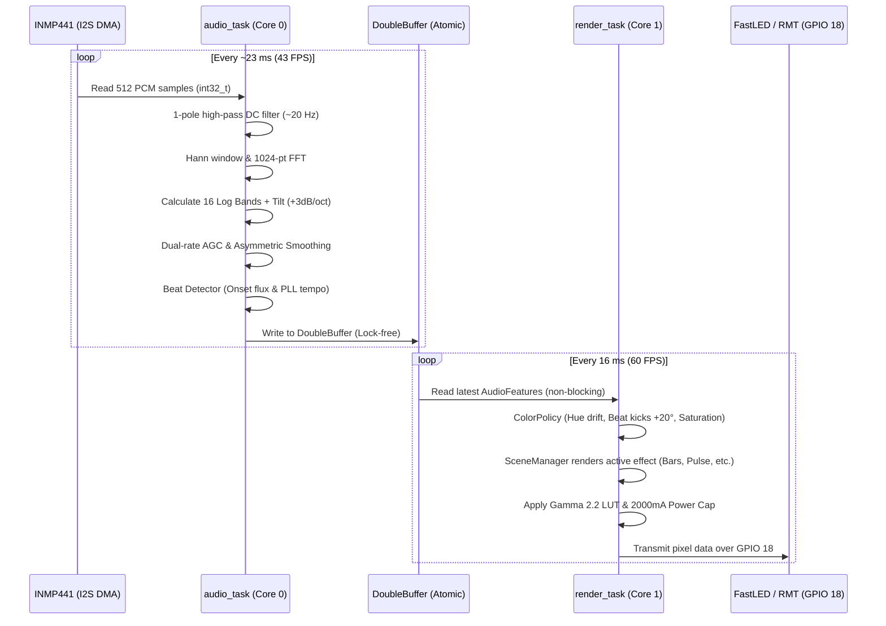

# Music-Reactive LED System — Complete System Architecture & Implementation Guide

---

## 1. Executive Summary: What Runs Where?

> [!IMPORTANT]
> ### **Is this code for your Android App or your ESP32?**
> **This code is 100% for your ESP32 microcontroller.**
> 
> - **The Code We Just Built (`firmware/`)**: Written in **C++** using Arduino-ESP32, FreeRTOS, and FastLED. It flashes onto the physical **ESP32 DevKit V1** board. It directly interfaces with the INMP441 I2S microphone, runs 43 FPS real-time FFT audio analysis, computes beats and musical mood, renders 8 lighting effects at 60 FPS, and drives the WS2812B LED strip via RMT on GPIO 18.
> - **Your Android App (`android/`)**: Written in **Kotlin & Jetpack Compose**. It runs on your **Android phone**. It communicates with the ESP32 over local Wi-Fi (WebSocket + REST). The phone's job is to send Spotify metadata (song title, artist, duration, playback position, and album art color palette) and act as a wireless remote control.

---

## 2. Codebase Path & File Directory

The entire firmware project is self-contained in:
`d:\PC DEFAULT\Room automation\firmware`

### Complete File Structure:

| Directory / File Path | Description |
| :--- | :--- |
| [`firmware/platformio.ini`](file:///d:/PC%20DEFAULT/Room%20automation/firmware/platformio.ini) | PlatformIO project configuration, dependencies (`FastLED`, `ArduinoJson`, `arduinoFFT`, `ESPAsyncWebServer`, `IRremoteESP8266`, `Adafruit SSD1306`), and dual-bank partition flags. |
| [`firmware/partitions.csv`](file:///d:/PC%20DEFAULT/Room%20automation/firmware/partitions.csv) | Partition table with dual OTA app banks (`app0`, `app1`), NVS, and LittleFS (`spiffs`). |
| [`firmware/docs/HARDWARE_SETUP.md`](file:///d:/PC%20DEFAULT/Room%20automation/firmware/docs/HARDWARE_SETUP.md) | Pinout table, power budget calculation, and physical wiring instructions. |
| [`firmware/tools/gen_bands.py`](file:///d:/PC%20DEFAULT/Room%20automation/firmware/tools/gen_bands.py) | Python script that computes 16 logarithmically spaced band boundary bin indices. |
| [`firmware/test/test_dsp/test_dsp.cpp`](file:///d:/PC%20DEFAULT/Room%20automation/firmware/test/test_dsp/test_dsp.cpp) | Native unit tests for DSP silence detection, RMS linearity, and AGC stability. |
| **`firmware/src/`** | **Core Source Code** |
| [`src/main.cpp`](file:///d:/PC%20DEFAULT/Room%20automation/firmware/src/main.cpp) | Entry point (`setup` and `loop`), FreeRTOS task spawning, and system-level state machine. |
| [`src/config/pins.h`](file:///d:/PC%20DEFAULT/Room%20automation/firmware/src/config/pins.h) | Hardware pin assignments (GPIO 18, 25, 26, 33, 21, 22, 34, 4). |
| [`src/config/defaults.h`](file:///d:/PC%20DEFAULT/Room%20automation/firmware/src/config/defaults.h) | Compile-time defaults: sample rate (22050 Hz), FFT size (1024), 60 FPS, current caps. |
| [`src/core/app_state.h`](file:///d:/PC%20DEFAULT/Room%20automation/firmware/src/core/app_state.h) / [`.cpp`](file:///d:/PC%20DEFAULT/Room%20automation/firmware/src/core/app_state.cpp) | Global operating modes (`BOOT`, `IDLE`, `MUSIC`, `ERROR_SAFE`), TrackState, and position extrapolation. |
| **`firmware/src/audio/`** | **Audio Capture & Digital Signal Processing (Core 0)** |
| [`audio_features.h`](file:///d:/PC%20DEFAULT/Room%20automation/firmware/src/audio/audio_features.h) | `AudioFeatures` struct, lock-free `DoubleBuffer<T>`, and FreeRTOS queue `EventBus`. |
| [`audio_input.h`](file:///d:/PC%20DEFAULT/Room%20automation/firmware/src/audio/audio_input.h) | Abstract interface for audio input drivers. |
| [`i2s_mic.h`](file:///d:/PC%20DEFAULT/Room%20automation/firmware/src/audio/i2s_mic.h) / [`.cpp`](file:///d:/PC%20DEFAULT/Room%20automation/firmware/src/audio/i2s_mic.cpp) | INMP441 I2S driver: 22,050 Hz, 32-bit slot, 8-bit right shift, 20 Hz one-pole DC high-pass filter. |
| [`dsp_pipeline.h`](file:///d:/PC%20DEFAULT/Room%20automation/firmware/src/audio/dsp_pipeline.h) / [`.cpp`](file:///d:/PC%20DEFAULT/Room%20automation/firmware/src/audio/dsp_pipeline.cpp) | Hann window, 1024-pt FFT, 16 bands, +3 dB/octave tilt, dual-rate AGC, asymmetric smoothing. |
| [`beat_detector.h`](file:///d:/PC%20DEFAULT/Room%20automation/firmware/src/audio/beat_detector.h) / [`.cpp`](file:///d:/PC%20DEFAULT/Room%20automation/firmware/src/audio/beat_detector.cpp) | Bass/low-mid onset flux envelope, adaptive threshold, PLL tempo tracking (60–180 BPM), Drop/Section detection. |
| [`mood_estimator.h`](file:///d:/PC%20DEFAULT/Room%20automation/firmware/src/audio/mood_estimator.h) / [`.cpp`](file:///d:/PC%20DEFAULT/Room%20automation/firmware/src/audio/mood_estimator.cpp) | 30-second rolling window rule-based musical mood classifier (Calm, Warm, Energetic, Dark, Bright). |
| [`band_bins.h`](file:///d:/PC%20DEFAULT/Room%20automation/firmware/src/audio/band_bins.h) | Precomputed FFT bin edge tables and geometric center frequencies. |
| [`audio_task.h`](file:///d:/PC%20DEFAULT/Room%20automation/firmware/src/audio/audio_task.h) / [`.cpp`](file:///d:/PC%20DEFAULT/Room%20automation/firmware/src/audio/audio_task.cpp) | Dedicated FreeRTOS task running on Core 0 (Priority 5, ~23 ms per hop, silence calibration). |
| **`firmware/src/lighting/`** | **Visual Engine & Hardware Rendering (Core 1)** |
| [`palette.h`](file:///d:/PC%20DEFAULT/Room%20automation/firmware/src/lighting/palette.h) / [`.cpp`](file:///d:/PC%20DEFAULT/Room%20automation/firmware/src/lighting/palette.cpp) | 5-anchor HSV palette sampler, hex color parser, and preset mood palettes. |
| [`effect.h`](file:///d:/PC%20DEFAULT/Room%20automation/firmware/src/lighting/effect.h) | Pure virtual `Effect` base class and immutable `RenderContext`. |
| [`color_policy.h`](file:///d:/PC%20DEFAULT/Room%20automation/firmware/src/lighting/color_policy.h) / [`.cpp`](file:///d:/PC%20DEFAULT/Room%20automation/firmware/src/lighting/color_policy.cpp) | Hue drift (0.5–2.0 deg/s), beat kicks (+20°), bar kicks (+60°), saturation scaling, drop color inverter. |
| [`scene_manager.h`](file:///d:/PC%20DEFAULT/Room%20automation/firmware/src/lighting/scene_manager.h) / [`.cpp`](file:///d:/PC%20DEFAULT/Room%20automation/firmware/src/lighting/scene_manager.cpp) | Auto-rotates effects weighted by mood every 24 beats or section change; 1.0s crossfade transitions. |
| [`led_output.h`](file:///d:/PC%20DEFAULT/Room%20automation/firmware/src/lighting/led_output.h) / [`.cpp`](file:///d:/PC%20DEFAULT/Room%20automation/firmware/src/lighting/led_output.cpp) | FastLED wrapper, precomputed Gamma 2.2 LUT, and hardware current limiting (2000 mA default). |
| [`render_task.h`](file:///d:/PC%20DEFAULT/Room%20automation/firmware/src/lighting/render_task.h) / [`.cpp`](file:///d:/PC%20DEFAULT/Room%20automation/firmware/src/lighting/render_task.cpp) | High-precision 60 FPS render loop on Core 1 (Priority 4) using `vTaskDelayUntil`. |
| **`firmware/src/lighting/effects/`** | **The 8 Visual Effects Catalog** |
| [`spectrum_bars.h`](file:///d:/PC%20DEFAULT/Room%20automation/firmware/src/lighting/effects/spectrum_bars.h) / [`.cpp`](file:///d:/PC%20DEFAULT/Room%20automation/firmware/src/lighting/effects/spectrum_bars.cpp) | 16-band spectrum mapped across the strip with beat peak flashes. |
| [`center_pulse.h`](file:///d:/PC%20DEFAULT/Room%20automation/firmware/src/lighting/effects/center_pulse.h) / [`.cpp`](file:///d:/PC%20DEFAULT/Room%20automation/firmware/src/lighting/effects/center_pulse.cpp) | Pool of 8 expanding concentric rings spawned by bass beats from the strip center. |
| [`comet_chase.h`](file:///d:/PC%20DEFAULT/Room%20automation/firmware/src/lighting/effects/comet_chase.h) / [`.cpp`](file:///d:/PC%20DEFAULT/Room%20automation/firmware/src/lighting/effects/comet_chase.cpp) | Comet head moving at BPM speed with exponential phosphor trail decay. |
| [`ripple_shockwave.h`](file:///d:/PC%20DEFAULT/Room%20automation/firmware/src/lighting/effects/ripple_shockwave.h) / [`.cpp`](file:///d:/PC%20DEFAULT/Room%20automation/firmware/src/lighting/effects/ripple_shockwave.cpp) | Beats spawn expanding ripples whose hue reflects the spectral brightness (centroid). |
| [`sparkle.h`](file:///d:/PC%20DEFAULT/Room%20automation/firmware/src/lighting/effects/sparkle.h) / [`.cpp`](file:///d:/PC%20DEFAULT/Room%20automation/firmware/src/lighting/effects/sparkle.cpp) | Pool of 64 sparks triggered by high-frequency treble flux. |
| [`lava_fire.h`](file:///d:/PC%20DEFAULT/Room%20automation/firmware/src/lighting/effects/lava_fire.h) / [`.cpp`](file:///d:/PC%20DEFAULT/Room%20automation/firmware/src/lighting/effects/lava_fire.cpp) | 1D thermal cellular automata; bass injects heat at the base, cooling diffuses upward. |
| [`breathing_wash.h`](file:///d:/PC%20DEFAULT/Room%20automation/firmware/src/lighting/effects/breathing_wash.h) / [`.cpp`](file:///d:/PC%20DEFAULT/Room%20automation/firmware/src/lighting/effects/breathing_wash.cpp) | Ambient low-energy smooth color wash that breathes with a 0.3 Hz sine cycle. |
| [`strobe_burst.h`](file:///d:/PC%20DEFAULT/Room%20automation/firmware/src/lighting/effects/strobe_burst.h) / [`.cpp`](file:///d:/PC%20DEFAULT/Room%20automation/firmware/src/lighting/effects/strobe_burst.cpp) | Drop-only strobe; strictly limited to ≤ 3 flashes/second per WCAG 2.3.1 photosensitivity rules. |
| **`firmware/src/net/`** | **Networking, Web Services & OTA** |
| [`protocol.h`](file:///d:/PC%20DEFAULT/Room%20automation/firmware/src/net/protocol.h) | WebSocket protocol strings and version 1 spec constants. |
| [`wifi_manager.h`](file:///d:/PC%20DEFAULT/Room%20automation/firmware/src/net/wifi_manager.h) / [`.cpp`](file:///d:/PC%20DEFAULT/Room%20automation/firmware/src/net/wifi_manager.cpp) | Wi-Fi Station connection with exponential backoff and fallback AP (`RoomLight-XXXX`). |
| [`api_server.h`](file:///d:/PC%20DEFAULT/Room%20automation/firmware/src/net/api_server.h) / [`.cpp`](file:///d:/PC%20DEFAULT/Room%20automation/firmware/src/net/api_server.cpp) | REST endpoints (`/api/state`, `/settings`, `/scenes`, `/calibrate`, `/track`, `/ota`, `/diag`). |
| [`ws_server.h`](file:///d:/PC%20DEFAULT/Room%20automation/firmware/src/net/ws_server.h) / [`.cpp`](file:///d:/PC%20DEFAULT/Room%20automation/firmware/src/net/ws_server.cpp) | Real-time WebSocket (`/ws`): 15 Hz telemetry stream and client command parser. |
| [`ota.h`](file:///d:/PC%20DEFAULT/Room%20automation/firmware/src/net/ota.h) / [`.cpp`](file:///d:/PC%20DEFAULT/Room%20automation/firmware/src/net/ota.cpp) | ESP-IDF dual-bank OTA updater with rollback safety. |
| **`firmware/src/storage/`** | **Non-Volatile Storage** |
| [`settings_store.h`](file:///d:/PC%20DEFAULT/Room%20automation/firmware/src/storage/settings_store.h) / [`.cpp`](file:///d:/PC%20DEFAULT/Room%20automation/firmware/src/storage/settings_store.cpp) | NVS storage for user configuration and per-band noise floor calibration data. |
| [`preset_store.h`](file:///d:/PC%20DEFAULT/Room%20automation/firmware/src/storage/preset_store.h) / [`.cpp`](file:///d:/PC%20DEFAULT/Room%20automation/firmware/src/storage/preset_store.cpp) | LittleFS JSON preset storage in `/presets/*.json`. |
| **`firmware/src/integrations/`** | **Peripheral Integrations** |
| [`oled_display.h`](file:///d:/PC%20DEFAULT/Room%20automation/firmware/src/integrations/oled_display.h) / [`.cpp`](file:///d:/PC%20DEFAULT/Room%20automation/firmware/src/integrations/oled_display.cpp) | 128x64 I2C OLED: rotates Status screen, Now Playing (scrolling title), and mini-spectrum. |
| [`ir_input.h`](file:///d:/PC%20DEFAULT/Room%20automation/firmware/src/integrations/ir_input.h) / [`.cpp`](file:///d:/PC%20DEFAULT/Room%20automation/firmware/src/integrations/ir_input.cpp) | NEC IR remote control decoder with 200 ms debounce (Power, Brightness, Scene, Mode). |
| [`track_state.h`](file:///d:/PC%20DEFAULT/Room%20automation/firmware/src/integrations/track_state.h) / [`.cpp`](file:///d:/PC%20DEFAULT/Room%20automation/firmware/src/integrations/track_state.cpp) | JSON serialization and position extrapolation for incoming Spotify track data. |
| **`firmware/src/diag/`** | **Diagnostics & Safety** |
| [`diagnostics.h`](file:///d:/PC%20DEFAULT/Room%20automation/firmware/src/diag/diagnostics.h) / [`.cpp`](file:///d:/PC%20DEFAULT/Room%20automation/firmware/src/diag/diagnostics.cpp) | RTC memory crash counter (triggers `ERROR_SAFE` after 3 fast reboots), heap monitoring, log ring buffer. |

---

## 3. Hardware Connections & Circuit Diagram

### Pin Mapping Table:

| Component | Pin Label | ESP32 GPIO | Electrical Connection Notes |
| :--- | :--- | :--- | :--- |
| **WS2812B LED Strip** | DIN (Data In) | **GPIO 18** | Connect through a **74AHCT125** level shifter (3.3V → 5V) and a **330 Ω** series resistor. Driven by ESP32 RMT peripheral. |
| | +5V | **External 5V** | **NEVER** power the strip from the ESP32 board! Connect directly to 5V power supply. |
| | GND | **GND** | Must share a common ground with the ESP32. |
| **INMP441 I2S Mic** | SCK (Clock) | **GPIO 26** | I2S Bit Clock (BCLK). |
| | WS (Word Select)| **GPIO 25** | I2S Left/Right Clock (LRCL). |
| | SD (Serial Data)| **GPIO 33** | I2S Data Out (DOUT). |
| | L/R | **GND** | Connect to GND to select the Left channel. |
| | VDD | **3.3V** | Power from ESP32 3.3V regulator pin. |
| | GND | **GND** | Common ground. |
| **SSD1306 OLED (I2C)**| SDA | **GPIO 21** | Standard ESP32 I2C Data line. |
| | SCL | **GPIO 22** | Standard ESP32 I2C Clock line (400 kHz). |
| | VCC | **3.3V** | Display logic power. |
| | GND | **GND** | Common ground. |
| **IR Receiver** | OUT / DATA | **GPIO 34** | Input-only pin (ideal for IR demodulators). |
| | VCC | **3.3V** | Receiver power. |
| | GND | **GND** | Common ground. |

### Power Supply Rules:
1. **Current Sizing**: Each WS2812B pixel draws up to 60 mA at full white. A 60-LED strip can draw 3.6 A; a 300-LED strip can draw 18 A.
2. **Software Current Limiter**: The firmware has a built-in safety current cap set to **2000 mA** (`maxMilliamps = 2000` in `AppSettings`). It dynamically dims pixels if power exceeds this threshold.
3. **Decoupling Capacitor**: Solder a **1000 µF (16V+) electrolytic capacitor** directly across the 5V and GND power terminals at the start of the LED strip.

---

## 4. How the Audio-to-Light Pipeline Works



### The 8 Effects:
1. **Spectrum Bars**: 16 bands across strip with beat peaks.
2. **Center Pulse**: Bass beats generate concentric expanding waves from center.
3. **Comet Chase**: Trailing comet moving synchronously to detected BPM.
4. **Ripple Shockwave**: Rings spawned by beats with hue matching audio brightness (centroid).
5. **Sparkle**: High-frequency treble flux spawns random decaying sparks.
6. **Lava Fire**: Thermal simulation where bass kicks heat the strip base and cooling flows upward.
7. **Breathing Wash**: Relaxing slow gradient for quiet ambient passages.
8. **Strobe Burst**: Dramatic drop-only strobe limited to ≤ 3 Hz for safety.

---

## 5. Step-by-Step Implementation Guide

Follow these steps to compile, flash, and run the firmware on your ESP32:

### Step 1: Install PlatformIO CLI
If not already installed, PlatformIO is available via Python:
```powershell
pip install platformio
```

### Step 2: Wire the Hardware
1. Connect the **INMP441** to GPIO 26 (SCK), 25 (WS), 33 (SD), GND (L/R & GND), and 3.3V (VDD).
2. Connect the **WS2812B strip** data pin to GPIO 18 through a 330 Ω resistor. Connect its 5V and GND directly to your 5V power supply. Connect power supply GND to ESP32 GND.
3. Connect the **SSD1306 OLED** to GPIO 21 (SDA), 22 (SCL), 3.3V, and GND.
4. (Optional) Connect an **IR Receiver** output to GPIO 34.

### Step 3: Compile and Flash the ESP32
Connect your ESP32 board to your PC via a USB cable, open PowerShell, and run:

```powershell
# Navigate to the firmware directory
cd "d:\PC DEFAULT\Room automation\firmware"

# Compile the firmware
python -m platformio run -e esp32dev

# Flash the firmware to your ESP32
python -m platformio run -e esp32dev --target upload

# Open the serial monitor to view live logs
python -m platformio device monitor -b 115200
```

### Step 4: First-Boot Calibration
1. On boot, the OLED display will show: `=== ROOMLIGHT ===` and your IP address.
2. In a quiet room, trigger noise floor calibration via curl or a browser:
   ```bash
   curl -X POST http://roomlight.local/api/calibrate
   ```
   The ESP32 records 2 seconds of room background noise, calculates the baseline floor across all 16 bands, and saves it into NVS flash.

### Step 5: Connecting the Android Companion App
1. If your home Wi-Fi is not configured, the ESP32 will host a fallback Wi-Fi network named:
   `RoomLight-XXXX` (where XXXX is the end of the MAC address).
2. Connect your phone or laptop to `RoomLight-XXXX`, open your browser to `http://192.168.4.1/api/settings`, and submit your home Wi-Fi SSID and password.
3. Once the ESP32 is on your home network, your Android app connects to:
   - **WebSocket**: `ws://roomlight.local/ws` (or `ws://<ESP32-IP>/ws`)
   - **REST API**: `http://roomlight.local/api/`
4. The Android app sends Spotify playback state (`trackId`, `title`, `artist`, `durationMs`, `positionMs`, `isPlaying`, and the 3–5 palette colors extracted from album art) to `/api/track` or via the WebSocket. The ESP32 immediately updates its color palette and OLED display to match the playing music!
