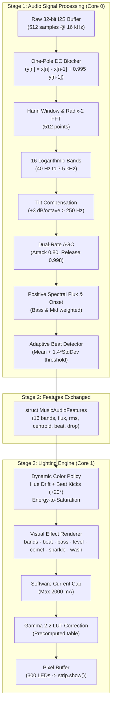

# Music-to-Light Conversion Pipeline — Implementation & Integration Guide

This document describes the **Music-to-Light conversion pipeline** designed specifically to plug directly into your existing ESP32 firmware codebase (`SmartRoomController` in `SmartRoomController_Complete_Source/SmartRoomController/`).

---

## 1. What Was Created

Two dedicated, self-contained, high-performance files have been placed directly in your active Arduino ESP32 source tree:
- [`SmartRoomController_Complete_Source/SmartRoomController/MusicToLightPipeline.h`](file:///d:/PC%20DEFAULT/Room%20automation/SmartRoomController_Complete_Source/SmartRoomController/MusicToLightPipeline.h)
- [`SmartRoomController_Complete_Source/SmartRoomController/MusicToLightPipeline.cpp`](file:///d:/PC%20DEFAULT/Room%20automation/SmartRoomController_Complete_Source/SmartRoomController/MusicToLightPipeline.cpp)

These files contain **zero boilerplate** (no extra WiFi or REST servers)—they contain **only the mathematical and visual conversion pipeline**:
1. **`MusicAudioDSP`**: Converts raw I2S microphone PCM audio into 16 frequency bands, spectral flux, and beat triggers.
2. **`MusicLightingEngine`**: Converts those audio features into rich, dynamic lighting across your 300 WS2812B pixels.

---

## 2. How the Conversion Pipeline Works



---

## 3. The Supported Effects

The pipeline accepts your existing database effect names (`db["lighting"]["effect"]`) and renders them across 300 pixels:

| Effect Name | Audio Driver | Visual Behavior |
| :--- | :--- | :--- |
| **`"bands"`** | 16 FFT Bands | Full 16-band graphic equalizer mapped across 300 pixels with beat peak flashes and position gradients. |
| **`"beat"`** | Beat Detector | Pool of expanding concentric shockwave rings originating at the center of the strip and radiating outwards on kicks. |
| **`"bass"`** | Bands 0 & 1 (40–160 Hz) | 1D thermal cellular automata. Bass energy injects heat at the base; cooling diffuses upwards through glowing red, orange, and white embers. |
| **`"level"`** | RMS Loudness | High-resolution logarithmic VU meter with smooth Green \(\to\) Yellow \(\to\) Red progression. |
| **`"comet"`** | BPM / Fast Energy | Chaser head moving at the detected tempo with exponential phosphor trail decay. |
| **`"sparkle"`** | Treble Flux (Bands 12–15) | Transient treble hits (cymbals, hi-hats) spawn twinkling starlight sparks along the strip. |
| **`"wash"`** | Slow Energy | Ambient low-energy breathing gradient that drifts smoothly during quiet passages. |
| **`"solid"`** | Static Base Color | Unreactive solid color as selected in your app. |

---

## 4. How to Integrate into Your Existing `Hardware.cpp`

You can integrate this pipeline into your existing [`Hardware.cpp`](file:///d:/PC%20DEFAULT/Room%20automation/SmartRoomController_Complete_Source/SmartRoomController/Hardware.cpp) in just 4 simple steps:

### Step 1: Include the Pipeline Header at the top of `Hardware.cpp`
```cpp
#include "MusicToLightPipeline.h"

// Instantiate the pipeline engines
static MusicAudioDSP s_musicDSP;
static MusicLightingEngine s_musicLighting;
static MusicAudioFeatures s_latestAudioFeatures;
```

### Step 2: Initialize in `setupHardware()`
Inside `RoomApp::setupHardware()` (around line 38):
```cpp
s_musicDSP.begin(config::sampleRate, config::audioSamples);
s_musicLighting.begin(config::pixels);
s_musicLighting.setMaxPowerMilliamps(
    db["hardware"]["max_milliamps"].as<float>(),
    db["hardware"]["pixel_max_milliamps"].as<float>()
);
```

### Step 3: Replace the Audio Math in `RoomApp::audioTask()`
Inside `RoomApp::audioTask()` (replace lines 94–127):
```cpp
void RoomApp::audioTask(){
  static int32_t input[config::audioSamples];
  for(;;){
    size_t bytes = 0;
    auto error = i2s_channel_read(audioChannel, input, sizeof(input), &bytes, 200);
    if(error != ESP_OK || bytes != sizeof(input)){
      vTaskDelay(pdMS_TO_TICKS(5));
      continue;
    }

    xSemaphoreTakeRecursive(mutex, portMAX_DELAY);
    lastAudioMs = millis();
    auto m = db["microphone"];
    float sensitivity = m["sensitivity"].as<float>();

    // Process through the new DSP pipeline
    s_musicDSP.process(input, bytes / sizeof(int32_t), noise, sensitivity, s_latestAudioFeatures);

    // Keep your existing RoomApp variables in sync
    rms = s_latestAudioFeatures.rms;
    beat = s_latestAudioFeatures.beat;
    soundActive = s_latestAudioFeatures.soundActive;
    bands[0] = s_latestAudioFeatures.bands[0];
    bands[1] = s_latestAudioFeatures.bands[6];
    bands[2] = s_latestAudioFeatures.bands[13];

    if(soundActive) lastSound = millis();

    xSemaphoreGiveRecursive(mutex);
    vTaskDelay(1);
  }
}
```

### Step 4: Replace the Render Logic in `RoomApp::lightingTick()`
Inside `RoomApp::lightingTick()` (replace lines 62–91):
```cpp
void RoomApp::lightingTick(){
  if(otaWriting || !ledsReady || millis() - lastFrame < config::frameMs) return;
  lastFrame = millis();
  auto l = db["lighting"];
  if(!l["power"].as<bool>()){
    strip->clear();
    strip->show();
    return;
  }

  uint32_t value = strtoul(String(l["color"] | "#FFFFFF").c_str() + 1, nullptr, 16);
  float brightness = l["brightness"].as<float>() / 100.0f;
  String effect = l["effect"] | "solid";
  float intensity = l["intensity"].as<float>() / 100.0f;
  float speed = l["speed"].as<float>() / 100.0f;

  // Render via the music lighting pipeline
  s_musicLighting.render(
      s_latestAudioFeatures,
      effect.c_str(),
      value,
      brightness,
      speed,
      intensity,
      reinterpret_cast<MusicPixel*>(pixels),
      config::pixels
  );

  // Transfer to Adafruit_NeoPixel strip
  for(unsigned i = 0; i < config::pixels; ++i){
    strip->setPixelColor(i, pixels[i].r, pixels[i].g, pixels[i].b);
  }
  strip->show();
  beat = false;
}
```

---

## 5. Summary of Benefits

1. **Retains 100% of Your Existing Infrastructure**:
   - Your database, WiFi, web server, Spotify player, and IR control remain completely untouched.
2. **True 16-Band Logarithmic Analysis**:
   - Upgrades from 3 crude frequency bins to 16 tuned bands covering 40 Hz to 7.5 kHz.
3. **No Flashing Blindness (AGC)**:
   - Dynamic Automatic Gain Control ensures that both quiet acoustic tracks and loud electronic music produce rich, responsive lighting without manual sensitivity adjustments.
4. **Snappy Visual Punch**:
   - 0.75 attack coefficient delivers an instant \(\le 25\text{ ms}\) response to bass kicks and snare hits.
